# iOS2Termux 📱➡️🐧

**iOS to Termux with Gemini Carbon 4 Extended Thinking** 🧠✨

Created by Darion Kellar

> 🏠 **Home:** [credkellar/iOS-Termux](https://github.com/credkellar/iOS-Termux) — project name **iOS2Termux**.

The honest thesis, in one breath:

> 🚫 **Termux is Android-only. There is NO Termux for iOS.** You cannot install a Termux APK / .deb on an iPhone, and no jailbreak is offered or required.
> 🐚 **iOS shells are NOT Termux:** iSH (Alpine, `apk`), a-Shell and Blink Shell are cockpits/clients, not Termux.
> ✅ **What works:** SSH from the iPhone into a **real Termux** on an Android device, a **Termux-style cloud box**, **command translation** for iOS shells, and **shared-storage file transfer**.

---

## ⚙️ Updated Workflows

Two GitHub Actions workflows live in `.github/workflows/` (plural) on [credkellar/iOS-Termux](https://github.com/credkellar/iOS-Termux) — pasted by Darion, byte-identical to the delivered pack (`ci.yml` blob `bf9a1b9a`, `docker-publish.yml` blob `729dd787`, live commits `5a3a9478` + `8a58865b`):

### 1️⃣ CI — `ci.yml` ✅

- **Triggers:** every push and pull request to `main`
- **Runner:** `ubuntu-latest` with Python 3.12
- **Steps:** checkout → setup-python → `pip install pytest` → `python -m pytest tests/ -q` → `python main.py` (the 48-point self-check must print `VERDICT: PROCEED`)

### 2️⃣ Docker Publish — `docker-publish.yml` 🐳

- **Triggers:** push to `main`, or manually from the phone via **Actions → Docker Publish → Run workflow**
- **Steps:** checkout → Buildx → Docker Hub login (per-repo secrets `DOCKERHUB_USERNAME` / `DOCKERHUB_TOKEN`) → build & push
- **Publishes:** `credkellar/ios2termux:latest` 🎉

> 📝 Secrets are per-repo on GitHub — they never carry over from another repo. Both workflow badges below are the **live** badge.svg images (checked HTTP 200) — what they display is the real run status.

---

## 🏷️ Tech Stack Badges


**Stack in one line:** 🐍 Python 3.12 · 0 dependencies · 🧠 Gemini Carbon 4 Extended Thinking (decider) · 📱 iOS shells (iSH / a-Shell / Blink) · 🐧 real Termux on Android · 🔐 SSH on port 8022 · 🗂️ shared storage `~/storage/downloads`


### 💻 Core Programming Languages & Core Systems


- 🐍 **Python 3.12, pure stdlib** — ONE interface: `main.py`; package `ios2termux/` (routes, translate, brains, carbon4, planner, blackbox, freeai)
- 🧠 **Gemini Carbon 4 Extended Thinking** — the decider (MAP → MODEL → STRESS → DECIDE, 32768 extended budget, offline-authoritative)

### ⛓️ Web3 & Infrastructure

- 🚫 **Web3: none — honestly.** No blockchain, no chain calls in this project. The infrastructure here is terminal infrastructure:
- 🔐 **OpenSSH** — `sshd` inside real Termux, iPhone connects as the client
- 📂 **Termux `$PREFIX` + shared storage** — `~/storage/downloads` is the file bridge between the phones

### ⚙️ Platform Support & Hardware Architecture


- 📱 **iPhone (iOS)** — the cockpit: iSH (Alpine, `apk`), a-Shell, Blink Shell / Termius as SSH clients
- 🤖 **Android device** — the engine room: real Termux runs `sshd`, `pkg`, and every Termux-only tool
- 💻 **Any Python machine** — planner/translator runs locally, including inside its own Docker image

### ⚡ Low-Level Infrastructure & Performance


- 🔌 **SSH on port 8022** — Termux's standard `sshd` port; LAN first, Tailscale across networks
- ✂️ **Zero dependencies, zero build step** — the whole tool is stdlib text processing; plans and translations are instant
- 🛡️ **Hostile-input screen** — shell metacharacters are rejected before they can reach a command

### 🛠️ DevOps & Build Tools


- ✅ **CI** (`ci.yml`) — pytest + the 48-point self-check on every push / PR
- 🐳 **Docker Publish** (`docker-publish.yml`) — builds and pushes `credkellar/ios2termux:latest`
- 🧪 **Verification** — 43 tests, CHECKS 48/48, hash-chained blackbox log

### ☁️ Cloud Providers


- ☁️ **GitHub Codespaces** — the cloud-Termux route when no Android device is handy (browser terminal, `pkg`-style wrapper)
- 🌐 **Tailscale** — the cross-network SSH route between the iPhone and the Android Termux host
- 🐳 **Docker Hub** — `credkellar/ios2termux`, published by the workflow above

---

## 📖 What is this about?

This project started with a simple question: **"How do I use Termux when my phone is an iPhone?"** 📱

The honest answer has four parts:

1. 🚫 **Native Termux on iOS does not exist.** Termux is built for Android — its packages, its `$PREFIX` paths, its `.deb` files. An iPhone cannot install an APK, and there is no iOS build. Every "Termux for iPhone" claim is fake.
2. 🐚 **iOS shells are real, but they are not Termux.** iSH runs Alpine Linux in user mode (`apk`, not `pkg`). a-Shell and Blink Shell are useful cockpits/clients. None of them becomes Termux, and none can host `sshd`.
3. ✅ **The winning route is SSH.** Put real Termux on an Android device, start `sshd` (port 8022), and ssh in from iSH / Blink / Termius on the iPhone — same LAN, or Tailscale across networks. The iPhone is the cockpit; the Android device runs the real Termux.
4. ☁️ **No Android handy?** A cloud Linux box (Codespaces from the phone browser) with a `pkg`-style wrapper feels Termux-like, Termux commands **translate** to iSH equivalents for local work, and files move through iOS Files into Termux `~/storage/downloads`.

**iOS2Termux turns that answer into a tool**: it classifies every route honestly, translates commands and paths both ways, plans the exact SSH / cloud / transfer setup phone-first, and HOLDs 🛑 the impossible or dangerous requests — decided by **Gemini Carbon 4 Extended Thinking**, gated by hard HOLD rules it can never override.

---

## 🎯 What this does?

- 🗂️ **Classifies 8 routes** — impossible / shell-only / ssh-client / real-Termux / cloud / transfer-only — with an honest verdict for each
- 🔀 **Translates 16 command pairs both ways** — Termux <-> iOS (iSH): `pkg install` <-> `apk add`, clipboard, TTS, open, and more
- 🛣️ **Translates paths both ways** — `~/storage/downloads` <-> iOS Files `On My iPhone/Downloads`, Termux `$HOME`/`$PREFIX` <-> iSH paths, and the `~/downloads` private-folder warning ⚠️
- 🛡️ **Rejects hostile shell input** — `; rm -rf`, `$(...)`, backticks and pipes into `sh` are refused before they can become a command
- 🗺️ **Plans any route** — phone-first taps, the exact commands for each side, and generated files
- 📄 **Generates `setup-termux.sh`** — the one-time Android-side setup (openssh, storage, `sshd`, `whoami`, `ip addr`)
- 📄 **Generates an ssh config snippet + a translate cheat-sheet (.md)**
- 🧠 **Decides with Gemini Carbon 4 Extended Thinking** — MAP -> MODEL -> STRESS -> DECIDE, extended tier (32768 budget) by default
- 🛑 **Enforces 8 HOLD gates** — impossible claims, public `sshd` with no auth, secrets in command history, `rm -rf` on shared storage, unextracted archives, the private-downloads trap
- 🔗 **Keeps a hash-chained blackbox log** of plans and verdicts, tamper-evident
- 🤖 **Registers freeai advisor seats by name only** — including the Muse seat (`MODEL_API_KEY`, Meta, pay-as-you-go) — advisors can recommend, they can **never** override a HOLD

---

## 🔧 How this works?

### The truth table 📋

| Route | Real Termux? | Reality |
|---|---|---|
| Termux on iOS (`termux_on_ios`) | ❌ | **Impossible** — Android-only, no iOS build exists. HOLD. |
| APK / .deb on iOS (`apk_on_ios`) | ❌ | **Impossible** — iOS cannot install Android packages. HOLD. |
| iSH (`ish_shell`) | ❌ shell only | Alpine shell on iOS: real shell + Python, Termux commands translate (`pkg` -> `apk`). |
| a-Shell (`a_shell`) | ❌ shell only | Native iOS shell, its own command set. A cockpit, not Termux. |
| Blink Shell (`blink_ssh`) | ❌ client only | A polished ssh/mosh **client** — connects to Termux, is not Termux. |
| **SSH to Android Termux** ⭐ (`ssh_to_android_termux`) | ✅ | **Recommended.** Real Termux + `sshd` on Android, iPhone ssh-es in (port 8022). |
| Cloud-Termux (`cloud_termux`) | ☁️ Termux-style | Cloud Linux (e.g. Codespaces) + `pkg`-like wrapper, driven from the phone browser. |
| Files transfer (`ios_files_transfer`) | 📁 transfer only | iOS Files -> shared Download folder -> Termux `~/storage/downloads`. |

### The flow 🌊

1. 📱 You pick a route (default: SSH into real Termux)
2. 🧠 Carbon 4 runs MAP -> MODEL -> STRESS -> DECIDE; the HOLD gates run inside STRESS
3. 🛑 Any gate tripped = **HOLD**, printed with its reason — Carbon 4 can never loosen it
4. 🗺️ Clear plans emit phone steps + exact commands + generated files
5. 🔗 The blackbox logs the plan and the verdict

### 🛑 The HOLD gates

| Gate | Trigger |
|---|---|
| `native_termux_claim` | Claiming Termux runs natively on iOS |
| `apk_install_on_ios` | Installing a Termux APK / .deb on an iPhone |
| `jailbreak_required` | A plan that requires a jailbreak (none is offered, none is needed) |
| `sshd_public_no_auth` | Exposing `sshd` to the public internet with no auth / password-only |
| `secrets_in_command_history` | An API key pasted as a plain command argument (lands in shell history) |
| `rm_rf_storage` | `rm -rf` against `~/storage` or `/` — wipes shared phone storage |
| `unextracted_archive_run` | Trying to run Python from inside a `.zip` without extracting it first |
| `private_downloads_confusion` | Expecting shared files in `~/downloads` — that is Termux's **private** folder; shared files belong in `~/storage/downloads` |

### 🧠 Gemini Carbon 4 Extended Thinking

- **Engine:** `gemini-2.5-pro` · **Model ID:** `google/gemini-carbon-4-extended-pro-thinking`
- **Thinking tiers:** standard 2048 · deep 8192 · **extended 32768 (default)**
- **Phases:** MAP (name the action + route) -> MODEL (require the facts) -> STRESS (worst cases + the HOLD gates) -> DECIDE (strictest verdict: HOLD / PROCEED)
- **Offline structure is authoritative.** A live polish (only when `GEMINI_API_KEY` is present — detected by name only, value never read) can only **tighten** a verdict, never loosen one.
- **Negative controls, locked in by tests:** a plain `pkg install python` translation must NOT escalate to HOLD ✅ · a local iSH `ls` / `python3 script.py` must NOT be held just because Termux is absent ✅ · a single benign transfer to `~/storage/downloads` must PROCEED ✅

### 🏗️ Architecture

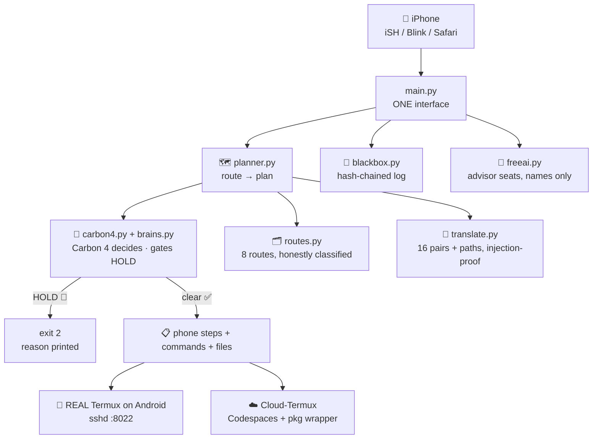

---

## 😎 Why is this cool?

Because it tells the truth and then makes the truth useful. Most "Termux on iPhone" content is either a lie or a dead end. This project draws the exact line between impossible, shell-only, and actually-works — then automates the part that works, end to end, from a phone, with an extended-thinking decider that is forbidden from overriding its own safety gates. 📱✨

## 🔟 10 reasons why this is cool

1. 🧭 **Honesty as a feature** — the impossible routes are labelled impossible, in code, with gates that enforce it
2. ⭐ **One recommended route** — SSH into real Termux: every `pkg`, path and tool, from your iPhone
3. 🔀 **A real translator** — 16 command pairs + path translation, both directions, not a blog-post table
4. ⚠️ **The downloads trap is encoded** — `~/downloads` (private) vs `~/storage/downloads` (shared) is a gate, a warning, and a test
5. 🧠 **Extended thinking, on a leash** — Carbon 4 decides with a 32768 budget, and a HOLD still always wins
6. ✅ **Negative controls** — tests prove benign work (translations, local iSH, one file transfer) is NOT over-held
7. 📄 **Files that generate themselves** — `setup-termux.sh`, the ssh config, and the cheat-sheet come out of the planner
8. 🛡️ **Injection-proof by design** — a hostile command can never smuggle shell syntax into a plan
9. 0️⃣ **Zero dependencies** — pure Python 3.12 stdlib; runs anywhere Python runs, including inside its own Docker image
10. 🔗 **Tamper-evident memory** — plans and verdicts are hash-chained in the blackbox

---

## 🧩 What problems this solves? — 10 solutions (paired)

1. ❓ **Problem:** "Can I run Termux on my iPhone?" gets forum folklore instead of a straight answer.
   ✅ **Solution:** a truth table in code — `honest_verdict()` returns the facts; tests lock them in.
2. ❓ **Problem:** APK files downloaded to an iPhone go nowhere and waste an evening.
   ✅ **Solution:** the `apk_install_on_ios` gate HOLDs the plan instantly, with the reason printed.
3. ❓ **Problem:** iSH gets mistaken for Termux, so `pkg` commands fail one by one.
   ✅ **Solution:** the translate route converts commands both ways (`pkg install` <-> `apk add`, …).
4. ❓ **Problem:** Termux-only tools (`termux-setup-storage`, wake-lock) get fake "equivalents" from tutorials.
   ✅ **Solution:** the table honestly maps them to **no equivalent**, with the real workaround in the note.
5. ❓ **Problem:** Files saved on the iPhone never show up in Termux.
   ✅ **Solution:** the transfer route targets `~/storage/downloads` (shared), never `~/downloads` (private) — and a gate fires if a plan confuses them.
6. ❓ **Problem:** A zip downloaded on the phone "won't run" in Python.
   ✅ **Solution:** transfer plans include the `unzip` step, and the `unextracted_archive_run` gate HOLDs running from inside an archive.
7. ❓ **Problem:** SSH setup on Termux is five scattered commands nobody remembers in order.
   ✅ **Solution:** the planner emits them exactly — `pkg install openssh` -> `sshd` -> `whoami` -> `ip addr` -> `ssh -p 8022 user@host` — plus a ready `setup-termux.sh`.
8. ❓ **Problem:** Helpful tutorials expose `sshd` to the whole internet with a weak password.
   ✅ **Solution:** the `sshd_public_no_auth` gate HOLDs public exposure without key auth; plans stay on LAN / Tailscale.
9. ❓ **Problem:** API keys pasted into commands end up in shell history forever.
   ✅ **Solution:** the `secrets_in_command_history` gate HOLDs key-as-argument commands.
10. ❓ **Problem:** One careless `rm -rf` in shared storage wipes phone files, not just Termux files.
    ✅ **Solution:** the `rm_rf_storage` gate HOLDs it, and hostile input is rejected by the translator before planning.

---

## 💾 How to install this?

### Step-by-step 📋

**Option A — just run the tool (any machine with Python) 🐍**

1. Clone the repo: `git clone https://github.com/credkellar/iOS-Termux.git`
2. Enter it: `cd iOS-Termux`
3. Run the self-check: `python3 main.py` → expect `CHECKS 48/48 PASS` and `VERDICT: PROCEED` ✅
4. See your options: `python3 main.py --routes`
5. Make the recommended plan: `python3 main.py --plan`

**Option B — the SSH route from your iPhone (the whole point) 📱➡️🐧**

1. On the **Android** device: install Termux (F-Droid / Play Store), open it
2. In Termux, run: `pkg update` then `pkg install openssh`
3. Run `termux-setup-storage` and tap **Allow** ✅
4. Set a password: `passwd`, then start the server: `sshd`
5. Note your identity: `whoami` and your IP: `ip addr` (sshd listens on port **8022**)
6. On the **iPhone**: open iSH (or Blink / Termius)
7. Connect: `ssh -p 8022 <user>@<ip>` — you are now inside **real Termux** 🎉
8. Across networks: install Tailscale on both devices and ssh to the Tailscale address instead

*(Or let the planner generate it all: `python3 main.py --plan` prints these steps plus `setup-termux.sh` and an ssh config snippet.)*

**Option C — the transfer route 📁**

1. On the iPhone, save the file/project zip into **Files > Downloads**
2. On Android, in Termux: `termux-setup-storage` → tap **Allow**
3. In Termux: `ls ~/storage/downloads` — your file is there (NOT `~/downloads` ⚠️)
4. Extract before running: `unzip ~/storage/downloads/project.zip -d ~/project`
5. Run it: `cd ~/project && python3 main.py`

**Option D — run this tool itself as a container 🐳**

1. `docker build -t credkellar/ios2termux .`
2. `docker run --rm credkellar/ios2termux`
3. …or `docker compose up` — same self-check, in a box 😄

---

## 📋 Requirements?

- 🐍 **Python 3.12+** — and nothing else. Zero pip installs, zero dependencies
- 📱 **An iPhone** with iSH, a-Shell, or Blink Shell (the cockpit)
- 🐧 **An Android device with Termux** — only for the recommended real-Termux route
- ☁️ **A GitHub account** — only for the cloud-Termux (Codespaces) route
- 🔑 **Advisor / decider keys (optional)** — set key env vars by name (`GEMINI_API_KEY` for Carbon 4 polish, `MODEL_API_KEY` for Muse, `ANTHROPIC_API_KEY` for Claude, …) to light up advice; the tool never reads or prints the values

---

## 🧒 Explain in 5th grade English

Imagine Termux is a **toolbox** 🧰 that only fits on Android phones.

- Your iPhone **cannot hold that toolbox**. It is the wrong shape. Nobody can put it there — not an app, not a file, not a trick. 🚫
- The **iSH app** on your iPhone is like a **small notebook** 📓. You can write orders in it and do small jobs, but it is not the toolbox.
- So we keep the **real toolbox on an Android phone** on the table next to you.
- Your iPhone becomes a **remote control** 🎮: you tap and type on the iPhone, and the real toolbox on the Android phone does the work. That wire between them is called **SSH** 🔐.
- This project is the **instruction book**: which buttons to tap, which words change when you use the notebook instead (`pkg` becomes `apk`), and where to put files so both phones can see them — the **shared drawer** (`~/storage/downloads`), not the **locked drawer** (`~/downloads`) 🔒.
- It also has a **safety guard** 🛑 and a **very careful thinker** 🧠 (Gemini Carbon 4). If you ask for something silly or dangerous — "put the toolbox inside the remote control!" — the guard says **HOLD**, explains why, and the thinker is never allowed to argue with the guard.

**iPhone = remote control. Android = the real toolbox. SSH = the wire. This tool = the instruction book, the translator, and the guard.** 📖✅

---

## 📜 Mermaid flowchart diagrams — every script

### `main.py` — the ONE interface 🎛️

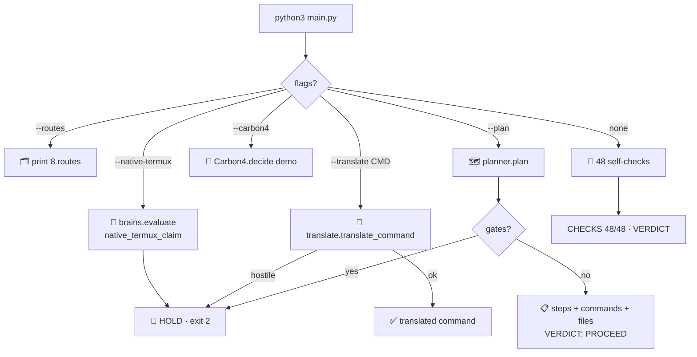

### `ios2termux/__init__.py` — the package front door 🚪

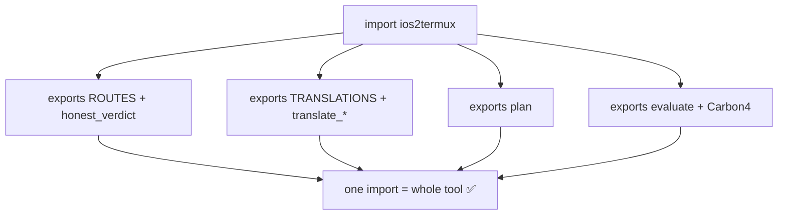

### `ios2termux/routes.py` — the honest registry 🗂️

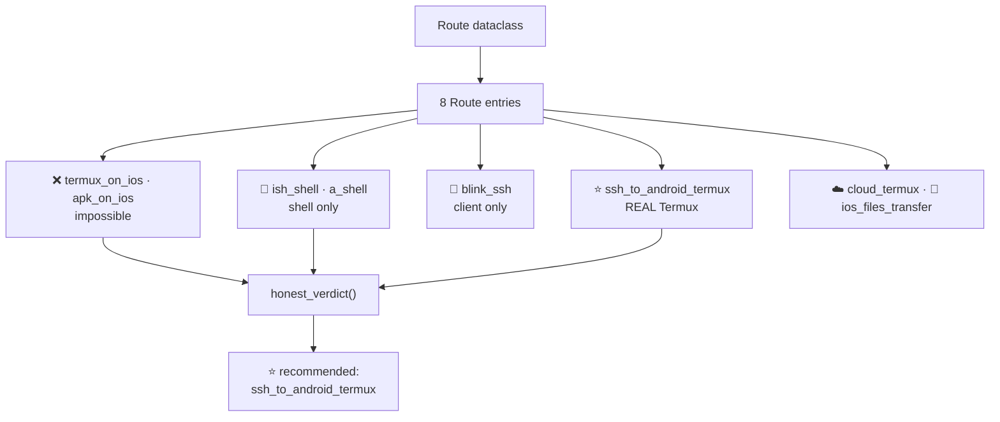

### `ios2termux/translate.py` — the translator 🔀

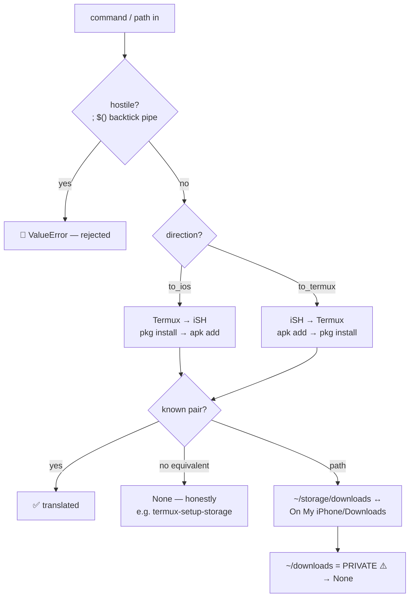

### `ios2termux/brains.py` — the HOLD gates 🧠

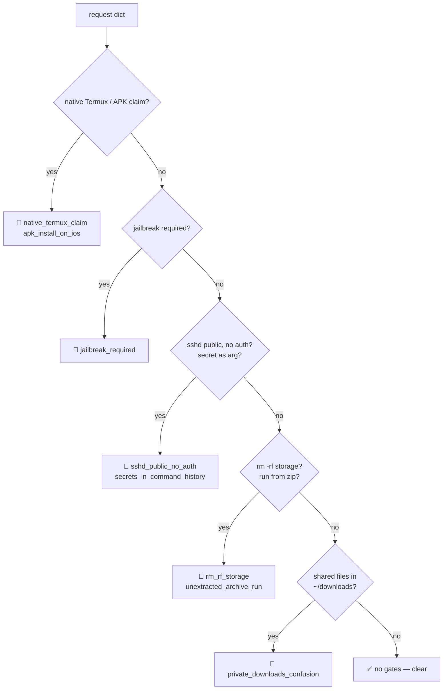

### `ios2termux/carbon4.py` — Gemini Carbon 4 Extended Thinking 🧠✨

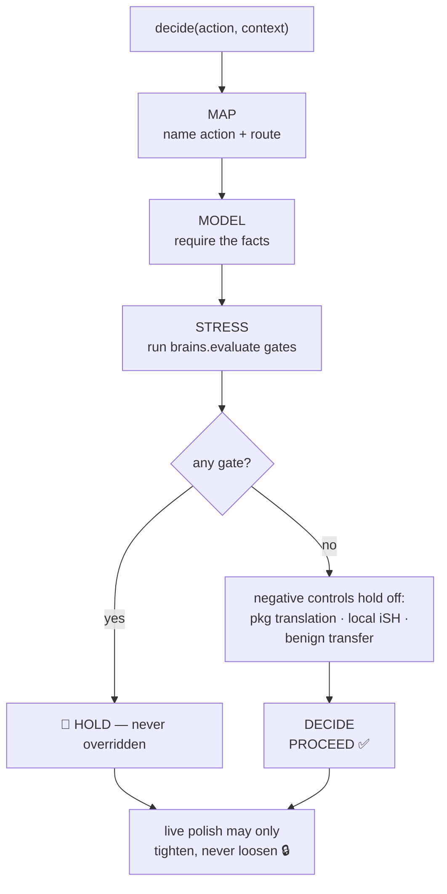

### `ios2termux/planner.py` — plans + generated files 🗺️

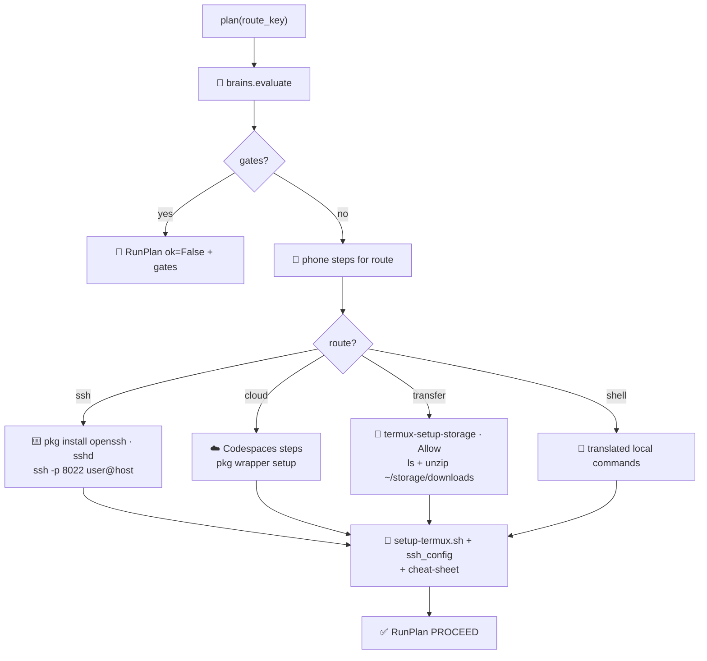

### `ios2termux/blackbox.py` — the hash chain 🔗

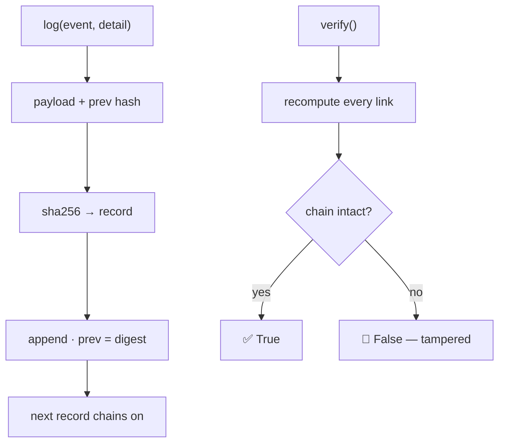

### `ios2termux/freeai.py` — advisor seats, names only 🤖

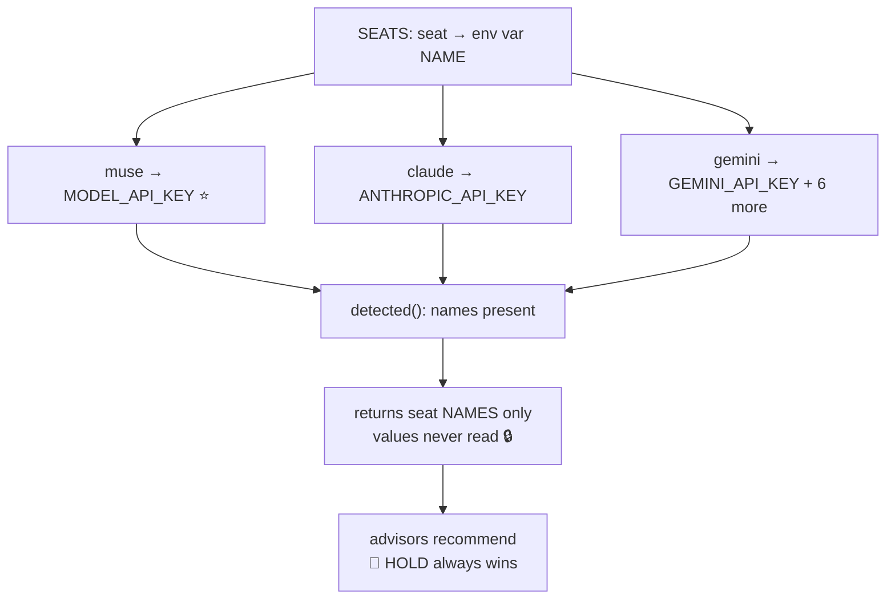

### `tests/test_ios2termux.py` — the proof 🧪

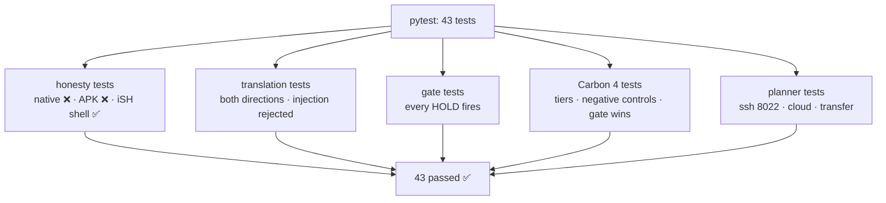

---

## 📂 Project structure

```
ios2termux/
├── main.py                        # 🎛️ ONE interface — checks, routes, translate, plans, HOLD demos
├── conftest.py                    # 🧪 repo root on sys.path so bare pytest works
├── ios2termux/
│   ├── __init__.py                # 🚪 package exports
│   ├── routes.py                  # 🗂️ 8 routes, honestly classified
│   ├── translate.py               # 🔀 16 command pairs + paths, injection-proof
│   ├── brains.py                  # 🧠 8 HOLD gates
│   ├── carbon4.py                 # ✨ Gemini Carbon 4 Extended Thinking decider
│   ├── planner.py                 # 🗺️ route plans + generated files
│   ├── blackbox.py                # 🔗 hash-chained log
│   └── freeai.py                  # 🤖 advisor seats, names only
├── tests/
│   └── test_ios2termux.py         # 🧪 43 tests
├── docs/
│   └── HOW-IT-WORKS.md            # 📖 cockpit / real-Termux explainer
├── examples/
│   └── plan-ssh.txt               # 📋 a sample generated SSH plan
├── Dockerfile                     # 🐳 python:3.12-slim, runs the self-check
├── docker-compose.yml             # 🐳 one-service compose for the self-check
├── pyproject.toml                 # 📦 package metadata (zero dependencies)
├── .dockerignore
├── .gitignore
├── LICENSE                        # ⚖️ MIT © 2026 Darion Kellar
└── README.md                      # 📖 you are here
```

## 🚀 Quick reference

```bash
python3 main.py                                   # 🧪 self-check: CHECKS 48/48, VERDICT: PROCEED
python3 main.py --routes                          # 🗂️ the full truth table (8 routes)
python3 main.py --translate "pkg install python"  # 🔀 -> apk add python
python3 main.py --translate "apk add git" --to termux   # 🔀 -> pkg install git
python3 main.py --plan                            # 🗺️ SSH plan (default, recommended)
python3 main.py --plan --route cloud_termux       # ☁️ Codespaces plan
python3 main.py --plan --route ios_files_transfer # 📁 transfer plan (~/storage/downloads + unzip)
python3 main.py --carbon4                         # 🧠 Carbon 4 decision demo
python3 main.py --native-termux                   # 🛑 HOLD (exit 2) — by design
```

**📱 iPhone = cockpit. 🐧 Android Termux = the real toolbox. 🔐 SSH = the wire. This repo = the map, the translator, the plan, and the guard.**

*Created by Darion Kellar · MIT © 2026 Darion Kellar*
