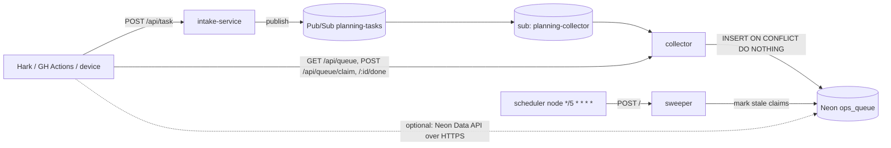

# planning-queue

A queue-backed planning/ops task backend for Platform201 (formerly Shoal), adapted from
[shoal-platform/message-queue-demo](https://github.com/shoal-platform/message-queue-demo).
Hark projects, GitHub Actions, and devices enqueue tasks; workers claim and complete them;
everything lands in a Neon Postgres table `ops_queue`.



## Platform201 graph

| Node | Type | Source path | Port |
| --- | --- | --- | --- |
| gateway | gateway | — (domain `planning-queue`) | — |
| dashboard | container | `apps/planning-queue/dashboard` | 8080 |
| intake-service | container | `apps/planning-queue/intake-service` | 8080 |
| collector | container | `apps/planning-queue/collector` | 8080 |
| sweeper | container | `apps/planning-queue/sweeper` | 8080 |
| planning-tasks | message queue | topic `planning-tasks`, pull sub `planning-collector` (ack 30s, retention 7d) | — |
| neon | Neon | existing connected org; DB `neondb` | — |
| stale-sweep | scheduler | `*/5 * * * *` → POST sweeper `/` | — |

### Gateway paths (IN → OUT)

| Edge | IN | OUT |
| --- | --- | --- |
| gateway → dashboard | `/` | `/` |
| gateway → intake-service | `/api/task` | `/` |
| gateway → collector | `/api/queue` | `/` |

`/api/queue/claim` and `/api/queue/<id>/done` reach the collector through the `/api/queue` prefix.

### Output mappings (env vars)

| Edge | Output | Env var |
| --- | --- | --- |
| queue → intake-service | Topic ID | `TASKS_TOPIC_ID` |
| queue → intake-service | GCP Project ID | `GCP_PROJECT_ID` |
| queue → collector | Sub: `planning-collector` | `TASKS_SUBSCRIPTION_ID` |
| queue → collector | GCP Project ID | `GCP_PROJECT_ID` |
| neon → collector | Connection String | `DATABASE_URL` |
| neon → sweeper | Connection String | `DATABASE_URL` |

Optional (set in Platform201 env, never committed): `INTAKE_TOKEN` (bearer for POST /api/task),
`WORKER_TOKEN` (bearer for claim/done), `SWEEP_TOKEN`, `STALE_AFTER_MINUTES` (default 30),
`REQUEUE_STALE` (`true` re-queues instead of marking `stale`).

## API

```bash
# enqueue
curl -X POST https://planning-queue.eu1.platform201.live/api/task \
  -H 'content-type: application/json' \
  -d '{"source":"gh-actions","repo":"timerloggedout-spec/termux-monorepo","kind":"triage","payload":{"pr":1249}}'
# list
curl 'https://planning-queue.eu1.platform201.live/api/queue?status=queued'
# claim the oldest queued task (204 when empty), then complete it
curl -X POST .../api/queue/claim -H 'content-type: application/json' -d '{"worker":"hark-ops","kind":"triage"}'
curl -X POST .../api/queue/<id>/done -H 'content-type: application/json' -d '{"worker":"hark-ops","ok":true,"result":{}}'
```

Statuses: `queued → claimed → done | failed`; the sweeper moves claims older than
`STALE_AFTER_MINUTES` to `stale` (or back to `queued`). Writes from the queue are idempotent on `id`,
so a client may pass its own `id` to make retries safe.

## Schema

`sql/001_ops_queue.sql` (also `collector/schema.sql`, applied on collector start-up).

## Neon Data API (direct HTTPS)

With the Data API enabled on the Neon branch, clients can read and write `ops_queue` without
going through the services (PostgREST-style, JWT auth). After enabling, grant the role:
`GRANT SELECT, INSERT, UPDATE ON ops_queue TO authenticated;`
