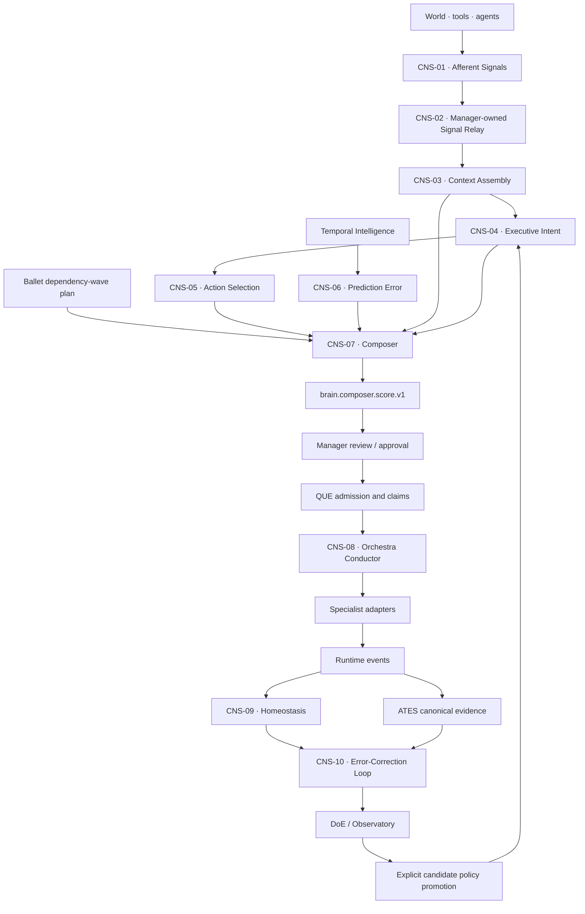

# Brain/CNS-Inspired Composer Architecture

**Implementation:** PR #5939, branch `feat/rhythmic-temporal-intelligence`  
**Score contract:** [brain.composer.score.v1](../schemas/brain.composer.score.v1.schema.json)  
**Design specification:** [Brain/CNS Composer design](../superpowers/specs/2026-11-27-brain-cns-composer-design.md)

## Executive model

The Brain/CNS layer is a modular software coordination model. It receives observations, assembles bounded context, normalizes intent, proposes compatible actions, composes a deterministic score, and exposes timing and wake feedback for future policy evaluation.

The Composer integrates specialist transformations and the existing Ballet and Conductor control-plane interfaces. It emits a content-addressed, declarative score. It does not execute tasks, grant permissions, claim queue work, or promote policy.

The anatomical vocabulary is an architectural analogy. The implementation models software responsibilities and typed data contracts; biological equivalence, medical validity, brain simulation, and claims about consciousness are outside scope.

## 1. CNS module atlas

| ID | Software module / owner | CNS inspiration | Contract | Authority |
|---|---|---|---|---|
| CNS-01 | Afferent Signals — `brain/signals.py` | sensory receptors and afferent pathways | validate, normalize, deduplicate, and sequence observations | observes only |
| CNS-02 | Signal Relay — Manager routing policy | thalamic relay/routing | route typed signals to declared specialist domains | Manager owns routing and approval |
| CNS-03 | Context Assembly — `brain/context.py` | hippocampal and working-context functions | bounded signal context, episode IDs, evidence references, truncation count | canonical records remain source of truth |
| CNS-04 | Executive Intent — `brain/executive.py` | prefrontal executive functions | normalized goal, priority, constraints, success criteria | proposes intent; Manager retains approval |
| CNS-05 | Action Selection — `brain/action_selection.py` | basal-ganglia action selection | deterministic priority-ordered, write-disjoint shortlist | QUE owns admission, claims, and priority windows |
| CNS-06 | Temporal Prediction — Temporal Intelligence + `brain/prediction.py` | cerebellar timing/error prediction | assignment windows, expected/actual duration, signed drift | temporal semantics remain with Temporal Intelligence |
| CNS-07 | Coordination + Composer — Ballet + `brain/composer.py` | distributed coordination | dependency waves, context/intent integration, deterministic score | Ballet owns wave planning; Composer owns score composition |
| CNS-08 | Motor Interface — Orchestra Conductor + specialist adapters | descending motor pathways | cue-sheet compilation and approved dispatch intent | adapters execute admitted work |
| CNS-09 | Homeostasis — `brain/homeostasis.py` + WAIT→WATCH | autonomic/homeostatic regulation | earliest future wake recommendation for collectors | collector/QUE lifecycle ownership remains canonical |
| CNS-10 | Error-Correction Loop — ATES + DoE / Observatory | cerebellar feedback/error correction | validated outcomes, drift analysis, candidate policy evaluation | ATES validates evidence; promotion remains explicit |

CNS-02 and CNS-08 are ownership mappings across existing components rather than new standalone Python packages. Each implemented module owns one pure transformation and exposes a small contract.

## 2. Data flow

### Execution sequence

1. **Sense:** `normalize_signals()` validates required signal identity, source, kind, sequence, and confidence. Identical duplicate IDs collapse; conflicting duplicates fail.
2. **Assemble context:** `build_context()` retains a bounded signal window, episode IDs, unique evidence references, and an explicit truncation count.
3. **Form intent:** `normalize_intent()` validates the goal and priority range, then canonicalizes constraints and success criteria.
4. **Select candidates:** `select_actions()` ranks by descending priority and stable task ID, then forms a write-disjoint shortlist. This is a recommendation, not admission.
5. **Plan:** Ballet produces dependency-safe waves; Temporal Intelligence supplies assignment timing metadata.
6. **Compose:** `compose_score()` joins normalized intent, context, ordered signal IDs, plan projection, action shortlist, timing feedback, optional wake recommendation, cue sheet, authority map, and adaptation marker.
7. **Address:** canonical JSON is hashed with SHA-256 to produce `score_id`.
8. **Approve and execute:** Manager and QUE govern routing, admission, and claims. Specialist adapters execute only admitted work.
9. **Observe:** collectors and WAIT→WATCH observe runtime conditions; ATES validates canonical evidence receipts.
10. **Evaluate:** prediction error and homeostasis outputs inform DoE candidates. Production policy changes require explicit review and existing promotion gates.

## 3. Executable module contracts

### Afferent Signals

`normalize_signals(signals)` requires `signal_id`, `source`, `kind`, `sequence`, and `confidence`. Identity/source/kind are non-empty; sequence is a non-negative integer; confidence lies in [0, 1]. Output ordering is `(sequence, signal_id)`.

### Context Assembly

`build_context(signals, episodes=(), max_items=64)` validates a positive bound, keeps the newest bounded signal slice, and preserves unique episode evidence references. `truncated_signal_count` makes information loss visible.

### Executive Intent

`normalize_intent(intent)` requires a non-empty goal, validates integer priority from 0 through 5, and returns sorted unique constraints and success criteria.

### Action Selection

`select_actions(candidates, max_parallel=1)` requires unique non-empty task IDs and integer priorities. It sorts by descending priority then task ID, then selects candidates whose write sets do not conflict. QUE remains the canonical admission/claim owner.

### Prediction Error

`timing_error(expected_duration_ms, actual_duration_ms)` validates finite non-negative values and returns expected, actual, signed drift, status (`overrun`, `underrun`, `on_time`), and `policy_action=observe_only`.

### Homeostasis

`plan_wake(now_ms, event_deadline_ms=None, window_close_ms=None, max_wait_ms=60000)` chooses the earliest future observation boundary. Past or current event/window boundaries are ignored; the maximum-wait boundary remains available.

### Composer

`compose_score(intent, signals, plan, assignments, placement, episodes, action_candidates, max_parallel, timing_observations, wake_context)` returns `brain.composer.score.v1`. Its `score_id` hashes canonical JSON before the ID field is added. Identical normalized inputs produce identical score IDs; evidence changes produce a different score ID.

### Conductor

`build_cue_sheet()` preserves task identity, nominal/open/close timestamps, expected duration, phase, open length, dependency barriers, evidence references, dependency IDs, and wake conditions. The cue sheet declares `dispatch_intent_only`.

## 4. Score envelope

The [JSON Schema](../schemas/brain.composer.score.v1.schema.json) defines:
- `intent`: normalized goal, priority, constraints, and success criteria;
- `context`: normalized signals, episode IDs, evidence references, and truncation count;
- `signal_ids`: stable ordered identities;
- `plan`: dependency waves and task count;
- `action_shortlist`: candidate task IDs;
- `timing_feedback`: expected/actual durations, drift, classification, observe-only action;
- `wake_recommendation`: a collector wake recommendation or `null`;
- `cue_sheet`: existing Conductor cue contract;
- `authority`: canonical owner map;
- `adaptation`: candidate-only boundary;
- `score_id`: lowercase SHA-256 digest.

## 5. Authority boundaries

| Concern | Canonical owner | Composer behavior |
|---|---|---|
| Signal routing | Manager | consumes routed observations |
| Goal and constraints | caller + Manager | normalizes and records intent |
| Context provenance | canonical stores / ATES | carries bounded references |
| Readiness and dependency barriers | dependency-phase engine | preserves supplied plan |
| Wave planning | Ballet | consumes plan |
| Queue and admission | QUE | shortlist is advisory |
| Timing semantics | Temporal Intelligence | consumes assignments and observations |
| Cue compilation | Orchestra Conductor | delegates |
| Execution | specialist adapters | emits declarative score only |
| Evidence validation | ATES | references receipts; does not validate itself |
| Candidate evaluation | DoE / Observatory | exposes observations |
| Production promotion | governance and repository gates | no self-promotion |

## 6. Failure and safety behavior

| Condition | Behavior |
|---|---|
| Missing signal field | reject with field-specific validation error |
| Conflicting duplicate signal identity | reject the signal batch |
| Confidence outside [0, 1] | reject signal |
| Context exceeds bound | retain newest slice and report truncation |
| Empty goal / invalid priority | reject intent |
| Duplicate action candidate ID | reject candidate set |
| Write-set overlap | exclude conflicting candidate from parallel shortlist |
| Negative or non-finite timing | reject observation |
| Past wake boundary | select next future boundary |
| Missing cue metadata | Conductor rejects cue generation |
| Malformed cue arrays/durations | Conductor rejects before output |
| QUE admission denied | preserve denial as observation; do not bypass |
| Missing/unresolved ATES receipt | preserve unverified state; exclude from policy promotion |

## 7. Governance and security

- Keep scores declarative and replayable.
- Preserve source attribution and stable identities.
- Carry bounded references instead of secret values or arbitrary source payloads.
- Treat signals and adapter outputs as untrusted input.
- Keep shortlist, prediction, and wake outputs advisory.
- Preserve unknown, partial, failed, censored, and inconclusive outcomes.
- Make policy versions immutable and promotion explicit.
- Keep the anatomical mapping labeled as an analogy in code, documentation, and telemetry.

## 8. Extension rule

Add a new CNS-inspired module only when it owns a distinct transformation, has a typed input/output contract, can be tested independently, and does not duplicate an existing authority. Keep event transport, persistent memory, autonomous dispatch, and model training outside this pure-module phase.
