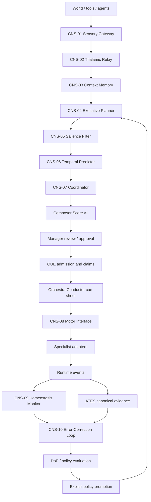

# Brain/CNS-Inspired Composer Architecture

**Status:** executable foundation + conceptual module architecture  
**Related:** [PR #5939 — Rhythmic Systems](https://github.com/timerloggedout-spec/termux-monorepo/pull/5939)  
**Score contract:** [composer.score.v1](../schemas/composer.score.v1.schema.json)  
**Design:** [Brain/CNS Composer design](../superpowers/specs/2026-11-27-brain-cns-composer-design.md)

## Executive model

The Composer is an intent-to-action composition layer. It receives a declared goal, a task cohort, contextual references, success criteria, and timing assignments. It delegates dependency planning to Ballet, cue construction to Orchestra Conductor, and emits a deterministic score that existing control planes can review and admit.

The brain/CNS model is a design analogy for distributed coordination. It provides a vocabulary for separating signal intake, context, goal maintenance, action selection, timing prediction, coordination, feedback, and actuation. It is not a biological simulation, clinical model, theory of consciousness, or assertion that any software component reproduces a brain region.

**Composer = composition authority only.** It has no direct authority over readiness, queue admission, claims, execution, evidence validation, or production policy promotion.

## 1. Module atlas

| ID | Module | CNS inspiration | Software responsibility | Input | Output | Authority |
|---|---|---|---|---|---|---|
| CNS-01 | Sensory Gateway | receptors and afferent pathways | normalize external events into typed, attributed signals | events, tool observations, telemetry | signal envelopes | observe only |
| CNS-02 | Thalamic Relay | thalamic relay/routing | classify signal type and route to declared specialist domains | signal envelopes + routing policy | routed signal references | Manager owns routing policy |
| CNS-03 | Context Memory | hippocampal episodic/context functions | attach relevant history, entity links, and provenance references | intent + canonical references | context frame | canonical stores remain source of truth |
| CNS-04 | Executive Planner | prefrontal executive functions | represent goal, constraints, success criteria, and candidate plan | context frame + intent | plan proposal | Manager approval remains authoritative |
| CNS-05 | Salience Filter | salience/action-selection networks | annotate urgency, relevance, novelty, and risk for downstream policy | signals + goals + declared policy | salience annotations | QUE owns priority/admission/claims |
| CNS-06 | Temporal Predictor | cerebellar timing/prediction analogy | carry expected duration, assignment phase, open/close window, and wake conditions | assignments + timing policy | temporal annotations | Temporal Intelligence owns temporal semantics |
| CNS-07 | Coordinator | distributed cortical/subcortical coordination | compose dependency waves and specialist roles | task graph + constraints | Ballet plan | Ballet owns wave planning |
| CNS-08 | Motor Interface | descending motor pathways | translate approved cue sheets into adapter-facing dispatch intent | approved cues | dispatch intent | specialist adapters execute |
| CNS-09 | Homeostasis Monitor | autonomic/homeostatic regulation | observe queue health, collector cadence, stale signals, and recovery conditions | QUE facts + collector observations | health observations | WAIT→WATCH and QUE retain lifecycle ownership |
| CNS-10 | Error-Correction Loop | cerebellar error correction/feedback | compare expected and observed outcomes; prepare evidence-backed policy evaluations | validated observations | evaluation inputs | ATES validates evidence; promotion is explicit |

The modules are logical boundaries. They can be deployed together or separated later according to measured load and ownership needs. The first executable slice is CNS-04/07 composition through `compose_score`; the remaining modules are extension contracts, not pretend implementations.

## 2. End-to-end signal path



### Canonical software flow

1. **Listen:** Sensory Gateway receives external facts with source, event identity, and observed time.
2. **Relay:** Thalamic Relay classifies and routes signals according to Manager-owned routing policy.
3. **Remember:** Context Memory attaches references to canonical records; it does not turn missing information into inferred facts.
4. **Form intent:** Executive Planner makes the goal, constraints, success criteria, and task cohort explicit.
5. **Mark salience:** Salience Filter annotates urgency and risk. It does not admit work.
6. **Model time:** Temporal Predictor carries the assignment window and expected duration supplied by Temporal Intelligence.
7. **Compose:** Ballet plans deterministic dependency waves; Composer wraps the plan and Conductor cue sheet in a versioned score.
8. **Approve and execute:** Manager and QUE apply their policies; adapters execute only admitted tasks.
9. **Observe:** Homeostasis Monitor and collectors observe runtime conditions; ATES validates canonical evidence.
10. **Learn:** Error-Correction Loop prepares policy-evaluation inputs. DoE compares treatments; a separate explicit promotion changes the active policy.

## 3. Module contracts

### CNS-01 — Sensory Gateway

**Purpose:** convert heterogeneous observations into a common signal envelope.

Suggested envelope:
- `signal_id`: stable source event identity;
- `signal_type`: registered vocabulary term;
- `source`: provider, workflow, adapter, or subsystem identity;
- `observed_at`: timezone-aware observation timestamp;
- `payload_ref`: reference to a bounded payload or evidence record;
- `integrity`: digest or source-defined integrity state;
- `quality`: `verified`, `candidate`, `partial`, or `unknown`.

Signal payloads should remain bounded and typed. Secret values, prompts, arbitrary completions, and unrestricted tool payloads stay outside the evidence plane.

### CNS-02 — Thalamic Relay

**Purpose:** route signals by declared type and subscription.

Routing contract:
- input: signal envelope + versioned routing policy;
- output: one or more destination references + routing decision trace;
- fallback: unresolved signal types go to an observation/quarantine lane;
- boundary: the relay does not grant write, claim, or execution permissions.

### CNS-03 — Context Memory

**Purpose:** give the planner continuity without turning memory into authority.

Context frame:
- `context_id`;
- `entity_refs[]`;
- `event_refs[]`;
- `prior_score_refs[]`;
- `source_refs[]`;
- `freshness` and `completeness` labels.

Canonical GitHub, ATES, and repository records remain authoritative. The context frame carries references and derived summaries with provenance.

### CNS-04 — Executive Planner

**Executable now:** `ComposerIntent`, `ComposerPolicy`, `compose_score()`.

Intent fields:
- stable `intent_id`;
- explicit objective;
- task cohort with task IDs and dependencies;
- success criteria;
- context references.

Policy fields:
- policy version;
- Conductor placement;
- Ballet strategy (`sequential`, `parallel`, `adaptive`);
- optional `max_parallel`.

The planner proposes. Manager approval remains the policy boundary.

### CNS-05 — Salience Filter

**Purpose:** annotate rather than decide.

Potential dimensions:
- urgency: deadline proximity and expiration state;
- relevance: relation to the declared objective;
- novelty: difference from already observed events;
- risk: blast radius, reversibility, and permission tier;
- confidence: source quality, never a substitute for evidence.

The filter emits annotations only. QUE remains the canonical admission and priority owner.

### CNS-06 — Temporal Predictor

**Purpose:** carry time semantics into the score.

Use existing Temporal Intelligence vocabulary:
- BEAT / OFFBEAT;
- nominal, open, and close timestamps;
- OPEN_LENGTH and EXPECTED_DURATION;
- ACTUAL and DRIFT;
- WAIT, WAKE_ON, and RECHECK_AT;
- collector cadence, phase, and polyrhythm.

All ordering and elapsed-time arithmetic uses UTC instants. Local timezone formatting is a presentation concern.

### CNS-07 — Coordinator

**Executable now:** Ballet `plan_choreography()`.

Ballet creates deterministic waves from dependencies, write-conflict constraints, strategy, and capacity. The Composer preserves the original task dependencies in cue metadata so the score remains auditable even when the caller's assignment record contains stale dependency copies.

### CNS-08 — Motor Interface

**Purpose:** adapt approved cues to execution adapters.

The motor interface consumes an approved cue and emits adapter-specific dispatch intent. It does not invoke adapters directly, claim QUE work, or bypass Manager approval. Specialist adapters remain the execution boundary.

### CNS-09 — Homeostasis Monitor

**Purpose:** maintain operational stability through observation.

Observe:
- queue age and queue wait;
- collector lag and cadence drift;
- stale or missing signals;
- retry/recovery pressure;
- partial completion and resource saturation.

It emits health observations and wake hints through existing WAIT→WATCH and QUE contracts. It does not alter queue state directly.

### CNS-10 — Error-Correction Loop

**Purpose:** convert validated outcomes into candidate improvements.

Loop:
1. read ATES-validated receipts;
2. align expected and actual timing/outcome;
3. identify drift and failure classes;
4. create a versioned DoE treatment proposal;
5. compare candidate policy against a defined cohort;
6. publish a recommendation with evidence;
7. promote only through explicit governance and repository gates.

A feedback observation is not a policy update. A green run is not by itself proof of task success.

## 4. Executable Composer API

```python
from deepcli.observatory import (
    ComposerIntent,
    ComposerPolicy,
    compose_score,
    serialize_score,
)

intent = ComposerIntent(
    intent_id="release-5939",
    objective="Deliver a verified release",
    tasks=(
        {"id": "spec", "depends_on": [], "writes": ["spec.md"]},
        {"id": "tests", "depends_on": ["spec"], "writes": ["tests.py"]},
        {"id": "docs", "depends_on": ["spec"], "writes": ["docs.md"]},
    ),
    success_criteria=("repository gates pass", "ATES evidence is attributable"),
    context_refs=("github://pull/5939",),
)

policy = ComposerPolicy(
    version="composer.policy.v1",
    placement="temporal_intelligence",
    strategy="adaptive",
    max_parallel=2,
)

score = compose_score(intent, assignments, policy)
canonical_json = serialize_score(score)
```

The `assignments` mapping is keyed by task ID and supplies the fields required by Orchestra Conductor: `nominal_at`, `opens_at`, `closes_at`, `expected_duration_ms`, `phase`, `open_length_ms`, `dependency_barriers`, and `evidence_refs`. Optional `wake_conditions` are preserved. Composer derives `depends_on` from the intent task graph, which is the canonical dependency source for the score.

### Score envelope

`composer.score.v1` contains:
- `intent`: stable ID and objective;
- `policy`: version, placement, strategy, and capacity;
- `plan`: Ballet's dependency-wave plan;
- `cue_sheet`: Conductor's cue output;
- `context_refs`: caller-supplied provenance pointers;
- `success_criteria`: caller-declared acceptance conditions;
- `decision_trace`: deterministic stage records;
- `authority`: `dispatch_intent_only`.

Canonical serialization uses sorted object keys, compact separators, UTF-8 text, and rejects non-finite numeric values. The score contains no generated timestamp; equivalent normalized inputs and policy versions produce equivalent serialized output.

## 5. Ownership and trust boundaries

| Concern | Canonical owner | Composer behavior |
|---|---|---|
| Goal and constraints | caller + Manager | carries explicit intent |
| Context provenance | canonical repository / evidence stores | carries references |
| Signal routing policy | Manager | consumes declared routing result |
| Readiness / dependency barrier | dependency-phase engine | preserves dependencies |
| Wave planning | Ballet | delegates |
| Queue / admission / claims | QUE | emits proposed cues only |
| Timing semantics | Temporal Intelligence | carries supplied annotations |
| Cue-sheet formatting | Orchestra Conductor | delegates |
| Execution | specialist adapters | emits intent only |
| Evidence validation | ATES | references receipts; never validates itself |
| Experiment evaluation | DoE / Observatory | supplies candidate score |
| Production promotion | governance + repository gates | no self-promotion |

## 6. Failure behavior

| Condition | Required behavior |
|---|---|
| Unknown signal type | quarantine/observe with provenance; route policy review |
| Missing context | preserve explicit unknown/partial state |
| Stale signal | annotate stale; retain original timestamp |
| Duplicate task ID | reject score composition |
| Unknown dependency / cycle | delegate to Ballet validation and reject |
| Missing assignment | reject before cue emission |
| Stale assignment dependency list | replace with canonical intent graph dependency list |
| Missing timing or evidence metadata | Conductor rejects cue generation |
| Conflicting write sets | Ballet serializes conflicting tasks into safe waves |
| QUE admission denied | retain denial as observation; do not bypass |
| Adapter failure | capture runtime outcome and evidence reference |
| ATES receipt unresolved | keep outcome unverified; do not learn/promote from it |
| Policy experiment inconclusive | preserve inconclusive state; retain active policy |

## 7. Security, privacy, and governance

- Carry references and bounded summaries; keep secret material out of scores and telemetry.
- Treat signals, context, and adapter outputs as untrusted input.
- Validate schema and task identities at every boundary.
- Keep policy versions immutable; create a new version for a new treatment.
- Preserve raw observations separately from derived scores.
- Retain failure, censoring, skipped, and unknown states.
- Keep the score replayable without embedding sensitive source payloads.
- Require explicit review and promotion for any policy that changes production behavior.

## 8. Delivery sequence

| Phase | Deliverable | State |
|---|---|---|
| 1 | intent/policy data classes + deterministic score compiler | implemented in this branch |
| 2 | cue metadata + dependency preservation | implemented in this branch |
| 3 | JSON Schema + architecture map | added in this branch |
| 4 | public exports + runnable example | pending |
| 5 | full repo gates + independent review | pending |

## 9. Extension rule

Add a new module when it owns a distinct transformation, has a typed input/output contract, can be tested independently, and does not duplicate an existing authority. Keep the first implementation small. Split a conceptual module into a separate Python file only when it gains independent runtime behavior and tests.
