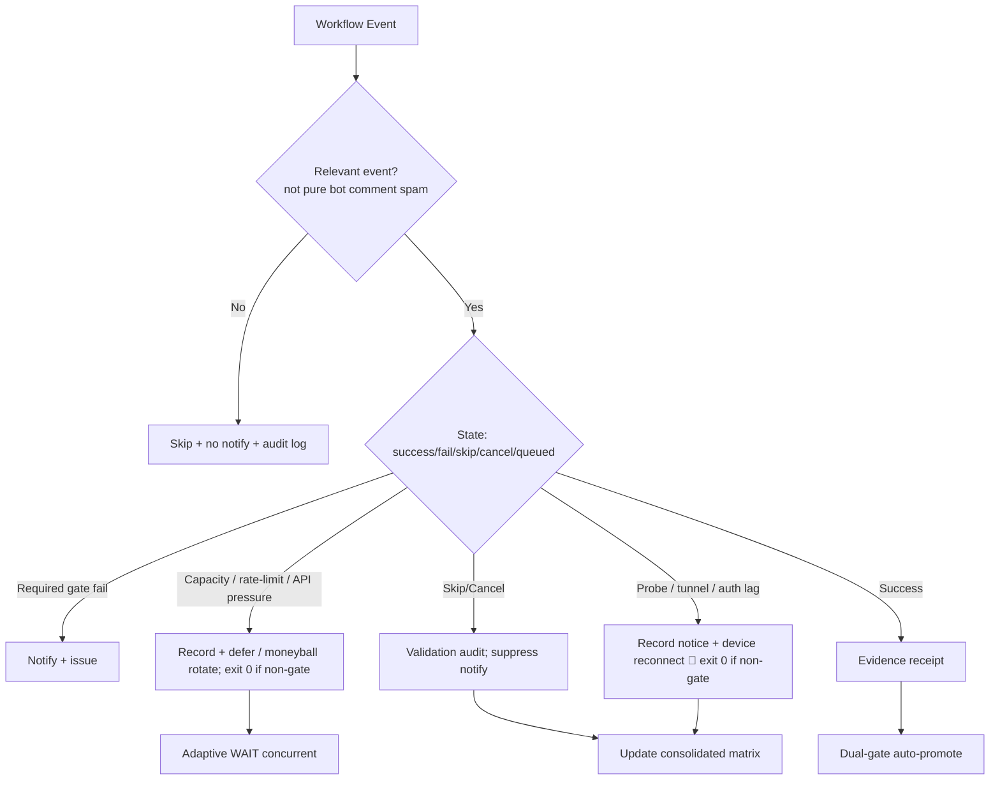

# Consolidated Actions Workflows Matrix — 2026-10-22 Post-Merge Recon

**Promoted:** PR #1483 merged 2026-10-22T20:04:44Z (branch `ops/actions-matrix-upgrade-2026-10-18`).
**Current branch:** `ops/actions-matrix-postmerge-2026-10-22` (this update).
**Authority:** Issue #631 13-phase + evidence-led-monorepo-ops + adaptive-wait.
**Goal:** Z3π0 Failures, 100% SUCCESS on required gates. Attentive audit of Skipped/Cancelled. Reduce notification spam via modular consolidations. Operational Pinggy/Tailscale alternatives with public-obfuscated device identification. Quota-aware caching, cadence, 3L0 moneyball telemetry. C.A.D.E. Continuously Autonomous Development Environment.

## Current State Recon (2026-10-22 ~02:00 UTC post-merge)

- Master tip `a1057981e14f398f431878353a7cbf5b3b22fdf4`: dual-gate green on recent pushes. Core gates success-dominant.
- Residual failures (capacity / probe / high-volume): Agent Runtime Stall Watch, GitLab governed reconciliation, Agentic Auth Canary, DeepCLI Agent Bridge Smoke, tribute-system1, Peer review orchestrator on issue_comment, etc. Classified as non-logic (API pressure, device lag, bot cascades).
- High-volume cascades: lane-events-recorder, agent-throughput, bot issue_comment fan-out → Skipped/Cancelled. Modular `issue-comment-router.yml` live (early classify; bots skipped unless matched).
- Watcher: dispatch-only. Cadence Lead/Lag (`*/4`) owns true lag_failure incidents.
- Device tunnel/auth (Pinggy / Tailscale on BLU B160V #1/#2): lag classified as notice (prefer exit 0). Opaque public `device_id=tmx-node-primary`. Live publisher still pending on #1 (broken screen origin). Tailscale preferred.
- Stall-watch resilient to API capacity (403/5xx → notice + exit 0 on pure lag). Residual runs may indicate true stalls or incomplete classification — audit artifacts.
- Dual-gate preserved. Vercel Hobby non-gate. Intentional concurrency cancels audited as non-failures.

## Repeated Issue Classes & Disposition

| Class | Examples | Root Cause | Fix / Disposition | Status |
|-------|----------|------------|-------------------|--------|
| Vercel rate-limit / deploy cap | #1419, #1314 | Hobby plan daily cap | Path filters, admission, non-gate. Adaptive defer. | Active / non-gate |
| Skipped/Cancelled spam | bot issue_comment, concurrency, workflow_run cascades | Broad triggers + high volume | Modular router + `if:` + concurrency groups + cadence ownership. Suppress pure skips in notifications. | Advancing (router live; expand extraction) |
| Zero-job / queued ghosts | Historical | Schedule/workflow id | v3 live; reaper active. | Historical |
| Device tunnel / auth (Pinggy / Tailscale) | Auth Canary, Tunnel Canary, #1440, BLU B160V#1/#2 | Publisher not live; stale heartbeat | Opaque `device_id: tmx-node-primary`. Lag as notice (exit 0). Tailscale preferred; Pinggy fallback. | Operational gap / device-side |
| API pressure / stall watch | Runtime Stall Watch, observatory 403 | High Actions volume | Resilient collection: capacity lag → exit 0 + receipt. Residual audit needed. | Partial (resilience live) |
| Quota / capacity | Actions free; Vercel constrained | Provider limits | Adaptive telemetry, dynamic cache, 3L0 moneyball. No blind retries. | Active |
| Filename / YAML parse | Historical | Not current-tree | Closed. | Closed |
| GitLab governed reconciliation | Scheduled failures | External/auth or capacity | Classify as lag or add resilience. | Open / audit |

## Cadence & Cache Improvements (3L0 Moneyball)

- Adaptive WAIT: re-fetch on material delta; concurrent non-conflicting progress. Backoff only on QUIET.
- Cache: SHA + path filters; provider capacity snapshots; device health. Dynamic adaptive for quota headroom.
- Modular consolidations: issue-comment-router absorbs unmatched bot comments; fewer full orchestrators. Expand to full job extraction / deprecate redundant workflows.
- Notification reduction: only actionable gates/failures/incidents. Suppress skipped/cancelled bot spam + pure lag notices. Audit trail in step summary / JSONL.
- Quota planning: soft classification; moneyball selection. Act before exhaustion. Specific runs (39233561401 observatory 403, 392349* quota-registry) classified as capacity lag.

## Flowchart: Consolidated Decision Path

## Pinggy / Device Identification (Public Obfuscation)

- Device #1 (original BLU B160V, broken screen): operational tunnel or alternative required. Opaque public ID `tmx-node-primary`.
- Device #2: replica/observer; do not overwrite origin manifest.
- September tests on #1; dual-device now. Manifests report device_id + TTL + role.
- Tailscale preferred; Pinggy emergency fallback (ssh -R0:localhost:port free.pinggy.io). Credentials names-only in #184.
- Tunnel canary + probes treat lag as notice (exit 0) to reduce spam while preserving visibility via step summary / issues.

## Quota Limit Planning

- Vercel: non-gate, path-scoped ignore-build.
- Actions: free for public; track pressure (stall-watch resilience added).
- Cache dynamic adaptive; 3L0 moneyball.
- No blind retries. Quota messages (observatory, peer-review) → capacity classification.

## Superceded / Combined Workflows Notes

- Merge Promotion Queue v1/v2 → v3.
- High-volume issue_comment → modular router + filters (early classify, no fan-out on bot spam).
- Watcher dispatch-only; cadence owns incidents.
- Stall-watch resilient to API capacity.
- Dual-gate promote authority. Device probes non-gate when classified as lag.
- PR #1483 promoted; matrix now reflects post-merge tip.

**Next:** Expand router to full job extraction / deprecate redundant workflows. Live device publisher on #1 (tmx-node-primary) or proven Tailscale. Audit residual stall-watch / GitLab / auth-canary runs for true vs capacity. Continue C.A.D.E. BIUDL. Reduce remaining notification spam via further modularization and adaptive cadence.

Agent-Identity: Grok (Administrator)
**BIUDL** — Broad → Integrate → Validate → Develop → Learn.
