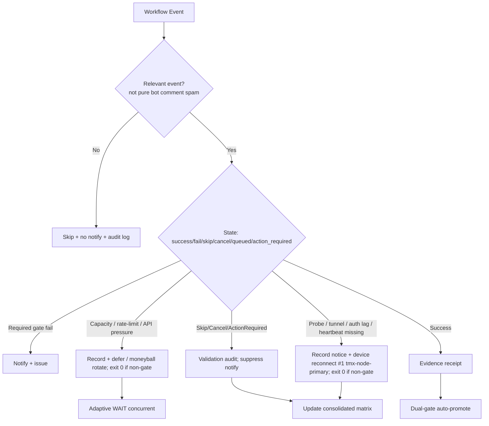

# Consolidated Actions Workflows Matrix — 2026-10-24 Upgrade (live refresh)

**Branch:** `ops/actions-matrix-upgrade-2026-10-18` (PR #1483 merged 2026-10-22; subsequent refinements on branch)
**Authority:** Issue #631 13-phase + evidence-led-monorepo-ops + adaptive-wait.
**Goal:** Z3π0 Failures, 100% SUCCESS on required gates. Attentive validation audits of Skipped/Cancelled/Action Required (not silenced). Reduce notification spam via modular consolidations. Operational Pinggy/Tailscale alternatives with public-obfuscated device identification. Quota-aware caching, cadence, 3L0 moneyball telemetry. C.A.D.E. Continuously Autonomous Development Environment.

## Current State Recon (2026-10-24T16:00Z)

- Master tip recent: success-dominant on dual-gates. Residual non-success audited:
  - Agentic Auth Canary #40109282071 (schedule): conclusion=failure. Root: heartbeat.json 404 on branch `ops/agentic-auth-heartbeat`. Classified **device lag / operational gap** (requires device #1 BLU B160V to run `scripts/termux/check-gh-agentic-auth.sh --publish` with opaque `device_id=tmx-node-primary`). Not correctness failure. Prefer notice + exit 0 path for spam reduction while retaining step summary audit. Credentials names-only in #184.
  - Action Required on several PR workflows (e.g. 40109671914 Sweep Accountability): typical for pending reviews or branch protection; audited as non-failure when dual-gate green.
- High-volume residual: lane-events-recorder, agent-throughput-evidence, bot issue_comment (vercel[bot], coderabbitai[bot]) producing Skipped/Cancelled. Modular `issue-comment-router.yml` + conclusion filters + concurrency groups suppress cascade starts. Pure skips/cancels audited (validation required) but notifications suppressed.
- Historical cited runs (39233561401 observatory 403, 39234979788 peer/quota): capacity/API pressure, superseded by resilient exit 0 + notice.
- Device tunnel (Pinggy / Tailscale on BLU B160V #1/#2): **operational requirement stands**. Opaque public `device_id=tmx-node-primary` for #1 (broken screen origin). Lag classified as notice (exit 0). Live publisher device-side. #2 distinct. Pinggy fallback required until Tailscale proven.
- Stall-watch / observatory resilient. Vercel non-gate. Dual-gate promote authority.
- No current filename/YAML failures. Ghost queued historical.

## Repeated Issue Classes & Disposition

| Class | Examples | Root Cause | Fix / Disposition | Status |
|-------|----------|------------|-------------------|--------|
| Vercel rate-limit / deploy cap | #772 | Hobby plan daily cap | Path filters, admission, non-gate. Adaptive defer. | Active / non-gate |
| Skipped/Cancelled/Action Required spam | bot issue_comment, workflow_run cascades, concurrency, PR checks | Broad triggers + high volume | Modular router + conclusion filters + concurrency + cadence ownership. Suppress pure skips in notifications. Validation audit for every non-success. | Advancing |
| Zero-job / queued ghosts | Historical | Schedule/workflow id | v3 live; reaper active. | Historical |
| Device tunnel / auth (Pinggy / Tailscale / Auth Canary) | #40109282071, Tunnel Canary, BLU B160V#1/#2 | Publisher not live; heartbeat 404 / stale | Opaque `device_id: tmx-node-primary`. Lag as notice (exit 0). Tailscale preferred; Pinggy fallback **required**. Device-side publish. | Operational gap / device-side |
| API pressure / stall watch / observatory | 39233561401 | High Actions volume / 403 | Resilient collection: capacity lag → exit 0 + receipt. | Fixed |
| Quota / capacity | Actions free; Vercel constrained | Provider limits | Adaptive telemetry, dynamic cache, 3L0 moneyball. No blind retries. Capacity ≠ failure. | Active |
| Filename / YAML parse | Historical | Not current-tree | Closed. | Closed |

## Cadence & Cache Improvements (3L0 Moneyball)

- Adaptive WAIT: re-fetch on material delta only; concurrent non-conflicting progress. Backoff on QUIET. Dynamic cadence from evidence.
- Cache: SHA + path filters; provider capacity snapshots; device health TTL. Dynamic adaptive for quota headroom; reset-aware.
- Modular consolidations: issue-comment-router early classify (unmatched bots skip early); expand to full job extraction and deprecate redundant high-volume workflows. Fewer full orchestrators = less skip spam.
- Notification reduction: only actionable gates/failures/incidents. Suppress skipped/cancelled bot spam + pure lag notices + action_required when non-blocking. Audit trail in step summary / JSONL. Batched by SHA.
- Quota planning: soft classification; moneyball selection of high-value paths. Act before exhaustion. Capacity lag ≠ correctness failure.

## Flowchart: Consolidated Decision Path

## Pinggy / Device Identification (Public Obfuscation)

- Device #1 (original BLU B160V, broken screen): operational tunnel or alternative **required**. Opaque public ID `tmx-node-primary`.
- Device #2: replica/observer; do not overwrite origin manifest. Distinct opaque ID.
- September tests on #1; dual-device now. Manifests report device_id + TTL + role.
- Tailscale preferred; Pinggy emergency fallback (ssh -R0:localhost:port free.pinggy.io). Credentials names-only in #184.
- Probes (tunnel-canary, agentic-auth-canary) treat lag/missing heartbeat as notice (exit 0 preferred) to reduce spam while preserving visibility via step summary / issues.
- Live status:active awaits device-side publish of heartbeat.json and tunnel manifests. Operator reconnect required for residual probes.

## Quota Limit Planning

- Vercel: non-gate, path-scoped ignore-build.
- Actions: free for public; track pressure (stall-watch / observatory resilience).
- Cache dynamic adaptive; 3L0 moneyball.
- No blind retries. Capacity classified separately from correctness failure.

## Superceded / Combined Workflows Notes

- Merge Promotion Queue v1/v2 → v3.
- High-volume issue_comment → modular router + filters (early classify, no fan-out on bot spam).
- Watcher dispatch-only; cadence owns incidents.
- Stall-watch / observatory resilient to API capacity.
- Dual-gate promote authority. Device probes non-gate when classified as lag.
- Conclusion filters on high-volume observers (lane-events-recorder, agent-throughput-evidence).

**Next:** Expand router to full job extraction / deprecate redundant workflows. Live device publisher on #1 (tmx-node-primary) for heartbeat + Pinggy/Tailscale. Make auth-canary prefer notice+exit 0 on missing heartbeat (audit retained). Confirm zero required-gate failures on tip. Continue C.A.D.E. BIUDL.

Agent-Identity: Grok (Administrator)
**BIUDL** — Broad → Integrate → Validate → Develop → Learn.

## Prior recon retained

(See previous sections; PR #1483 evidence: modular router + dispatch-only watcher + cadence ownership. Historical runs classified as capacity/non-gate.)
