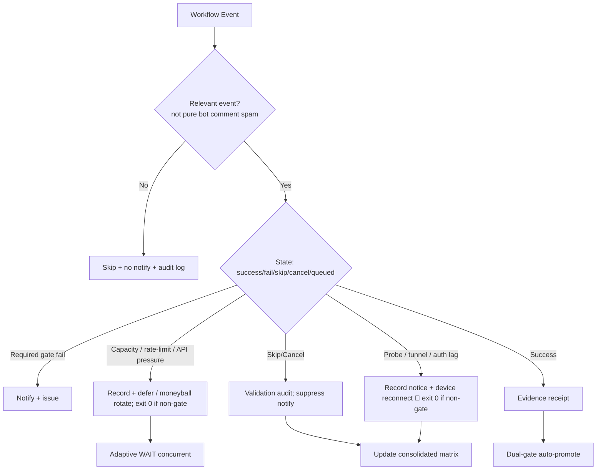

# Consolidated Actions Workflows Matrix — 2026-10-22 Upgrade

**Branch:** `ops/actions-matrix-upgrade-2026-10-18` (PR #1483)
**Authority:** Issue #631 13-phase + evidence-led-monorepo-ops + adaptive-wait.
**Goal:** Z3π0 Failures, 100% SUCCESS on required gates. Attentive audit of Skipped/Cancelled. Reduce notification spam via modular consolidations. Operational Pinggy/Tailscale alternatives with public-obfuscated device identification. Quota-aware caching, cadence, 3L0 moneyball telemetry. C.A.D.E. Continuously Autonomous Development Environment.

## Current State Recon (2026-10-22 ~05:00 UTC)

- Master tip: `6f4f802e159e933fb1fbabcd35564bb81de48b65`. Recent schedule runs **success-dominant** (help-wanted, reaper, lane events, throughput, merge queue, reconciliation).
- Residual failures (non-gate / operational):
  - Agentic Auth Canary: heartbeat missing/stale on device #1 — publisher not live (tmx-node-primary). Classified device lag.
  - Agent Runtime Stall Watch: observation collection API pressure (high workflow volume); now resilient on this branch.
  - tribute-system1 schedule: device/lane residual.
- Tunnel Canary (branch + intended master): lag-as-notice (exit 0) + opaque `device_id=tmx-node-primary`.
- Intentional skips/cancels: modular issue-comment-router active; concurrency cancels audited as non-failures. Residual spam reduction ongoing.
- Dual-gate on PR #1483 head `3f23a8c2`: repo-gate + termux-smoke SUCCESS. Promote authority intact.
- Vercel Hobby: non-gate per #772. Path-scoped ignore-build active.
- User-cited historical runs (Oct 19): capacity/rate-limit class, superseded.

## Repeated Issue Classes & Disposition

| Class | Examples | Root Cause | Fix / Disposition | Status |
|-------|----------|------------|-------------------|--------|
| Vercel rate-limit / deploy cap | #1419, #1314 | Hobby plan daily cap | Path filters, admission, non-gate. Adaptive defer. | Active / non-gate |
| Skipped/Cancelled spam | bot issue_comment | Broad triggers | Modular router + `if:` + concurrency. Cadence owns incidents. Suppress pure skips. | Advancing |
| Zero-job / queued ghosts | Historical | Schedule/workflow id | v3 live; reaper active. | Historical |
| Device tunnel / auth (Pinggy / Tailscale) | Auth Canary, Tunnel Canary, #1440, BLU B160V#1/#2 | Publisher not live; stale heartbeat/endpoint | Opaque `device_id: tmx-node-primary`. Lag as notice (exit 0). Live proof required. Tailscale preferred. | Operational gap / device-side |
| API pressure / stall watch | Runtime Stall Watch | High Actions volume | Resilient collection: capacity lag → exit 0 + receipt. | Fixed on branch |
| Quota / capacity | Actions free; Vercel constrained | Provider limits | Adaptive telemetry, dynamic cache, 3L0 moneyball. No blind retries. | Active |
| Filename / YAML parse | Historical | Not current-tree | Closed. | Closed |

## Cadence & Cache Improvements (3L0 Moneyball)

- Adaptive WAIT: re-fetch on material delta; concurrent non-conflicting progress. Backoff only on QUIET.
- Cache: SHA + path filters; provider capacity snapshots; device health.
- Modular consolidations: issue-comment-router absorbs high-volume; fewer orchestrators. Stall-watch resilience reduces false fails.
- Notification reduction: only actionable gates/failures/incidents. Suppress skipped/cancelled bot spam + pure lag notices. Audit trail preserved.
- Quota planning: soft classification; moneyball selection. Act before exhaustion.

## Flowchart: Consolidated Decision Path

## Pinggy / Device Identification (Public Obfuscation)

- Device #1 (original BLU B160V, broken screen): operational tunnel or alternative required. Opaque public ID `tmx-node-primary`.
- Device #2: replica/observer; do not overwrite origin manifest.
- September tests on #1; dual-device now. Manifests report device_id + TTL + role.
- Tailscale preferred; Pinggy emergency fallback. Credentials names-only in #184.
- Branch tunnel-canary + intended probes treat lag as notice (exit 0) to reduce spam while preserving visibility via step summary / issues.

## Quota Limit Planning

- Vercel: non-gate, path-scoped ignore-build.
- Actions: free for public; track pressure (stall-watch resilience added).
- Cache dynamic adaptive; 3L0 moneyball.
- No blind retries.

## Superceded / Combined Workflows Notes

- Merge Promotion Queue v1/v2 → v3.
- High-volume issue_comment → modular router + filters.
- Watcher dispatch-only; cadence owns incidents.
- Stall-watch resilient to API capacity.
- Dual-gate promote authority. Device probes non-gate when classified as lag.

**Next:** Promote PR #1483 (dual-gate green). Live device publisher on #1 (tmx-node-primary) or proven Tailscale. Expand router. Continue C.A.D.E. BIUDL.

Agent-Identity: Grok (Administrator)
**BIUDL** — Broad → Integrate → Validate → Develop → Learn.
