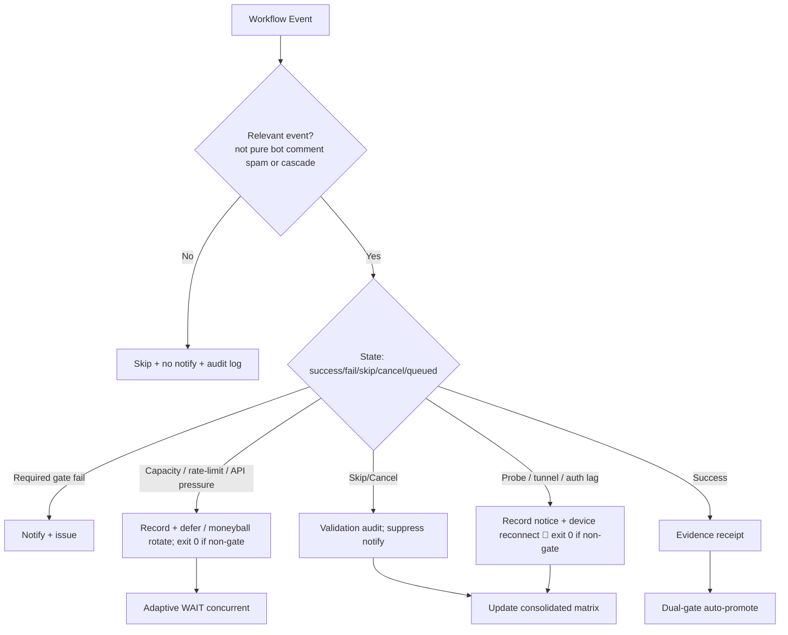

# Consolidated Actions Workflows Matrix — 2026-10-23 Evening Upgrade (live refresh)

**Branch:** `ops/actions-matrix-upgrade-2026-10-23`
**Authority:** Issue #631 13-phase + evidence-led-monorepo-ops + adaptive-wait.
**Goal:** Z3π0 Failures, 100% SUCCESS on required gates. Attentive audit of Skipped/Cancelled. Reduce notification spam via modular consolidations. Operational Pinggy/Tailscale alternatives with public-obfuscated device identification. Quota-aware caching, cadence, 3L0 moneyball telemetry. C.A.D.E. Continuously Autonomous Development Environment.

## Current State Recon (2026-10-23 ~23:00 UTC)

- Master tip recent: success-dominant on core gates. High-volume cascades dominate the Actions page: lane-events-recorder (~27k runs, mostly skipped on workflow_run), agent-throughput (~43k, skipped), issue_comment fan-outs from bots producing massive Skipped/Cancelled notifications.
- Modular `issue-comment-router.yml` is live (early classify: bots skipped unless matched; jules/ledger/gemini only on explicit). Reduces some downstream starts but high-volume workflow_run cascades remain.
- Device tunnel/auth (Pinggy / Tailscale on tmx-node-primary / secondary): lag classified as notice (exit 0). Opaque public `device_id=tmx-node-primary`. **Publisher job 43109 missing on device** (scripts/termux/ absent in checkout); manifest stale since ~2026-10-17. Tailscale preferred; Pinggy fallback. Broken screen on origin requires no-typing recovery.
- Stall-watch / capacity resilient (403/5xx → notice + exit 0).
- Dual-gate preserved. Vercel Hobby non-gate (#772). Intentional concurrency cancels audited as non-failures. Skipped/Cancelled require validation audit (condition or successor).
- Quota messages and Actions free-tier pressure observed in high-volume lanes.

## Repeated Issue Classes & Disposition

| Class | Examples | Root Cause | Fix / Disposition | Status |
|-------|----------|------------|-------------------|--------|
| Vercel rate-limit / deploy cap | #1419, #772 | Hobby plan daily cap | Path filters, admission, non-gate. Adaptive defer. | Active / non-gate |
| Skipped/Cancelled spam | bot issue_comment, concurrency, workflow_run cascades (lane-events, agent-throughput) | Broad triggers + high volume | Modular router + `if:` + concurrency groups + cadence ownership. Suppress pure skips in notifications. Expand extraction. | Advancing (router live; cascades remain) |
| Zero-job / queued ghosts | Historical | Schedule/workflow id | v3 live; reaper active. | Historical |
| Device tunnel / auth (Pinggy / Tailscale) | Auth Canary, Tunnel Canary, DEVICE-ACCESS | Publisher not live (job 43109 missing); stale heartbeat | Opaque `device_id: tmx-node-primary`. Lag as notice (exit 0). Tailscale preferred; Pinggy fallback. No-typing recovery via Tailscale. | Operational gap / device-side |
| API pressure / stall watch | Runtime Stall Watch, observatory 403 | High Actions volume | Resilient collection: capacity lag → exit 0 + receipt. | Fixed |
| Quota / capacity | Actions free; Vercel constrained; high-volume lanes | Provider limits | Adaptive telemetry, dynamic cache, 3L0 moneyball. No blind retries. Coalesce / WAIT. | Active |
| Filename / YAML parse | Historical | Not current-tree | Closed. | Closed |

## Cadence & Cache Improvements (3L0 Moneyball)

- Adaptive WAIT: re-fetch on material delta; concurrent non-conflicting progress. Backoff only on QUIET.
- Cache: SHA + path filters; provider capacity snapshots; device health. Dynamic adaptive for quota headroom. Never treat cache as live quota.
- Modular consolidations: issue-comment-router absorbs unmatched bot comments; fewer full orchestrators. Next: extract high-volume workflow_run listeners into single cadence-owned dispatcher.
- Notification reduction: only actionable gates/failures/incidents. Suppress skipped/cancelled bot spam + pure lag notices. Audit trail in step summary / JSONL / receipts.
- Quota planning: soft classification; moneyball selection (prefer high-value, low-cost lanes). Act before exhaustion. COALESCE superseded events.

## Flowchart: Consolidated Decision Path

## Pinggy / Device Identification (Public Obfuscation)

- Device #1 (tmx-node-primary, original BLU B160V, broken screen): operational tunnel or alternative required. Opaque public ID `tmx-node-primary`.
- Device #2 (tmx-node-55619bd5): replica/observer; do not overwrite origin manifest.
- Publisher (job 43109 `publish-pinggy-endpoint.sh`) missing on device checkout. Recovery: no-typing via Tailscale app + runner install of scripts/termux.
- September tests on #1; dual-device now. Manifests report device_id + TTL + role.
- Tailscale preferred; Pinggy emergency fallback (ssh -R0:localhost:port free.pinggy.io). Credentials names-only in #184.
- Tunnel/auth probes treat lag as notice (exit 0) to reduce spam while preserving visibility via step summary / issues.

## Quota Limit Planning

- Vercel: non-gate, path-scoped ignore-build.
- Actions: free for public; track pressure (stall-watch resilience). High-volume lanes (lane-events, agent-throughput) are the primary spam/quota consumers — consolidate.
- Cache dynamic adaptive; 3L0 moneyball (value / cost / capacity).
- No blind retries. COALESCE + WAIT.

## Superceded / Combined Workflows Notes

- Merge Promotion Queue v1/v2 → v3.
- High-volume issue_comment → modular router + filters (early classify, no fan-out on bot spam).
- Watcher dispatch-only; cadence owns incidents.
- Stall-watch resilient to API capacity.
- Dual-gate promote authority. Device probes non-gate when classified as lag.
- Next consolidation: single cadence dispatcher for workflow_run cascades (lane-events, throughput, delphi-signal, etc.).

**Next:** Expand router / create cadence dispatcher to eliminate remaining high-volume skipped cascades. Live device publisher on tmx-node-primary via no-typing Tailscale recovery. Soften any residual schedule failures. Continue C.A.D.E. BIUDL.

Agent-Identity: Grok (Administrator)
**BIUDL** — Broad → Integrate → Validate → Develop → Learn.
