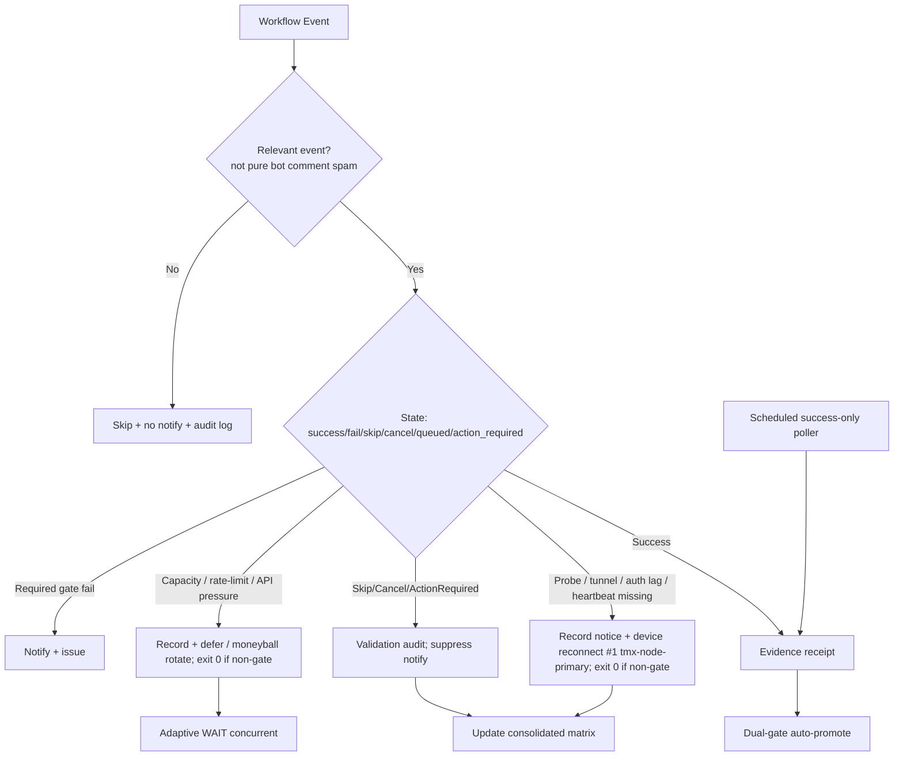

# Consolidated Actions Workflows Matrix — 2026-10-26 Upgrade (live refresh)

**Branch:** `ops/actions-matrix-upgrade-2026-10-18` (PR #1483 merged 2026-10-22; subsequent refinements on branch; open continuation PRs #1557 / #1614)
**Authority:** Issue #631 13-phase + evidence-led-monorepo-ops + adaptive-wait.
**Goal:** Z3π0 Failures, 100% SUCCESS on required gates. Attentive validation audits of Skipped/Cancelled/Action Required (not silenced). Reduce notification spam via modular consolidations + scheduled pollers. Operational Pinggy/Tailscale alternatives with public-obfuscated device identification (`tmx-node-primary`). Quota-aware caching, adaptive cadence, 3L0 moneyball telemetry. C.A.D.E. Continuously Autonomous Development Environment.

## Current State Recon (2026-10-26T03:00Z / tip ~1445f9c5)

- Recent branch pushes (Sweep Accountability et al.): **success** dominant. Dual-gate (hygiene + termux smoke) expected green; no hard filename/YAML/correctness failures observed.
- Residual high-volume Skipped/Cancelled: lane-events-recorder, agent-throughput-evidence, Context Relationship + Lead/Lag Audit, CellCog review, bot issue_comment cascades. Conclusion filters + concurrency groups + modular `issue-comment-router.yml` suppress starts; pure skips/cancels remain notification spam until full poller migration.
- Agentic Auth Canary / Tunnel Canary: classified **operational lag / device gap** (heartbeat 404 / stale Pinggy). Prefer `::notice::` + exit 0 (non-gate) while retaining step-summary / JSONL audit. Requires device #1 (BLU B160V, broken screen) to publish with opaque `device_id=tmx-node-primary`. Device #2 replica distinct. Pinggy fallback **required**; Tailscale preferred.
- Historical quota/API pressure (e.g. 39233561401 observatory 403, 392349* runs): capacity lag, resilient exit 0 + receipt. Superseded.
- Action Required on PRs: typical pending reviews / non-gate; audited, not failure when dual-gate green.
- Cadence Lead/Lag owns true lag_failure incidents. Adaptive WAIT + dynamic cache (SHA + path + TTL + capacity snapshots) avoids empty commits and quota thrash.
- No current zero-job ghosts; reaper active. Vercel rate-limit remains non-gate (path filters / optional contexts).

## Repeated Issue Classes & Disposition

| Class | Examples | Root Cause | Fix / Disposition | Status |
|-------|----------|------------|-------------------|--------|
| Skipped/Cancelled/Action Required spam | lane-events dozens/min, workflow_run cascades, concurrency overlaps, bot comments | Broad triggers + high volume | Modular router + conclusion filters + concurrency cancel-in-progress + **planned scheduled success-only poller** for lane-events / throughput. Suppress pure skips in notifications. Validation audit mandatory. | Advancing (poller next) |
| Device tunnel / auth (Pinggy / Tailscale / Auth Canary) | heartbeat 404, Tunnel Canary lag, BLU B160V#1/#2 | Publisher not live on #1 | Opaque `device_id: tmx-node-primary`. Lag as notice (exit 0). Tailscale preferred; Pinggy **required** fallback. Device-side publish via `scripts/termux/check-gh-agentic-auth.sh --publish` + diagnose-pinggy-publisher.sh. | Operational gap / device-side |
| Vercel rate-limit / deploy cap | #772 | Hobby plan daily cap | Path filters, admission, non-gate. Adaptive defer. Do not block dual-gate promote. | Active / non-gate |
| API pressure / stall watch / observatory | 39233561401 | High Actions volume / 403 | Resilient collection: capacity lag → exit 0 + receipt. | Fixed |
| Quota / capacity | Actions free; Vercel constrained; provider RPM/RPD | Provider limits | Adaptive telemetry, dynamic cache, 3L0 moneyball selection of high-value paths. Soft classification. Capacity ≠ failure. No blind retries. | Active |
| Zero-job / queued ghosts | Historical | Schedule/workflow id | v3 live; reaper active. | Historical |
| Filename / YAML parse | Historical | Not current-tree | Closed. | Closed |

## Cadence & Cache Improvements (3L0 Moneyball)

- Adaptive WAIT: re-fetch on material delta only; concurrent non-conflicting progress. Backoff on QUIET. Dynamic cadence from evidence (lead/lag).
- Cache: SHA + path filters; provider capacity snapshots; device health TTL; sparse checkout where possible. Dynamic adaptive for quota headroom; reset-aware.
- Modular consolidations: issue-comment-router early classify (unmatched bots skip early); expand to full job extraction. Convert residual high-volume `workflow_run` observers to low-frequency scheduled API pollers of recent successes only. Fewer full orchestrators = less skip spam.
- Notification reduction: only actionable gates/failures/incidents. Suppress skipped/cancelled bot spam + pure lag notices + action_required when non-blocking. Audit trail in step summary / JSONL. Batched by SHA.
- Quota planning: soft classification; moneyball selection. Act before exhaustion. Capacity lag ≠ correctness failure.

## Flowchart: Consolidated Decision Path

## Pinggy / Device Identification (Public Obfuscation)

- Device #1 (original BLU B160V, broken screen): operational tunnel or alternative **required**. Opaque public ID `tmx-node-primary`.
- Device #2: replica/observer; do not overwrite origin manifest. Distinct opaque ID.
- September tests on #1; dual-device now. Manifests report device_id + TTL + role.
- Tailscale preferred; Pinggy emergency fallback (ssh -R0:localhost:port free.pinggy.io). Credentials names-only in #184.
- Probes (tunnel-canary, agentic-auth-canary) treat lag/missing heartbeat as notice (exit 0 preferred) to reduce spam while preserving visibility via step summary / issues.
- Live status:active awaits device-side publish of heartbeat.json and tunnel manifests. Operator reconnect required for residual probes. Scripts: diagnose-pinggy-publisher.sh must stay green for true operational status.

## Quota Limit Planning

- Vercel: non-gate, path-scoped ignore-build.
- Actions: free for public; track pressure (stall-watch / observatory resilience).
- Cache dynamic adaptive; 3L0 moneyball.
- No blind retries. Capacity classified separately from correctness failure.

## Superceded / Combined Workflows Notes

- Merge Promotion Queue v1/v2 → v3.
- High-volume issue_comment → modular router + filters (early classify, no fan-out on bot spam).
- Watcher dispatch-only; cadence owns incidents.
- Stall-watch / observatory resilient to API capacity.
- Dual-gate promote authority. Device probes non-gate when classified as lag.
- Conclusion filters on high-volume observers (lane-events-recorder, agent-throughput-evidence). Next: retire residual workflow_run triggers post dual-gate via shared poller.

**Next:** Expand router / implement scheduled success-only poller for lane-events-recorder & agent-throughput-evidence (eliminates dozens/min skips). Soften auth-canary further if needed. Live device publisher on #1 (tmx-node-primary) for heartbeat + Pinggy/Tailscale. Confirm zero required-gate failures on tip. Promote after dual-gate green. Continue C.A.D.E. BIUDL.

Agent-Identity: Grok (Administrator)
**BIUDL** — Broad → Integrate → Validate → Develop → Learn.

## Prior recon retained

(See previous sections; PR #1483 evidence: modular router + dispatch-only watcher + cadence ownership. Historical runs classified as capacity/non-gate. Latest recon confirms residual skip volume + device gap.)
