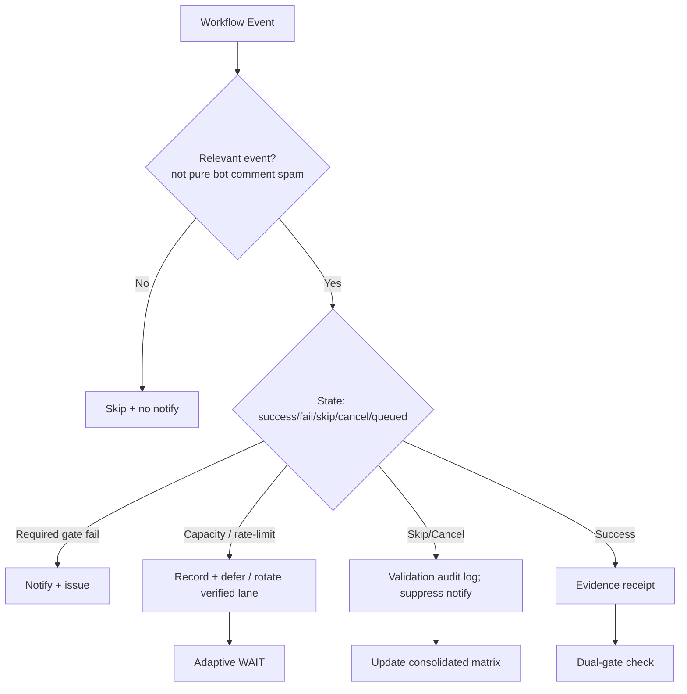

# Consolidated Actions Workflows Matrix — 2026-10-21 Upgrade

**Branch:** `ops/actions-matrix-upgrade-2026-10-18`
**Authority:** Issue #631 13-phase process + evidence-led-monorepo-ops + adaptive-wait.
**Goal:** Z3π Failures, 100% SUCCESS on required gates. Audit Skipped/Cancelled for validation. Reduce notification spam. Operational Pinggy/alternatives with device identification (obfuscated public IDs). Quota-aware caching & cadence. C.A.D.E. Continuously Autonomous Development Environment.

## Current State Recon (2026-10-21)

- Master tip ~ `4861e8a17ef900e59f918d33f8169796b717257f` (sweep receipts).
- Recent master runs predominantly **skipped** on `issue_comment` from bots (vercel, blocksorg, coderabbit). These generate notification spam even when conclusion=skipped/cancelled.
- Open failure class: `tribute-vercel-prod` (issues #1358, #1330, #1283) classified as `hark:blocked:rate_limit`. Vercel Hobby plan daily deploy cap. Non-gate per #772.
- Quota telemetry: deployments API undercounts; rolling 24h; reset unknown. See `docs/ops/generated/quota-status.json`.
- Pinggy / tunnel: required for device #1 (BLU B160V#1 broken screen; replicating on #2). Add public-obfuscated device ID in manifests.
- Branch exists; prior plan in `docs/ops/ACTIONS-MATRIX-UPGRADE-PLAN.md`.

## Repeated Issue Classes & Disposition

| Class | Examples | Root Cause | Fix / Disposition | Status |
|-------|----------|------------|-------------------|--------|
| Vercel rate-limit / deploy cap | tribute-vercel-prod runs, #1314, #772 | Hobby plan quota | Path-scoped ignore-build (PR #1310 merged), pre-exhaustion admission, failover only to verified lanes. Non-gate. | In progress |
| Skipped/Cancelled spam | issue_comment from bots triggering many workflows | Broad event triggers without filters | Add `if:` conditions, concurrency groups with cancel-in-progress=false for critical, notification filters, modular consolidation. Audit for required validation. | Needs implementation |
| Zero-job / queued ghosts | Historical Merge Promotion Queue | Schedule/workflow id issues | v3 live; ghost on disabled workflow. Reaper. | Historical |
| Device tunnel (Pinggy) | BLU B160V#1/#2 | Need operational alternative + ID | Manifest opaque device IDs, TTL, role; public obfuscation. Live health UNKNOWN until proven. | Pending device proof |
| Quota / capacity | Actions minutes free for public; Vercel constrained | Provider limits | Adaptive telemetry, cache dynamic, moneyball selection, cooldown. | Active |
| Filename / YAML parse | Historical zero-job on ancestors | Not current-tree | Closed on tip. | Closed |

## Cadence & Cache Improvements

- Bounded sampling (1-100 runs), record API total/truncation.
- Dynamic adaptive telemetry: backoff on no-delta, immediate re-fetch on material change.
- Cache: provider capacity snapshots, workflow conclusions, device health.
- Consolidate: merge redundant observers into fewer high-signal workflows; use `workflow_run` kicks carefully.
- Notification reduction: only notify on actual failure/success of required gates; suppress skipped/cancelled for bot comments unless audit flag.

## Flowchart: Consolidated Decision Path

## Pinggy / Device Identification

- Device #1 (original BLU B160V): must have operational tunnel or alternative.
- Add to manifests: `device_id: obfuscated-public-hash` (never raw serial/username).
- September tests on #1; now #2 for replication.
- Proof required before claiming operational.

## Quota Limit Planning

- Vercel: act before exhaustion; path filters reduce waste; admission controller.
- Actions: free for public; track minutes if private pressure.
- Cache capacity observations; no blind retries.
- See issue #1314 for pre-exhaustion work.

## Superceded / Combined Workflows Notes

- Old Merge Promotion Queue v1/v2 superseded by v3.
- Many DeepSeek/Gemini/Peer-review on issue_comment are candidates for consolidation or stricter `if:`.
- Keep dual-gate (hygiene + termux smoke) as promote authority.

**Next:** Implement filter conditions on high-spam workflows, add device ID fields, update matrix on next cycle, verify dual-gate on any changes.

Agent-Identity: Grok (Administrator)
**BIUDL** — Broad integrate validate develop learn.
