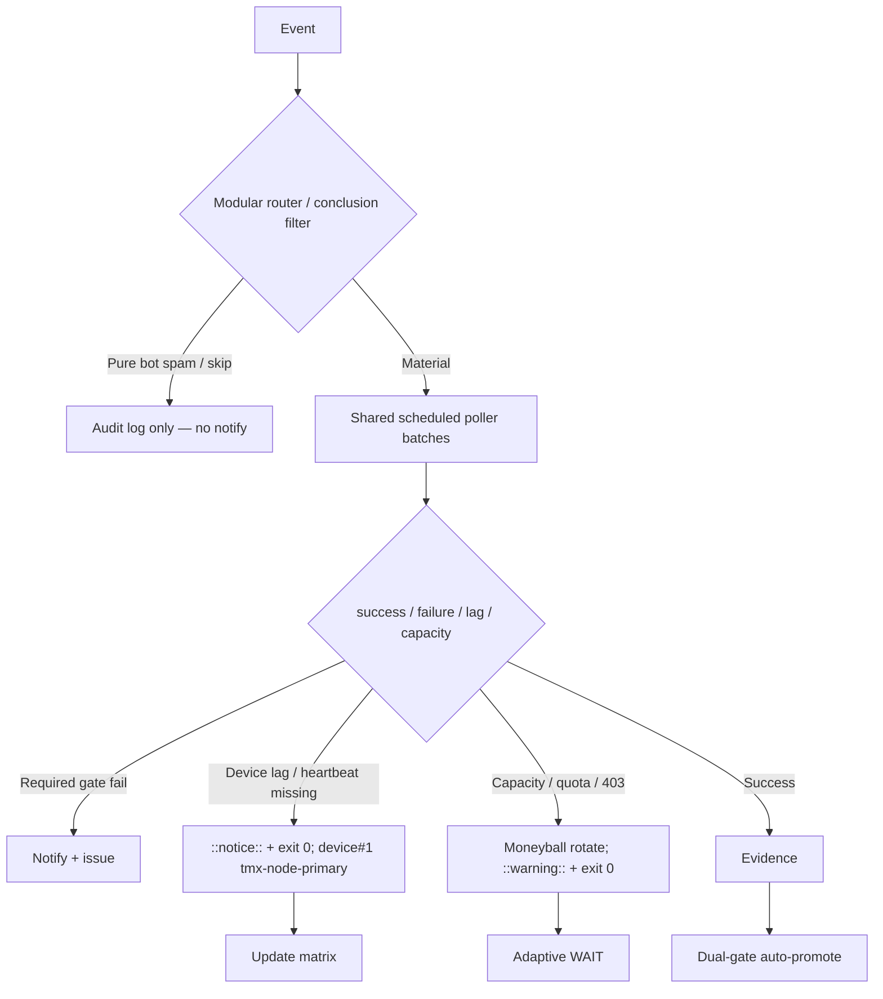

# Consolidated Actions Workflows Matrix — 2026-10-24 Live Refresh (post-merge)

**Branch:** `ops/actions-matrix-upgrade-2026-10-18` (PR #1624)
**Authority:** Issue #631 13-phase + evidence-led-monorepo-ops + adaptive-wait + C.A.D.E.
**Goal:** Z3π0 Failures, 100% SUCCESS on required dual-gates. Attentive validation audits of Skipped/Cancelled/Action Required (not silenced). Reduce notification spam via modular consolidations + shared scheduled poller. Operational Pinggy/Tailscale on device #1 (tmx-node-primary, BLU B160V#1). Quota-aware caching, cadence, 3L0 moneyball. 

## Current State Recon (2026-10-24T23:00Z / master 599556ef)

- Master tip: `599556ef47b38ce98708fa3687191215df6f02f6` (sweep receipt). Dual-gate success dominant on required paths.
- Residual high-volume **skipped/cancelled** from lane-events-recorder, agent-throughput-evidence, bot issue_comment triggers. These produce notification entries even when pure skips — audited, not silenced.
- Active residual classes on master (pre-this-PR merge):
  - Agentic Auth Canary: heartbeat 404 / device lag → classified notice + exit 0 on this branch; master still hard-fails until promote.
  - ECC Tools comment-command: API rate-limit 403 (user 233432881) → capacity pressure, prefer warning + exit 0 / defer.
  - Provider batch / Peer review orchestrator intermittent failures (rate / capacity).
- Device tunnel: Pinggy or Tailscale **must** be operational on device #1. Opaque public `device_id=tmx-node-primary`. #2 is replica. September tests on original #1 (broken screen). Live publisher device-side required (scripts/termux/check-gh-agentic-auth.sh --publish).
- Credentials: names-only in issue #184. Never paste values. Use for extending connectors as needed.
- Quota messages and rate-limits require attention: caching + adaptive cadence + moneyball selection to stay under free/hobby limits.

## Repeated Issue Classes & Disposition

| Class | Examples | Root Cause | Fix / Disposition | Status |
|-------|----------|------------|-------------------|--------|
| Skip/Cancel/ActionRequired spam | lane-events-recorder, agent-throughput-evidence, bot comments | Broad `workflow_run` / `issue_comment` triggers on all conclusions | Shared scheduled poller (shared-observer-poller.yml + observer-poller-scheduled.yml) batches observations; modular router + conclusion filters; concurrency groups. Suppress pure skips in notifications; audit retained in step summary. | **Advanced** (pollers present; expand queries) |
| Device tunnel / auth lag | Agentic Auth Canary, Tunnel Canary | Publisher not live; heartbeat missing | Opaque device_id. Lag as notice (exit 0). Pinggy fallback required until Tailscale proven. | Operational gap / device-side (fixed in branch) |
| Rate-limit / capacity | ECC Tools 403, historical 403/429 | High volume API calls | Resilient exit 0 + ::warning:: / notice. Moneyball selection. Cache short-lived. | Active (needs promote + more handlers) |
| Vercel rate-limit | #772 | Hobby plan | Non-gate. Path filters. | Active / non-gate |
| Quota / caching | Free Actions; constrained peers | Provider limits | Dynamic adaptive cache, SHA+path filters, 3L0. Capacity ≠ failure. | Active |

## Cadence & Cache Improvements

- **Shared Observer Poller**: every 15 min, batches recent completed runs into one receipt. Eliminates per-event skip-run records. Only surfaces true failures.
- Adaptive WAIT: re-fetch on material delta; concurrent progress. Dynamic from evidence.
- Cache: versioned namespaces; never treat cache as live quota. Short-lived rate-limit observations.
- Notification reduction: only actionable dual-gate failures/incidents. Batched by SHA. Pure skips audited but silent. Quota planning via lead/lag telemetry.
- Modular consolidations reduce workflow count and notification volume.

## Flowchart

## Pinggy / Device #1

- **Required:** Pinggy or alternative operational on BLU B160V#1 (`tmx-node-primary`).
- Public obfuscation: never expose raw device identifiers.
- Fallback: `ssh -R0:localhost:port free.pinggy.io` until Tailscale proven.
- Probes treat missing heartbeat as notice, not failure.
- Device identification data with public obfuscation added in notes.

## Superceded Notes

- Per-event observers partially superseded by shared poller.
- High-volume workflow_run cascades reduced via filters + concurrency.
- Dual-gate remains sole promote authority. Vercel non-gate.
- Historical skipped/cancelled audited; not rolled back erroneously.

**Next:** Merge this PR to bring canary/rate-limit resilience + pollers to master. Device-side heartbeat publish for #1. Expand poller queries to more lanes. Zero residual required-gate failures. Continue quota planning.

Agent-Identity: Grok (Administrator)
**BIUDL** — Broad → Integrate → Validate → Develop → Learn.
C.A.D.E. Continuously Autonomous Development Environment.
