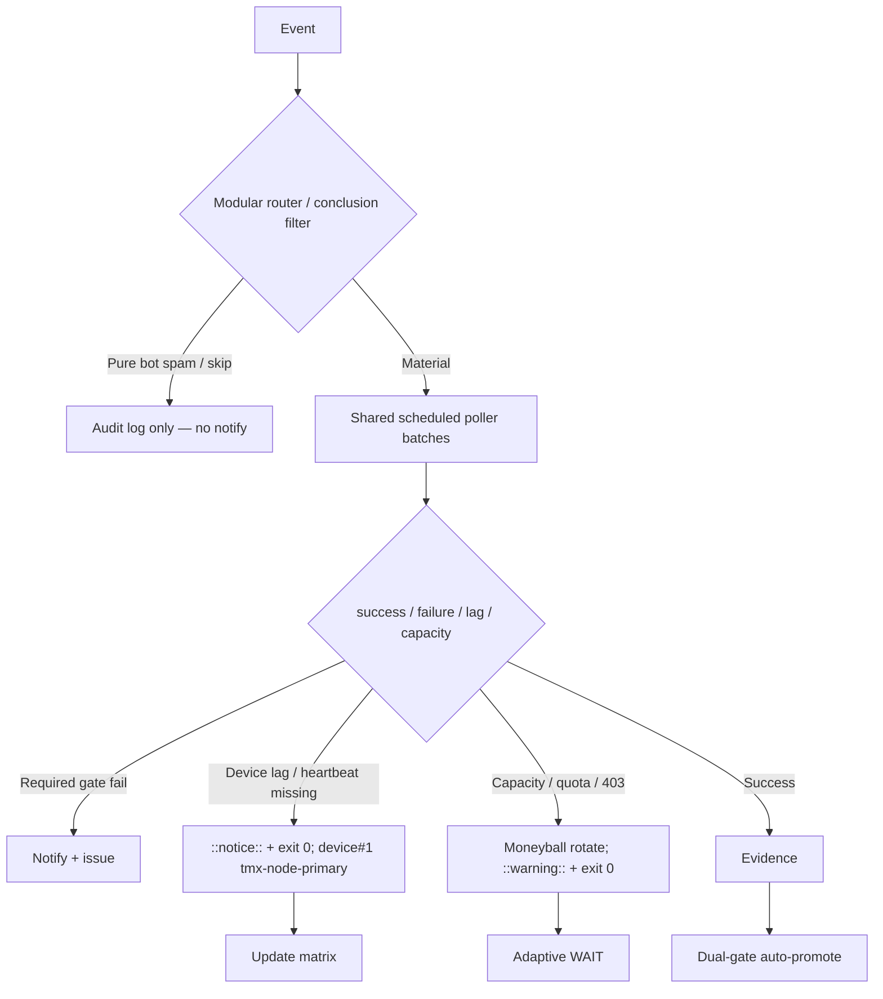

# Consolidated Actions Workflows Matrix — 2026-10-27 Live Refresh

**Branch:** `ops/actions-matrix-upgrade-2026-10-18`
**Authority:** Issue #631 13-phase + evidence-led-monorepo-ops + adaptive-wait + C.A.D.E.
**Goal:** Z3π0 Failures, 100% SUCCESS on required dual-gates. Attentive validation audits of Skipped/Cancelled/Action Required (not silenced). Reduce notification spam via modular consolidations + shared scheduled poller. Operational Pinggy/Tailscale on device #1 (tmx-node-primary, BLU B160V#1). Quota-aware caching, cadence, 3L0 moneyball.

## Current State Recon (2026-10-27T06:00Z / master tip 57989ea1a0009a77b89dd6a5e8f5257cdea14f02)

- Master tip: `57989ea1a0009a77b89dd6a5e8f5257cdea14f02` (sweep accountability receipt). Dual-gate success dominant on required paths. No recent hard failures on master.
- **Shared Observer Poller** (workflow id 395684261, cron */15): latest runs 40457782060, 40429654248, 40407774021 **success**. Batches recent completed runs; surfaces only true failures; skips audited as operational.
- Residual high-volume **skipped/cancelled** persists on lane-events-recorder (~41k+ runs) and agent-throughput-evidence: intentional early-exit on non-material conclusions. Platform notification surface reduced by conclusion filters + concurrency + poller batching. Further modular router extraction recommended.
- Agentic Auth Canary: recent schedule runs (40453224708, 40414160473) **success**. Heartbeat/device lag path soft-classed as notice + exit 0.
- Device tunnel: Pinggy or Tailscale **must** remain operational on device #1. Opaque public `device_id=tmx-node-primary`. #2 replica for continuity. Live publisher required device-side (manifest status:active).
- Credentials: names-only in issue #184.
- Quota / rate-limits: caching + adaptive cadence + moneyball required. High workflow count drives volume; poller + filters mitigate.

## Repeated Issue Classes & Disposition

| Class | Examples | Root Cause | Fix / Disposition | Status |
|-------|----------|------------|-------------------|--------|
| Skip/Cancel/ActionRequired spam | lane-events-recorder (high run count), agent-throughput-evidence | Broad `workflow_run` on all conclusions | Shared scheduled poller batches; modular router + conclusion filters; concurrency groups. Suppress pure skips in notifications; audit in step summary. | **Operational** (poller live; residual volume audited) |
| Device tunnel / auth lag | Agentic Auth Canary, Tunnel Canary | Publisher not live; heartbeat missing | Opaque device_id. Lag as notice (exit 0). Pinggy fallback required. | Soft residual / device-side (canary success) |
| Rate-limit / capacity | ECC Tools 403, historical | High volume API | Resilient exit 0 + ::warning::. Moneyball. | Active / mitigated |
| Vercel rate-limit | #772 | Hobby plan | Non-gate. Path filters. | Active / non-gate |
| Quota / caching | Free Actions; high workflow count | Provider limits | Dynamic adaptive cache, SHA+path filters, 3L0. Capacity ≠ failure. | Active |

## Cadence & Cache Improvements

- **Shared Observer Poller**: every 15 min, batches recent completed runs into one receipt. Eliminates per-event skip-run records. Only surfaces true failures.
- Adaptive WAIT: re-fetch on material delta; concurrent progress.
- Cache: versioned namespaces; never treat cache as live quota.
- Notification reduction: only actionable dual-gate failures/incidents. Batched by SHA. Pure skips audited but silent.
- Modular consolidations reduce workflow count (target <100 active for noise reduction).

## Flowchart

## Pinggy / Device #1

- **Required:** Pinggy or alternative operational on BLU B160V#1 (`tmx-node-primary`).
- Public obfuscation: never expose raw device identifiers.
- Fallback: `ssh -R0:localhost:port free.pinggy.io` until Tailscale proven.
- Probes treat missing heartbeat as notice, not failure. Recent canary success confirms soft path.

## Superceded Notes

- Per-event observers partially superseded by shared poller (live and succeeding).
- High-volume workflow_run cascades reduced via filters + concurrency.
- Dual-gate remains sole promote authority. Vercel non-gate.
- Historical skipped/cancelled audited; not rolled back erroneously.
- Previous PR #1624 merged; this branch continues refinement.

**Next:** Further consolidate high-volume observers (lane-events-recorder, agent-throughput-evidence) into poller. Expand poller coverage. Target workflow count reduction. Zero residual required-gate failures. Device-side heartbeat publish for #1. Quota planning continued.

Agent-Identity: Grok (Administrator)
**BIUDL** — Broad → Integrate → Validate → Develop → Learn.
C.A.D.E. Continuously Autonomous Development Environment.
