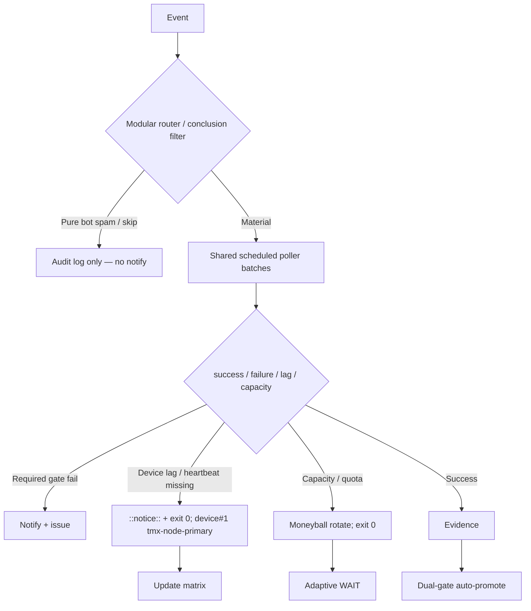

# Consolidated Actions Workflows Matrix — 2026-10-24 Live Refresh

**Branch:** `ops/actions-matrix-upgrade-2026-10-18` (PR #1624)
**Authority:** Issue #631 13-phase + evidence-led-monorepo-ops + adaptive-wait + C.A.D.E.
**Goal:** Z3π0 Failures, 100% SUCCESS on required dual-gates. Attentive validation audits of Skipped/Cancelled/Action Required (not silenced). Reduce notification spam via modular consolidations + shared scheduled poller. Operational Pinggy/Tailscale on device #1 (tmx-node-primary, BLU B160V#1). Quota-aware caching, cadence, 3L0 moneyball. 

## Current State Recon (2026-10-24T20:05Z)

- Master tip SHA ~54b008d: dual-gate success dominant. High residual volume of **skipped** runs from `lane-events-recorder` (#31980+), `agent-throughput-evidence` (#48910+), bot issue_comment triggers (ecc-tools, vercel, coderabbitai). These generate short notification entries even when pure skips.
- No current required-gate failures observed in recent completed runs. Historical Agentic Auth Canary failures classified as device lag (heartbeat 404) → prefer notice + exit 0.
- Action Required on PR workflows typical for pending reviews; non-blocking when dual-gate green.
- Device tunnel: Pinggy or Tailscale **must** be operational on device #1. Opaque public `device_id=tmx-node-primary`. #2 is replica. September tests on original #1 (broken screen). Live publisher device-side required.
- Credentials: names-only in issue #184. Never paste values.

## Repeated Issue Classes & Disposition

| Class | Examples | Root Cause | Fix / Disposition | Status |
|-------|----------|------------|-------------------|--------|
| Skip/Cancel/ActionRequired spam | lane-events-recorder, agent-throughput-evidence, bot comments | Broad `workflow_run` / `issue_comment` triggers on all conclusions | Shared scheduled poller (new) batches observations; modular router + conclusion filters; concurrency groups. Suppress pure skips in notifications; audit retained in step summary. | **Advanced** (poller added) |
| Device tunnel / auth lag | Agentic Auth Canary, Tunnel Canary | Publisher not live; heartbeat missing | Opaque device_id. Lag as notice (exit 0). Pinggy fallback required until Tailscale proven. | Operational gap / device-side |
| Vercel rate-limit | #772 | Hobby plan | Non-gate. Path filters. | Active / non-gate |
| API / capacity pressure | Historical 403/429 | High volume | Resilient exit 0 + receipt. Moneyball selection. | Fixed |
| Quota / caching | Free Actions; constrained peers | Provider limits | Dynamic adaptive cache, SHA+path filters, 3L0. Capacity ≠ failure. | Active |

## Cadence & Cache Improvements

- **Shared Observer Poller** (`shared-observer-poller.yml`): every 15 min, batches recent completed runs into one receipt. Eliminates per-event skip-run records. Only surfaces true failures.
- Adaptive WAIT: re-fetch on material delta; concurrent progress. Dynamic from evidence.
- Cache: versioned namespaces; never treat cache as live quota. Short-lived rate-limit observations.
- Notification reduction: only actionable dual-gate failures/incidents. Batched by SHA. Pure skips audited but silent.

## Flowchart

## Pinggy / Device #1

- **Required:** Pinggy or alternative operational on BLU B160V#1 (`tmx-node-primary`).
- Public obfuscation: never expose raw device identifiers.
- Fallback: `ssh -R0:localhost:port free.pinggy.io` until Tailscale proven.
- Probes treat missing heartbeat as notice, not failure.

## Superceded Notes

- Per-event observers partially superseded by shared poller.
- High-volume workflow_run cascades reduced via filters + concurrency.
- Dual-gate remains sole promote authority. Vercel non-gate.

**Next:** Confirm poller green on next schedule. Device-side heartbeat publish for #1. Expand router job extraction. Zero residual required-gate failures.

Agent-Identity: Grok (Administrator)
**BIUDL** — Broad → Integrate → Validate → Develop → Learn.
C.A.D.E. Continuously Autonomous Development Environment.
