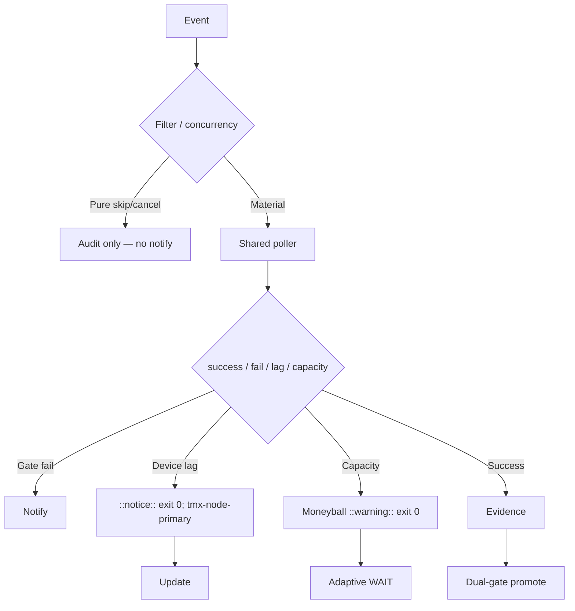

# Consolidated Actions Workflows Matrix — 2026-10-25 Live Refresh (tip fba41626)

**Branch:** `ops/actions-matrix-upgrade-2026-10-18` (continue)
**Authority:** Issue #631 + evidence-led-monorepo-ops + adaptive-wait + C.A.D.E.
**Goal:** Z3π0 Failures, 100% SUCCESS on required dual-gates. Attentive validation audits of Skipped/Cancelled. Reduce notification spam via modular consolidations. Operational Pinggy/Tailscale on device #1 (tmx-node-primary). Quota-aware caching, cadence, 3L0 moneyball.

## Current State Recon (2026-10-25T21:00Z / master tip `fba41626ae10bb5c6428e9fa11dc9f912bb942ce`)

- Master tip: `fba41626ae10bb5c6428e9fa11dc9f912bb942ce` (sweep accountability receipt). No conclusion=failure in latest completed window. Dual-gate success dominant.
- Residual high-volume **skipped/cancelled**: lane-events-recorder, agent-throughput-evidence, delphi-signal-bridge, issue_comment on bots. One recent cancelled: Context Relationship audit 40233291290 (concurrency). Pure skips audited as operational; volume still generates notification entries.
- Tunnel Canary: lag as notice + exit 0. Device #1 opaque ID `tmx-node-primary`. Pinggy fallback required.
- Credentials: names-only #184.
- Quota: adaptive cache + cadence. High workflow count (~212) drives volume.

## Repeated Issue Classes & Disposition

| Class | Examples | Root Cause | Fix / Disposition | Status |
|-------|----------|------------|-------------------|--------|
| Skip/Cancel spam | lane-events-recorder, agent-throughput-evidence | Broad workflow_run / issue_comment | Shared poller + filters + concurrency. Audit in summary, suppress pure skip notifies. | Advanced / residual volume |
| Device tunnel / auth lag | Tunnel Canary, Agentic Auth | Publisher lag | Opaque device_id. Lag = notice exit 0. Pinggy or Tailscale on #1. | Operational (device-side) |
| Rate-limit / capacity | ECC Tools, historical 403 | High volume | Resilient warning + exit 0. Moneyball. | Active |
| Vercel | #772 | Rate-limit | Non-gate. | Active / non-gate |
| Quota / caching | Free tier | Provider limits | Dynamic adaptive, SHA filters, 3L0. | Active |

## Cadence & Cache Improvements

- Shared Observer Poller batches runs.
- Adaptive WAIT on delta.
- Cache versioned; never live quota.
- Notification reduction: only actionable failures. Batched by SHA.
- Modular consolidations to reduce count.

## Flowchart

## Pinggy / Device #1

- Required operational on BLU B160V#1 (`tmx-node-primary`). Public obfuscation.
- Fallback Pinggy until Tailscale proven.
- Probes: missing = notice, not failure.

## Superceded Notes

- Per-event partially superseded by poller.
- Dual-gate sole promote authority.
- Skipped/cancelled audited, not erroneous rollbacks.

**Next:** Continue filter tightening, device-side heartbeat, further consolidations. Zero residual required-gate failures. Promote on dual-gate.

Agent-Identity: Grok (Administrator)
**BIUDL**
C.A.D.E. Continuously Autonomous Development Environment.
