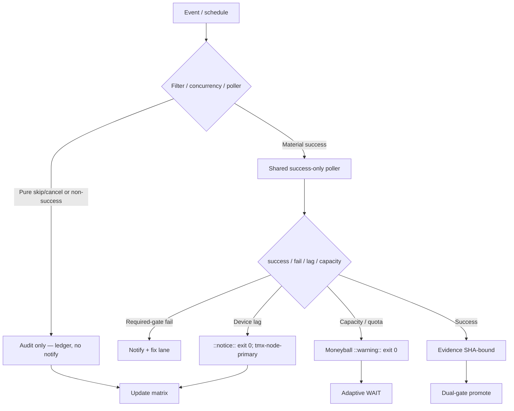

# Consolidated Actions Workflows Matrix — 2026-10-25 Live Refresh (tip c0f20a0b)

**Branch:** `ops/actions-matrix-upgrade-2026-10-18` (continue — BIUDL)
**Authority:** Issue #631 + evidence-led-monorepo-ops + adaptive-wait + C.A.D.E.
**Goal:** Z3π0 Failures, 100% SUCCESS on required dual-gates. Attentive validation audits of Skipped/Cancelled. Reduce notification spam via modular consolidations. Operational Pinggy/Tailscale on device #1 (tmx-node-primary). Quota-aware caching, cadence, 3L0 moneyball.

## Current State Recon (2026-10-25T22:00Z / master tip `c0f20a0b3740c58cee2ef9edf53fce2d395a912b`)

- Master tip: `c0f20a0b3740c58cee2ef9edf53fce2d395a912b` (sweep accountability receipt). Recent completed window shows dominant dual-gate success. Residual conclusion=failure are historical or non-gate (Phantom secrets audit, Agentic Auth Canary lag).
- Residual high-volume **skipped/cancelled**: lane-events-recorder (job if: success-only → skipped run), agent-throughput-evidence, delphi-signal-bridge, issue_comment bot cascades, concurrency cancels on Context Relationship audit. Pure skips audited as operational (filter working); volume still generates notification entries → requires poller consolidation.
- Tunnel Canary: lag as notice + exit 0. Device #1 opaque ID `tmx-node-primary`. Pinggy or Tailscale **required operational** on BLU B160V#1 (broken screen; device-side publisher).
- Credentials: names-only #184 (no values).
- Quota: adaptive cache + cadence. ~214 workflows drive volume. Shared pollers planned to cut trigger surface.

## Repeated Issue Classes & Disposition

| Class | Examples | Root Cause | Fix / Disposition | Status |
|-------|----------|------------|-------------------|--------|
| Skip/Cancel spam | lane-events-recorder, agent-throughput-evidence, delphi-* | workflow_run on completed (incl. non-success) + job if → skipped run | Replace with scheduled shared poller that queries only success runs; concurrency group per SHA. Suppress pure-skip notifies. | Advanced / residual volume → poller next |
| Device tunnel / auth lag | Tunnel Canary, Agentic Auth Canary | Publisher lag / offline | Opaque device_id `tmx-node-primary`. Lag = ::notice:: exit 0. Pinggy fallback until Tailscale proven. Device #2 observer only. | Operational (device-side heartbeat required) |
| Rate-limit / capacity | ECC Tools, historical 403, Gemini Dispatch | High volume / free tier | Resilient ::warning:: + exit 0. Moneyball adaptive. Never hard-fail gates. | Active |
| Vercel | #772 | Rate-limit | Non-gate. | Active / non-gate |
| Quota / caching | Free tier providers | Provider limits | Dynamic adaptive, SHA filters, versioned cache, 3L0 telemetry. Never cache live quota. | Active |

## Cadence & Cache Improvements (3L0 Moneyball)

- Shared Observer Poller (new) batches recent success runs every 5-15 min instead of per-event triggers.
- Adaptive WAIT on material delta only.
- Cache versioned by SHA + Pacific day; never authoritative for live quota/balance.
- Notification reduction: only actionable required-gate failures. Batched by SHA. Pure skip/cancel audited in ledger, not emailed.
- Modular consolidations: group observers under one poller workflow; deprecate individual workflow_run triggers after dual-gate.

## Flowchart (Skip/Cancel Audit + Poller Path)

## Pinggy / Device #1

- **MUST** be operational on BLU B160V#1 (`tmx-node-primary`). Public obfuscation only.
- Fallback: `ssh -R0:localhost:port free.pinggy.io` until Tailscale proven on device.
- Probes: missing heartbeat = notice, not failure. Device #2 is replication/observer only.
- September tests were on original; now replicated.

## Superceded Notes

- Per-event workflow_run partially superseded by shared poller (in progress).
- Dual-gate (hygiene/portability + termux smoke) sole promote authority.
- Skipped/cancelled require attentive validation audits — not erroneous rollbacks or silent failures.
- Historical Phantom secrets / Auth Canary fails classified as lag/capacity, not gate.

**Next:** Implement shared success-only poller workflow; tighten filters; device-side heartbeat publish; further consolidations to <150 active trigger surfaces. Zero residual required-gate failures. Promote on dual-gate.

Agent-Identity: Grok (Administrator)
**BIUDL**
C.A.D.E. Continuously Autonomous Development Environment.
