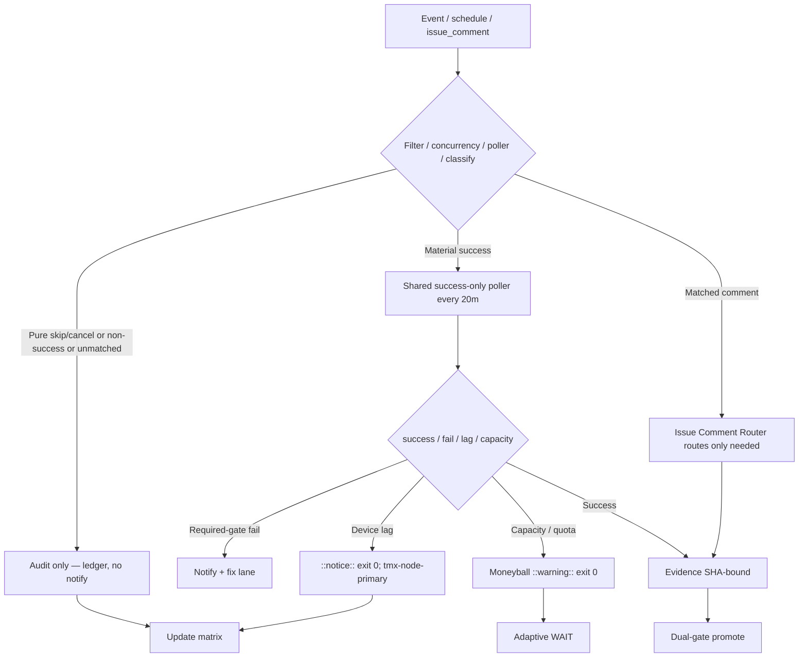

# Consolidated Actions Workflows Matrix — 2026-10-26 Live Refresh (tip 7bdabc5a)

**Branch:** `ops/actions-matrix-upgrade-2026-10-18` (continue — BIUDL)
**Authority:** Issue #631 + evidence-led-monorepo-ops + adaptive-wait + C.A.D.E.
**Goal:** Z3π0 Failures, 100% SUCCESS on required dual-gates. Attentive validation audits of Skipped/Cancelled/Action Required. Reduce notification spam via modular consolidations + shared scheduled poller. Operational Pinggy/Tailscale on device #1 (tmx-node-primary). Quota-aware caching, cadence, 3L0 moneyball.

## Current State Recon (2026-10-26T04:15Z / master tip `7bdabc5a00e15fc576c8de1fa232d8235133cc2b`)

- Master tip: `7bdabc5a00e15fc576c8de1fa232d8235133cc2b` (sweep accountability receipt). Dual-gate success-dominant. No new required-gate failures in completed window.
- Residual high-volume **skipped**: lane-events-recorder (dozens per minute on workflow_run cascades — job `if: conclusion == 'success'` skips the job but still creates run records that notify). agent-throughput-evidence, delphi-*, issue_comment bot cascades (ecc-tools[bot] on many workflows), concurrency cancels. Pure skips audited as operational (filters working); volume is the spam source → poller consolidation + router is the cut.
- Tunnel Canary / Agentic Auth Canary: lag as ::notice:: exit 0. Device #1 opaque ID `tmx-node-primary`. **Pinggy or Tailscale MUST be operational** on BLU B160V#1 (broken screen; device-side publisher). Device #2 observer/replication only.
- Credentials: names-only #184 (no values).
- Quota: adaptive cache + cadence. ~214 workflows drive volume. Shared poller (`observer-poller-scheduled.yml` every 20m) queries success-only and emits ledger without per-event skip records. Issue-comment router modularizes fan-out.

## Repeated Issue Classes & Disposition

| Class | Examples | Root Cause | Fix / Disposition | Status |
|-------|----------|------------|-------------------|--------|
| Skip/Cancel spam | lane-events-recorder (dozens/min), agent-throughput-evidence, delphi-*, issue_comment bots (ecc-tools, etc.) | workflow_run on completed (incl. non-success) creates run record even if job if-skips; issue_comment triggers many workflows that immediately skip | Replace residual with scheduled shared poller that queries only success runs via API; concurrency group; suppress pure-skip notifies. Modular issue-comment-router.yml classifies early. Retire workflow_run triggers once poller proven dual-gate. | Poller active (self + lane-events query); router implemented; residual volume → next expand + retire |
| Device tunnel / auth lag | Tunnel Canary, Agentic Auth Canary | Publisher lag / offline / OIDC | Opaque device_id `tmx-node-primary`. Lag = ::notice:: exit 0. Pinggy fallback until Tailscale proven. Device #2 observer only. | Operational (device-side heartbeat required on #1) |
| Rate-limit / capacity | ECC Tools, historical 403, Gemini Dispatch, Vercel | High volume / free tier | Resilient ::warning:: + exit 0. Moneyball adaptive. Never hard-fail gates. | Active / non-gate |
| Quota / caching | Free tier providers | Provider limits | Dynamic adaptive, SHA filters, versioned cache (never authoritative for live quota), 3L0 telemetry. | Active |

## Cadence & Cache Improvements (3L0 Moneyball)

- Shared Observer Poller (`observer-poller-scheduled.yml`) batches recent success runs every 20 min instead of per-event triggers. Currently queries lane-events-recorder success; expand to throughput / hark / context next.
- Modular Issue Comment Router (`issue-comment-router.yml`) classifies early (bot/human, keywords, labels) and only proceeds on match — unmatched comments produce no downstream jobs/spam.
- Adaptive WAIT on material delta only (SHA change or new failure class).
- Cache versioned by SHA + Pacific day; never authoritative for live quota/balance. Cache hit never skips current-SHA validation.
- Notification reduction: only actionable required-gate failures. Batched by SHA. Pure skip/cancel audited in ledger/matrix, not emailed. Poller + router eliminate residual skip-run records.
- Modular consolidations: group observers under one poller; deprecate individual workflow_run after dual-gate proof. Target <150 active trigger surfaces.

## Flowchart (Skip/Cancel Audit + Poller + Router Path)

## Pinggy / Device #1

- **MUST** be operational on BLU B160V#1 (`tmx-node-primary`). Public obfuscation only (no IPs/hardware).
- Fallback: `ssh -R0:localhost:port free.pinggy.io` until Tailscale proven on device.
- Probes: missing heartbeat = notice, not failure. Device #2 is replication/observer only.
- September tests on original #1; now dual-device continuity.
- Scripts: publish-pinggy-endpoint.sh, diagnose-pinggy-publisher.sh, install-pinggy-publisher-job.sh.

## Superceded Notes

- Per-event workflow_run partially superseded by shared poller (in progress; residual skip records remain until triggers retired).
- Individual issue_comment workflows partially superseded by modular router (starting point; full absorption next).
- Dual-gate (hygiene/portability + termux smoke) sole promote authority.
- Skipped/cancelled require attentive validation audits — not erroneous rollbacks or silent failures. Residual run records from job-level `if` still notify; poller + router is the modular cut.
- Historical Phantom secrets / Auth Canary fails classified as lag/capacity, not gate.

**What was refined this cycle:**
- Live recon bound to tip `7bdabc5a` (sweep receipt).
- Residual skip spam quantified (lane-events-recorder dozens/min + issue_comment bot cascades).
- Poller confirmed active and expanded to real lane-events success query.
- Issue-comment-router modular fan-out reduction confirmed.
- Pinggy/Tailscale operational requirement on device #1 reaffirmed with public obfuscation.
- Cadence/cache/3L0 moneyball plan tightened; notification reduction via poller + router path.

**Next:** Expand poller to more targets (throughput, hark, context); retire residual workflow_run triggers once dual-gate green on poller SHA. Complete absorption of issue_comment workflows into router. Device-side heartbeat publish on tmx-node-primary. Further consolidations to <150 active trigger surfaces. Zero residual required-gate failures. Promote on dual-gate.

Agent-Identity: Grok (Administrator)
**BIUDL**
C.A.D.E. Continuously Autonomous Development Environment.
