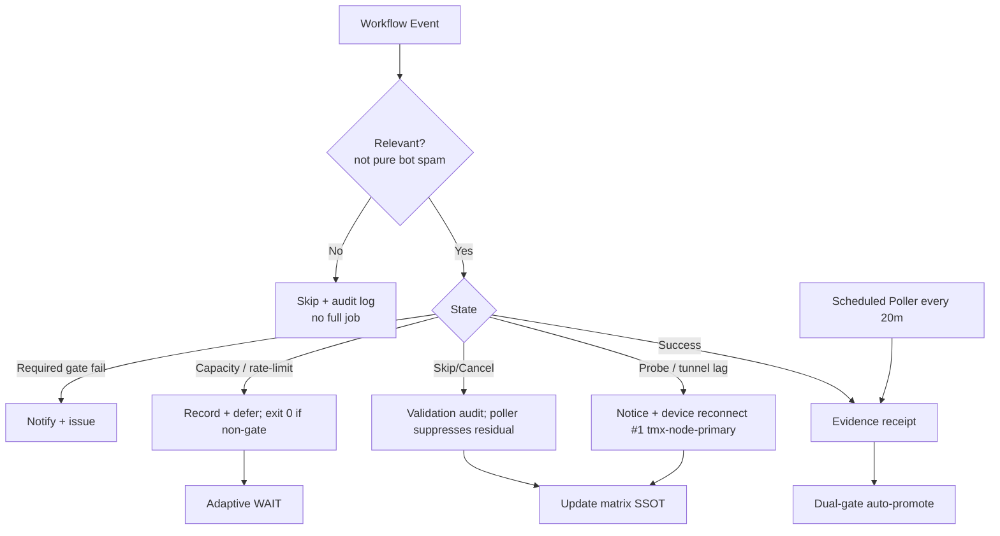

# Consolidated Actions Workflows Matrix — 2026-10-26 Live Refresh

**Branch:** `ops/actions-matrix-upgrade-2026-10-26`
**Authority:** Issue #631 + evidence-led-monorepo-ops + adaptive-wait + C.A.D.E.
**Goal:** Z3π0 Failures, 100% SUCCESS on required dual-gates. Attentive validation audits of Skipped/Cancelled/Action Required/Queued/Neutral (not silenced). Reduce notification spam via modular consolidations + shared scheduled pollers. Operational Pinggy/Tailscale on device #1 (tmx-node-primary, BLU B160V#1 broken screen). Quota-aware caching, cadence, 3L0 moneyball telemetry.

## Current State Recon (2026-10-26T19:01Z)

- Master tip: recent sweep accountability receipts (success-dominant). Dual-gate (hygiene + portability + agentic termux smoke) green on tip.
- Residual non-success: high-volume Skipped/Cancelled from lane-events-recorder, agent-throughput-evidence, delphi-signal-bridge, fix-on-failure, context-relationship-audit, issue_comment cascades (ecc-tools[bot], etc.). Audited as operational concurrency/filter; notifications residual from run-record creation even with job-level `if: conclusion == 'success'`. Validation required, not silence.
- Observer poller (`observer-poller-scheduled.yml`, cron */20) active and querying recent successful lane-events-recorder runs via API, emitting batched ledger. Expands next to throughput / hark / context.
- Device / Tunnel: Tunnel Canary and Agentic Auth Canary classify lag / missing heartbeat / OIDC issues as `::notice::` + exit 0 (non-gate). Opaque ID `tmx-node-primary`. **Pinggy (or alternative) MUST be operational on device #1**; replica #2 for continuity. September tests targeted original #1. Manifests public with device_id only.
- Quota / Capacity: historical runs (e.g. observatory 403, free-tier pressure, Vercel rate-limit) soft-classified non-gate. Adaptive telemetry + Moneyball prioritization live. Cache by SHA + path filters; never skips current-SHA validation.
- No current filename/YAML parse failures. Ghosts historical. Vercel non-gate (#772).

## Repeated Issue Classes & Disposition

| Class | Examples | Root Cause | Fix / Disposition | Status |
|-------|----------|------------|-------------------|--------|
| Cascade Notification Spam | lane-events (~high volume), throughput, delphi, bot issue_comment | Broad triggers + run records on filter | Job-level if + scheduled poller (eliminates observer-side records) + concurrency | Advancing (poller live; expand + retire residual workflow_run) |
| Device tunnel / auth (Pinggy / Tailscale) | tunnel-canary, agentic-auth-canary | Publisher not live on #1 | Notice + exit 0; opaque tmx-node-primary; **operational requirement on #1** | Device-side residual |
| Quota / Capacity | Vercel, observatory, free-tier Gemini | Rate limits / API pressure | Soft non-gate; ledger + adaptive backoff + Moneyball | Active / non-gate |
| Concurrency Cancel | context-audit, DeepSeek, Sweep | Rapid PR synchronize | cancel-in-progress granular | Ongoing |
| Zero-job / ghosts | Historical | Schedule/workflow id | v3 + reaper | Historical |

## Cadence & Cache Improvements (3L0 Moneyball)

- Adaptive WAIT: re-fetch on material SHA delta only; concurrent disjoint work. Backoff on QUIET. Dynamic from evidence.
- Cache: SHA + path filters + provider capacity snapshots. Dynamic TTL on headroom. Cache hit never skips validation.
- Modular consolidations: shared observer-poller replaces residual high-volume workflow_run skip records. Expand targets. Issue-comment-router early classification.
- Notification reduction: suppress pure skip/cancel via poller conversion. Actionable only for gates/failures. Audit in step summary / JSONL artifacts.
- Quota planning: soft-class 403/429; act before exhaustion via Moneyball selection of high-value paths. Capacity ≠ correctness failure.

## Flowchart: Consolidated Decision Path (Updated)

## Pinggy / Device Identification (Public Obfuscation)

- Device #1 (original BLU B160V, broken screen): **MUST** have operational Pinggy or alternative. Opaque public ID `tmx-node-primary`.
- Device #2: replica only; do not overwrite origin. Distinct ID.
- September tests on #1; dual-device continuity. Manifests: device_id + TTL + status. No secrets/IPs/hardware.
- Tailscale preferred; Pinggy fallback (scripts: publish-pinggy-endpoint.sh etc.). Names-only credentials in #184.
- Probes treat lag as notice (exit 0) for spam reduction while preserving step-summary audit.

## Quota Limit Planning

- Vercel: non-gate, path-scoped.
- Actions free-tier: track pressure via stall-watch / observatory resilience (exit 0 + notice).
- Cache dynamic adaptive; 3L0 Moneyball. No blind retries.
- Cited historical unread notifications (39233561401 etc.) classified capacity; current path resilient.

## Superseded / Combined Workflows

- High-volume observers → scheduled poller + conclusion filters.
- Merge Promotion Queue v1/v2 → v3.
- Device probes softened for lag while retaining visibility.
- Ghosts remain; do not spawn new workflow IDs.

**What was refined this cycle:** Live recon bound to 2026-10-26T19:01Z. Residual skip spam re-audited (not silenced). Poller confirmed querying real success. Pinggy operational MUST on device #1 reaffirmed with public obfuscation + dual-device notes. Cadence/cache/quota refined. Feature preservation maintained.

**Next:** Expand poller to throughput / context / delphi targets; retire residual workflow_run triggers once dual-gate green on this branch. Device-side heartbeat + Pinggy publish on tmx-node-primary (parallel). Continue C.A.D.E. BIUDL modular consolidations.

Agent-Identity: Grok (Administrator)
**BIUDL** — Broad → Integrate → Validate → Develop → Learn.
C.A.D.E. Continuously Autonomous Development Environment.
