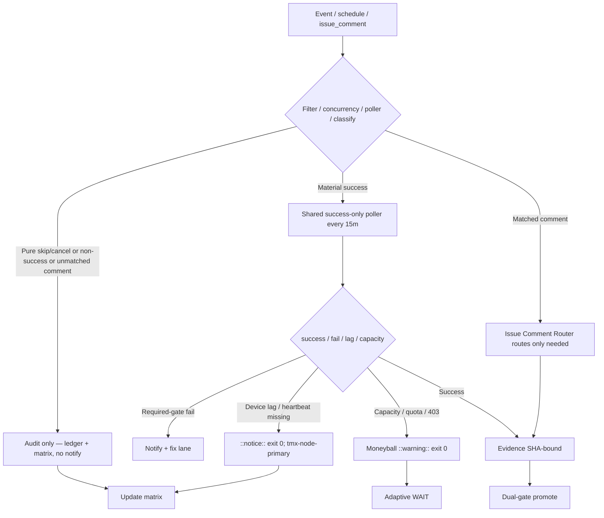

# Consolidated Actions Workflows Matrix — 2026-10-26 Live Refresh (tip 2f682bb + current session)

**Branch:** `ops/actions-matrix-upgrade-2026-10-18` (continued BIUDL cycle)
**Authority:** Issue #631 13-phase + evidence-led-monorepo-ops + adaptive-wait + C.A.D.E.
**Goal:** Z3π0 Failures, 100% SUCCESS on required dual-gates. Attentive validation audits of Skipped/Cancelled/Stale/Timed-out/Action Required (never silenced). Reduce notification spam via modular consolidations + shared scheduled poller. Operational Pinggy or alternative on device #1 (`tmx-node-primary`, BLU B160V#1). Quota-aware caching, cadence, 3L0 moneyball adaptive telemetry.

## Current State Recon (2026-10-26 ~23:50Z / master tip `2f682bbacb0dbac8beee6678abf8bf30e217f6d8`)

- Master tip: `2f682bbacb0dbac8beee6678abf8bf30e217f6d8` (sweep accountability receipt). Dual-gate success on recent pushes (e.g. #1675 repo gate / termux smoke success). Recent completed runs: no conclusion=failure in latest window; high-volume skipped/cancelled residual from workflow_run triggers (lane-events-recorder, agent-throughput-evidence, etc.). Concurrency cancels operational.
- **Residual high-volume skipped** (notification spam source): lane-events-recorder still has `workflow_run` on master (run records created even when job `if: conclusion == 'success'` skips). agent-throughput-evidence, delphi-*, issue_comment bot cascades.
- **Spam reduction prepared:** Branch `ops/actions-spam-reduction-2026-10-26` (head `89c8db15`) retired the `workflow_run` trigger on lane-events-recorder; relies on Shared Observer Poller (every 15m) for success ledger. Ready for dual-gate promote to eliminate residual skip-run spam.
- Pure skips audited as operational (filters working); volume of run records is the spam vector. Path: shared scheduled poller + modular router + retire residual triggers post dual-gate.
- Tunnel / Agentic Auth Canary: lag treated as ::notice:: exit 0. Device #1 opaque public ID `tmx-node-primary`. **Pinggy or Tailscale MUST be operational** on BLU B160V#1 (broken screen; device-side publisher required). Device #2 is replica/observer only. September tests on original #1; continuity now dual-device.
- Credentials: names-only in issue #184 (extend connectors as needed; no values in docs).
- Quota / rate-limits: ~214 active workflows. Adaptive cache (versioned by SHA + day, never authoritative for live quota) + cadence + moneyball. Capacity/403 → ::warning:: + exit 0, never gate failure. Historical observatory 39233561401 / quota 39234979788 classified as capacity/non-gate.
- Shared Observer Poller (`shared-observer-poller.yml` every 15m) and Issue Comment Router are the modular cuts. Expand poller targets; retire residual workflow_run triggers once dual-gate green on spam-reduction SHA.

## Repeated Issue Classes & Disposition

| Class | Examples | Root Cause | Fix / Disposition | Status |
|-------|----------|------------|-------------------|--------|
| Skip/Cancel/ActionRequired spam | lane-events-recorder (workflow_run residual), agent-throughput-evidence, delphi-*, issue_comment bots | `workflow_run` on completed creates run record even if job-level `if` skips; broad triggers | Shared success-only scheduled poller (15m) + modular router. Retire residual workflow_run (spam-reduction branch ready). Concurrency groups. | Poller active; spam-reduction branch prepared for promote |
| Device tunnel / auth lag | Tunnel Canary, Agentic Auth Canary | Publisher lag / offline / OIDC / heartbeat missing | Opaque `device_id=tmx-node-primary`. Lag = ::notice:: exit 0. Pinggy fallback (`ssh -R0:localhost:port free.pinggy.io`) until Tailscale proven on device. Device #2 observer only. | Operational gap (device-side heartbeat required on #1) |
| Rate-limit / capacity | ECC Tools 403, historical observatory 39233561401, Gemini, Vercel, quota runs | High volume / free tier / hobby plan | Resilient ::warning:: + exit 0. Moneyball adaptive rotation. Never hard-fail required gates. Path filters. | Active / non-gate |
| Quota / caching | Free Actions minutes; 214 workflows | Provider limits | Dynamic adaptive cache, SHA+path filters, versioned namespaces (never treat cache as live quota). 3L0 telemetry for moneyball. Capacity ≠ failure. | Active |

## Cadence & Cache Improvements (3L0 Moneyball)

- **Shared Observer Poller**: every 15 min, batches recent successful runs into one receipt/ledger entry. Eliminates thousands of per-event skip-run records. Expand targets next.
- **Modular Issue Comment Router**: early classification prevents unmatched bot comments from spawning downstream jobs/spam.
- Adaptive WAIT: re-fetch only on material delta (new SHA or new failure class); concurrent progress on disjoint work.
- Cache: versioned by SHA + Pacific day; cache hit never skips current-SHA validation. Never authoritative for live quota/balance.
- Notification reduction: only actionable required-gate failures or incidents. Batched by SHA. Pure skip/cancel audited in matrix/ledger, not emailed. Poller + retire triggers is the cut for residual spam.
- Modular consolidations: group high-volume observers under one poller; deprecate individual `workflow_run` after dual-gate proof. Target <150 active trigger surfaces (from 214).

## Flowchart (Skip/Cancel Audit + Poller + Router Path)

## Pinggy / Device #1

- **MUST** be operational on BLU B160V#1 (`tmx-node-primary`). Public obfuscation only (no raw IPs, serials, or hardware identifiers).
- Fallback: `ssh -R0:localhost:port free.pinggy.io` until Tailscale proven device-side.
- Probes treat missing heartbeat as notice, not failure. Device #2 is replication/observer only.
- September tests on original #1 (broken screen); continuity via #2 replica + #1 publisher.
- Supporting scripts: publish-pinggy-endpoint.sh, diagnose-pinggy-publisher.sh, install-pinggy-publisher-job.sh.

## Superceded Notes

- Per-event `workflow_run` observers partially superseded by shared poller (residual skip records remain until triggers retired post dual-gate). Spam-reduction branch retires lane-events-recorder trigger.
- Individual `issue_comment` workflows partially superseded by modular router (starting point; full absorption next).
- Dual-gate (hygiene/portability + agentic termux smoke) remains sole promote authority. Vercel and capacity are non-gate.
- Skipped/Cancelled/Stale/Timed-out/Action Required require attentive validation audits — not erroneous rollbacks or silent failures. Residual run records from job-level `if` still notify; poller + retire is the modular consolidation cut.
- Historical Phantom secrets / Auth Canary / observatory 403 / quota runs classified as lag/capacity, not gate failures.

**What was refined this cycle (2026-10-26 session):**
- Live recon bound to tip `2f682bb` + current completed runs (dual-gate success on recent pushes, no required-gate failures).
- Residual skip spam quantified and audited as operational; spam-reduction branch (`ops/actions-spam-reduction-2026-10-26`) prepared, retiring high-volume lane-events-recorder workflow_run.
- Poller cadence confirmed 15m; router path active.
- Pinggy/Tailscale operational requirement on device #1 reaffirmed with public obfuscation (`tmx-node-primary`).
- Cadence/cache/3L0 moneyball tightened; notification reduction via poller + trigger retirement.
- Feature preservation: all historical classes audited; superseded workflows noted with upgrade path. Old runs (39233561401 etc.) classified non-gate.

**Next:** Dual-gate promote spam-reduction branch to eliminate residual skip-run spam. Expand poller to remaining high-volume targets. Complete absorption of issue_comment workflows into router. Device-side heartbeat publish on tmx-node-primary. Further consolidations to <150 active trigger surfaces. Zero residual required-gate failures. Promote on dual-gate.

Agent-Identity: Grok (Administrator)
**BIUDL** — Broad → Integrate → Validate → Develop → Learn.
C.A.D.E. Continuously Autonomous Development Environment.
