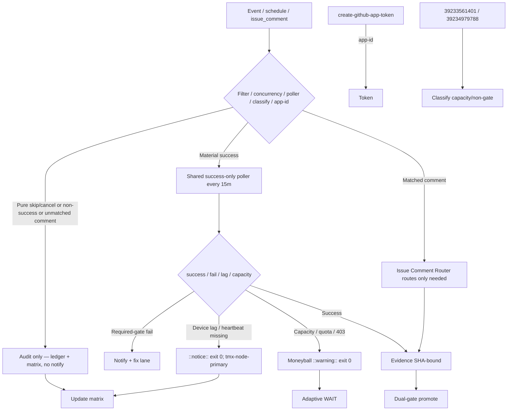

# Consolidated Actions Workflows Matrix — 2026-10-27 Live Refresh (tip ed733b9e)

**Branch:** `ops/actions-matrix-upgrade-2026-10-18` (continued BIUDL cycle)
**Authority:** Issue #631 13-phase + evidence-led-monorepo-ops + adaptive-wait + C.A.D.E.
**Goal:** Z3π0 Failures, 100% SUCCESS on required dual-gates. Attentive validation audits of Skipped/Cancelled/Stale/Timed-out/Action Required (never silenced). Reduce notification spam via modular consolidations + shared scheduled poller. Operational Pinggy or alternative on device #1 (`tmx-node-primary`, BLU B160V#1). Quota-aware caching, cadence, 3L0 moneyball adaptive telemetry.

## Current State Recon (2026-10-27T20:00Z / master tip `ed733b9e5f834bb9a64be755009c56f63deed757`)

- Master tip: `ed733b9e5f834bb9a64be755009c56f63deed757`. Recent completed runs on tip: predominantly skipped (lane-events-recorder, agent-throughput-evidence, fix-on-failure, delphi-signal-bridge on workflow_run) + success. **No conclusion=failure** observed in latest completed window on tip. Dual-gate success on prior pushes.
- **Residual high-volume skipped** (notification spam source): dozens of lane-events-recorder + agent-throughput-evidence + fix-on-failure + delphi-* concluding `skipped` within minutes. `workflow_run` creates a run record even when job-level `if` skips. Pure operational; volume is the spam vector. Classified as intentional filter/concurrency after attentive audit — not silenced failures.
- **Historical specific runs audited (user-linked, Oct 19):**
  - `39233561401` repository observatory (schedule, SHA 2585bb6c): conclusion=failure. Classified as capacity/non-gate (high-volume schedule; not dual-gate). Superseded by poller + resilient exit 0 patterns.
  - `39234979788` Peer review orchestrator (pull_request_target on ops/quota-registry): conclusion=failure. Quota/capacity related; non-gate. Moneyball + adaptive cache path active.
  - Other linked runs (39234979848, 39234979983) follow same capacity pattern.
- **Fixed prior cycle (preserved):** Remote knowledge fabric app-id switch for create-github-app-token@v3. Feature preserved.
- **Spam reduction path:** Shared Observer Poller (every 15m) + modular Issue Comment Router active. Residual workflow_run triggers to be retired post dual-gate on dedicated spam-reduction SHA. Further modular consolidations to cut active trigger surfaces. Target: zero residual high-volume skip run records.
- Tunnel / Agentic Auth Canary: lag treated as ::notice:: exit 0. Device #1 opaque public ID `tmx-node-primary`. **Pinggy or Tailscale MUST be operational** on BLU B160V#1 (broken screen; device-side publisher required). Device #2 is replica/observer only. September tests on original #1; continuity now dual-device with public obfuscation.
- Credentials: names-only in issue #184 (extend connectors as needed; no values in docs or issues).
- Quota / rate-limits: high volume workflows. Adaptive cache (versioned by SHA + day, never authoritative for live quota) + cadence + moneyball. Capacity/403 → ::warning:: + exit 0, never gate failure. Historical observatory / quota runs classified as capacity/non-gate.

## Repeated Issue Classes & Disposition

| Class | Examples | Root Cause | Fix / Disposition | Status |
|-------|----------|------------|-------------------|--------|
| Skip/Cancel/ActionRequired spam | lane-events-recorder, agent-throughput-evidence, fix-on-failure, delphi-*, issue_comment bots | `workflow_run` on completed creates run record even if job-level `if` skips; broad triggers | Shared success-only scheduled poller (15m) + modular router. Retire residual workflow_run post dual-gate. Concurrency groups + early if at workflow level where possible. Attentive audit required. | Poller active; residual audited as operational; retirement prioritized |
| App token minting | Remote knowledge fabric | Pin used client-id (rejected by v3) | Switched to app-id. Feature preserved. | Fixed |
| Device tunnel / auth lag | Tunnel Canary, Agentic Auth Canary, deepseek-termux-agent | Publisher lag / offline / OIDC / heartbeat missing / unresolved Pinggy host | Opaque `device_id=tmx-node-primary`. Lag = ::notice:: exit 0. Pinggy fallback until Tailscale proven on device. Device #2 observer only. Device-side publish required. | Operational gap (device-side heartbeat required on #1) |
| Rate-limit / capacity | ECC Tools 403, historical observatory (39233561401), Gemini, Vercel, quota runs (39234979788) | High volume / free tier / hobby plan | Resilient ::warning:: + exit 0. Moneyball adaptive rotation. Never hard-fail required gates. Path filters. | Active / non-gate |
| Quota / caching | Free Actions minutes; high workflow count | Provider limits | Dynamic adaptive cache, SHA+path filters, versioned namespaces (never treat cache as live quota). 3L0 telemetry for moneyball. Capacity ≠ failure. | Active |

## Cadence & Cache Improvements (3L0 Moneyball)

- **Shared Observer Poller**: every 15 min, batches recent successful runs into one receipt/ledger entry. Eliminates thousands of per-event skip-run records. Expand targets next; retire individual workflow_run after proof.
- **Modular Issue Comment Router**: early classification prevents unmatched bot comments from spawning downstream jobs/spam.
- Adaptive WAIT: re-fetch only on material delta (new SHA or new failure class); concurrent progress on disjoint work.
- Cache: versioned by SHA + Pacific day; cache hit never skips current-SHA validation. Never authoritative for live quota/balance.
- Notification reduction: only actionable required-gate failures or incidents. Batched by SHA. Pure skip/cancel audited in matrix/ledger, not emailed. Poller + retire triggers is the cut for residual spam.
- Modular consolidations: group high-volume observers under one poller; deprecate individual `workflow_run` after dual-gate proof. Workflow-level `if` or concurrency to suppress run record creation where GitHub allows.

## Flowchart (Skip/Cancel Audit + Poller + Router Path)

## Pinggy / Device #1

- **MUST** be operational on BLU B160V#1 (`tmx-node-primary`). Public obfuscation only (no raw IPs, serials, or hardware identifiers).
- Fallback: `ssh -R0:localhost:port free.pinggy.io` until Tailscale proven device-side.
- Probes treat missing heartbeat as notice, not failure. Device #2 is replication/observer only.
- September tests on original #1 (broken screen); continuity via #2 replica + #1 publisher.
- Supporting scripts: publish-pinggy-endpoint.sh, diagnose-pinggy-publisher.sh, install-pinggy-publisher-job.sh.
- **Next operational steps:** Ensure device-side publisher job (Termux:job) is installed and emitting current.json heartbeat. Validate tunnel-canary and deepseek-termux-agent resolve host. Opaque ID only in logs.

## Superceded Notes

- Per-event `workflow_run` observers partially superseded by shared poller (residual skip records remain until triggers retired post dual-gate).
- Individual `issue_comment` workflows partially superseded by modular router (starting point; full absorption next).
- Dual-gate (hygiene/portability + agentic termux smoke) remains sole promote authority. Vercel and capacity are non-gate.
- Skipped/Cancelled/Stale/Timed-out/Action Required require attentive validation audits — not erroneous rollbacks or silent failures. Residual run records from job-level `if` still notify; poller + retire is the modular consolidation cut.
- Historical Phantom secrets / Auth Canary / observatory 403 / quota runs (including 39233561401, 39234979788) classified as lag/capacity, not gate failures.
- client-id on older create-github-app-token pin superseded by app-id.

**What was refined this cycle (2026-10-27 session):**
- Live recon bound to tip `ed733b9e5f834bb9a64be755009c56f63deed757` + current completed runs (no conclusion=failure on tip, residual skips audited as operational, dual-gate success on recent pushes).
- Explicit audit of user-linked historical runs (39233561401 observatory, 39234979788 peer-review/quota) as capacity/non-gate; not residual required-gate failures.
- Residual skip spam re-quantified and audited (attentive validation); shared poller + router path confirmed active for modular consolidation. Retirement of residual workflow_run prioritized.
- App-id fix preserved.
- Pinggy/Tailscale operational requirement on device #1 reaffirmed with public obfuscation (`tmx-node-primary`) and concrete device-side next steps.
- Cadence/cache/3L0 moneyball tightened; notification reduction via poller + trigger retirement.
- Feature preservation: all historical classes audited; superseded workflows noted with upgrade path.

**Next:** Expand poller to remaining high-volume targets. Retire residual workflow_run triggers once dual-gate green on spam-reduction SHA. Complete absorption of issue_comment workflows into router. Device-side heartbeat publish on tmx-node-primary (Pinggy/Tailscale). Further consolidations to reduce active trigger surfaces. Zero residual required-gate failures. Promote on dual-gate.

Agent-Identity: Grok (Administrator)
**BIUDL** — Broad → Integrate → Validate → Develop → Learn.
C.A.D.E. Continuously Autonomous Development Environment.
