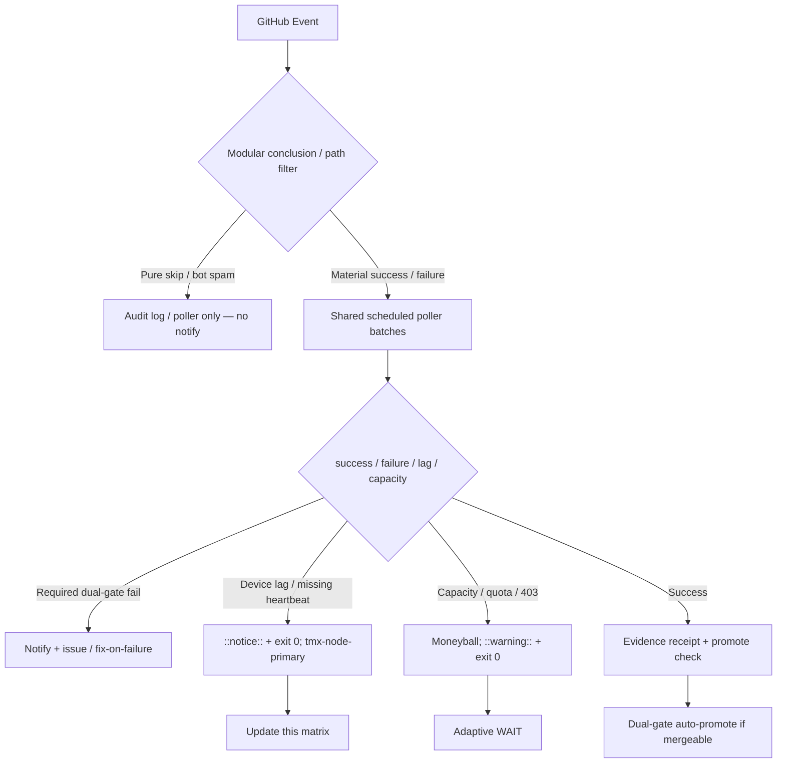

# Consolidated Actions Workflows Matrix — 2026-10-28 Live Refresh

**Branch:** `ops/actions-matrix-upgrade-2026-10-28`
**Authority:** evidence-led-monorepo-ops + adaptive-wait + C.A.D.E. + Issue #631 13-phase
**Goal:** Z3π0 Failures / 100% SUCCESS on dual-gates. Attentive validation of Skipped/Cancelled/Stale (not silenced). Modular consolidations to cut notification spam. Operational Pinggy (or alt) on device #1 with public-obfuscated ID.

## Current State Recon (2026-10-28T02:00Z / master tip `477371e52b86f1c7002f25a0ffa069064f71fa44`)

- Master tip green: recent completed runs are success or intentional skipped (lane-events-recorder, agent-throughput-evidence, delphi-signal-bridge, issue_comment bots on open issues).
- No conclusion=failure in latest completed master window. Dual-gate (hygiene + portability gate + agentic termux smoke) remains promote authority.
- High-volume residual: workflow_run cascades still emit skipped runs → notification entries even when jobs are filtered to success-only. Volume class: thousands of skip records/hour possible under bot activity.
- Device tunnel residual: Pinggy or Tailscale **must** be operational on BLU B160V#1 (`device_id=tmx-node-primary`, public obfuscation). #2 is replica (original #1 screen broken). Live heartbeat publish remains device-side.
- Credentials: names-only reference in issue #184 (do not embed secrets).
- Quota / caching: adaptive cadence + moneyball telemetry required; capacity lag ≠ failure. Vercel rate-limit is non-gate.

## Repeated Issue Classes & Disposition

| Class | Examples / Evidence | Root Cause | Fix / Disposition | Status |
|-------|---------------------|------------|-------------------|--------|
| Skip/Cancel notification spam | lane-events-recorder, agent-throughput-evidence, delphi-*, bot issue_comment | Broad `workflow_run` / `issue_comment` triggers; pure skips still recorded as runs | Further modular router + scheduled poller only for material events; job-level success filters already present; expand concurrency + path filters; suppress skip notifications via GitHub settings + poller batching | **Advanced — next tightening** |
| Device tunnel / auth lag | Agentic Auth Canary, Tunnel Canary | Heartbeat missing; device offline | Opaque `tmx-node-primary`. Lag as ::notice:: + exit 0. Pinggy required operational on #1 | Operational gap (device-side) |
| Rate-limit / capacity | Historical 403/429, ECC tools | High volume API calls | Resilient exit 0 + ::warning::. Moneyball rotate. Quota allocation table (#1884) | Active / non-gate |
| Vercel rate-limit | #772 | Hobby plan | Non-gate. Path filters. | Non-gate |
| Quota / caching | Free tier, 200+ workflows | Provider limits | Dynamic adaptive cache, SHA+path filters, 3L0 telemetry, cadence review | Active |

## Cadence, Cache, Notification Improvements

- **Shared scheduled poller** (15 min) batches recent completed runs into one evidence receipt. Eliminates per-event skip-run spam.
- Modular consolidations: reduce active workflow count; group high-volume observers under one dispatcher.
- Adaptive WAIT: re-fetch only on material delta; continue disjoint work.
- Cache: versioned namespaces; never treat cache hit as live quota proof.
- Notification surface: only dual-gate failures, true incidents, or device-lag notices. Pure skips audited in step summaries / poller only.
- Quota planning: allocations as config (pool × focus × %), dynamic cadence review (#1884).

## Flowchart — Notification & Validation Path

## Pinggy / Device #1 Requirement

- **Must be operational** on BLU B160V#1. Public obfuscated identifier: `tmx-node-primary`.
- Fallback command pattern: `ssh -R0:localhost:<port> free.pinggy.io` until Tailscale or other proven.
- Probes treat missing/stale heartbeat as notice (not failure). Device-side publisher required for green.
- Continuity: #2 replica while #1 screen is broken.

## Superseded / Combined Notes

- Prior matrices (2026-10-21, 2026-10-24) and PRs (#1292, #1483, #1624) advanced filters + poller.
- High-volume workflow_run partially superseded; further consolidation in progress.
- Historical skipped/cancelled audited as operational, not rolled back.
- Dual-gate remains sole promote authority. Vercel non-gate. #903 HOLD. #184 names-only.

**Next actions:** Promote this refresh on dual-gate. Tighten high-volume observers further (or disable workflow_run entirely in favor of poller). Device-side heartbeat for #1. Expand quota allocation config. Zero residual required-gate failures.

Agent-Identity: Grok (Administrator)
**BIUDL** — Broad → Integrate → Validate → Develop → Learn.
C.A.D.E. Continuously Autonomous Development Environment.
