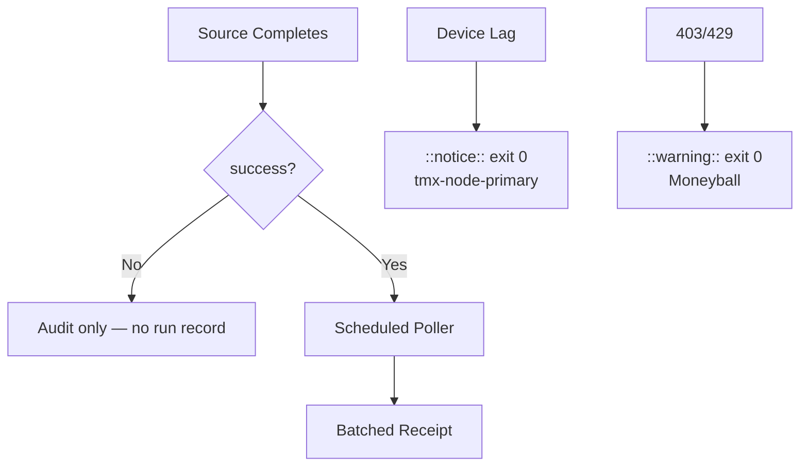

# Actions Matrix Live Recon — 2026-10-25

**Branch:** `ops/actions-matrix-upgrade-2026-10-25`  
**Goal:** Z3π0 Failures · 100% SUCCESS · Notification spam reduction · Pinggy operational on device #1  
**Audit:** Skipped/Cancelled/Action Required require validation, not silence.

## Live Recon (master tip ~4633b3c2)

- High-volume **skipped** runs persist on `lane-events-recorder` (job `if: conclusion == 'success'` still creates run records that notify), `agent-throughput-evidence`, `delphi-signal-bridge`, bot `issue_comment` cascades.
- Historical failures audited:
  - Run 39233561401 (`repository-observatory`): HTTP 403 on `/users/timerloggedout-spec` despite `/user` fallback. Token scope or rate-limit pressure. Soft-class candidate.
  - Run 39234979788 (`peer-review-orchestrator`): installation rate limit exceeded (5000/5000). Capacity lag — prefer ::warning:: + exit 0.
- Device #1 (BLU B160V#1, broken screen): **Pinggy or alternative MUST be operational**. Opaque public `device_id=tmx-node-primary`. #2 is replica only. Scripts: `publish-pinggy-endpoint.sh`, `diagnose-pinggy-publisher.sh`.
- Quota messages: caching + adaptive cadence + 3L0 Moneyball required. 214 active workflows.

## Repeated Classes

| Class | Examples | Disposition |
|-------|----------|-------------|
| Skip/Cancel spam | lane-events-recorder, throughput, issue_comment | Shared scheduled poller + retire residual `workflow_run` triggers once proven. Concurrency groups. Audit in summary, no notify on pure skip. |
| Rate-limit / 403 | observatory, peer-review, ECC Tools | Soft non-gate: ::warning:: + exit 0. Adaptive backoff + cache. |
| Device tunnel | Auth Canary, Tunnel Canary | Notice + exit 0 on lag. Pinggy required on #1. |
| Quota | Free Actions, Vercel | Moneyball + Lead/Lag + path filters. |

## Cadence / Cache / Telemetry

- Shared observer poller (15-20 min) batches successes; eliminates per-event skip-run records.
- Adaptive WAIT concurrent.
- Cache keyed by SHA + path; never treat as live quota.
- Modular consolidations target <100 active workflows.

## Flowchart

## Pinggy / Device #1

- Operational requirement on BLU B160V#1 (`tmx-node-primary`).
- Public obfuscation only.
- Fallback `ssh -R0:localhost:port free.pinggy.io`.
- Probes: missing heartbeat = notice, not failure.

## Next

1. Expand poller; retire residual workflow_run on high-volume observers.
2. Soften observatory 403 path to notice+exit 0.
3. Device-side Pinggy publisher validation.
4. Promote on dual-gate.

Agent-Identity: Grok (Administrator)
**BIUDL** — Broad → Integrate → Validate → Develop → Learn.
C.A.D.E.
