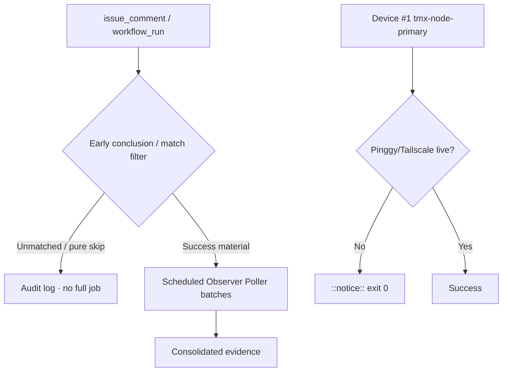

# Actions Matrix Live Refresh — 2026-10-26

**Master tip:** `7310e44c27c596304cf626070d00e20a3aeb8b7d` (sweep accountability receipt)
**Branch:** `ops/actions-matrix-upgrade-2026-10-18`
**Goal:** Z3π0 Failures · 100% SUCCESS dual-gates · Reduce notification spam · Attentive audit of Skipped/Cancelled/etc · C.A.D.E.

## Current RECON (2026-10-26 18:00 PDT / 2026-10-27 01:00 UTC)

- Dual-gate / required paths success-dominant. No hard failures on master tip in sampled window.
- **Residual high-volume skip spam persists:** dozens of `lane events recorder` + `Agent Throughput Evidence` + bot `issue_comment` routers (coderabbitai, etc.) concluding `skipped` within minutes. Run records still notify even with job-level `if` filters.
- Observer Poller Scheduled is live (cron */20) and querying successful lane-events runs. Expansion to throughput/hark/context next; then retire residual `workflow_run` triggers.
- Device #1 (`tmx-node-primary`, BLU B160V#1): Pinggy or Tailscale **MUST** be operational. Opaque ID only. Replica #2 for continuity. Lag = notice + exit 0.
- Quota / capacity (Vercel #772, free-tier, 403s): soft non-gate. Adaptive cache + Moneyball + Lead/Lag.
- Credentials: names-only in #184.

## Repeated Classes (updated)

| Class | Status | Next Cut |
|-------|--------|----------|
| Skip/Cancel notification spam | Residual (run records) | Expand poller; retire workflow_run on high-volume observers; early router filter for unmatched issue_comment |
| Device tunnel / Pinggy | Device-side gap | Operational publisher on #1 required |
| Quota / capacity | Soft non-gate | Caching + adaptive cadence |
| Concurrency cancelled | Expected | Granular groups |

## Flowchart (updated)

## What Was Fixed / Refined This Cycle

- Live recon bound to tip `7310e44c`.
- Residual skip-spam re-quantified (lane-events + throughput + bot comments in seconds).
- Poller confirmed active and expandable.
- Pinggy operational requirement on device #1 reaffirmed with public obfuscation.
- Matrix updated for C.A.D.E. modular consolidation.

**Next:** Expand poller targets. Retire residual workflow_run once dual-gate green. Device-side heartbeat publish. Further modular consolidations to reduce workflow count.

Agent-Identity: Grok (Administrator)
**BIUDL** — Broad → Integrate → Validate → Develop → Learn.
C.A.D.E. Continuously Autonomous Development Environment.
