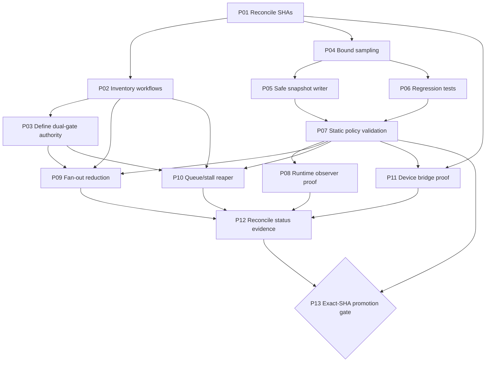

# Actions Matrix Upgrade — 13-Phase Delivery Plan

**Workstream:** CADE / Actions Matrix Upgrade  
**Implementation branch:** `ops/actions-matrix-upgrade-hardening-2026-10-18`  
**Planning baseline:** `ops/actions-matrix-upgrade-2026-10-18` at `0757583bcb5fad5ed247ea9a03d48ccb28df7c6a`  
**Requested master comparison point:** `669c0d0bc81862c6fbab830b3521a82464031320`  
**Re-fetched PR base at creation:** `c83ea89d92eb4f3176f8d3371e7701183527692c` (re-fetch again before promotion)  
**Status:** PLAN + implementation in progress; this document is not a claim of CI success, merge, live device health, or production promotion.

## Objectives and non-negotiable invariants

1. Correctness and promotion authority outrank speed and green-badge counts.
2. A workflow success badge is not task PASS; dual-gate remains promotion authority.
3. Skipped/cancelled/queued observations are classified and audited, not silently discarded or mislabeled as model failure.
4. Public device manifests contain opaque IDs only; never publish physical device identity, serials, IMEI, MAC, or location.
5. Runtime health must be proven by a live device publisher; a seeded `status: unknown` manifest is not healthy.
6. Workflow automation must be bounded, observable, idempotent, and honest about failed writes.
7. The matrix is the navigation/decision surface; individual workflow contracts and generated evidence remain authoritative for their own domains.

## Thirteen phases

| Phase | Work package | Depends on | Deliverable / exit criterion | Priority |
|---|---|---|---|---|
| P01 | Reconcile source SHAs and branch ancestry | — | Exact base/head SHAs recorded; no ambiguous “latest” refs | P0 |
| P02 | Inventory workflows and trigger graph | P01 | Machine-readable inventory of workflow IDs, triggers, permissions, concurrency, and downstream consumers | P0 |
| P03 | Classify dual-gate authority | P01, P02 | Explicit allowlist of promotion-authoritative checks; advisory/non-gate checks separated | P0 |
| P04 | Harden cadence input and sampling | P01 | Input is shell-safe; sample is 1–100 runs; no accidental unbounded history scan | P0 |
| P05 | Harden snapshot commit/push behavior | P04 | No swallowed push failures; concurrent master movement is reconciled; no-op remains successful | P0 |
| P06 | Add classifier regression tests | P04 | Success badge, operational outcomes, in-flight states, and failures have deterministic tests | P0 |
| P07 | Validate YAML and workflow policy | P04–P06 | YAML parse + actionlint + repository workflow-surface policy pass on exact head SHA | P0 |
| P08 | Validate observer runtime | P07 | Dispatch/scheduled run records sample count, API total, truncation, output hash, run/job IDs | P1 |
| P09 | Reconcile notification fan-out | P02, P03, P07 | Trigger graph reduced without removing required coverage; skip/cancel noise has no incident spam | P1 |
| P10 | Add queue/stall reaper evidence | P02, P03 | Zero-job/long-queued runs classified with reason and successor evidence; no blind cancellation | P1 |
| P11 | Verify device bridge publication | P01, P07 | Live publisher proves TCP target and emits schema v3 with unique opaque ID; otherwise remains UNKNOWN | P1 |
| P12 | Produce Gantt/dependency and live status receipt | P01–P11 | Matrix, generated evidence, and this plan agree on open/closed/blocked work | P1 |
| P13 | Promotion review and post-promotion watch | P07–P12 | Exact-head dual-gate green, mergeability clean, deliberate promotion, then observe first production cycle | P0 gate |

## Gantt — relative sequence, not calendar promises

Legend: `██` planned execution window; `◆` decision gate. Windows are dependency slots, not duration guarantees.

| Phase | W1 | W2 | W3 | W4 | W5 | W6 |
|---|:---:|:---:|:---:|:---:|:---:|:---:|
| P01 Source reconciliation | ██ | | | | | |
| P02 Workflow inventory | ██ | ██ | | | | |
| P03 Dual-gate authority | | ██ | | | | |
| P04 Bounded sampling | ██ | | | | | |
| P05 Safe snapshot writer | ██ | ██ | | | | |
| P06 Regression tests | ██ | ██ | | | | |
| P07 Static policy gates | | ◆ | ██ | | | |
| P08 Runtime observer validation | | | ██ | | | |
| P09 Fan-out reduction | | ██ | ██ | ██ | | |
| P10 Queue/stall reaper | | | ██ | ██ | | |
| P11 Device bridge proof | | ██ | ██ | | | |
| P12 Matrix/status reconciliation | | | | ██ | ██ | |
| P13 Promotion + watch | | | | | ◆ | ██ |

W1–W6 are relative planning windows. Do not convert them into dated commitments until run capacity, maintainers, and device access are confirmed.

## Dependency graph

## Acceptance checklist

- [ ] Branch head and master base re-fetched immediately before review.
- [ ] Unit tests cover classifier semantics and invalid sample bounds.
- [ ] `actionlint`, YAML parse, and repository workflow-surface policy pass on the exact PR head.
- [ ] Dispatch input is never interpolated directly into shell source.
- [ ] API sample is bounded to one page and records `api_total_count` + `sample_truncated`.
- [ ] Snapshot writer never converts a failed push into a successful step.
- [ ] Writer concurrency does not cancel an in-progress snapshot write.
- [ ] Public bridge manifest stays schema v3 and opaque; live status remains UNKNOWN until independently observed.
- [ ] Queue reaper records evidence and avoids destructive action without a verified successor.
- [ ] Skipped, cancelled, stale, queued, neutral, and timed-out outcomes receive explicit classification.
- [ ] Required dual-gate checks pass on the exact head SHA; advisory checks are not mislabeled as blockers.
- [ ] Promotion is deliberate; no merge is implied by this plan.
- [ ] After promotion, watch one real scheduled/dispatch cycle through run, jobs, artifact/output, and resulting repository SHA.

## Risks and mitigations

| Risk | Impact | Mitigation |
|---|---|---|
| Workflow inventory misses dynamic/downstream triggers | Fan-out changes silently remove coverage | Compare event triggers, `workflow_run` consumers, reusable workflows, and dispatch callers before disabling anything |
| Master advances during snapshot commit | Lost update or push rejection | Fetch/rebase and fail visibly if push cannot be reconciled |
| API sample accidentally paginates all history | Excess runtime/API use; misleading “sample” semantics | Single-page fetch; expose total count and truncation |
| Green workflow is mistaken for product correctness | Unsafe promotion | Exact-SHA dual-gate + task evidence + explicit promotion gate |
| Seed manifest is treated as live device health | False operational readiness | Require live timestamp, expiry, TCP verification, and opaque device identity |
| Cancelled/skipped runs are ignored | Hidden deadlocks or concurrency starvation | Preserve operational samples and require successor/stall evidence |
| Broad workflow cleanup breaks unrelated lanes | Coverage regression | Modular slices, dependency map, before/after run cohort comparison |

## Current known blockers

- Device bridge seed remains `status: unknown`; this plan cannot prove live Termux/Pinggy connectivity.
- The branch requires exact-head CI evidence before promotion.
- The repository's broad workflow fan-out reduction is intentionally split into multiple slices; this PR should not claim all 158 workflows have been optimized.
- Live runtime and post-promotion behavior remain unverified until a real run is observed.

## Operating loop

`RECON → PLAN/MEASURE → IMPLEMENT → TEST → COMMIT → WAIT → WATCH → VALIDATE → RE-FETCH → COMPARE → CLASSIFY → RECORD → REPEAT`

Every status transition must be backed by source SHA, workflow run/attempt, conclusion, and evidence reference. `QUEUED` is not `EXECUTED`; `SUCCESS` is not automatically `PROMOTED`.
