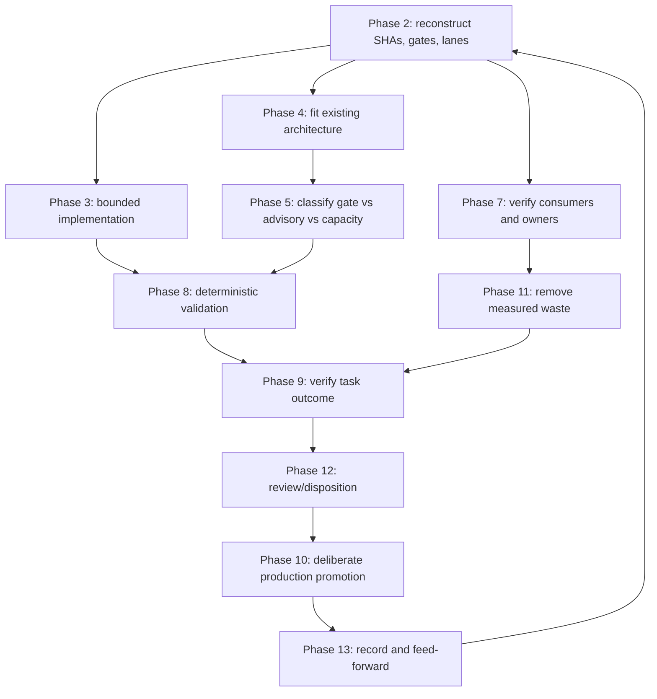

# Actions Matrix Upgrade — RECON and Execution Map

**Authority:** established 13-phase process in [Issue #631](https://github.com/timerloggedout-spec/termux-monorepo/issues/631). This document maps the Actions Matrix work into that process; it does not redefine the phases or establish a parallel methodology.

**Implementation branch:** `ops/actions-matrix-upgrade-hardening-2026-10-18`  
**Source branch at request:** `ops/actions-matrix-upgrade-2026-10-18` @ `0757583bcb5fad5ed247ea9a03d48ccb28df7c6a`  
**Requested master comparison point:** `669c0d0bc81862c6fbab830b3521a82464031320`  
**Base observed at prior PR fetch:** `c83ea89d92eb4f3176f8d3371e7701183527692c` — re-fetch before promotion.  
**State:** RECON found existing governance, quota policy, and the canonical phase definitions. Current implementation and current-SHA validation remain distinct states.

## RECON findings — verified repository authority

1. The canonical phase names and meanings are in Issue #631. The previous version of this file replaced them with invented technical work-package phase names. That was incorrect; the map below preserves the canonical phases.
2. Repository operating contract is `RECON → CLASSIFY → PLAN → ACT → WAIT → VALIDATE → RE-FETCH → RECORD → REPEAT` in `.agents/skills/evidence-led-monorepo-ops/SKILL.md`.
3. Adaptive asynchronous execution is governed by `.agents/skills/adaptive-wait/SKILL.md`: re-fetch after material changes, back off only on no-delta evidence, retry only when the attempt changes for an evidence-backed reason, and do not duplicate active work.
4. The repository dual-gate is hygiene/portability plus agentic Termux smoke. Vercel is explicitly a non-gate in the canonical ops skill and issue #772. A Vercel quota failure must not be misreported as a code defect or CI gate failure.
5. `docs/DEPLOYMENT-LANES.md` records the `termux-monorepo` and `mcp-hub` Vercel lanes as live. The GitHub Pages workflow and `gh-pages` branch exist, but current publication/source-SHA proof was not available in this RECON pass; Pages is configured but unverified. Render and Cloudflare remain unproven candidates. Do not silently claim or route production traffic to an unproven lane.
8. Vercel project checks on merge commit `fe617f7f8eff0aeaecac67e0964e139ae9ab9035` reported `build-rate-limit` for four connected projects. A separate live deployment inspection showed `termux-monorepo` at `5827176ea6ec3580c5050e275493f94baef4a9e8` READY, while three deployments on unrelated research commit `e3ff387c95b9f94ab789a2ba65b51a103e357012` were CANCELED with the provider's `ignored-build-step` help link. Keep these states separate: quota failures are capacity evidence; ignored-build-step cancellations are intentional skip outcomes.
6. `docs/schemas/model-rotation.yaml` governs **LLM** free-tier rotation; it is not a Vercel deployment quota registry. Reuse its quota-first design principles, but do not conflate provider types or their budgets.
7. The latest known PR #1242 head before this RECON correction was `4b569bc2c9a8e032fd8464636b2d0d9e6a6e2087`. Re-fetch the live PR head/base and checks before drawing any current-state conclusion.

## Canonical 13 phases — retained verbatim in name and intent

The phases below are the established workflow. Technical work packages may run in parallel at different phases, as Issue #631 specifies; the phases themselves are not replaced by technical milestones.

| # | Tone | Established phase | Application to this work | Evidence / exit condition |
|---:|---|---|---|---|
| 1 | Magnetic (Hun) | **Initiation / Purpose** | Define the requested outcome: improve Actions-matrix reliability and quota-resilient operation without changing the canonical process. | Objective and scope trace to the user request and issue/PR lineage. |
| 2 | Lunar (Ka) | **Challenge / Obstacle** | Reconstruct source/master SHAs, existing phase authority, CI gates, provider quota constraints, and unproven fallback lanes. | Current-state facts, risks, and unknowns explicitly separated. |
| 3 | Electric (Ox) | **Activation / Movement** | Start bounded implementation of the confirmed defects: bounded run sampling, safe input handling, reliable snapshot writes, classifier tests, and bridge input validation. | Changes tied to identified code paths; no speculative provider switch. |
| 4 | Self-Existing (Kan) | **Form / Architecture** | Fit technical work to the existing workflow graph, dual-gate, lane SSOTs, and established phase process. | Contracts and dependencies cite the existing repository authorities. |
| 5 | Overtone (Ho) | **Empowerment / Core** | Preserve the promotion authority and make provider capacity decisions explicit. Separate required gates, advisory services, and deployment capacity. | No success badge or provider response is treated as task success; no unverified lane gains authority. |
| 6 | Rhythmic (Uac) | **Balance / Rhythm** | Use adaptive WAIT and quota-aware scheduling: sample boundedly, preserve concurrency, deduplicate equivalent work, observe remaining capacity where available, and back off on no delta. | Run IDs, sample limits, cooldown/rotation decisions, and retry reasons are recorded. |
| 7 | Resonant (Uc) | **Alignment / Attunement** | Reconcile workflow owners, downstream consumers, notification fan-out, source SHA, review findings, and current base. | No trigger is removed without verifying required downstream coverage. |
| 8 | Galactic (Uaxac) | **Integrity / Modeling** | Validate YAML/action policy, deterministic classifier tests, privacy-safe manifests, and quota/fallback decisions against fixtures. | Tests and policy checks run on the exact candidate SHA; unknown behavior remains UNKNOWN. |
| 9 | Solar (Bolon) | **Realization / Intent** | Close confirmed defects and produce current-SHA evidence for the operational outcome. | Implementation evidence plus authoritative check/run/job/artifact receipts. |
| 10 | Planetary (Lahun) | **Manifestation / Production** | Promote only through the repository-defined dual-gate and deliberate merge process; verify production outcomes separately. | Candidate SHA and resulting production SHA are recorded; deployment health is independently checked. |
| 11 | Spectral (Buluc) | **Release / Dissolution** | Remove redundant polling, unbounded scans, duplicate dispatches, noisy notifications, and retries that cannot change the outcome. | Before/after evidence shows lower waste without losing required coverage. |
| 12 | Crystal (Lahca) | **Cooperation / Review** | Review implementation and quota decisions with the relevant lane owners; capture actionable findings and dispositions. | Review evidence is current-SHA-bound; advisory skips are not called approvals. |
| 13 | Cosmic (Oxlahun) | **Transcendence / Evolution** | Record lessons and promote verified improvements into the next operating baseline; feed residual work back into the same 13-phase cycle. | Closeout receipt names what is proven, what remains unknown, and the next evidence-backed cycle. |

## Parallel work map and dependency order

These are workstreams inside the canonical phases, not replacement phases:

| Workstream | Main phases | Depends on | Status / completion evidence |
|---|---|---|---|
| Source and workflow recon | 1–2, 4, 7 | Live refs and SSOTs | Re-fetch master/head, ancestry, changed paths, trigger graph, current-SHA runs/jobs/reviews. |
| Bounded cadence collector | 3, 6, 8 | Workflow input and API contract | Single-page run sampling; validate 1–100; expose API total and truncation; deterministic tests. |
| Snapshot writer correctness | 3, 6, 8 | Cadence collector output | No swallowed write/push errors; safe no-op; reconcile concurrent master movement; never cancel active writer. |
| Classification and regression tests | 3, 8, 9 | Explicit operational-state contract | Distinguish workflow badge, task outcome, queued/in-flight, skipped/cancelled/neutral, and real failure. |
| Notification/fan-out reduction | 4, 7, 11 | Verified trigger and consumer inventory | Remove only redundant fan-out; retain required downstream coverage; measure noise/volume before and after. |
| Device bridge safety | 3, 4, 8 | Manifest schema and live device access | Validate opaque device IDs, roles, TTL; do not publish local usernames; live health remains UNKNOWN until independently proven. |
| Quota and capacity management | 2, 5, 6, 8, 11 | Provider identity, observed limits, and configured alternatives | Classify provider-capacity failures independently; avoid retry storms; rotate only to a pre-provisioned, verified eligible lane. |
| Promotion and post-promotion watch | 8–13 | Exact-SHA validation, reviews, current base | Dual-gate + task outcome on candidate; deliberate promotion; inspect first production cycle and record resulting SHA. |

### Dependency view

### Gantt — relative work overlap, not new phase numbering

`W1–W6` are dependency slots, not calendar promises. The canonical phases remain the phase sequence above; parallel technical work can span multiple phases.

| Workstream | W1 | W2 | W3 | W4 | W5 | W6 |
|---|:---:|:---:|:---:|:---:|:---:|:---:|
| Source / SSOT RECON | ■ | ■ | | | | |
| Cadence collector + snapshot writer | ■ | ■ | | | | |
| Classifier tests + static policy validation | | ■ | ■ | | | |
| Trigger graph + fan-out review | ■ | ■ | ■ | | | |
| Quota/fallback lane recon | ■ | ■ | ■ | | | |
| Device bridge proof | | ■ | ■ | ■ | | |
| Current-SHA integration evidence | | | ■ | ■ | | |
| Review, promotion, post-promotion watch | | | | ■ | ■ | ■ |

## Implemented in the quota-resilience follow-up branch

- The GitHub Actions publisher now uses `cancel-in-progress: false` so a later event cannot cancel an active publication after consuming work/capacity.
- The Pages setup job is skipped for a Vercel-only manual request; it no longer performs an unrelated Pages configuration API call on that path.
- Pages setup is idempotent: an already-correct `gh-pages:/` configuration exits without a write. API transport errors, unexpected statuses, and failed writes are no longer hidden with `|| true`.
- Vercel ignored-build-step commands are now explicitly top-root path-scoped in:
  - `mcp-hub/vercel.json` → `mcp-hub/`
  - `apps/help-wanted-dashboard/vercel.json` → dashboard sources plus generated dashboard snapshots and status validation scripts
  - `demo-portal/public/vercel.json` → static demo portal only
- Missing previous/current SHAs and diff errors fail open to a build; unchanged source returns exit 0 to skip; relevant changes return nonzero to continue the build. This follows Vercel's documented ignored-build-step contract.
- `tests/test_vercel_ignore_commands.py` adds regression coverage for unrelated changes, relevant changes, missing previous SHA, and project-path scoping.

**Activation boundary:** PR #1310 is merged as `2194a62192dce89e3dedbb3142418aad06d6fab9`. The shared helper and project-scoped `vercel.json` settings are now on master, and the connected Vercel project settings for `mcp-hub`, `help-wanted-dash`, `help-wanted-oversight`, and `termux-monorepo` were updated to call the helper. This makes the selector configured, but the provider still returned `build-rate-limit` on the merge SHA and no deployment records were returned for that SHA; effectiveness is therefore not yet verified by a successful post-merge event. Source-path filters reduce unnecessary build attempts; they do not manufacture quota headroom, expose a remaining-quota counter, or provide cross-provider production failover.

## Quota resilience policy — act before exhaustion, never after a retry storm

### Correct classification

A Vercel `api-deployments-free-per-day` response is **provider capacity = constrained/exhausted**, not code correctness = FAIL and not repository dual-gate = FAIL. Keep the deployment observation visible, but do not let a Vercel-only check block the code gates. This is consistent with the canonical ops skill and issue #772.

### Rotation and fallback contract

1. **Spend only on meaningful deploy events.** Use change/path filtering, deduplication, stable concurrency, and no-op detection so duplicate or docs-only changes do not consume a deployment where the lane does not need one.
2. **Use budget thresholds before exhaustion.** Track observed usage and reset time when the provider exposes them. At the configured safety threshold, stop optional/preview deployments and reserve capacity for production-critical work. Never invent an exact remaining quota when the provider does not expose it.
3. **Classify before retry.** On a provider quota response, preserve the first response and timestamp; do not immediately repeat the same deploy. Re-fetch provider state once if useful, then wait for reset or select an eligible alternative.
4. **Rotate only across verified lanes.** Candidate order is a policy input, not proof of readiness. An alternative must already have a concrete project/site, source/root boundary, required secrets, production branch, URL, and successful source-SHA verification. GitHub Pages is configured for static publication but remains unverified as a current healthy publication; it cannot serve as a substitute for the MCP/application runtime. Do not automatically send live traffic to Render, Cloudflare, or Pages based only on their mention in the lane registry.
5. **Fail open for CI, fail closed for promotion.** A Vercel quota failure does not fail unrelated CI. A release cannot claim deployment success until the intended source SHA is deployed and verified on the selected lane.
6. **Circuit-break and recover.** Mark the exhausted provider/lane unavailable for the relevant quota window, avoid retry storms, continue independent work, re-check at the provider's reset or recovery signal, and restore preference only after a successful health/source-SHA probe.
7. **Keep secrets and budgets separate.** Do not copy credentials between providers or infer quota availability from the LLM model-rotation registry. Provider-specific capacity and authorization are independent inputs.

### Current deployment-lane truth

| Lane | Evidence-backed status | Allowed behavior during Vercel quota exhaustion |
|---|---|---|
| Vercel `termux-monorepo` | Live lane; Hobby plan observed in the connected Vercel team context | Defer noncritical deploys; preserve CI and source evidence; retry only after capacity recovery or a changed deployment input. |
| Vercel `mcp-hub` | Live lane in deployment-lane SSOT | Manage independently by project; do not assume its deployment budget is a separate account-wide allowance without provider evidence. |
| GitHub Pages | **Configured, publication unverified**: workflow configures `gh-pages`, mirrors static routes to `timerloggedout-spec.github.io`, and the `gh-pages` branch exists; current run/URL/source-SHA health evidence was not returned. | Verify the exact published URL and deployed source SHA before relying on it for static dashboard continuity. Never route the Vercel-hosted MCP service to Pages. |
| Render | Candidate / unproven in this repository | Not an automatic fallback. Requires concrete project/service and source-SHA health proof. |
| Cloudflare / Pages / Workers | Candidate / unproven in this repository | Not an automatic fallback. Establish the exact product, project, route/domain, source boundary, and verification first. |

**Present limitation:** the connected Vercel team is on the Hobby plan and provider check URLs report `build-rate-limit`; no authoritative remaining daily-deployment counter was exposed. PR #1310 is merged, and the four connected projects' ignored-build settings now point to the shared path selector. The merge SHA still has provider-capacity failures and no deployment records, so skip/build behavior must be verified on the next provider-eligible event. GitHub Pages is configured for static publication, but current URL/source-SHA health is unverified. Automatic application/MCP failover remains gated on provisioning and verifying a compatible alternative lane.

## Acceptance checklist

- [ ] Canonical 13 phase names/meanings remain unchanged from Issue #631.
- [ ] Current master/head/base and ancestry are re-fetched before promotion.
- [ ] Unit tests, YAML parse, actionlint, and workflow-surface policy run on the exact current head.
- [ ] Cadence sampling is bounded and records API total/truncation.
- [ ] Snapshot writes are concurrency-safe and do not mask push failures.
- [ ] Classifier tests distinguish operational state from correctness/task outcome.
- [ ] Fan-out changes preserve required downstream coverage.
- [ ] Provider capacity, CI correctness, deployment state, and task outcome are classified independently.
- [ ] Quota responses do not trigger blind retry loops or incorrectly fail repository dual-gate.
- [ ] No alternative deployment provider is labeled live or selected for production without source-SHA verification.
- [ ] Device bridge remains UNKNOWN until live publication and reachability are proven.
- [ ] Review, dual-gate, mergeability, and task outcome are current-SHA-bound.
- [ ] Post-promotion observation records run/job/artifact and resulting source/deployment SHA.

## Operating receipt

Every material cycle should retain the repository's existing receipt fields: operation, repo, base SHA, head SHA, observed-at timestamp, evidence IDs, state/outcome, provenance/confidence, decision, reason, and remaining unproven work. Use the established RECON → CLASSIFY → PLAN → ACT → WAIT → VALIDATE → RE-FETCH → RECORD → REPEAT loop; do not create a parallel phase system.

**Truth boundary:** this document is a reconstructed execution map, not proof that CI passed, a provider quota is available, a fallback deployment is live, a device is healthy, or production promotion occurred.
