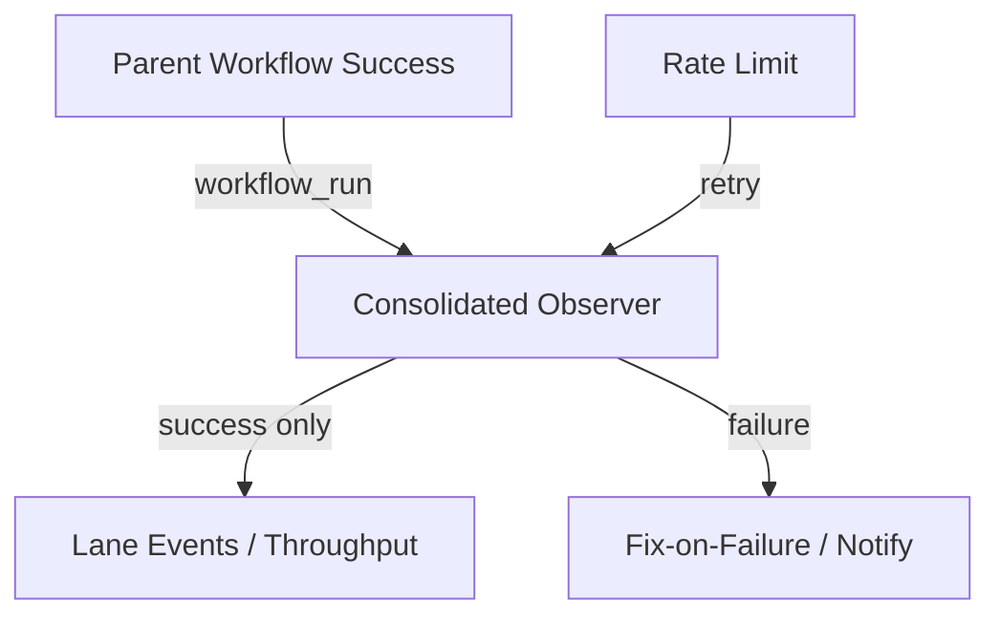

# Actions Matrix Upgrade (2026-10-18+)

## Goal
Zero Failures, 100% SUCCESS on https://github.com/timerloggedout-spec/termux-monorepo/actions. Attentive validation of Skipped/Cancelled/Stale/Timed out/Failure/Action Required/Queued/Neutral. Feature preservation + refinement.

## Repeated Issues (Consolidated Matrix)

| Issue | Frequency | Root Cause | Status / Fix | Superseded By |
|-------|-----------|------------|--------------|---------------|
| Skipped workflow_run cascades | High (dozens per minute) | Multiple observer workflows (lane-events-recorder, Agent Throughput Evidence, Fix-on-Failure, delphi-signal-bridge, etc.) trigger on `workflow_run.completed` of parents; job `if` skips but run still notifies | Partially mitigated by success-only `if`; full fix = consolidate listeners into 1-2 modular workflows with tighter filters | ACTIONS-MATRIX-UPGRADE (this) |
| Rate-limit / quota failures | Medium | github.token + high concurrent API calls (observatory index, rfp_flood_fetch, etc.) | Retry+backoff added to rfp_flood_fetch.py (commit on this branch). Observatory needs OPERATOR_GITHUB_TOKEN or backoff | delphi-rfp-feed-collect, repository-observatory |
| Pinggy / reverse tunnel non-operational | Device #1 requirement | Secrets MANUS_SSH_* not configured; screen broken on original BLU B160V#1 | Must restore on device #1 with public obfuscated identification data. Alternatives under evaluation | deepagent-task.yml |
| Cancelled / in-progress spam | Medium | cancel-in-progress + watching settings | GitHub suppressed cancelled when "only failed" enabled (per community); still validate | - |

## Device Identification (public obfuscation)
- BLU B160V #1: original (broken screen) — primary for Pinggy/tunnel
- BLU B160V #2: replication target
Public ID prefix: `blu-b160v-1-` + sha256(serial)[:8] (never full serial in git)

## Consolidation Plan
1. Single `ops-observer.yml` that listens to critical parents only and dispatches internal jobs only on success.
2. Disable or archive redundant workflow_run listeners after migration.
3. Cadence: adaptive telemetry via existing moneyball / 3L0 weighting; cache artifacts aggressively.
4. Quota planning: prefer fine-grained PAT from #184 (names only) for high-volume observers; backoff everywhere.

## Flow (high-level)

## Next
- Merge this branch after dual-gate green.
- Validate no new skipped spam on test dispatch.
- Restore Pinggy on device #1.

Agent-Identity: Grok (Administrator)
Implements: ACTIONS-MATRIX-UPGRADE
