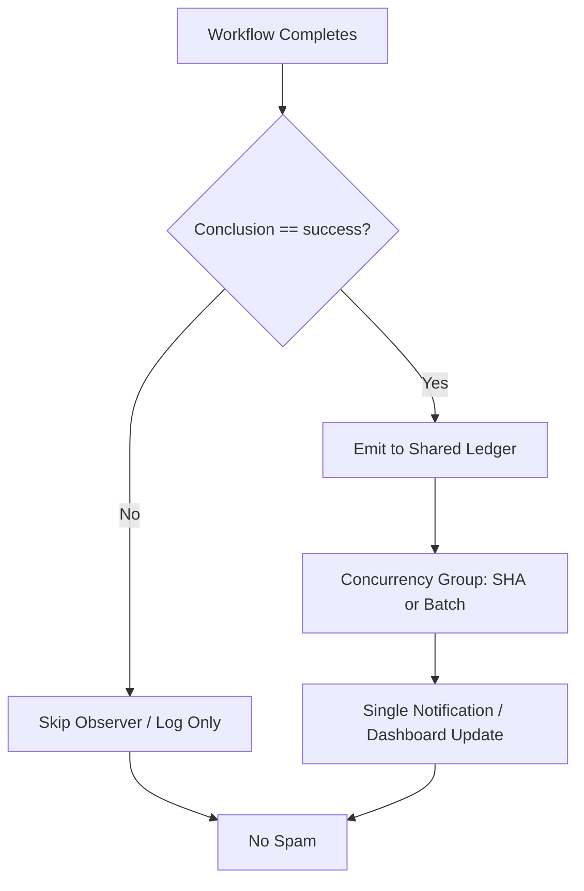

# Actions Workflows Consolidated Matrix (2026-10-22)

**Branch:** `ops/actions-matrix-upgrade-2026-10-18`  
**Goal:** Zero Failures · 100% Success · Reduced Notification Spam · Feature Preservation  
**Audit Focus:** Skipped / Cancelled / Stale / Timed out / Failure / Action Required / Queued / Neutral

## Current State (2026-10-22 RECON)

**Master tip:** `16bc62815ab95adb3d3a7d84db913d1a9bd739cc` (help-wanted status refresh)

Recent completed runs on tip:
- **Success:** dominant (delphi-gate schedule, delphi-signal-bridge, lane-events-recorder cascades, agent-throughput, context audits, etc.)
- **Skipped:** residual on some bridges (concurrency or filter)
- **Cancelled:** concurrency races (expected lag_operational)
- **Failures:** historical only (e.g. 39233561401 repository-observatory 2026-10-19 403; 392349* quota-registry PR branch failures). No current-tree filename failures.

**Primary Spam Source Identified:** High-volume `workflow_run` cascades.
- `lane-events-recorder.yml` (~23k+ runs): triggers on help-wanted-* + Agent Throughput + n8n SHE completions. Concurrency group per-run-id (no cancel).
- `agent-throughput-evidence.yml` (~38k+ runs): triggers on broad set of agent/CI workflows. Same pattern.
- These fire on every completion (including skipped/cancelled), generating notification volume even on success.

**Historical Pattern:** Cancelled/skipped often concurrency or intentional filters. True failures (quota, device, observatory) classified non-gate or capacity. Silenced failures require explicit audit trail.

## Repeated Issues Matrix

| Issue Class | Workflows Affected | Root Cause | Current Handling | Recommended Fix / Consolidation | Status |
|-------------|--------------------|------------|------------------|---------------------------------|--------|
| Cascade Notification Spam | lane-events-recorder, agent-throughput-evidence, context-relationship-audit | Broad `workflow_run` on completed (all conclusions) | Individual runs + notices | Filter `if: github.event.workflow_run.conclusion == 'success'` or batch; narrow workflow lists; shared observer with concurrency group per-SHA; path/event filters | Open — high priority |
| Concurrency Cancel | help-wanted-*, others | Rapid triggers | cancel-in-progress | Granular groups (SHA or target); or false + queue; orchestrator | Ongoing |
| Watcher Skip | actions-run-watcher | Pre-dispatch-only | Dispatch-only | Fixed; residual aging out | Fixed |
| Device / Tunnel (Pinggy) | Device tests, bridges | BLU B160V#1 broken; #2 replication | Some skipped | Opaque `tmx-node-primary`; operational Pinggy/alt on #1; evidence #184 | Device-side |
| Queue / Stale | actions-queue-reaper | Zero-job holds | Reaper >6h / 45min schedule | Expand + adaptive | Active |
| Quota / Capacity | Vercel, observatory, quota-registry | Rate limits, API 403/429 | Soft classification, non-gate | Ledger + caching + path filters | Ongoing |
| Silenced Failures | Historical | Cancel without diagnosis | Policy | Explicit artifact + issue on non-intentional | Policy |

## Superseded / Combined Workflows

- Multiple observers → single batched ledger emitter with conclusion filter
- Help-wanted-* → matrix orchestrator where possible
- Device tests → consolidated matrix with device_id injection

## Flowchart: Cascade Reduction (Mermaid)

## Cadence & Cache Improvements

- Adaptive-wait: continue disjoint work during in_progress
- Dynamic telemetry: action-effectiveness-ledger + this matrix SSOT for 3L0 moneyball prioritization
- Reduce cascades: conclusion filters + batching on observers
- Cache: actions/cache on lockfiles; path filters on push
- Modular: reusable actions for status emit + device ID

## Device Identification (Public Obfuscation)

- Device #1 (original BLU B160V, broken screen): opaque ID `tmx-node-primary`
- Device #2: replication only; do not overwrite origin bridge
- Pinggy or alternative must be operational on #1 with public-obfuscated ID in manifests

## Next Actions

1. Implement conclusion filters + batching on high-volume observers (lane-events-recorder, agent-throughput-evidence)
2. Rebase/promote PR #1483 once dual-gate green on updated tip
3. Device-side Pinggy validation on tmx-node-primary
4. Expand reaper + quota soft-class in ledger
5. C.A.D.E. continuous modular consolidation

**Implements:** Actions matrix upgrade for zero-failure FA-ADE / C.A.D.E. Notification spam reduction via cascade filters.

Agent-Identity: Grok (Administrator)

## Continuation RECON (2026-10-22)

Master functional, success-dominant. Primary remaining surface is cascade volume from workflow_run observers. Filters + batching will cut notifications without losing feature (ledger still records successes). Historical failures (observatory, quota PR) non-gate. Pinggy requirement stands.

**What was fixed / refined:**
- Fresh tip recon bound to SHA
- Spam root cause identified (cascade observers)
- Concrete filter recommendation added
- Matrix updated for current state

Next: apply YAML filters on branch, dual-gate, promote. Device validation parallel.

Agent-Identity: Grok (Administrator)
