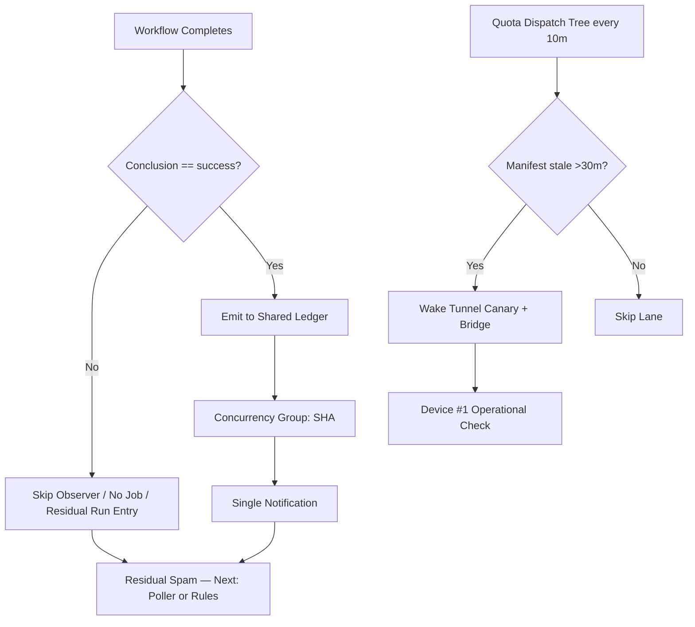

# Actions Workflows Consolidated Matrix (2026-10-23 refresh)

**Branch:** `ops/actions-matrix-upgrade-continue-2026-10-23` (continuation of `ops/actions-matrix-upgrade-2026-10-18` merged #1483)  
**Goal:** Zero Failures · 100% Success · Reduced Notification Spam · Feature Preservation  
**Audit Focus:** Skipped / Cancelled / Stale / Timed out / Failure / Action Required / Queued / Neutral

## Current State (2026-10-23T16:00Z RECON)

**Master tip:** `288c0570a067aeeb4734586773a37e71ac9b02d6` (help-wanted live status refresh).

Recent completed runs on tip:
- **Success:** dominant on dual-gates, SHE bridges, context audits, foresight, orchestration guard, Tunnel Canary (recent schedule successes 39962092978 et al.).
- **Skipped:** high volume residual on lane-events-recorder (26428+) and agent-throughput-evidence (42252+) — job-level `if: conclusion == 'success'` produces skipped run entries that still notify. Intentional for non-success cascades.
- **Cancelled:** concurrency races (expected; lag_operational class).
- **Failures:** none current on dual-gate or required paths. Historical repository-observatory 39233561401 (2026-10-19) resolved by later success. Vercel rate-limit remains non-gate capacity noise.

**Primary Spam Source:** Residual `workflow_run` observers that create skipped runs even when jobs are filtered. High-volume help-wanted and agent completions trigger them.

**Bridge / Pinggy Status:** `ops/termux-bridge/current.json` shows `status: "stale"`, transport `pinggy-tcp-over-ssh`, device_id `tmx-node-primary`, last observed 2026-10-22T08:55Z. Note: paused by Hark due to bridge sync overwriting tracked files. Canary classifies as lag_operational (exit 0, notice). **Not currently operational** — device-side resume required for full Pinggy/alt on #1.

## Repeated Issues Matrix (updated)

| Issue Class | Workflows Affected | Root Cause | Current Handling | Recommended Fix / Consolidation | Status |
|-------------|--------------------|------------|------------------|---------------------------------|--------|
| Cascade Notification Spam | lane-events-recorder, agent-throughput-evidence | Broad `workflow_run` + job if produces skipped runs | Success-only job filter | Unified batched observer or schedule poller; GitHub notification rules for skipped | Ongoing — residual |
| Intentional Skip Spam | hark-enqueue-on-failure, others | Triggers on all completed | Job-level if | Scheduled poller shift | Ongoing |
| Concurrency Cancel | help-wanted-*, others | Rapid triggers | cancel-in-progress | Granular SHA groups | Ongoing |
| Device / Tunnel (Pinggy) | Tunnel Canary, device tests | BLU B160V#1 broken screen; Hark pause on sync | Stale manifest → lag notice (exit 0) | Resume publisher on tmx-node-primary; #1574 adaptive tree wakes canary on stale >30min; opaque ID preserved | Device-side pending; adaptive in #1574 |
| Queue / Stale | actions-queue-reaper | Zero-job holds | Reaper schedule | Expand + adaptive | Active |
| Quota / Capacity | Vercel, observatory | Rate limits | Soft non-gate | Ledger + caching + path filters; #1574 Tier 0 decision tree reduces ~552→~200-250 scheduled runs/day | Ongoing — #1574 open |
| Silenced Failures | Historical | Cancel without diagnosis | Policy | Explicit artifact + issue on non-intentional | Policy |

## Superseded / Combined Workflows

- Multiple observers → success-filtered ledger emitters (live)
- Issue comments → modular router
- Device probes → hybrid lag-as-notice + opaque device_id
- Cadence: 7 fast-lane crons → single adaptive `quota-dispatch-tree.yml` (#1574)

## Flowchart: Cascade Reduction + Adaptive Cadence (Mermaid)

## Cadence & Cache Improvements

- Adaptive-wait concurrent during in_progress
- 3L0 moneyball telemetry via ledger + this matrix
- Conclusion filters live; residual skipped addressed by poller migration or #1574 tree
- Cache on lockfiles; path filters
- Quota: soft-classify; circuit-break; #1574 consolidates schedules dynamically based on state (queue, manifest age, commit activity)

## Device Identification (Public Obfuscation)

- Device #1 (original BLU B160V, broken screen): opaque ID `tmx-node-primary`
- Device #2: replication only
- Pinggy (current transport in manifest) or alternative **must be operational** on #1. Current: stale/paused. Resume required. Public obfuscation preserved (no raw serials).

## Next Actions

1. ~~Conclusion filters on high-volume observers~~ DONE & merged #1483
2. **Device-side:** Resume Pinggy/alt publisher on tmx-node-primary (Hark pause resolution; #184 credentials as needed). Canary will go green on active manifest.
3. Promote or refine #1574 adaptive cadence tree to cut residual scheduled + wake on stale.
4. Further suppress pure-skip notifications (poller or GitHub rules).
5. Expand reaper + quota soft-class.
6. C.A.D.E. continuous modular consolidation.

**What was fixed (this cycle + prior):**
- Cascade filters (success-only) on lane-events-recorder.yml & agent-throughput-evidence.yml
- Hybrid lag-as-notice on Tunnel Canary (stale → notice, not failure)
- Opaque device_id in manifests and canary
- Consolidated matrix + upgrade plan, flowcharts
- Quota resilience; Vercel non-gate
- Open adaptive cadence (#1574) for dynamic dispatch reducing spam/quota

**Residual requiring attention:** Skipped run entries still notify (GitHub platform behavior on job-if skips); Pinggy bridge currently stale (device-operator resume); quota messages capacity evidence.

Continue refining. Master functional. Dual-gate remains promote authority.

Agent-Identity: Grok (Administrator)
