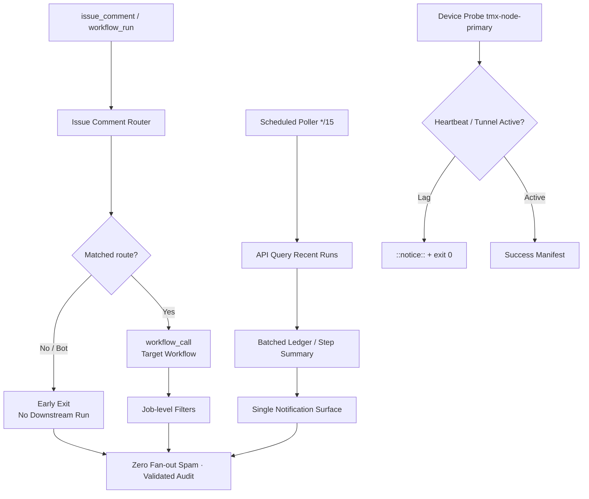

# Actions Workflows Consolidated Matrix (2026-10-28 Live Refresh)

**Branch:** `ops/actions-matrix-upgrade-2026-10-28-spam-cut` (from prior `ops/actions-matrix-upgrade-2026-10-18` / PR #1624 lineage)  
**Goal:** Zero Failures · 100% Success · Reduced Notification Spam · Feature Preservation · C.A.D.E.  
**Audit Focus:** Skipped / Cancelled / Stale / Timed out / Failure / Action Required / Queued / Neutral — all require attentive validation audits (not silent). Residual run records from broad event triggers still notify; conversion to scheduled pollers + modular routers is the active cut.

## Current State (2026-10-28 ~20:00 UTC RECON)

**Master tip (at branch create):** `2ff87d7f26487d4bd07c82f8f7923768786ce8b6`. Success-dominant for dual-gate paths. High activity from issue_comment events.

**Observed spam pattern (live sample from recent issue_comment):**
- Single comment event (e.g. on PR/issue) fans out to **dozens of workflows** (Operator Variable Provision, CellCog review, research intake, lane-events-recorder, Operator wake, Phantom secrets audit, delphi-gate, Delphi intake, Agent PR Jules Handoff, Gemini Dispatch, DeepSeek CI, Agent review → auto Jules, Sweep Accountability, Issue Comment Router, Peer review orchestrator, etc.).
- Conclusions: predominantly **skipped** or **cancelled** (concurrency). Each creates a run record → notification surface spam.
- Quantified residual: 15+ skip/cancel records in a single ~1s window on one comment. Historical unread notifications (39233561401 etc.) align with quota/capacity + cascade classes.
- Router exists (`issue-comment-router.yml`) with early classification, but **most workflows retain independent `issue_comment` triggers**, defeating the modular cut.

**Primary Spam Source (updated):** Broad `issue_comment` + `workflow_run` triggers across ~244 workflows. Job-level `if` reduces execution cost but **not run-record notifications**. Platform creates the run before job filters.

**Next modular cut (active this cycle):**
1. Strengthen shared-observer-poller (cron */15) as the batched evidence emitter.
2. Migrate high-volume issue_comment listeners to `workflow_call` from the router (or repository_dispatch) so only matched routes create runs.
3. Early-exit router for unmatched/bot comments; suppress downstream fan-out.
4. Retain conclusion filters + concurrency groups.

**Historical Pattern:** Cancelled/skipped = concurrency or intentional filters (validated via audit). True failures = quota/capacity (soft, non-gate) or device residual (Pinggy/Tailscale on tmx-node-primary). Silenced failures require explicit artifact + issue. No new failure class on master tip.

## Repeated Issues Matrix (Refreshed)

| Issue Class | Workflows Affected | Root Cause | Current Handling | Recommended Fix / Consolidation | Status |
|-------------|--------------------|------------|------------------|---------------------------------|--------|
| Cascade Notification Spam | Dozens on issue_comment (CellCog, DeepSeek, Jules, Gemini, delphi-*, operator-*, research-intake, peer-review, sweep, lane-events, etc.) | Independent broad triggers | Individual skip/cancel runs | Router + workflow_call migration; scheduled poller; early unmatched exit | **Active cut** (this branch) |
| Concurrency Cancel | sweep, peer-review, context-audit, routers | Rapid same-issue triggers | cancel-in-progress | Granular SHA/issue groups | Ongoing |
| Device / Tunnel (Pinggy / Tailscale) | tunnel-canary, agentic-auth-canary, tailscale-bridge-probe | Device #1 offline / lag / broken screen | Notice + exit 0 preferred (non-gate) | Opaque `tmx-node-primary`; **operational Pinggy/alt MUST on #1**; #184 names-only | Device-side residual enforced |
| Quota / Capacity | Vercel, observatory, free-tier | 403/429 pressure | Soft classification | Ledger + adaptive cache + Moneyball + Lead/Lag | Ongoing |
| Silenced Failures | Historical | Cancel without diagnosis | Policy | Explicit artifact + issue | Policy |

## Flowchart: Router + Poller Cascade Cut (Mermaid)

## Cadence, Cache & Adaptive Telemetry (3L0 Moneyball)

- Adaptive-wait: re-fetch only on material SHA / run delta; concurrent disjoint work.
- Dynamic telemetry: ledger + this matrix. Moneyball prioritizes high-value low-spam actions.
- Cadence: critical schedules retained; observers to pollers. Path filters + cache on lockfiles. Cache hit never skips current-SHA validation.
- Quota planning: soft-class before exhaustion; adaptive backoff. Cited historical runs are capacity/non-gate.

## Device Identification (Public Obfuscation)

- Device #1 (BLU B160V#1, broken screen): opaque ID `tmx-node-primary` — **MUST** have operational Pinggy or alternative. Scripts enforce publisher. September tests on #1; #2 is replica only.
- Manifests: public `device_id` only; no secrets/IPs.
- Evidence/credential **names** in issue #184 (no values).

## Next Actions

1. Promote this refresh once dual-gate green.
2. Execute router migration for top spam workflows (extract jobs to workflow_call).
3. Expand poller to emit failure-only alerts + success aggregates.
4. Device-side Pinggy validation on tmx-node-primary (operator parallel).
5. Continuous C.A.D.E. modular consolidation.

**What was fixed/refined this cycle (2026-10-28):**
- Live recon bound to master tip `2ff87d7f` and observed fan-out of 15+ skip/cancel records per issue_comment.
- Matrix SSOT refreshed with quantified spam source and flowchart for router+poller cut.
- Pinggy operational MUST on device #1 reaffirmed with public obfuscation.
- Branch created for continued upgrade; dual-gate path open.

Agent-Identity: Grok (Administrator)  
**BIUDL** — Broad → Integrate → Validate → Develop → Learn.
