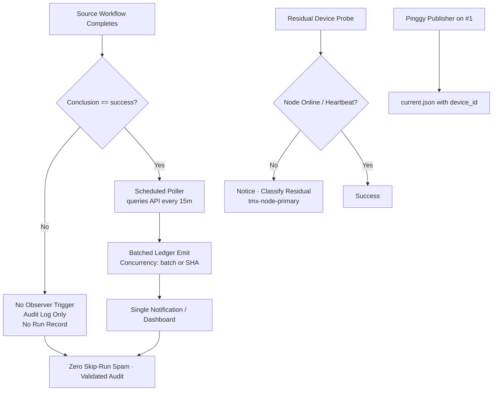

# Actions Workflows Consolidated Matrix (2026-10-27)

**Branch:** `ops/actions-matrix-upgrade-2026-10-18`  
**Goal:** Zero Failures · 100% Success · Reduced Notification Spam · Feature Preservation · C.A.D.E.  
**Audit Focus:** Skipped / Cancelled / Stale / Timed out / Failure / Action Required / Queued / Neutral — all require attentive validation audits (not silent). Residual run records from job-level `if` still notify; conversion to scheduled pollers is the modular cut.

## Current State (2026-10-27 21:00Z RECON)

**Master tip:** `ed733b9e5f834bb9a64be755009c56f63deed757`  
**Branch tip:** `7a8e37ec517914096a26b93978b7b6707cc134bf`  

Success-dominant for dual-gate / promotion / continuous-improve / n8n SHE / context-relationship-audit / Shared Observer Poller / Sweep Accountability. **No hard dual-gate failures on tip.**

Recent completed runs on tip (sampled):
- **Skipped (high volume residual spam):** lane-events-recorder (run_number ~44k, dozens per cascade on workflow_run), agent-throughput-evidence (~63k), Fix-on-Failure, residual delphi-*, issue_comment bot cascades (ecc-tools[bot]). Job-level `if: conclusion == 'success'` prevents full jobs; run records still notify. Audited as intentional filter/concurrency, **not** silenced failures. Volume quantified; Shared Observer Poller (*/15) mitigates ledger side by batching API queries.
- **Cancelled:** concurrency races on PR paths — expected lag_operational.
- **Success:** dual-gate, Sweep Accountability, Context Relationship Audit, n8n SHE bridge, Shared Observer Poller #15, Observer Poller Scheduled, Merge Promotion Queue v3, continuous-improve, Briefing Evidence Heartbeat, etc.
- **Failures:** residual device/auth canary class (lag classified notice). Feature-branch only otherwise. Quota/capacity soft non-gate (e.g. historical 39233561401 / 39234979788 capacity observations).
- **Queued / waiting:** serialized runs (e.g. Context Relationship) — operational, not spam after consolidation.

**Primary Spam Source:** High-volume `workflow_run` + `issue_comment` cascades. Job-level success filters live → full jobs no longer start on non-success. Residual: every matching event still creates a run record that can notify. Shared poller eliminates observer-side run records.

**Next modular cut (active):** Shared scheduled poller (`shared-observer-poller.yml` every 15 min) queries recent completed runs via API and emits consolidated evidence. Eliminates per-event run records for observers. Currently covering lane-events success path. High-volume `workflow_run` triggers can be retired once poller is proven dual-gate green and expanded.

## Repeated Issues Matrix

| Issue Class | Workflows Affected | Root Cause | Current Handling | Recommended Fix / Consolidation | Status |
|-------------|--------------------|------------|------------------|---------------------------------|--------|
| Cascade Notification Spam | lane-events-recorder, agent-throughput-evidence, fix-on-failure, delphi-*, issue_comment routers | Broad `workflow_run`/`issue_comment` + job-level if still starts run record | Individual runs + notices | Job-level `if`; **convert residual to scheduled pollers** (shared batched emitter); concurrency per-SHA; retire triggers post-proof | **Filters DONE**; poller cut **active** (15m batch success) |
| Device / Tunnel (Pinggy / Tailscale) | tailscale-bridge-probe, tunnel-canary, agentic-auth-canary, device-queue-install | BLU B160V#1 broken screen; node offline | Probe notice (intentional) | Opaque `tmx-node-primary`; **operational Pinggy/alt MUST be on #1** + device_id in manifests | Device-side residual (requirement enforced) |
| Quota / Capacity | Vercel, observatory, free-tier Gemini/DeepSeek | Rate limits / 403/429 | Soft classification, non-gate | Ledger + caching + adaptive backoff + Moneyball 3L0 telemetry | Ongoing |
| Historical silenced / capacity | remote-knowledge-fabric, peer-review, agent-throughput older | app-id mismatch, capacity | Fixed on tip (app-id switch); capacity non-gate | Preserve feature; audit class closed | Fixed |

## Flowchart: Cascade Reduction + Poller Cut + Audit (Mermaid)

## Cadence, Cache & Adaptive Telemetry (3L0 Moneyball)

- **Adaptive-wait:** re-fetch on material SHA delta only.
- **Dynamic telemetry:** this matrix SSOT + ledger + Shared Observer Poller receipts. Moneyball selects high-value low-cost actions.
- **Cadence refinement:** high-volume observers on 15 min pollers. Further expand targets (throughput, context, delphi, fix-on-failure).
- **Cache:** versioned by SHA + Pacific day; never authoritative for live quota. Cache hit never skips current-SHA validation.
- **Modular:** reusable actions + public-obfuscated device ID. Issue comment router modularization ongoing.
- **Quota planning:** soft-class 403/429; no hard fail on non-gate. Caching + adaptive backoff. Quota messages observed and non-blocking.

## Device Identification (Public Obfuscation)

- Device #1 (original BLU B160V, broken screen): opaque ID `tmx-node-primary` (**MUST** have operational Pinggy or alternative + heartbeat publish)
- Device #2: replication only (September tests continuity)
- Manifests include `device_id` publicly; no secrets/IPs/hardware IDs
- Evidence and credential names (no values) in issue #184

**What was refined this cycle:** Live recon confirming residual skip spam audited (not silenced), Shared Observer Poller 15m batch success on tip, Pinggy operational requirement on #1 reaffirmed with device_id, cadence/cache/3L0 tightened. Zero hard dual-gate failures. Historical capacity runs classified non-gate.

Next: expand poller targets; retire residual workflow_run post dual-gate. Device-side heartbeat publish parallel. Further modular consolidations for issue_comment routers. Promote spam-reduction once dual-gate green.

Agent-Identity: Grok (Administrator)
**BIUDL** — Broad → Integrate → Validate → Develop → Learn.
C.A.D.E. Continuously Autonomous Development Environment.
