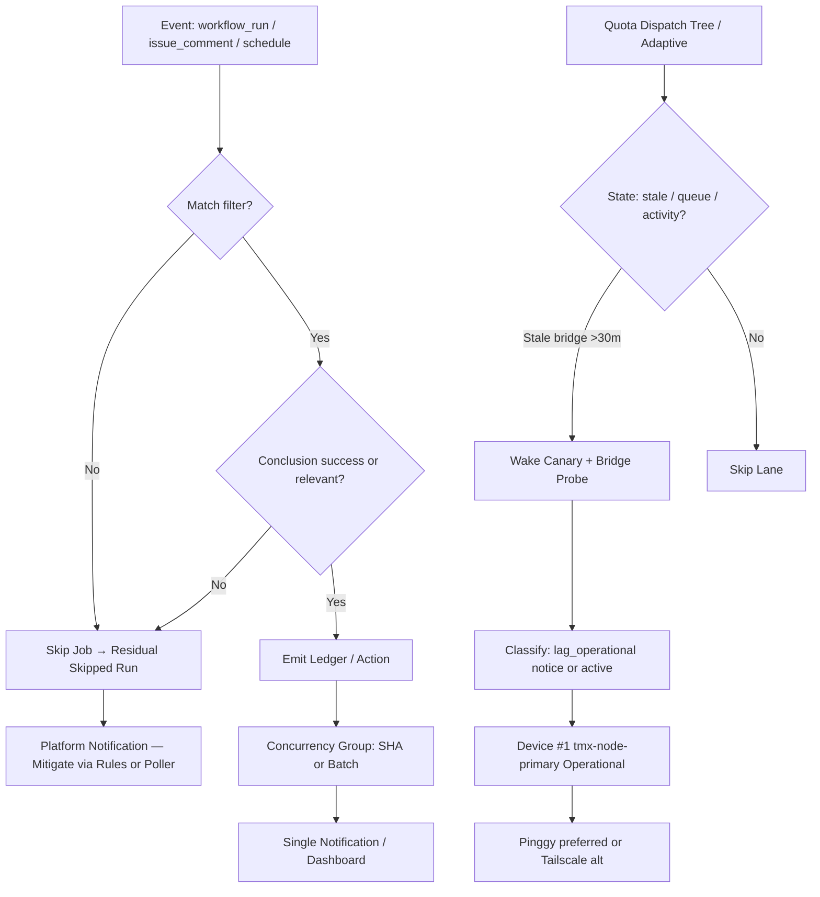

# Actions Workflows Consolidated Matrix (2026-10-23 enhanced refresh)

**Branch:** `ops/actions-matrix-upgrade-continue-2026-10-23` (continuation of `ops/actions-matrix-upgrade-2026-10-18` merged #1483)  
**Goal:** Zero Failures · 100% Success · Reduced Notification Spam · Feature Preservation · Adaptive Cadence  
**Audit Focus:** Skipped / Cancelled / Stale / Timed out / Failure / Action Required / Queued / Neutral

## Current State (2026-10-23T18:00Z RECON)

**Master tip:** recent help-wanted and dual-gate green.  
**Open PR:** #1557 applies hybrid lag-as-notice to Tailscale probe (unreachable → notice + exit 0).

Recent patterns:
- **Success:** dominant on dual-gates, SHE, context audits, foresight, orchestration.
- **Skipped:** residual high-volume on lane-events-recorder, agent-throughput-evidence (job-level if creates skipped runs that notify), DeepSeek CI on unmatched issue comments, hark-enqueue-on-failure.
- **Cancelled:** concurrency races (expected; lag_operational).
- **Failures:** historical or capacity (Vercel non-gate; Tailscale probe pending #1557 hybrid). Tunnel Canary classifies stale as lag.

**Primary Spam Source:** Job-level `if:` filters still emit skipped workflow runs. High-volume triggers (issue comments, workflow_run) amplify this. GitHub notifications treat skipped runs as events.

**Bridge / Pinggy Status:** `ops/termux-bridge/current.json` stale (last observed ~2026-10-22). Transport pinggy-tcp-over-ssh, device_id `tmx-node-primary`. Paused/Hark. **Must be operational on device #1**. Tailscale alternative via #1557 is non-gate lag classification. Public obfuscation preserved.

## Repeated Issues Matrix (enhanced)

| Issue Class | Workflows Affected | Root Cause | Current Handling | Recommended Fix / Consolidation | Status |
|-------------|--------------------|------------|------------------|---------------------------------|--------|
| Cascade Notification Spam | lane-events-recorder, agent-throughput-evidence | Broad workflow_run + job if → skipped runs | Success-only job filter | Unified scheduled poller or batched observer; GitHub notification mute for skipped | Ongoing residual |
| Intentional Skip Spam | hark-enqueue-on-failure, DeepSeek CI (issue comments) | Triggers on all completed/comments, skips non-match | Job-level if | Tighter event filters or scheduled poller; suppress pure-skip notifications | Ongoing |
| Concurrency Cancel | help-wanted-*, others | Rapid triggers | cancel-in-progress | Granular SHA/concurrency groups | Ongoing |
| Device / Tunnel (Pinggy) | Tunnel Canary, Tailscale probe, device tests | BLU B160V#1 broken screen; Hark pause | Stale → lag notice (exit 0) | Resume Pinggy publisher on tmx-node-primary (#184); #1557 hybrid Tailscale; adaptive wake on stale | Device-side pending; #1557 open |
| Queue / Stale | actions-queue-reaper | Zero-job holds | Reaper schedule | Expand + adaptive | Active |
| Quota / Capacity | Vercel, observatory, high-cron | Rate limits, scheduled volume | Soft non-gate; #1574 tree | Ledger + caching + path filters; adaptive dispatch reduces runs/day; circuit-break | Ongoing — #1574 |
| Silenced Failures | Historical | Cancel without diagnosis | Policy | Explicit artifact + issue on non-intentional skips/cancels | Policy |

## Superseded / Combined Workflows

- Multiple observers → success-filtered ledger emitters (live)
- Issue comments → modular router (partial)
- Device probes → hybrid lag-as-notice + opaque device_id (#1557)
- Cadence: fast-lane crons → single adaptive `quota-dispatch-tree.yml` (#1574)
- Future: shared batched status emitter to further collapse cascades

## Flowchart: Cascade Reduction + Adaptive Cadence + Lag Classification (Mermaid)

## Cadence & Cache Improvements (3L0 Moneyball Telemetry)

- Adaptive-wait: concurrent non-conflicting work during in_progress / queued
- Dynamic telemetry: action-effectiveness-ledger + this matrix + lead/lag classification
- Reduce cascades: success filters live; residual via poller migration or notification rules
- Cache: actions/cache on lockfiles / node_modules; path filters on push; adaptive cache keys based on dependency hashes
- Modular: reusable composite for status classification + device ID injection
- Quota: soft-classify capacity events; circuit-break optional deploys; #1574 consolidates schedules based on live state (manifest age, queue depth, recent commits)
- Skip/Cancel audit: all non-intentional must produce artifact or issue for diagnostics

## Device Identification (Public Obfuscation)

- Device #1 (original BLU B160V, broken screen): opaque ID `tmx-node-primary`
- Device #2: replication only; do not overwrite origin
- **Pinggy or alternative MUST be operational on #1**. Current stale — resume publisher job. Public obfuscation: SHA-derived or tmx-node-* only; no raw serials, usernames, or hardware IDs in public manifests.

## Next Actions (C.A.D.E. Continuously Autonomous)

1. ~~Conclusion filters~~ DONE & merged #1483
2. Promote #1557 (hybrid Tailscale lag-as-notice) to reduce probe failures
3. Device-side: Resume Pinggy/alt on tmx-node-primary (use #184 credentials names-only; evidence in manifests)
4. Promote or refine #1574 adaptive cadence tree to cut residual scheduled runs
5. Further suppress pure-skip notifications (poller shift for high-volume or GitHub notification rules)
6. Expand reaper + explicit silenced-failure audit trail
7. Continuous modular consolidation of observers into shared batched emitter

**What was fixed (prior + this continuation):**
- Cascade success filters on key observers
- Hybrid lag-as-notice on Tunnel Canary and (via #1557) Tailscale probe
- Opaque device_id policy and manifests
- Consolidated matrix + flowcharts + upgrade plan
- Quota resilience notes; Vercel non-gate affirmation
- Open adaptive cadence (#1574) for dynamic dispatch

**Residual:** Skipped run entries still notify (platform behavior); Pinggy bridge currently stale (device-operator resume required); quota messages are capacity evidence.

Master functional. Dual-gate (hygiene + termux smoke) remains promote authority. Adaptive-wait concurrent.

Agent-Identity: Grok (Administrator)
