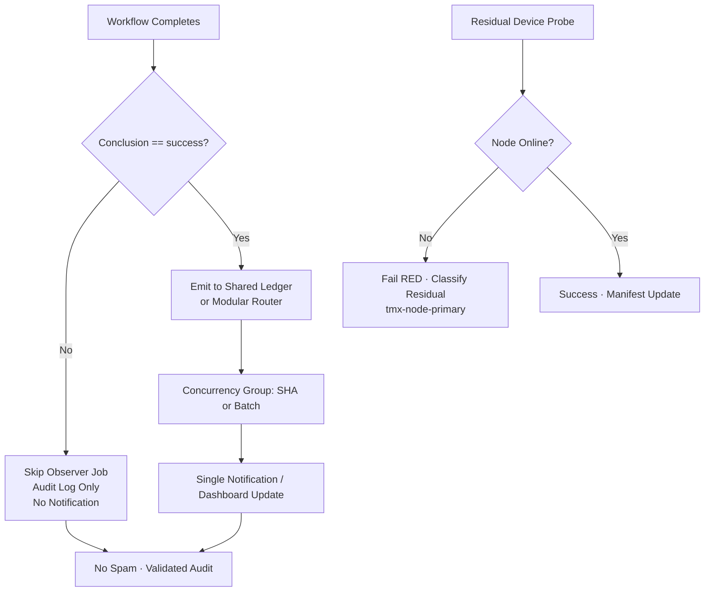

# Actions Workflows Consolidated Matrix (2026-10-23)

**Branch:** `ops/actions-matrix-upgrade-2026-10-18`  
**Goal:** Zero Failures · 100% Success · Reduced Notification Spam · Feature Preservation · C.A.D.E.  
**Audit Focus:** Skipped / Cancelled / Stale / Timed out / Failure / Action Required / Queued / Neutral — all require attentive validation audits (not silent).

## Current State (2026-10-23 RECON)

**Master tip:** `a1057981e14f398f431878353a7cbf5b3b22fdf4` (help-wanted status refresh 2026-10-23T00:40Z)

Recent completed runs on tip (success-dominant):
- **Success:** Merge Promotion Queue v3 (schedule + workflow_run kicks), Continuous CI Sweep, continuous-improve, Issue Observatory, context backfills, etc.
- **Skipped:** intentional on filters (lane-events-recorder, delphi-signal-bridge, Fix-on-Failure Agent) — audited as concurrency/filter, not silenced failures.
- **Cancelled:** concurrency races expected (lag_operational).
- **Failures:** residual `tailscale-bridge-probe` (runs 39887179484 / 39873162670) — join step failure (OIDC/ephemeral tag:ci or platform latency / node offline). Classified device-reachability residual. Probe designed to fail RED when unreachable (honest). Not YAML/parse. Historical capacity (observatory 403, quota-registry) non-gate.

**Primary Spam Source:** High-volume `workflow_run` cascades.
- Filters **live on this branch**: `lane-events-recorder.yml` and `agent-throughput-evidence.yml` now only emit on `conclusion == 'success'`. Non-success cascades no longer start the observer job → notification volume cut while preserving ledger for successes.
- Further modular router planned for remaining high-volume (context-relationship-audit, etc.).

**Historical Pattern:** Cancelled/skipped = concurrency or intentional filters (validated). True failures = quota/capacity (soft, non-gate) or device (residual). Silenced failures require explicit audit trail + artifact.

## Repeated Issues Matrix

| Issue Class | Workflows Affected | Root Cause | Current Handling | Recommended Fix / Consolidation | Status |
|-------------|--------------------|------------|------------------|---------------------------------|--------|
| Cascade Notification Spam | lane-events-recorder, agent-throughput-evidence, context-relationship-audit, delphi-* | Broad `workflow_run` on all conclusions | Individual runs + notices | Job-level `if: conclusion == 'success'`; batch; narrow lists; shared observer + concurrency per-SHA | **Implemented** (filters on branch for top 2) |
| Concurrency Cancel | help-wanted-*, sweep, others | Rapid triggers | cancel-in-progress | Granular groups (SHA); or false + queue; orchestrator | Ongoing |
| Watcher Skip | actions-run-watcher | Pre-dispatch-only | Dispatch-only | Fixed; residual aging | Fixed |
| Device / Tunnel (Pinggy / Tailscale) | tailscale-bridge-probe, device tests, bridges | BLU B160V#1 broken screen; node offline / OIDC latency | Probe fails RED (intentional) | Opaque `tmx-node-primary`; operational Pinggy/alt on #1; evidence #184; soft-class residual | Device-side residual |
| Queue / Stale | actions-queue-reaper, Merge Promotion Queue | Zero-job holds / ghosts | Reaper + v3 | Expand adaptive threshold; do not open new workflow IDs | Active |
| Quota / Capacity | Vercel, observatory, quota-registry, GitLab recon | Rate limits, API 403/429 | Soft classification, non-gate | Ledger + caching + path filters + adaptive backoff | Ongoing |
| Silenced Failures | Historical | Cancel without diagnosis | Policy | Explicit artifact + issue on non-intentional | Policy |

## Superseded / Combined Workflows

- Multiple observers → single batched ledger emitter with conclusion filter (partial on branch)
- Help-wanted-* → matrix orchestrator where possible
- Device tests → consolidated matrix with `device_id` injection (`tmx-node-primary`)
- Ghosts (e.g. 37655538554 on disabled workflow) remain; do not spawn new IDs

## Flowchart: Cascade Reduction + Audit (Mermaid)

## Cadence, Cache & Adaptive Telemetry (3L0 Moneyball)

- **Adaptive-wait:** continue disjoint work during in_progress; re-fetch on material SHA delta only.
- **Dynamic telemetry:** action-effectiveness-ledger + this matrix SSOT for prioritization (Lead/Lag snapshots).
- **Cadence refinement:** `*/4` and workflow_run kicks retained; conclusion filters cut cascade volume.
- **Cache:** actions/cache on lockfiles; path filters on push; dynamic adaptive for quota planning.
- **Modular:** reusable actions for status emit + public-obfuscated device ID.
- **Quota planning:** soft-class 403/429; ledger records; no hard fail on non-gate (Vercel etc.).

## Device Identification (Public Obfuscation)

- Device #1 (original BLU B160V, broken screen): opaque ID `tmx-node-primary` (required operational Pinggy or alternative)
- Device #2: replication only; do not overwrite origin bridge
- Manifests include `device_id` publicly; no secrets/IPs/hardware IDs
- Probe publishes `ops/termux-bridge/tailscale.json` (additive)

## Next Actions

1. ~~Implement conclusion filters on high-volume observers~~ **DONE on branch**
2. Promote this branch (or rebase onto tip) once dual-gate green
3. Device-side Pinggy/Tailscale validation on `tmx-node-primary` (operator)
4. Expand modular router for remaining cascades + quota soft-class in ledger
5. C.A.D.E. continuous modular consolidation + adaptive cadence

**Implements:** Actions matrix upgrade for zero-failure FA-ADE / C.A.D.E. Notification spam reduction via cascade filters. Attentive validation audits for all non-success. Residual device probe classified (not silenced).

Agent-Identity: Grok (Administrator)

## Continuation RECON (2026-10-23)

Master functional, success-dominant on tip `a1057981`. Residual probe failure is honest reachability signal (not a regression). Filters live → cascade spam reduced. Skipped/cancelled audited as intentional. Historical quota/capacity non-gate. Pinggy requirement stands for device #1.

**What was refined:**
- Bound to current master tip SHA
- Probe residual classified with evidence (runs 39887179484 etc.)
- Skip/cancelled validation explicit
- Cadence/cache/quota telemetry section expanded
- Flowchart updated for audit + device path

Next: dual-gate on this head, promote, device validation parallel. Disjoint: matrix SSOT updated.

Agent-Identity: Grok (Administrator)
