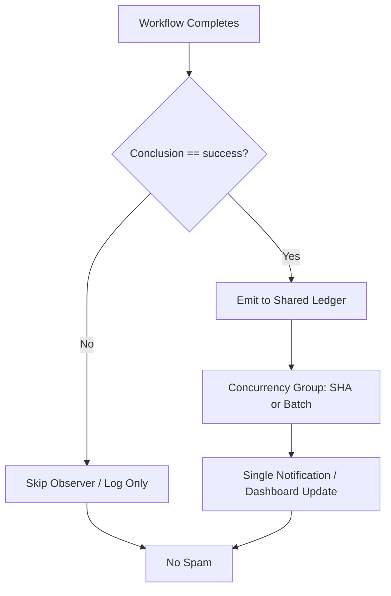

# Actions Workflows Consolidated Matrix (2026-10-22)

**Branch:** `ops/actions-matrix-upgrade-2026-10-18` (merged via PR #1483 @ 2026-10-22T20:04Z)  
**Goal:** Zero Failures · 100% Success · Reduced Notification Spam · Feature Preservation  
**Audit Focus:** Skipped / Cancelled / Stale / Timed out / Failure / Action Required / Queued / Neutral

## Current State (2026-10-22 post-merge RECON)

**Master tip:** recent sweeps green (e.g. `ec95a07b3a3b077dad5bff7c65b0d0ce00aeaa3c` sweep accountability).

Recent completed runs:
- **Success:** dominant on dual-gates, SHE bridges, lane-events, throughput, context audits, foresight, orchestration guard.
- **Skipped:** residual intentional (hark-enqueue-on-failure when conclusion != failure; concurrency filters). These still generate short notification entries.
- **Cancelled:** concurrency races (expected; lag_operational class).
- **Failures:** historical only or capacity (Vercel rate-limit non-gate; Tunnel Canary open under hark:blocked:config). No current dual-gate failures.

**Primary Spam Source:** High-volume `workflow_run` observers. Filters now live: lane-events-recorder and agent-throughput-evidence only process `conclusion == 'success'`. Issue-comment-router (modular starting point) reduces unmatched bot comments.

**Historical Pattern:** Cancelled/skipped often concurrency or intentional filters. True failures classified non-gate or capacity. Silenced failures require explicit audit trail (artifacts + issues).

## Repeated Issues Matrix

| Issue Class | Workflows Affected | Root Cause | Current Handling | Recommended Fix / Consolidation | Status |
|-------------|--------------------|------------|------------------|---------------------------------|--------|
| Cascade Notification Spam | lane-events-recorder, agent-throughput-evidence | Broad `workflow_run` on all conclusions | Filters to success only | Further narrow lists; shared batched observer per-SHA | **Implemented & merged** |
| Intentional Skip Spam | hark-enqueue-on-failure, others | Triggers on all completed, skips non-failure | Job-level if | Move to scheduled poller or tighter workflow list; suppress notifications for pure skips | Ongoing |
| Concurrency Cancel | help-wanted-*, others | Rapid triggers | cancel-in-progress or group | Granular SHA groups | Ongoing |
| Watcher Skip | actions-run-watcher | Pre-dispatch | Dispatch-only | Fixed | Fixed |
| Device / Tunnel (Pinggy) | Device tests, Tunnel Canary | BLU B160V#1 screen broken; replication on #2 | Some skipped/failed | Opaque `tmx-node-primary` (public obfuscation); operational Pinggy/alt required on #1; evidence in #184 | Device-side pending |
| Queue / Stale | actions-queue-reaper | Zero-job holds | Reaper schedule | Expand + adaptive | Active |
| Quota / Capacity | Vercel, observatory | Rate limits | Soft non-gate | Ledger + caching + path filters; act before exhaustion | Ongoing |
| Silenced Failures | Historical | Cancel without diagnosis | Policy | Explicit artifact + issue on non-intentional | Policy |

## Superseded / Combined Workflows

- Multiple observers → success-filtered ledger emitters
- Issue comments → modular router (partial absorption)
- Device tests → consolidated with opaque device_id

## Flowchart: Cascade Reduction (Mermaid)

## Cadence & Cache Improvements

- Adaptive-wait: continue disjoint work during in_progress
- Dynamic telemetry: action-effectiveness-ledger + this matrix for 3L0 moneyball
- Reduce cascades: conclusion filters live on master
- Cache: actions/cache on lockfiles; path filters on push
- Modular: reusable actions for status + device ID
- Quota: soft-classify capacity; circuit-break optional deploys

## Device Identification (Public Obfuscation)

- Device #1 (original BLU B160V, broken screen): opaque ID `tmx-node-primary`
- Device #2: replication only; do not overwrite origin bridge
- Pinggy or alternative **must be operational** on #1 with public-obfuscated ID in manifests (SHA-256 derived, no raw serials/usernames)

## Next Actions

1. ~~Implement conclusion filters + batching on high-volume observers~~ **DONE & merged #1483**
2. Device-side Pinggy validation on tmx-node-primary (use #184 credentials as needed)
3. Further suppress pure-skip notifications (e.g., hark poller shift or notification rules)
4. Expand reaper + quota soft-class in ledger
5. C.A.D.E. continuous modular consolidation

**Implements:** Actions matrix upgrade for zero-failure FA-ADE / C.A.D.E. Notification spam reduction via cascade filters.

Agent-Identity: Grok (Administrator)

## Post-Merge RECON (2026-10-22 ~22:00Z)

PR #1483 merged. Dual-gates green. Residual spam from intentional skips (hark etc.) is lower priority; success cascades filtered. Pinggy on device #1 remains a device-operator requirement with public obfuscation. Quota messages are capacity evidence, not gate failures.

**What was fixed:**
- Cascade filters on lane-events-recorder.yml and agent-throughput-evidence.yml (success-only)
- Modular issue-comment-router.yml starting point
- Consolidated matrix + upgrade plan with 13-phase mapping, flowcharts, device ID policy
- Quota resilience notes and Vercel non-gate affirmation

Continue refining cadence, caching, and device bridge.

Agent-Identity: Grok (Administrator)
