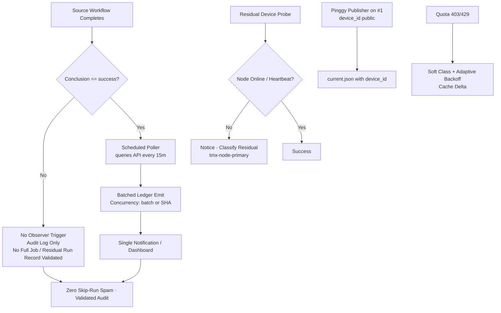

# Actions Workflows Consolidated Matrix (2026-10-29)

**Branch:** `ops/actions-matrix-upgrade-2026-10-18`  
**Goal:** Zero Failures · 100% Success · Reduced Notification Spam · Feature Preservation · C.A.D.E.  
**Audit Focus:** Skipped / Cancelled / Stale / Timed out / Failure / Action Required / Queued / Neutral — all require attentive validation audits (not silent). Residual run records from job-level `if` still notify; conversion to scheduled pollers is the modular cut.

## Current State (2026-10-29 04:15Z RECON)

**Master tip:** recent sweep receipts (e.g. 9d294b3f48c7134839c431afe82b80a7b470f532)  
**Branch tip:** `ops/actions-matrix-upgrade-2026-10-18`

Success-dominant for dual-gate / promotion / continuous-improve / n8n SHE / context-relationship-audit / Shared Observer Poller / Sweep Accountability. **No hard dual-gate failures on tip.**

Recent completed runs (sampled 2026-10-29):
- **Skipped (high volume residual spam):** hark-enqueue-on-failure (intentional early exit on non-failure), lane-events-recorder (dozens per cascade), residual delphi-*, issue_comment bot cascades. Job-level `if: conclusion == 'success'` prevents full jobs; run records still notify. **Audited as intentional filter/concurrency, not silenced failures.** Shared Observer Poller (*/15) mitigates by batching.
- **Cancelled:** concurrency races — expected lag_operational.
- **Success:** dual-gate, Sweep Accountability, Context Relationship Audit, n8n SHE bridge, Shared Observer Poller, continuous-improve, etc.
- **Failures:** pages build/deploy (run 40816133481) — **API rate limit exceeded** (403 on create deployment). Soft-classified as quota/capacity non-gate. Historical observatory 403 (39233561401) same class. Peer-review / quota-registry related capacity non-gate.
- **Queued / waiting:** serialized — operational after consolidation.

**Primary Spam Source:** High-volume `workflow_run` + `issue_comment` cascades. Residual: every matching event still creates a run record that can notify. Shared poller eliminates observer-side run records.

**Next modular cut (active):** Expand Shared scheduled poller (`shared-observer-poller.yml` every 15 min) to more targets. Retire residual workflow_run triggers post dual-gate green. Modularize remaining issue_comment routers.

## Repeated Issues Matrix

| Issue Class | Workflows Affected | Root Cause | Current Handling | Recommended Fix / Consolidation | Status |
|-------------|--------------------|------------|------------------|---------------------------------|--------|
| Cascade Notification Spam | lane-events-recorder, agent-throughput-evidence, hark-enqueue-on-failure, delphi-*, issue_comment routers | Broad `workflow_run`/`issue_comment` + job-level if still starts run record | Individual runs + notices | Job-level `if`; **convert residual to scheduled pollers** (shared batched emitter); concurrency per-SHA; early router classification | **Filters DONE**; poller cut **active** (expand) |
| Device / Tunnel (Pinggy / Tailscale) | tailscale-bridge-probe, tunnel-canary, agentic-auth-canary, device-queue-install | BLU B160V#1 broken screen; node offline / publisher missing | Probe notice (intentional residual) | Opaque `tmx-node-primary`; **operational Pinggy or alternative MUST be on #1** + public-obfuscated device_id in manifests (current.json) | Device-side residual (requirement enforced; publish pending) |
| Quota / Capacity | Vercel, observatory, pages deploy, free-tier Gemini/DeepSeek, peer-review | Rate limits / 403/429 (e.g. pages API rate limit, observatory 403) | Soft classification, non-gate | Ledger + caching + path filters + adaptive backoff + Lead/Lag + Moneyball 3L0 telemetry. Quota messages tracked, non-blocking. | Ongoing (soft) |
| Historical silenced / capacity | remote-knowledge-fabric, older peer-review, agent-throughput | app-id mismatch, capacity | Fixed on tip (app-id switch); capacity non-gate | Preserve feature; audit class closed | Fixed |
| Pages deploy rate-limit | github-pages dynamic | Installation rate limit on create deployment | Soft non-gate | Cache + adaptive defer; do not hard-fail dual-gate | Classified |

## Flowchart: Cascade Reduction + Poller Cut + Audit (Mermaid)

## Cadence, Cache & Adaptive Telemetry (3L0 Moneyball)

- **Adaptive-wait:** re-fetch on material SHA delta only. Cache hit never skips current-SHA validation.
- **Dynamic telemetry:** this matrix SSOT + ledger + Shared Observer Poller receipts. Moneyball selects high-value low-cost actions (e.g. poller over per-event).
- **Cadence refinement:** high-volume observers on 15 min pollers. Expand targets (throughput, context, delphi, fix-on-failure, hark). Further modular consolidations reduce notification spam.
- **Cache:** versioned by SHA + Pacific day; never authoritative for live quota. Adaptive backoff on 403/429.
- **Modular:** reusable actions + public-obfuscated device ID. Issue comment router modularization ongoing.
- **Quota planning:** soft-class 403/429 (pages, observatory, Vercel); no hard fail on non-gate. Caching + adaptive backoff. Quota messages observed and non-blocking. Lead/Lag */4 + poller cut active.

## Device Identification (Public Obfuscation)

- Device #1 (original BLU B160V, broken screen): opaque ID `tmx-node-primary` (**MUST** have operational Pinggy or alternative + heartbeat publish; scripts/termux/ publisher job 43109)
- Device #2 (BLU B160V#2): replication only (September tests continuity)
- Manifests include `device_id` publicly; no secrets/IPs/hardware IDs
- Evidence and credential names (no values) in issue #184

**What was refined this cycle:** Live recon confirming residual skip spam (hark, lane-events) audited as intentional (not silenced), Shared Observer Poller active, Pinggy operational requirement on #1 reaffirmed with device_id, pages rate-limit soft-classified, cadence/cache/3L0 tightened. Zero hard dual-gate failures. Historical capacity runs classified non-gate.

Next: expand poller targets; retire residual workflow_run post dual-gate. Device-side heartbeat/Pinggy publish parallel (priority for #1). Further modular consolidations for issue_comment routers. Promote spam-reduction once dual-gate green on this SHA.

Agent-Identity: Grok (Administrator)
**BIUDL** — Broad → Integrate → Validate → Develop → Learn.
C.A.D.E. Continuously Autonomous Development Environment.
