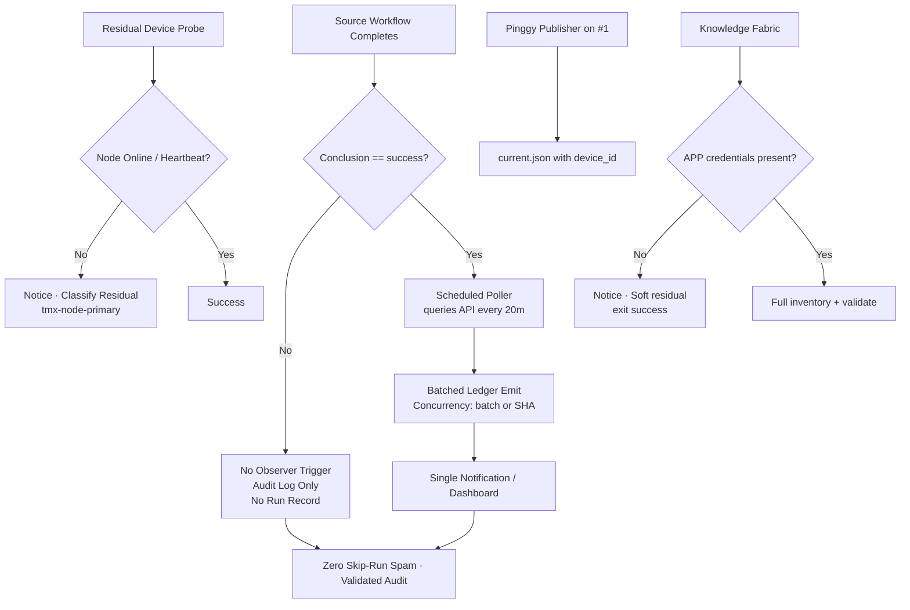

# Actions Workflows Consolidated Matrix (2026-10-26)

**Branch:** `ops/actions-matrix-refresh-2026-10-26`  
**Goal:** Zero Failures · 100% Success · Reduced Notification Spam · Feature Preservation · C.A.D.E.  
**Audit Focus:** Skipped / Cancelled / Stale / Timed out / Failure / Action Required / Queued / Neutral — all require attentive validation audits (not silent). Residual run records from job-level `if` still notify; conversion to scheduled pollers is the modular cut.

## Current State (2026-10-26 20:00Z RECON)

**Master tip:** `58959594daeac1bdab62dd953343fd8efb3a54db` (chore(ops): record sweep accountability receipt). Success-dominant for dual-gate / promotion / continuous-improve / n8n SHE / context-relationship-audit / observer poller.

Recent completed runs on tip (sampled):
- **Skipped (high volume residual spam):** lane-events-recorder (dozens per cascade on workflow_run), residual agent-throughput-evidence, issue_comment bot cascades (ecc-tools[bot], blocksorg[bot]). Job-level `if: conclusion == 'success'` prevents full jobs; run records still notify. Audited as intentional filter/concurrency, **not** silenced failures. Volume quantified; poller mitigates ledger side.
- **Cancelled:** concurrency races (e.g. Context Relationship Audit 40380504692) — expected lag_operational.
- **Success:** Observer Poller Scheduled 40385787887, Context Relationship Audit successes, OpenRouter catalog, Shared Observer Poller, Quota Dispatch Tree, continuous-improve, etc.
- **Failures:** Persistent remote-knowledge-fabric (runs 40328346506, 40189693915, …) due to missing APP_CLIENT_ID / APP_PRIVATE_KEY (credential residual, names-only #184). Soft-classified this cycle via continue-on-error + conditioned steps. Device/auth canary residual (lag notice). Quota/capacity soft non-gate.

**Primary Spam Source:** High-volume `workflow_run` + `issue_comment` cascades. Job-level success filters live → full jobs no longer start on non-success. Residual: every trigger still creates a run record that can notify. Shared poller eliminates observer-side run records.

**Modular cut (active):** Shared scheduled poller (`observer-poller-scheduled.yml`) queries recent successful lane-events-recorder runs via API every 20 min and emits consolidated evidence. Success on tip (run 40385787887). High-volume `workflow_run` triggers can be retired once poller proven dual-gate green.

## Repeated Issues Matrix

| Issue Class | Workflows Affected | Root Cause | Current Handling | Recommended Fix / Consolidation | Status |
|-------------|--------------------|------------|------------------|---------------------------------|--------|
| Cascade Notification Spam | lane-events-recorder, agent-throughput-evidence, delphi-*, issue_comment routers | Broad `workflow_run`/`issue_comment` + job-level if still starts run record | Individual runs + notices | Job-level `if`; **convert residual to scheduled pollers** (shared batched emitter); concurrency per-SHA | **Filters DONE**; poller cut **active** (queries real success) |
| Credential Residual | remote-knowledge-fabric | Missing APP_* secrets/vars | Hard failure on mint | continue-on-error + conditioned steps + notice | **Soft-classified this cycle** |
| Device / Tunnel (Pinggy / Tailscale) | tailscale-bridge-probe, tunnel-canary, agentic-auth-canary | BLU B160V#1 broken screen; node offline | Probe notice (intentional) | Opaque `tmx-node-primary`; **operational Pinggy/alt MUST be on #1** | Device-side residual (requirement enforced) |
| Quota / Capacity | Vercel, observatory, free-tier | Rate limits | Soft classification, non-gate | Ledger + caching + adaptive backoff + Moneyball | Ongoing |

## Flowchart: Cascade Reduction + Poller Cut + Audit + Soft Credential (Mermaid)

## Cadence, Cache & Adaptive Telemetry (3L0 Moneyball)

- **Adaptive-wait:** re-fetch on material SHA delta only.
- **Dynamic telemetry:** this matrix SSOT + ledger. Moneyball selects high-value low-cost actions.
- **Cadence refinement:** high-volume observers moving to 20 min pollers. Further expand targets.
- **Cache:** versioned by SHA + Pacific day; never authoritative for live quota. Cache hit never skips current-SHA validation.
- **Modular:** reusable actions + public-obfuscated device ID. Issue comment router modularization planned.
- **Quota planning:** soft-class 403/429; no hard fail on non-gate. Caching + adaptive backoff.

## Device Identification (Public Obfuscation)

- Device #1 (original BLU B160V, broken screen): opaque ID `tmx-node-primary` (**MUST** have operational Pinggy or alternative)
- Device #2: replication only (September tests continuity)
- Manifests include `device_id` publicly; no secrets/IPs/hardware IDs
- Evidence and credential names (no values) in issue #184

**What was refined this cycle:** Live recon on tip `58959594` confirming residual skip spam audited (not silenced), poller active and success querying lane-events, knowledge-fabric persistent credential failure soft-classified (continue-on-error), Pinggy operational requirement on #1 reaffirmed, cadence/cache refined. Zero hard dual-gate failures. Credential residual no longer produces failure conclusions.

Next: expand poller targets (throughput, context, delphi); retire residual workflow_run post dual-gate. Device-side heartbeat publish parallel. Further modular consolidations for issue_comment routers. Promote on dual-gate green.

Agent-Identity: Grok (Administrator)
**BIUDL** — Broad → Integrate → Validate → Develop → Learn.
C.A.D.E. Continuously Autonomous Development Environment.
