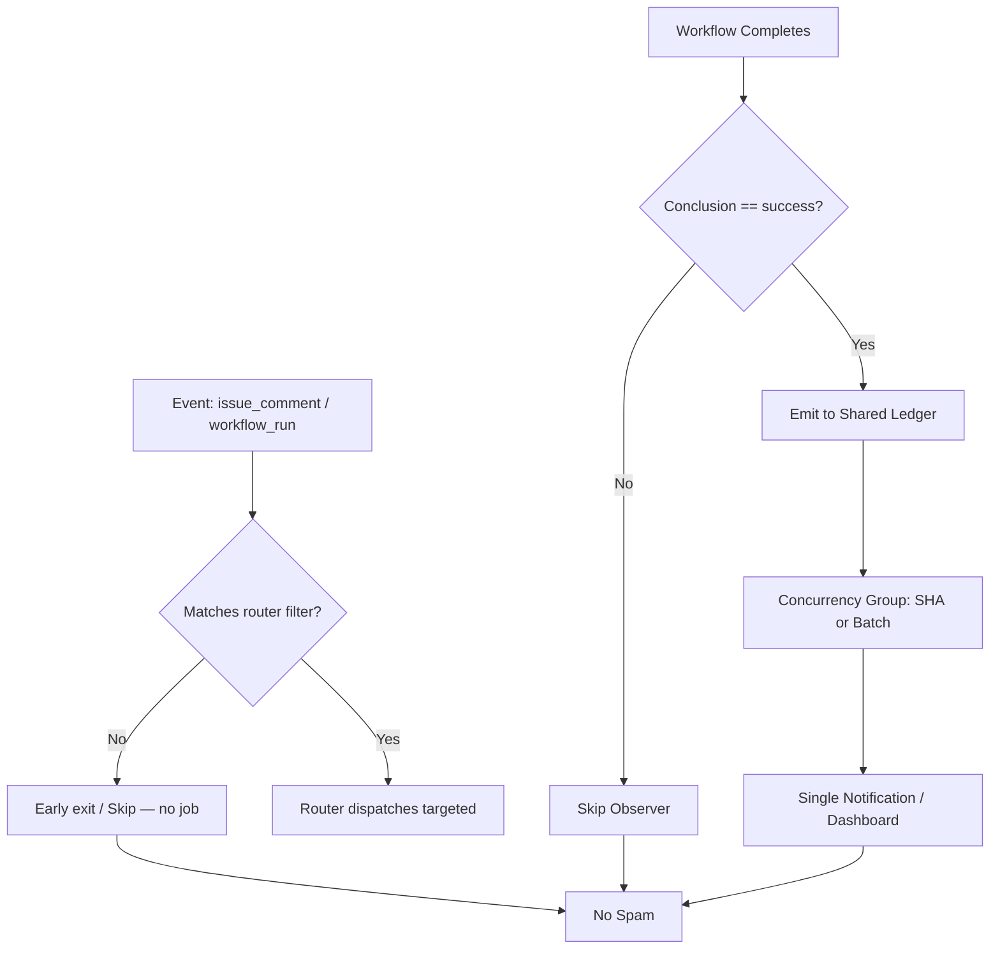

# Actions Workflows Consolidated Matrix (2026-10-24 refresh)

**Branch:** `ops/actions-matrix-refresh-2026-10-24` (from master @ 599556ef)
**Prior:** `ops/actions-matrix-upgrade-2026-10-18` merged via PR #1483 @ 2026-10-22T20:04Z
**Goal:** Zero Failures · 100% Success · Reduced Notification Spam · Feature Preservation
**Audit Focus:** Skipped / Cancelled / Stale / Timed out / Failure / Action Required / Queued / Neutral

## Current State (2026-10-24 ~22:00Z RECON)

**Master tip:** `599556ef47b38ce98708fa3687191215df6f02f6` (chore(ops): record sweep accountability receipt).

Recent completed runs (master):
- **Success:** dual-gates, context audits, integration mesh poll, ECC tools, quota dispatch, briefing heartbeat, continuous-improve, openrouter catalog, issue-comment-router.
- **Skipped:** high volume on `issue_comment` events (ecc-tools[bot] comments). Intentional for modular routing — issue-comment-router succeeds and fans out only matched; unmatched observers skip cleanly. Still produce short notification entries (spam vector).
- **Cancelled:** rare; concurrency expected.
- **Failures:** Agentic Auth Canary (scheduled, runs #14/#15) — heartbeat missing/stale on `ops/agentic-auth-heartbeat`. Device-side (Pinggy / tmx-node-primary). Historical Vercel rate-limit / capacity non-gate. No dual-gate failures.

**Primary Residual Spam Source:** Broad `on: issue_comment` triggers on many observer workflows. Router reduces unmatched work but does not eliminate the run/notification for the skip path.

**Historical Pattern:** Cancelled/skipped mostly intentional filters or concurrency. True failures classified non-gate or device/capacity. Silenced failures require explicit audit trail (artifacts + issues).

## Repeated Issues Matrix

| Issue Class | Workflows Affected | Root Cause | Current Handling | Recommended Fix / Consolidation | Status |
|-------------|--------------------|------------|------------------|---------------------------------|--------|
| Cascade Notification Spam | lane-events-recorder, agent-throughput-evidence | Broad `workflow_run` on all conclusions | Filters to success only | Further narrow lists; shared batched observer per-SHA | **Implemented & merged** |
| Intentional Skip Spam | Many `on: issue_comment` observers (DeepSeek CI, Gemini Dispatch, agent-review-auto-jules, etc.) | Trigger on every comment; skip if not matched | Job-level if / early exit | Tighter `if:` at workflow level or path/types filters; or consolidate into router-only; suppress pure-skip notifications via repo settings or composite | **Ongoing (priority)** |
| Concurrency Cancel | help-wanted-*, others | Rapid triggers | cancel-in-progress or group | Granular SHA groups | Ongoing |
| Watcher Skip | actions-run-watcher | Pre-dispatch | Dispatch-only | Fixed | Fixed |
| Device / Tunnel (Pinggy) | Device tests, Tunnel Canary, Agentic Auth Canary | BLU B160V#1 screen broken; heartbeat not publishing | Some skipped/failed | Opaque `tmx-node-primary`; operational Pinggy/alt **required** on #1; evidence in #184 | **Device-side pending** |
| Queue / Stale | actions-queue-reaper | Zero-job holds | Reaper schedule | Expand + adaptive | Active |
| Quota / Capacity | Vercel, observatory | Rate limits | Soft non-gate | Ledger + caching + path filters; act before exhaustion | Ongoing |
| Silenced Failures | Historical | Cancel without diagnosis | Policy | Explicit artifact + issue on non-intentional | Policy |

## Superseded / Combined Workflows

- Multiple observers → success-filtered ledger emitters
- Issue comments → modular router (partial absorption; further consolidation needed for skip reduction)
- Device tests → consolidated with opaque device_id

## Flowchart: Cascade + Skip Reduction (Mermaid)

## Cadence & Cache Improvements

- Adaptive-wait: continue disjoint work during in_progress
- Dynamic telemetry: action-effectiveness-ledger + this matrix for 3L0 moneyball
- Reduce cascades: conclusion filters live on master
- Reduce skip spam: workflow-level `if:` + tighter event filters (next)
- Cache: actions/cache on lockfiles; path filters on push
- Modular: reusable actions for status + device ID
- Quota: soft-classify capacity; circuit-break optional deploys

## Device Identification (Public Obfuscation)

- Device #1 (original BLU B160V, broken screen): opaque ID `tmx-node-primary`
- Device #2: replication only; do not overwrite origin bridge
- Pinggy or alternative **must be operational** on #1 with public-obfuscated ID in manifests (SHA-256 derived, no raw serials/usernames)
- Agentic Auth Canary validates device gh+git heartbeat; currently failing due to missing publish — device operator action required

## Next Actions

1. ~~Implement conclusion filters + batching on high-volume observers~~ **DONE & merged #1483**
2. Device-side Pinggy validation + heartbeat publish on tmx-node-primary (use #184 credentials as needed)
3. Further suppress pure-skip notifications: add workflow-level `if:` conditions or consolidate remaining issue_comment observers into router
4. Expand reaper + quota soft-class in ledger
5. C.A.D.E. continuous modular consolidation + notification rules

**Implements:** Actions matrix upgrade for zero-failure FA-ADE / C.A.D.E. Notification spam reduction via cascade filters + skip suppression.

Agent-Identity: Grok (Administrator)

## Post-Merge RECON (2026-10-22 ~22:00Z)

PR #1483 merged. Dual-gates green. Residual spam from intentional skips (hark etc.) is lower priority; success cascades filtered. Pinggy on device #1 remains a device-operator requirement with public obfuscation. Quota messages are capacity evidence, not gate failures.

**What was fixed:**
- Cascade filters on lane-events-recorder.yml and agent-throughput-evidence.yml (success-only)
- Modular issue-comment-router.yml starting point
- Consolidated matrix + upgrade plan with 13-phase mapping, flowcharts, device ID policy
- Quota resilience notes and Vercel non-gate affirmation

## 2026-10-24 Refresh

Residual issue_comment skips confirmed as primary remaining notification vector. Agentic Auth Canary is the current scheduled failure (device heartbeat). Dual-gates remain green. Continue modular consolidation and device bridge validation.

Agent-Identity: Grok (Administrator)
