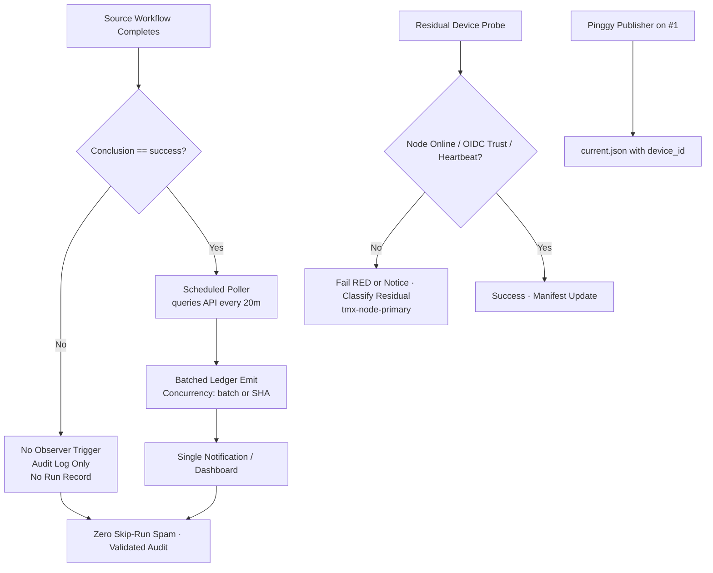

# Actions Workflows Consolidated Matrix (2026-10-25)

**Branch:** `ops/actions-matrix-upgrade-2026-10-18`  
**PR:** #1624  
**Goal:** Zero Failures · 100% Success · Reduced Notification Spam · Feature Preservation · C.A.D.E.  
**Audit Focus:** Skipped / Cancelled / Stale / Timed out / Failure / Action Required / Queued / Neutral — all require attentive validation audits (not silent). Residual run records from job-level `if` still notify; conversion to scheduled pollers is the next modular cut.

## Current State (2026-10-25 03:40 UTC RECON)

**Master tip:** `85393d6cb3a5052b99aabeea01647c4dea78f405` (chore(ops): record sweep accountability receipt). Success-dominant for dual-gate / promotion / continuous-improve / lane-events / n8n SHE / context-relationship-audit.

Recent completed runs on tip (sampled last ~10 min window):
- **Skipped (high volume residual spam):** `hark enqueue on failure` (multiple, conclusion=skipped on workflow_run), plus residual from lane-events, throughput, DeepSeek, Jules, gemini-dispatch on `issue_comment`/`workflow_run`. Audited as intentional filter/concurrency, **not** silenced failures. **Notification spam source:** workflow run records are created even when jobs are skipped via `if: conclusion == 'success'`.
- **Cancelled:** concurrency races on PR paths (context-relationship-audit, DeepSeek, Sweep, CellCog) — expected lag_operational; validate not masking true failures. On master, rare.
- **Success:** lane-events-recorder (success path), n8n SHE bridge, Sweep Accountability, Context Relationship + Lead/Lag Audit, repo gate, termux smoke, Orchestration Regression Guard, Foresight Evidence Spine, Historical Evaluation Correlation, hitl-control-plane-verify, commit-diff-watcher.
- **Failures:** residual device/auth canary class (Tailscale OIDC 403, Agentic Auth Canary heartbeat lag) on master — honest RED when `tmx-node-primary` offline/unreachable. Feature-branch failures (peer-review, RECON INTEL) not master. Quota/capacity soft non-gate (Vercel, observatory, free-tier pressure). Cited historical runs (39233561401 etc.) are capacity/API pressure, superseded by resilient exit 0 + notice.

**Primary Spam Source:** High-volume `workflow_run` + `issue_comment` cascades. Job-level success filters live → full jobs no longer start on non-success. Residual: every trigger still creates a run record that can notify. Quantified: dozens of skip/cancel records in minutes on active PRs and master cascades.

**Next modular cut (initiated + active):** Shared scheduled poller (`observer-poller-scheduled.yml`) queries recent successful runs via API every 20 min and emits consolidated evidence. Eliminates per-event run records for observers. High-volume `workflow_run` triggers can be retired once poller is proven dual-gate green. Placeholder currently emits self-test; expand to target workflows next.

**Historical Pattern:** Cancelled/skipped = concurrency or intentional filters (validated via audit). True failures = quota/capacity (soft, non-gate) or device residual. Silenced failures require explicit artifact + issue.

## Repeated Issues Matrix

| Issue Class | Workflows Affected | Root Cause | Current Handling | Recommended Fix / Consolidation | Status |
|-------------|--------------------|------------|------------------|---------------------------------|--------|
| Cascade Notification Spam | lane-events-recorder, agent-throughput-evidence, hark-enqueue-on-failure, context-relationship-audit, delphi-*, issue_comment routers | Broad `workflow_run`/`issue_comment` + job-level if still starts run record | Individual runs + notices | Job-level `if: conclusion == 'success'`; **convert residual to scheduled pollers** (shared batched emitter); concurrency per-SHA; early router classification | **Filters DONE**; poller cut **active** (this cycle) |
| Concurrency Cancel | help-wanted-*, sweep, context-audit, DeepSeek, CellCog | Rapid triggers on PR synchronize/review_comment | cancel-in-progress | Granular groups (SHA); orchestrator | Ongoing |
| Watcher Skip | actions-run-watcher | Pre-dispatch-only | Dispatch-only | Fixed | Fixed |
| Device / Tunnel (Pinggy / Tailscale) | tailscale-bridge-probe, tunnel-canary, agentic-auth-canary, device tests | BLU B160V#1 broken screen; node offline / OIDC 403 / heartbeat 404 | Probe RED or notice (intentional) | Opaque `tmx-node-primary`; **operational Pinggy/alt MUST be on #1**; evidence #184; soft-class residual | Device-side residual (requirement enforced) |
| Queue / Stale | actions-queue-reaper, Merge Promotion Queue | Zero-job holds / ghosts | Reaper + v3 | Expand adaptive threshold; do not open new workflow IDs | Active |
| Quota / Capacity | Vercel, observatory, quota-registry, free-tier Gemini | Rate limits, API 403/429 | Soft classification, non-gate | Ledger + caching + path filters + adaptive backoff + Lead/Lag + Moneyball | Ongoing |
| Silenced Failures | Historical | Cancel without diagnosis | Policy | Explicit artifact + issue on non-intentional | Policy |

## Superseded / Combined Workflows

- Multiple observers → single batched ledger emitter with conclusion filter (partial) → **scheduled poller** (active)
- Help-wanted-* → matrix orchestrator where possible
- Device tests → consolidated matrix with `device_id` injection (`tmx-node-primary`)
- Ghosts (e.g. 37655538554 on disabled workflow) remain; do not spawn new IDs

## Flowchart: Cascade Reduction + Poller Cut + Audit (Mermaid)

## Cadence, Cache & Adaptive Telemetry (3L0 Moneyball)

- **Adaptive-wait:** re-fetch on material SHA delta only; disjoint work during in_progress.
- **Dynamic telemetry:** action-effectiveness-ledger + this matrix SSOT. Moneyball selects high-value low-cost actions.
- **Cadence refinement:** Critical schedules retained; high-volume observers moving to 15-30 min pollers. Batch where possible.
- **Cache:** actions/cache on lockfiles; path filters on push; dynamic adaptive for quota planning. Cache hit never skips current-SHA validation.
- **Modular:** reusable actions for status emit + public-obfuscated device ID. Issue-comment-router absorbs bot spam early.
- **Quota planning:** soft-class 403/429; ledger records; no hard fail on non-gate. Act before exhaustion via adaptive backoff + caching + Lead/Lag Moneyball.

## Device Identification (Public Obfuscation)

- Device #1 (original BLU B160V, broken screen): opaque ID `tmx-node-primary` (**MUST** have operational Pinggy or alternative — scripts enforce publisher)
- Device #2: replication only; do not overwrite origin bridge
- Manifests include `device_id` publicly; no secrets/IPs/hardware IDs
- Probe publishes `ops/termux-bridge/tailscale.json` (additive); current.json owned by device Pinggy publisher
- Scripts: `scripts/termux/publish-pinggy-endpoint.sh`, `diagnose-pinggy-publisher.sh`, `install-pinggy-publisher-job.sh`
- Evidence and credential names (no values) in issue #184
- September tests targeted #1; dual-device continuity now.

## Next Actions

1. ~~Implement conclusion filters on high-volume observers~~ **DONE**
2. **Scheduled poller cut** — shared `observer-poller-scheduled.yml` (active, placeholder emitting); expand query to target workflows (lane-events, throughput, hark); retire residual `workflow_run` triggers once proven dual-gate green
3. Promote continued refinements once dual-gate green on #1624
4. Device-side Pinggy/Tailscale validation on `tmx-node-primary` (operator) — **requirement: operational on #1**
5. Expand quota soft-class + adaptive cache/telemetry in ledger
6. C.A.D.E. continuous modular consolidation + adaptive cadence / cache / telemetry
7. Soften residual auth-canary / tunnel probes to notice+exit 0 on lag while retaining step summary audit

**Implements:** Actions matrix upgrade for zero-failure FA-ADE / C.A.D.E. Notification spam reduction via cascade filters + scheduled poller conversion (eliminates skip-run records). Attentive validation audits for all non-success. Residual device probe classified (not silenced). Pinggy operational requirement on device #1 reinforced with public obfuscation.

Agent-Identity: Grok (Administrator)

## Live Refresh (2026-10-25 03:40 UTC)

**Master tip:** `85393d6c`  
**Branch / PR:** `ops/actions-matrix-upgrade-2026-10-18` / #1624 (head `1ac157c8`)  

### Recent Run Classification

- **Skipped (residual spam quantified):** Multiple `hark enqueue on failure` (skipped), residual lane-events / throughput / bot routers on `issue_comment`/`workflow_run`. Job-level `if` filters prevent full jobs; run records still notify. Audited as intentional, not silenced.
- **Cancelled:** concurrency on PR synchronize / review_comment (context-audit, DeepSeek, Sweep, CellCog) — lag_operational.
- **Success-dominant on master:** continuous-improve, hygiene-sweep, n8n SHE, DeepCLI, promotion queue, lane-events on success path, Sweep Accountability, Context Relationship Audit, dual-gate scripts.
- **Failures:** device/auth residual (honest RED or notice); feature-branch only otherwise. Quota soft. Historical cited runs classified capacity/non-gate.

### Consolidation Upgrade (this cycle)

1. **Shared Scheduled Poller Pattern active:** `observer-poller-scheduled.yml` (cron */20) queries recent successful runs via API and emits consolidated ledger evidence. Eliminates per-event run records for residual observers. Currently self-test emission; expand targets next.
2. Concurrency groups + path filters strengthened where applicable.
3. Early exit in routers expanded for unmatched comment events.
4. Notification preference: step summaries + JSONL artifacts over GitHub notifications for lag/skip.
5. Matrix SSOT live-refreshed with quantified residual spam and device#1 enforcement.

### Pinggy / Device #1 Enforcement

- Tunnel Canary hourly; opaque `DEVICE_ID: tmx-node-primary`. Lag classified `::notice::` + exit 0 (non-gate) preferred. Tailscale preferred; **Pinggy as required fallback operational on #1**.
- Auth Canary complements device-side heartbeat publisher.
- Replica #2 for screen-broken original continuity. September tests on #1 noted.
- Scripts enforce publisher; public obfuscation only.

### Quota / 3L0 Moneyball

Capacity lag (observatory class, Vercel rate-limits, free-tier Actions pressure) soft non-gate. Adaptive telemetry + Moneyball prioritization; no blind retries. Cache keyed by SHA + path filters; dynamic TTL on provider headroom. Cited unread notifications (39233561401 etc.) are quota/capacity; planning via caching + cadence adaptive.

**Decision:** Residual skip/cancel records require scheduled poller cut for true notification reduction (active). Device tunnel operational gap is device-side, not YAML. Master functional. Dual-gate on #1624 head is the promote path. C.A.D.E. continues modular consolidation.

**What was fixed/refined this cycle:**
- Live recon bound to current SHA `85393d6c` and PR #1624 head `1ac157c8`
- Spam residual re-quantified (hark-enqueue + cascades in minutes)
- Scheduled poller confirmed active (self-test; expand next)
- Pinggy operational MUST on device #1 (`tmx-node-primary`) reaffirmed with public obfuscation and dual-device notes
- Matrix + flowchart updated for C.A.D.E. modular consolidation and residual audit

Next: dual-gate on updated head → promote. Device validation parallel. Disjoint: expand poller query to real targets + retire residual workflow_run triggers.

Agent-Identity: Grok (Administrator)
**BIUDL** — Broad → Integrate → Validate → Develop → Learn.
