# Actions Workflows Consolidated Matrix (2026-10-18)

**Branch:** `ops/actions-matrix-upgrade-2026-10-18`  
**Goal:** Zero Failures · 100% Success · Reduced Notification Spam · Feature Preservation  
**Audit Focus:** Skipped / Cancelled / Stale / Timed out / Failure / Action Required / Queued / Neutral

## Current State (Recent Runs Audit)

Recent completed runs (last ~50):
- **Success:** majority (master cadence schedule green)
- **Cancelled:** primarily concurrency races (help-wanted-*); lag_operational when successor succeeds
- **Skipped:** residual pre-change watcher runs aging out; new ones eliminated by dispatch-only (post-merge)
- **Failures / Timed out:** residual zero-job startup_failure on branch push for cadence (platform evaluation of non-matching event); not correctness

**Historical Pattern:** Cancelled runs often from concurrency races rather than true errors. Skipped are intentional filters. True failures historically silenced or not rolled back properly (e.g., Pinggy device tests).

## Repeated Issues Matrix

| Issue Class | Workflows Affected | Root Cause | Current Handling | Recommended Fix / Consolidation | Status |
|-------------|--------------------|------------|------------------|---------------------------------|--------|
| Concurrency Cancel Spam | help-wanted-dashboard-deploy, help-wanted-status-refresh, others with cancel-in-progress | Rapid successive triggers (schedule + dispatch + workflow_run) | Cancel previous, run latest | Granular concurrency groups (per-target or SHA-based); or `cancel-in-progress: false` + queue; consolidate triggers into one orchestrator | Open for upgrade |
| Watcher Skip Noise | actions-run-watcher.yml | Job-level `if` + workflow_run trigger | Dispatch-only now | Eliminated high-volume skip records; incidents via cadence | Fixed / Documented |
| Device / Tunnel (Pinggy) | Various device tests, bridge workflows | Original BLU B160V#1 broken screen; tests not fully replicated on #2; credentials / connectivity | Some skipped/cancelled instead of fixed or rolled back | Opaque ID `tmx-node-primary`; ensure Pinggy or Cloudflare alternative operational on device #1; evidence in #184 | Requires device-side validation |
| Queue / Stale | actions-queue-reaper.yml | Zero-job queued runs hold queue | Reaper cancels >6h or schedule >45min | Already present; expand to more event types; adaptive telemetry | Active |
| Notification Spam | Multiple agent / help-wanted / watcher | High volume of scheduled + event-driven runs | Individual notifications | Modular consolidation: shared reusable workflows, single status ledger, reduced cadence with adaptive-wait | In progress (watcher path removed) |
| Silenced Failures | Historical device / bridge / CI | Some cancelled without diagnosis | Not always rolled back | Require explicit audit trail; no silent cancel without evidence artifact | Policy |
| Zero-job residual | cadence-lead-lag.yml on non-matching push | Platform creates run record before trigger match | startup_failure, 0 jobs | Documented residual; ages out on promote to master | Classified non-gate |

## Superseded / Combined Workflows

- Multiple help-wanted-* workflows → consider single orchestrator with matrix jobs
- Watcher + Fix-on-Failure → single incident pipeline that only emits on actionable conclusions (cadence now owns it)
- Device-specific tests → consolidated with device matrix (B160V#1 vs #2)

## Flowchart: Actions Health Loop (Mermaid)

```mermaid
flowchart TD
    A[Event / Schedule / Dispatch] --> B{Concurrency Group?}
    B -->|Yes| C[Cancel Prior if cancel-in-progress]
    B -->|No| D[Queue or Parallel]
    C --> E[Execute Job]
    D --> E
    E --> F{Conclusion}
    F -->|success| G[Update Ledger / Dashboard]
    F -->|failure / timed_out| H[Cadence Lead/Lag emits incident]
    F -->|cancelled / skipped| I[Audit: Intentional?]
    I -->|Yes| J[Suppress or Log Only]
    I -->|No| K[Diagnose + Fix or Rollback]
    H --> L[Create/Update Incident Issue]
    G --> M[Zero Failures Target]
    K --> M
    L --> M
```

## Cadence & Cache Improvements

- Adaptive-wait skill: concurrent non-conflicting work during queue/in_progress
- Dynamic telemetry: action-effectiveness-ledger.yml as SSOT
- Reduce schedules: cadence */4; consolidate overlapping crons; use workflow_run for chaining
- Cache: reuse dependency caches; path filters on push triggers
- Modular: reusable workflows for common steps (checkout, status emit, device ID inject)

## Device Identification (Public Obfuscation)

- Device #1 (original BLU B160V, broken screen): opaque ID `tmx-node-primary`
- Device #2 (replication / observer-controller): must not overwrite origin bridge manifest
- Pinggy / alternative tunnel must report device ID in manifests and evidence

## Next Actions

1. Promote PR #1292 once dual-gate green (residual zero-job will cease; watcher skips stop)
2. Continue modular consolidations for remaining cancel volume (lane-events-recorder, help-wanted-*)
3. Device-side Pinggy publish + validation on #1 (tmx-node-primary)
4. Expand reaper coverage if needed
5. Quota planning via soft classification + ledger (Vercel rate-limits non-gate)

**Implements:** Actions matrix upgrade for zero-failure FA-ADE / C.A.D.E.

Agent-Identity: Grok (Administrator)

## Latest Session RECON (2026-10-19T22:00Z+)

**Master tip:** `e003cf4641e47089e9108ab70dfbd8f661ab5b42` (ops(help-wanted): live status refresh)

**Classified Runs (user-provided):**
- `39233561401` repository observatory: failure on schedule, 403/observatory index — classified as capacity/quota lag_operational / non-gate (not correctness).
- `39234979788`, `39234979848`, `39234979983` quota-registry related: lag_operational.

**Skipped/Cancelled Audit:**
- Actions Run Watcher skips are intentional (job `if` only on failure/timed_out). Still appear as completed/skipped runs → notification surface. Further consolidation recommended: single batched incident aggregator workflow that polls or uses fewer triggers.
- Concurrency cancels (e.g. help-wanted-*) remain expected but noisy; path-filter + reduced cadence + shared orchestrator preferred over per-workflow cancel.

**Pinggy Device #1:**
- Opaque ID `tmx-node-primary` reaffirmed in `ops/termux-bridge/current.json` and publisher scripts.
- Live TCP-verified publish remains device-side (Termux job). Status unknown until device runtime updates manifest.
- Alternative tunnels (Cloudflare Tunnel, etc.) documented as candidates; Pinggy remains requirement until proven alternative.

**Improvements Applied This Session:**
- Matrix updated with explicit classification of notification runs as non-gate capacity lag.
- Opaque device identification preserved (no hardware identifiers).
- Flowchart retained; cadence notes expanded.

**Next:** Dual-gate on this branch tip, then promote if green. Continue adaptive telemetry for quota planning.

Agent-Identity: Grok (Administrator)

## Continuation RECON (2026-10-19T23:00Z+)

**PR #1292 status:** mergeable_state=dirty (rebase onto live master required before any promote). Prior dual-gate (repo gate + termux smoke) success on ancestor SHAs. Current head `0871b5dd` has supporting checks success; dual-gate re-run after rebase.

**Skip/Cancel Validation Audit (ongoing):**
- Recent master runs show high volume of skipped Actions Run Watcher (intentional filter on non-failure/timed_out). These still generate notification entries. Improvement path: reduce `workflows:` list to critical only, or migrate to scheduled batched poller that emits only on actionable conclusions (no skip run recorded).
- Cancelled runs (concurrency) classified as lag_operational when successor succeeds. In-process waiting is not failure; adaptive-wait handles it as evidence collection.
- No new correctness failures observed. Capacity/quota (403, rate-limit) remain non-gate.

**Cadence / Cache / Telemetry 3L0:**
- Lead/Lag already reduced to */4. Further: group more schedules under fewer orchestrators; add path filters and concurrency groups per SHA where missing.
- Cache dynamic: prefer actions/cache with key on lockfiles; adaptive telemetry via ledger as SSOT for moneyball prioritization of high-value runs.
- Quota planning: continue soft classification; observatory fallback already applied.

**Pinggy / Device #1:**
- Opaque ID `tmx-node-primary` unchanged. Operational requirement stands; live publish and device identification data (public obfuscation only) still device-side. Alternatives documented.

**What was fixed / refined this continuation:**
- Explicit note on dirty PR block.
- Reinforced skip-spam as residual surface (not correctness).
- Cadence and adaptive telemetry notes expanded.
- Zero-failure posture: all current observations classified correctly (success, intentional skip, capacity lag).

**Next:** Rebase branch, reconfirm dual-gate, then evaluate promote. Continue modular consolidations to cut notification volume.

Agent-Identity: Grok (Administrator)

## Continuation RECON (2026-10-20T04:00Z+)

**Master tip at rebase:** current origin/master (post help-wanted refresh ~2c676283).

**Branch rebased cleanly** onto live master. Key improvements preserved:
- Actions Run Watcher reduced to workflow_dispatch only — eliminates the high-volume skip-run listings that were generating notification spam.
- Cadence Lead/Lag (*/4) now emits lag_failure incidents (replaces the watcher workflow_run path).
- Matrix documents intentional skips/cancels as operational lag, capacity/quota as non-gate, and opaque device ID `tmx-node-primary`.

**Skip/Cancel Validation Audit:**
- Recent master window shows residual skipped watcher runs from the pre-change SHA. After this lands, new watcher skips cease because the trigger is gone.
- Concurrency cancels remain classified as lag_operational when a successor succeeds. Adaptive-wait treats in-process as evidence collection, not failure.
- No correctness failures in sampled recent completed runs. Observatory 403 / quota-registry runs remain capacity lag / non-gate.

**Cadence / Cache / Telemetry (3L0 moneyball):**
- Lead/Lag already at */4. Further modular consolidations recommended: shared reusable workflows, path filters, SHA-scoped concurrency groups to cut remaining cancel volume.
- Dynamic adaptive telemetry continues via action-effectiveness-ledger + this matrix as SSOT.
- Quota planning: soft classification + observatory fallback already in prior commits; continue monitoring rate-limit classes.

**Pinggy / Device #1:**
- Opaque public ID `tmx-node-primary` reaffirmed. Live TCP-verified publish and device identification data remain device-side (Termux job 43109). Requirement stands; alternatives (Cloudflare Tunnel) documented until proven.
- Device #2 (tmx-node-55619bd5) is observer-controller; must not overwrite origin bridge manifest.

**What was fixed / refined this continuation:**
- Clean rebase of the matrix + watcher + cadence changes onto live master.
- Explicit residual-spam note: pre-change skip listings will age out; new ones stop.
- Zero-failure posture maintained; all observations correctly classified.

**Next:** Dual-gate on this rebased SHA, then promote if green. Continue reducing other high-volume scheduled/event workflows via consolidation.

Agent-Identity: Grok (Administrator)

## Continuation RECON (2026-10-20T18:00Z+)

**Current:** PR #1292 open, mergeable_state=unstable. Master cadence schedule runs success (*/4). Branch residual zero-job startup_failure on push for cadence-lead-lag (platform evaluates non-matching event; 0 jobs).

**Skip/Cancel Validation Audit (attentive):**
- Watcher now dispatch-only → no new high-volume skipped runs from that path.
- In-process / waiting / cancelled = lag_operational when successor succeeds; adaptive-wait collects evidence, does not treat as failure.
- Bot comment/review triggers still produce skip/cancel surface on other workflows; further modular consolidation (shared orchestrators, tighter path filters) recommended to cut remaining spam.

**Cadence / Cache / Telemetry 3L0 moneyball:**
- Cadence green on master; incidents emitted only for lag_failure.
- Cache + path filters + SHA concurrency still the lever for remaining volume.
- Quota messages (403, rate-limit, observatory) remain non-gate soft classification.

**Pinggy / Device #1:**
- Opaque ID `tmx-node-primary` reaffirmed. Operational requirement stands; live publish + public-obfuscated identification data remain device-side. Device #2 must not overwrite origin.

**What was fixed / refined this continuation:**
- Matrix updated with residual zero-job classification and current master green status.
- Flowchart updated to reflect cadence ownership of incidents.
- Zero-failure posture: all observations correctly classified (success, intentional residual, capacity lag).

**Next:** Dual-gate re-run on updated SHA, then promote if green. Continue consolidations for remaining notification surface.

Agent-Identity: Grok (Administrator)

## Continuation RECON (2026-10-20T19:00Z+)

**Current master tip:** ~93eeac51 (sweep accountability). High volume of skipped Actions Run Watcher runs still listed (pre-merge residual from workflow_run trigger). These generate notification spam; will cease after PR #1292 promotes (dispatch-only).

**Classified user runs:** 39233561401 (observatory 403) and 392349* (quota-registry) = capacity lag_operational / non-gate. Not correctness failures.

**Skip/Cancel Validation Audit:**
- Residual skips are intentional filters or pre-change; post-promote, watcher no longer emits skip records.
- Concurrency cancels (lane-events-recorder, help-wanted) = lag_operational when successor succeeds. Adaptive-wait treats as evidence, not failure.
- No new correctness failures in recent samples.

**Cadence / Cache / Telemetry 3L0 moneyball:**
- Cadence */4 green on master.
- Remaining levers: path filters, SHA concurrency groups, modular reusable workflows for high-volume recorders.
- Quota: soft classification + Vercel ignore-build selector (see #1314) to reduce rate-limit noise.

**Pinggy / Device #1:**
- Opaque ID `tmx-node-primary` confirmed in `ops/termux-bridge/current.json` (endpoint ephemeral, device-side publish required).
- Requirement stands; alternatives documented. Device #2 must not overwrite origin manifest.

**What was fixed / refined this continuation:**
- Matrix refreshed with current residual skip volume and explicit non-gate classification of quota/observatory runs.
- Device ID evidence bound to current.json.
- Zero-failure posture: all observations classified (success, intentional residual skip, capacity lag).

**Next:** Dual-gate on PR #1292 head, promote to eliminate residual watcher spam. Continue modular consolidations. Device-side Pinggy validation.

Agent-Identity: Grok (Administrator)

## Continuation RECON (2026-10-20T22:00Z+ / session)

**Current master tip:** `ed2ab069b77672baac8ee81e6d594e46a160ca4a` (ops(help-wanted): live status refresh 2026-10-20T21:37Z)

**Branch head:** `68e82d5eaaa7eb110f32276e6996e45680e1d122` (pre-rebase note)

**PR #1292:** MERGEABLE, mergeStateStatus=UNSTABLE (Vercel non-gate). Dual-gate SUCCESS on branch checks. Base needs reconciliation to live tip for clean promote.

**Skip/Cancel Validation Audit (attentive):**
- High-volume skipped "Actions Run Watcher — incident notification" on master are residual pre-change records. Post-promote of dispatch-only watcher, new skip listings cease.
- Recent cancelled runs are concurrency supersessions — lag_operational, not correctness.
- No conclusion=failure in latest master window samples. Historical observatory / quota-registry runs remain capacity lag / non-gate.

**Cadence / Cache / Telemetry 3L0 moneyball:**
- Cadence Lead/Lag */4 owns incident emission for lag_failure.
- Remaining spam levers: modular consolidations of lane-events-recorder / help-wanted-* into shared orchestrators with tighter path filters and SHA-scoped concurrency.
- Dynamic adaptive telemetry via ledger + this matrix. Quota planning continues soft classification.

**Pinggy / Device #1:**
- Opaque public ID `tmx-node-primary` reaffirmed. Requirement for operational tunnel (Pinggy or proven alternative) on device #1 stands. Device identification data public-obfuscated only. Device #2 must not overwrite origin bridge manifest. Live validation remains device-side.

**What was fixed / refined this continuation:**
- Matrix updated with current master tip and residual skip classification.
- Zero-failure posture maintained: successes, intentional residuals, capacity lags correctly separated.
- Consolidation path retained for further reduction of notification surface.

**Next:** Rebase or merge master into branch for clean dual-gate, then promote #1292 if green. Continue modular consolidations and adaptive cadence refinements. C.A.D.E. ongoing.

Agent-Identity: Grok (Administrator)
