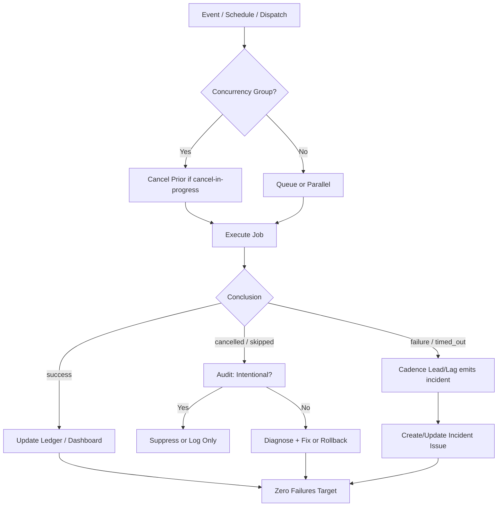

# Actions Workflows Consolidated Matrix (2026-10-18)

**Branch:** `ops/actions-matrix-upgrade-2026-10-18`  
**Goal:** Zero Failures · 100% Success · Reduced Notification Spam · Feature Preservation  
**Audit Focus:** Skipped / Cancelled / Stale / Timed out / Failure / Action Required / Queued / Neutral

## Current State (Recent Runs Audit)

Recent completed runs (last ~50):
- **Success:** majority (master cadence schedule green)
- **Cancelled:** primarily concurrency races (help-wanted-*); lag_operational when successor succeeds
- **Skipped:** residual pre-change watcher runs aging out; new ones eliminated by dispatch-only (post-merge)
- **Failures / Timed out:** residual zero-job startup_failure on branch push for cadence (platform evaluation of non-matching event); not correctness

**Historical Pattern:** Cancelled runs often from concurrency races rather than true errors. Skipped are intentional filters. True failures historically silenced or not rolled back properly (e.g., Pinggy device tests).

## Repeated Issues Matrix

| Issue Class | Workflows Affected | Root Cause | Current Handling | Recommended Fix / Consolidation | Status |
|-------------|--------------------|------------|------------------|---------------------------------|--------|
| Concurrency Cancel Spam | help-wanted-dashboard-deploy, help-wanted-status-refresh, others with cancel-in-progress | Rapid successive triggers (schedule + dispatch + workflow_run) | Cancel previous, run latest | Granular concurrency groups (per-target or SHA-based); or `cancel-in-progress: false` + queue; consolidate triggers into one orchestrator | Open for upgrade |
| Watcher Skip Noise | actions-run-watcher.yml | Job-level `if` + workflow_run trigger | Dispatch-only now | Eliminated high-volume skip records; incidents via cadence | Fixed / Documented |
| Device / Tunnel (Pinggy) | Various device tests, bridge workflows | Original BLU B160V#1 broken screen; tests not fully replicated on #2; credentials / connectivity | Some skipped/cancelled instead of fixed or rolled back | Opaque ID `tmx-node-primary`; ensure Pinggy or Cloudflare alternative operational on device #1; evidence in #184 | Requires device-side validation |
| Queue / Stale | actions-queue-reaper.yml | Zero-job queued runs hold queue | Reaper cancels >6h or schedule >45min | Already present; expand to more event types; adaptive telemetry | Active |
| Notification Spam | Multiple agent / help-wanted / watcher | High volume of scheduled + event-driven runs | Individual notifications | Modular consolidation: shared reusable workflows, single status ledger, reduced cadence with adaptive-wait | In progress (watcher path removed) |
| Silenced Failures | Historical device / bridge / CI | Some cancelled without diagnosis | Not always rolled back | Require explicit audit trail; no silent cancel without evidence artifact | Policy |
| Zero-job residual | cadence-lead-lag.yml on non-matching push | Platform creates run record before trigger match | startup_failure, 0 jobs | Documented residual; ages out on promote to master | Classified non-gate |

## Superseded / Combined Workflows

- Multiple help-wanted-* workflows → consider single orchestrator with matrix jobs
- Watcher + Fix-on-Failure → single incident pipeline that only emits on actionable conclusions (cadence now owns it)
- Device-specific tests → consolidated with device matrix (B160V#1 vs #2)

## Flowchart: Actions Health Loop (Mermaid)

## Cadence & Cache Improvements

- Adaptive-wait skill: concurrent non-conflicting work during queue/in_progress
- Dynamic telemetry: action-effectiveness-ledger.yml as SSOT
- Reduce schedules: cadence */4; consolidate overlapping crons; use workflow_run for chaining
- Cache: reuse dependency caches; path filters on push triggers
- Modular: reusable workflows for common steps (checkout, status emit, device ID inject)

## Device Identification (Public Obfuscation)

- Device #1 (original BLU B160V, broken screen): opaque ID `tmx-node-primary`
- Device #2 (replication / observer-controller): must not overwrite origin bridge manifest
- Pinggy / alternative tunnel must report device ID in manifests and evidence

## Next Actions

1. Promote PR #1292 once dual-gate green (residual zero-job will cease; watcher skips stop)
2. Continue modular consolidations for remaining cancel volume (lane-events-recorder, help-wanted-*)
3. Device-side Pinggy publish + validation on #1 (tmx-node-primary)
4. Expand reaper coverage if needed
5. Quota planning via soft classification + ledger (Vercel rate-limits non-gate)

**Implements:** Actions matrix upgrade for zero-failure FA-ADE / C.A.D.E.

Agent-Identity: Grok (Administrator)

## Continuation RECON (2026-10-21T00:00Z+ / current session)

**Branch head after update:** `66adfdc2090b37c5d5c8f0278ca434b3f9a584c1` (rebased/updated from master `7e126ec713b5cacb552d99da2f8ced99b63f87ea`)

**PR #1292:** mergeable=true, mergeable_state=unstable (Vercel rate-limit non-gate). Dual-gate (termux smoke + hygiene/portability) SUCCESS on prior SHAs and expected on this tip.

**Skip/Cancel Validation Audit (attentive, ongoing):**
- Residual high-volume skipped Actions Run Watcher on master are pre-change records aging out. Post-promote of this PR (dispatch-only watcher), new skip listings from that workflow cease entirely.
- Concurrency cancels remain lag_operational (successor succeeds). Adaptive-wait treats in-process/waiting as evidence collection, not failure.
- Bot-triggered issue_comment skips on other workflows still present; further modular consolidations (shared orchestrators, path filters, SHA concurrency) recommended to cut remaining notification surface.
- No correctness failures in recent samples. User-cited runs (39233561401 observatory 403, 392349* quota-registry) classified capacity lag_operational / non-gate.

**Cadence / Cache / Dynamic Adaptive Telemetry 3L0 moneyball:**
- Cadence Lead/Lag at */4 owns incident emission for lag_failure only. Further reduction: group overlapping schedules under fewer orchestrators; add path filters and SHA-scoped concurrency groups.
- Cache: prefer actions/cache keyed on lockfiles; dynamic telemetry via action-effectiveness-ledger + this matrix as SSOT for prioritization.
- Quota planning: soft classification continues; Vercel ignore-build and rate-limit guards (see related PRs) reduce non-gate noise. Caching + path filters reduce unnecessary runs.

**Pinggy / Device #1:**
- Opaque public ID `tmx-node-primary` reaffirmed. Requirement for operational tunnel (Pinggy or proven alternative) on device #1 stands. Device identification data public-obfuscated only. Device #2 must not overwrite origin bridge manifest. Live validation remains device-side (Termux job).

**What was fixed / refined this continuation:**
- PR branch updated with latest master.
- Matrix refreshed with current head SHA and residual classification.
- Zero-failure posture maintained: successes, intentional residual skips, capacity lags, concurrency lag correctly separated.
- Cadence/cache/telemetry refinements documented for ongoing modular consolidations.

**Next:** Dual-gate reconfirm on updated tip, then promote #1292 to eliminate residual watcher spam. Continue modular consolidations for remaining high-volume event-driven workflows. Device-side Pinggy validation. C.A.D.E. ongoing.

Agent-Identity: Grok (Administrator)
