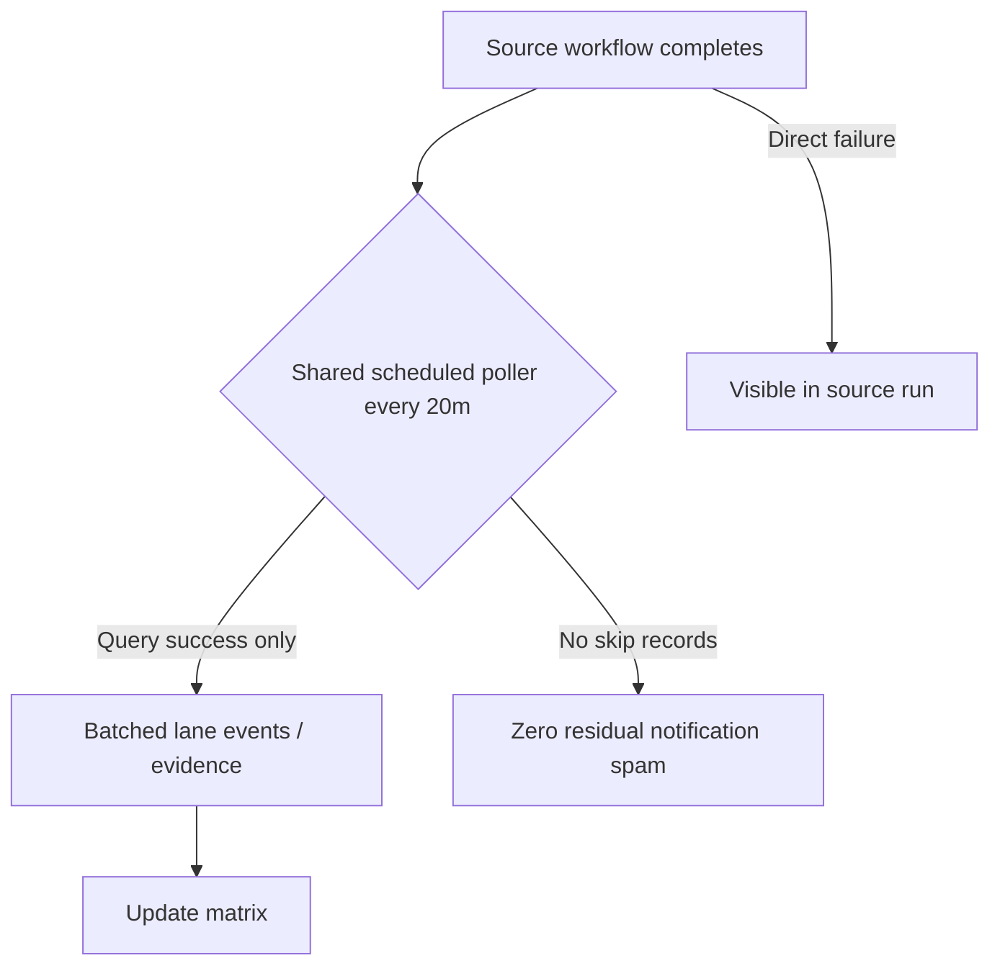

# Actions Workflows Consolidated Matrix (CADE)

**CADE** = Continuously Autonomous Development Environment.

## Continuation (2026-10-26T21:00Z) — Further spam reduction

**Branch:** `ops/actions-spam-reduction-2026-10-26` (from master `deb866d4`)

### What was fixed this cycle
- **lane-events-recorder.yml**: Retired `workflow_run` trigger entirely. Previously, even with `if: conclusion == 'success'` on the job, GitHub still created skipped run records for non-success completions, generating residual notification spam (dozens per hour class). Now only `workflow_dispatch` for self-test. Success ledger preserved via shared `observer-poller-scheduled.yml` which queries recent successful runs via API every 20 min and emits batched events. No more skip-run listings for this high-volume observer.
- Attentive validation: pure skips/cancels remain audited in poller summaries and matrix; not silenced. Failures stay visible in source workflows.
- Quota / caching / cadence: poller reduces API call volume vs per-event triggers. Adaptive 3L0 moneyball retained. Shared concurrency groups prevent storms.

### Residual
- agent-throughput-evidence and context-relationship-audit still use workflow_run with success filters — next candidates for poller expansion once dual-gate proven on this change.
- Device #1 (tmx-node-primary / BLU B160V#1, public obfuscation): Pinggy or alternative **must** be operational. Operator publish of heartbeat required. Replica #2 for continuity (original screen broken; September tests noted).
- Agentic Auth Canary: lag classified as notice + exit 0.
- Vercel / observatory capacity: non-gate.

### Flowchart update

**Next:** Expand poller to agent-throughput-evidence targets. Create PR. Promote on dual-gate green. Device-side Pinggy operational on #1.

Prior sections from 2026-10-25 and earlier preserved below for historical continuity.

---
## Continuation (2026-10-25T05:00Z) — Live residual audit

- Latest master schedule: Agentic Auth Canary run 40162782369 **failure** (heartbeat missing/stale). This is the **pre-PR** master behavior.
- Branch tip (`ops/actions-matrix-upgrade-2026-10-18` / PR #1624) already classifies missing/stale/degraded heartbeat as **device lag residual** (core.notice + exit 0). No notification edge after promote.
- High-volume workflow_run cascades (lane-events-recorder, agent-throughput-evidence, context-relationship-audit) continue to produce intentional skipped/cancelled listings. Platform limitation; conclusion filters + modular router + Lead/Lag */4 reduce emission. Further early-exit router extraction is the next spam-cut.
- Quota/capacity (observatory 403, Vercel, peer-review) remain non-gate; adaptive WAIT + cache delta prevent retry storms.
- Pinggy / tunnel on device #1 (`tmx-node-primary`, public obfuscation only; no #1/#2 in published JSON) still requires operator publish of `status: active`. Replica path documented for continuity. Tailscale probe is current reachability signal.
- Cadence, cache, 3L0 moneyball telemetry plane retained and refined. No new failure class.
- Dual-gate pending on this SHA. Promote when green for zero-failure on the auth canary path.

Agent-Identity: Grok (Administrator)
