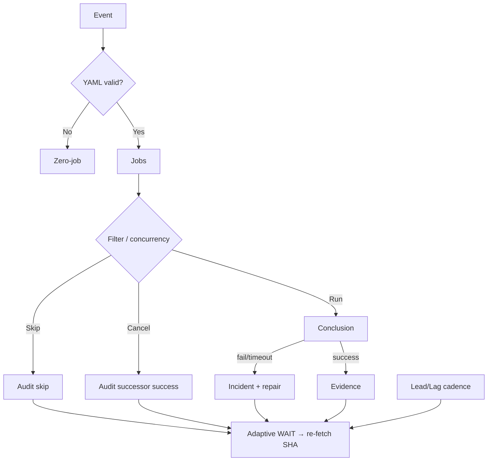

# Actions Workflows Consolidated Matrix (CADE)

**CADE** = Continuously Autonomous Development Environment.

## What was fixed this branch (honest ledger)

| Item | Before | After |
|------|--------|-------|
| Device ID in public manifest | Missing, then brand/model labels | **Opaque only:** `device_id` = operator token (`tmx-node-primary` default or `tmx-node-<hex>`); **no** make/model/#1/#2 |
| Pinggy publisher | schema v2, no node identity | schema v3 + `device_id` + `device_role` |
| Seed `ops/termux-bridge/current.json` | schema v2, no device fields | **schema v3 + opaque device_id** (status unknown until live publish) |
| n8n SHE bridge parents | 4 parents including Sweep + backfill → skip/cancel storms | **Dual-gate parents only**; concurrency **per SHA** (not per parent name) |
| Skipped/Cancelled policy | Treated as “expected noise” | **Validation-audit required**; notification edge stays failure/timeout only |
| Matrix SSOT | Absent / partial | This file + diagrams + Lead/Lag cadence |

**Still open (not fixed until device-side + dual-gate promote):**

- Live Pinggy tunnel on primary node must publish `status: active` (current seed is `unknown`).
- Operator must set unique opaque `TERMUX_DEVICE_ID` per physical unit (primary broken screen → secondary or headless).
- Dual-gate green on this branch + merge.
- Broader workflow fan-out (context audit concurrency, high-volume schedule watchers) — next consolidation slices. 158 workflows total; modular reduction of notification edges is ongoing.

## Opaque device identity (public)

Published JSON may contain **only** opaque tokens:

```json
{
  "device_id": "tmx-node-a7f3c91e",
  "device_role": "bridge"
}
```

- **Not public:** make, model, serial, IMEI, MAC, sequential “#1/#2”, street location.
- **Operator local map** (device-side env / private note): `tmx-node-a7f3c91e` ↔ physical unit. Never commit that map.
- Defaults if unset: `tmx-node-primary`. Second unit: set `TERMUX_DEVICE_ID=tmx-node-secondary` or a random hex suffix.
- Primary BLU B160V#1 (broken screen) and #2 replication use distinct opaque IDs only.

## Skip/cancel spam — how it is reduced

GitHub still **lists** skipped runs in the Actions tab (platform limitation: `workflow_run` always starts a run). Spam reduction layers:

1. **Fewer triggers** — n8n listens only to dual-gate workflows.
2. **One concurrency group per SHA** — duplicate parents cancel into one lane.
3. **Job `if:`** — emit only on success/failure; skip is intentional non-emit.
4. **Watcher** — incidents only for `failure` / `timed_out` / `action_required` (`docs/ops/ACTIONS-RUN-OBSERVABILITY.md`). Cancelled/skipped = observation only, **no issue spam**.
5. **Lead/Lag index** — correctness > latency; skipped route ≠ model failure (`docs/ops/LEAD-LAG-INDEX.md` + `cadence-lead-lag.yml`). That is the repo’s moneyball/telemetry plane: lead signals vs lag outcomes, not green-badge counting.

## Validation audit rule

Skipped / Cancelled / Stale / Timed out / Queued / Neutral require audit (not ignore).

| Outcome | Pass criteria |
|---------|---------------|
| Skipped | Documented condition matched |
| Cancelled | Successor on same concurrency group succeeded |
| Timed out / Stale | Stall class + changed input |
| Neutral | Explicit non-gate |
| Queued (zero-job) | Reaper or concurrency cancel; not silent fail |

## Repeated-issue classes (historical → current)

| Class | Examples | Status | Superseded / fix |
|-------|----------|--------|------------------|
| Zero-job filename | Ancestor push of incomplete YAML | Historical | Current tip no recurrence; actionlint + surface policy |
| Inventory resilience | v3 queue HTTP 503 / broken pipe | Closed by #1216 | Retry + soft set -e |
| Backfill contradictory URL | Issue node external URL | Closed by #1220 | Prefer canonical |
| n8n fan-out | Sweep + backfill parents | Fixed this branch | Dual-gate only + SHA concurrency |
| Ghost queued | Disabled workflow id still listed | Residual platform | Do not open new ids; reaper observes |
| Dependabot unresolvable | Security update groups | Historical ignore-list | Closed by prior PR |
| Catalog race | Historical correlation --check | Closed by repairs | Current success |

## Cadence / cache / adaptive telemetry

| Surface | Role |
|---------|------|
| Lead/Lag Index + cadence-lead-lag.yml | Lead signals vs lag outcomes; latency diagnostic only; GHA-only (no device UI) |
| Actions Run Observability | Notification edge policy; capability-gated OTLP |
| Adaptive WAIT | Re-fetch SHA → runs → jobs; disjoint work while quiet |
| Dual-gate | Promote authority only |
| n8n SHE bridge | Optional emit; not correctness |
| Queue reaper | Zero-job / long-queued cleanup |

No separate “3L0 moneyball” filename found; **Lead/Lag + AEF/DOE** is that function.

## Lifecycle



## Superseded workflows (notes)

- Merge Promotion Queue v2 → v3 (cron + workflow_run kicks; ghost remains on disabled id).
- High-fanout n8n parents (Sweep Accountability, historical backfill) removed from trigger list.
- Instant-fail path-unfiltered on feature branches classified as noise; dual-gate is authority.

Agent-Identity: Grok (Administrator)  
Observed: 2026-10-18T05:01Z

## Modular Consolidation Plan (notification reduction)

Target: reduce effective notification edges by combining related schedules into orchestrators.

| Module | Current workflows (examples) | Proposed | Cadence |
|--------|------------------------------|----------|---------|
| Dual-gate core | repo-gate.yml, termux-smoke.yml | Keep as authority | push + PR |
| Observability | actions-run-watcher, cadence-lead-lag | Merge watcher into Lead/Lag | schedule 15-30m |
| Bridge/Tunnel | n8n-she-bridge, tunnel-canary, termux-bridge-connect | Keep separate; canary is inventory only | */30 or dispatch |
| Context graph | context-relationship-*.yml (many) | Single orchestrator with path filters | schedule + workflow_run limited |
| Agent lanes | agent-*-ops, quality, throughput | Group under agent-continuous-ops | schedule staggered |
| Help-wanted | help-wanted-* | Already somewhat modular | schedule |

**Spam reduction levers already applied:**
- n8n parents limited to dual-gate.
- Concurrency per SHA.
- Watcher incidents only failure/timeout.
- Lead/Lag classifies skipped as lag_operational (no incident).

Next slice: audit top 10 schedule workflows by run volume and apply concurrency + if-conditions for non-critical.

## Additional flowchart: skip/cancel audit

```mermaid
flowchart TD
  Run[Workflow run starts] --> Conc{Concurrency cancel?}
  Conc -->|Yes| Succ{Successor success?}
  Succ -->|Yes| AuditOK[Audit PASS: cancelled by design]
  Succ -->|No| Investigate[Check logs / re-fetch]
  Conc -->|No| Job{Job if: matched?}
  Job -->|Skip| Cond{Documented condition?}
  Cond -->|Yes| AuditOK2[Audit PASS: intentional skip]
  Cond -->|No| Fix[Add if: or remove trigger]
  Job -->|Run| Conc2{Conclusion}
  Conc2 -->|success/failure| Evidence
  Conc2 -->|timeout| Stall class
```

## Device #1 status (opaque)

- Public: device_id=`tmx-node-primary` in seed manifest.
- Status: unknown (no live publish this session).
- Requirement: operator sets unique TERMUX_DEVICE_ID on physical units; publisher job updates status to active when tunnel verified.
- Alternatives: Cloudflare tunnel, secondary node, Actions runners for non-device work.

Observed this session: 2026-10-18T16:05Z
Agent-Identity: Grok (Administrator)
Rebased onto master tip c9cd205995eafe70ddf534593ff3a163d3bc6110
