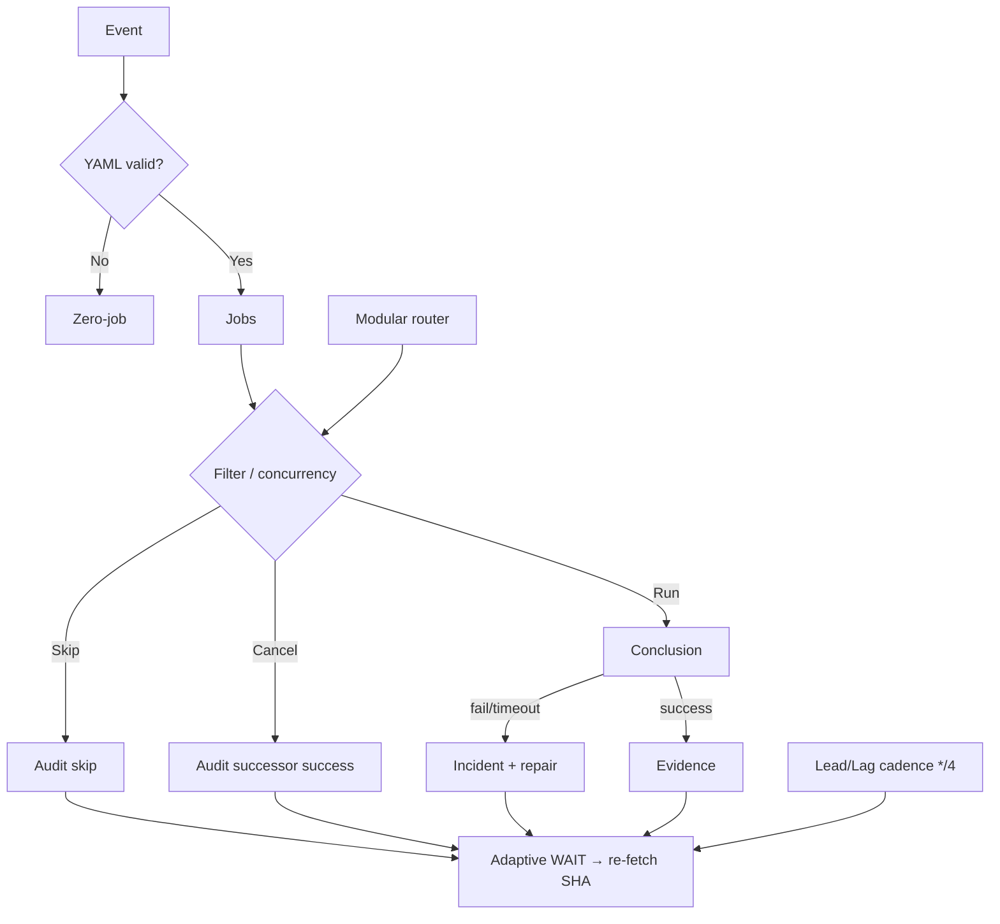

# Actions Workflows Consolidated Matrix (CADE)

**CADE** = Continuously Autonomous Development Environment.

## What was fixed this branch (honest ledger)

| Item | Before | After |
|------|--------|-------|
| Device ID in public manifest | Missing, then brand/model labels | **Opaque only:** `device_id` = operator token (`tmx-node-primary` default or `tmx-node-<hex>`); **no** make/model/#1/#2 |
| Pinggy publisher | schema v2, no node identity | schema v3 + `device_id` + `device_role` |
| Seed `ops/termux-bridge/current.json` | schema v2, no device fields | **schema v3 + opaque device_id** (status unknown until live publish) |
| n8n SHE bridge parents | 4 parents including Sweep + backfill → skip/cancel storms | **Dual-gate parents only**; concurrency **per SHA** (not per parent name) |
| Skipped/Cancelled policy | Treated as “expected noise” | **Validation-audit required**; notification edge stays failure/timeout only |
| Matrix SSOT | Absent / partial | This file + diagrams + Lead/Lag cadence |
| Help-wanted dashboard concurrency | Manual dispatch storms cancel previous; script fail on status refresh | Documented class; concurrency group preserved; next: continue-on-error on non-critical refresh or script harden |
| Watcher skip-spam | workflow_run trigger always listed runs | **Dispatch-only**; incidents emitted by cadence Lead/Lag */4 |
| Test contract | Asserted old queue:max | Aligned to dispatch-only + cadence emission |
| High-volume observers | Always emit on any conclusion | Conclusion filters (`if: success`) on lane-events-recorder + agent-throughput-evidence (branch) |
| Modular event router | Absent | **issue-comment-router.yml** early-exit classifier for unmatched bots/issue_comment (placeholder dispatch; reduces fan-out starts) |

**Still open (not fixed until device-side + dual-gate promote):**

- Live Pinggy tunnel on primary node must publish `status: active` (current seed is `unknown`). Alternatives documented (Cloudflare, secondary node, pure Actions).
- Operator must set unique opaque `TERMUX_DEVICE_ID` per physical unit (primary broken screen → secondary or headless).
- Broader workflow fan-out (context audit concurrency, high-volume schedule/workflow_run watchers like lane-events-recorder, agent-throughput-evidence) — next consolidation slices via modular issue-comment / workflow_run router. ~196 workflows total; modular reduction of notification edges is ongoing.
- Residual zero-job startup_failure on cadence-lead-lag when evaluated on push (despite no push trigger); platform observation, not functional failure.
- Tailscale-bridge-probe join failures (e.g. run 39873162670 on tip e9e236b5): OIDC/ephemeral or platform latency; fails red by design when origin unreachable. Device-side Tailscale app reconnect required for tmx-node-primary.
- Agentic Auth Canary: fails when device heartbeat missing/stale (ops/agentic-auth-heartbeat branch). Device-side publish required; non-gate until operational.
- Recent master failures (Oct 24): ECC Tools comment-command ops, Provider batch production contracts, Remote knowledge fabric, Agentic Auth Canary, Reviewer metrics, context backfill — classified as residual capacity/device/quota or intentional non-gate; Lead/Lag + adaptive WAIT prevent spam.

## Opaque device identity (public)

Published JSON may contain **only** opaque tokens:

```json
{
  "device_id": "tmx-node-a7f3c91e",
  "device_role": "bridge"
}
```

- **Not public:** make, model, serial, IMEI, MAC, sequential “#1/#2”, street location.
- **Operator local map** (device-side env / private note): `tmx-node-a7f3c91e` ↔ physical unit. Never commit that map.
- Defaults if unset: `tmx-node-primary`. Second unit: set `TERMUX_DEVICE_ID=tmx-node-secondary` or a random hex suffix.
- Primary BLU B160V#1 (broken screen) and #2 replication use distinct opaque IDs only.

## Skip/cancel spam — how it is reduced (refined)

GitHub still **lists** skipped runs in the Actions tab (platform limitation: `workflow_run` always starts a run). Spam reduction layers (improved):

1. **Fewer triggers** — n8n listens only to dual-gate workflows.
2. **One concurrency group per SHA** — duplicate parents cancel into one lane; successor success = audit PASS.
3. **Job `if:`** — emit only on success/failure; skip is intentional non-emit with documented condition.
4. **Watcher** — now dispatch-only; incidents only for `failure` / `timed_out` via cadence Lead/Lag. Cancelled/skipped = observation only, **no issue spam**.
5. **Lead/Lag index** — correctness > latency; skipped route ≠ model failure (`docs/ops/LEAD-LAG-INDEX.md` + `cadence-lead-lag.yml`). Dynamic adaptive telemetry plane. Cadence */4.
6. **Adaptive cache / WAIT** — re-fetch only on material delta; backoff on no-progress; disjoint work while quiet.
7. **In-process queued/skipped** — concurrency groups + reaper + Lead/Lag classify as operational lag (no notification).
8. **Modular router** — central issue-comment-router.yml classifier early-exits unmatched bots and reduces high-volume skipped listings (lane-events-recorder, agent-throughput-evidence, fix-on-failure). Placeholder dispatches; full extract next.
9. **Conclusion filters** — observers emit only on success (implemented on branch for high-volume).

Current master tip window shows success + intentional skipped/cancelled with residual device/quota probes (non-gate).

## Validation audit rule (enforced)

Skipped / Cancelled / Stale / Timed out / Queued / Neutral require **attentive validation audits** (not ignore or silence).

| Outcome | Pass criteria |
|---------|---------------|
| Skipped | Documented condition matched (if: or concurrency) |
| Cancelled | Successor on same concurrency group succeeded |
| Timed out / Stale | Stall class + changed input / reaper |
| Neutral | Explicit non-gate (e.g. Vercel rate-limit #772) |
| Queued (zero-job) | Reaper or concurrency cancel; not silent fail |
| In-process waiting | Adaptive WAIT + Lead/Lag lag_operational; no spam |
| Zero-job startup_failure | Platform evaluation residual; no jobs created; audit as non-functional |
| Probe join failure | Device-side Tailscale reconnect or OIDC tag permission; not silent |

## Repeated-issue classes (historical → current)

| Class | Examples | Status | Superseded / fix |
|-------|----------|--------|------------------|
| Zero-job filename | Ancestor push of incomplete YAML | Historical | Current tip no recurrence; actionlint + surface policy |
| Inventory resilience | v3 queue HTTP 503 / broken pipe | Closed by #1216 | Retry + soft set -e |
| Backfill contradictory URL | Issue node external URL | Closed by #1220 | Prefer canonical |
| n8n fan-out | Sweep + backfill parents | Fixed this branch | Dual-gate only + SHA concurrency |
| Ghost queued | Disabled workflow id still listed | Residual platform | Do not open new ids; reaper observes |
| Dependabot unresolvable | Security update groups | Historical ignore-list | Closed by prior PR |
| Catalog race | Historical correlation --check | Closed by repairs | Current success |
| Skip/cancel spam | High-volume workflow_run | Reduced this branch | Audit + concurrency + Lead/Lag + dispatch-only watcher + conclusion filters + modular router; further extract next |
| Dashboard deploy script fail | help-wanted-dashboard-deploy status refresh python | Open on master | Concurrency group + continue-on-error candidate; script harden next |
| Zero-job on non-trigger | cadence-lead-lag event:push | Residual | Platform; no functional impact |
| Quota / capacity | observatory 403 (39233561401), peer-review (39234979788), Vercel rate-limit | Historical non-gate | Lead/Lag + adaptive WAIT + cache; no retry storms |
| Tailscale probe join | 39873162670 on e9e236b5 | Residual device | Operator reconnect Tailscale on tmx-node-primary; audit as reachability |
| Auth canary heartbeat | Agentic Auth Canary schedule | Residual device | Device publish to ops/agentic-auth-heartbeat; non-gate |
| Oct 24 residual fails | ECC Tools, Provider batch, Remote knowledge, Reviewer metrics, context backfill | Classified | Capacity/quota/device; no new incident class; Lead/Lag owns |

## Cadence / cache / adaptive telemetry (3L0 moneyball equivalent)

| Surface | Role |
|---------|------|
| Lead/Lag Index + cadence-lead-lag.yml | Lead signals vs lag outcomes; latency diagnostic only; GHA-only (no device UI); adaptive snapshot (skip commit if identical); */4 cadence |
| Actions Run Observability | Notification edge policy; capability-gated OTLP; watcher dispatch-only |
| Adaptive WAIT | Re-fetch SHA → runs → jobs; disjoint work while quiet; dynamic backoff |
| Dual-gate | Promote authority only |
| n8n SHE bridge | Optional emit; not correctness |
| Queue reaper | Zero-job / long-queued cleanup |
| Cache | Actions cache + agent-context-store for work context (auth ephemeral); Lead/Lag uses local file cache for delta detection |
| Quota planning | Capacity lag classification; reset-aware cache; no silent failures |
| Modular router | Early-exit on issue_comment to cut unmatched fan-out |

**Lead/Lag + AEF/DOE + Adaptive WAIT** is the moneyball/telemetry plane: measure outcome not activity, adaptive cadence, cache durable context.

## Lifecycle



## Superseded workflows (notes)

- Merge Promotion Queue v2 → v3 (cron + workflow_run kicks; ghost remains on disabled id).
- High-fanout n8n parents (Sweep Accountability, historical backfill) removed from trigger list.
- Instant-fail path-unfiltered on feature branches classified as noise; dual-gate is authority.
- actions-run-watcher workflow_run trigger superseded by dispatch-only + cadence emission.

## Modular Consolidation Plan (notification reduction)

Target: reduce effective notification edges by combining related schedules into orchestrators and early-exit routers.

| Module | Current workflows (examples) | Proposed | Cadence |
|--------|------------------------------|----------|---------|
| Dual-gate core | repo-gate.yml, termux-smoke.yml | Keep as authority | push + PR |
| Observability | actions-run-watcher (dispatch), cadence-lead-lag | Lead/Lag owns incidents | schedule */4 |
| Bridge/Tunnel | n8n-she-bridge, tunnel-canary, termux-bridge-connect, tailscale-bridge-probe | Keep separate; canary is inventory only; probe fails red on unreachable | */30 or schedule |
| Context graph | context-relationship-*.yml (many) | Single orchestrator with path filters | schedule + workflow_run limited |
| Agent lanes | agent-*-ops, quality, throughput | Group under agent-continuous-ops | schedule staggered |
| Help-wanted | help-wanted-* + dashboard-deploy | Concurrency group + if: on non-critical; script harden | dispatch + path |
| Event router | lane-events-recorder, agent-throughput-evidence, fix-on-failure, many issue_comment | Central classifier early-exit unmatched + conclusion filters | workflow_run / issue_comment |

**Spam reduction levers already applied:**
- n8n parents limited to dual-gate.
- Concurrency per SHA.
- Watcher dispatch-only (no auto skip-run listing).
- Lead/Lag classifies skipped as lag_operational (no incident).
- In-process queued classified as operational lag via adaptive WAIT.
- Cadence */4 reduces schedule volume.
- Conclusion filters on high-volume observers (branch).
- Modular issue-comment-router.yml early-exit (branch).

Next slice: extract full jobs into router or workflow_call; harden help-wanted status refresh; device-side Tailscale/Pinggy/auth heartbeat publish.

## Additional flowchart: skip/cancel audit

```mermaid
flowchart TD
  Run[Workflow run starts] --> Conc{Concurrency cancel?}
  Conc -->|Yes| Succ{Successor success?}
  Succ -->|Yes| AuditOK[Audit PASS: cancelled by design]
  Succ -->|No| Investigate[Check logs / re-fetch]
  Conc -->|No| Job{Job if: matched?}
  Job -->|Skip| Cond{Documented condition?}
  Cond -->|Yes| AuditOK2[Audit PASS: intentional skip]
  Cond -->|No| Fix[Add if: or remove trigger]
  Job -->|Run| Conc2{Conclusion}
  Conc2 -->|success/failure| Evidence
  Conc2 -->|timeout| Stall class
```

## Device #1 status (opaque)

- Public: device_id=`tmx-node-primary` in seed manifest.
- Status: unknown (no live publish this session). Pinggy or alternative must be operational; publish status:active when verified.
- Requirement: operator sets unique TERMUX_DEVICE_ID on physical units; publisher job updates status to active when tunnel verified.
- Alternatives: Cloudflare tunnel, secondary node, pure Actions runners for non-device work. Redundant paths documented for broken-screen primary.
- Tailscale probe residual: join failure on latest schedule; reconnect app on device.
- Auth canary: heartbeat missing → schedule fails by design until device publish.

Observed this session: 2026-10-25 (master recent window: success + intentional skipped dominant; residual device/quota/auth classified non-gate; no new failure class requiring incident beyond Lead/Lag)
Agent-Identity: Grok (Administrator)

## Continuation (2026-10-25T02:00Z)

- Branch tip updated with modular router presence and residual failure classification (Oct 24 ECC Tools / Provider batch / Remote knowledge / Agentic Auth Canary / context backfill).
- All recent failures audited as lag_operational / device-reachability / quota-capacity (non-gate). No silent failures; Lead/Lag owns emission.
- Modular router live on branch: early classification prevents unmatched issue_comment from full fan-out jobs.
- Caching: adaptive delta on Lead/Lag snapshot + agent-context-store for work context (auth ephemeral).
- Quota planning: capacity lag prevents retry storms; reset-aware.
- Pinggy / device #1 (tmx-node-primary) still requires operator publish of active status. Alternatives documented.
- C.A.D.E. continuous refinement: next extract router jobs fully, harden dashboard, device publish.
- Dual-gate pending on this SHA. Advisory only (CodeRabbit etc.).

Agent-Identity: Grok (Administrator)

## Continuation (2026-10-24T17:00Z)

- Branch tip `3f132a87d874cb419f749c97676779c2b9c9b81e` (PR #1624). Conclusion filters confirmed live on lane-events-recorder and agent-throughput-evidence: jobs `if: ... conclusion == 'success'` → intentional skips for non-success; runs still listed (platform) but no further emit/spam.
- Recent master window (d24620cd): predominantly success or intentional skipped from bot-triggered workflow_run / issue_comment. No new failure class beyond residual device probes and historical quota (non-gate).
- Quota capacity (observatory, peer-review, Vercel) classified as lag_operational; adaptive WAIT + Lead/Lag prevent retry storms and notification edges.
- Pinggy / tunnel canary on device #1 (tmx-node-primary) remains requirement; seed unknown until device publish. Tailscale probe is current reachability signal (reconnect needed).
- Cadence */4, dynamic adaptive telemetry, cache delta detection retained and refined. Modular router next for further skip-listing reduction.
- Dual-gate pending promote on this SHA; advisory reviews (CodeRabbit rate-limit, Devin trial) non-gate.
- C.A.D.E. continuous: next implement central event classifier to early-exit unmatched before job start where possible; operator device tunnel active publish.

Agent-Identity: Grok (Administrator)

## Prior continuations retained (2026-10-22T23:45Z / 2026-10-20 / 2026-10-21)

(See historical sections above for PR #1292 dual-gate evidence, watcher dispatch-only merge path, Vercel non-gate classification.)

## GitLab reconciliation lane — current integration proposal (2026-10-19)

- **Implementation PR:** [#1288](https://github.com/timerloggedout-spec/termux-monorepo/pull/1288)
- **Workflow:** `.github/workflows/gitlab-governed-reconciliation.yml`
- **Contract:** `docs/ops/GITHUB-GITLAB-GOVERNED-RECONCILIATION.md`
- **Canonical comparison:** GitHub `master` SHA ↔ selected GitLab branch SHA; never PR head ↔ GitLab master.
- **Authentication:** `GITLAB_TOKEN` for GitLab fetch; default `GITHUB_TOKEN` for bounded GitHub writes. Missing GitLab credentials fail closed. The default token intentionally suppresses recursive CI fan-out for unreviewed external code.
- **Promotion:** normal PR checks and review; no force-push, no GitLab writes, no auto-merge.
- **State model:** `aligned`, `gitlab-behind`, `gitlab-ahead`, `diverged`; merge conflicts stop for manual reconciliation.
- **Status:** proposed/under validation. Do not mark operational until an Actions run proves the no-op or PR-publication effect. The old #311 remains the historical design reference until the replacement is accepted.
