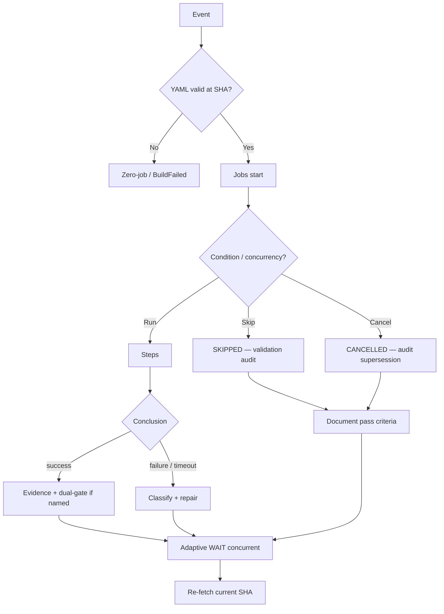
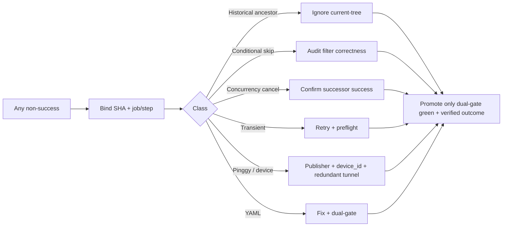

# Actions Workflows Consolidated Matrix (CADE)

**SSOT for repeated issues, superseded workflows, diagnosis paths, and notification reduction.**

**CADE** = Continuously Autonomous Development Environment (FA-ADE sibling posture).

Live master tip (2026-10-18): advanced past `64712b14` → `f722a74` / `fd1a5cc` / later. **Zero conclusion=failure** in the recent window. Dual-gate remains promote authority.

## Validation audit rule (non-negotiable)

**Skipped / Cancelled / Stale / Timed out / Queued / Neutral are not noise.** Each requires an attentive validation audit:

| Outcome | Audit question | Pass criteria |
|---------|----------------|---------------|
| Skipped | Was the `if:` / path filter correct for this SHA and event? | Documented condition matched; no missing required parent conclusion |
| Cancelled | Concurrency supersession or explicit cancel? | Newer run on same group succeeded; no silent loss of required evidence |
| Stale / Timed out | Stall class (admission / queue / execution / effect)? | Re-dispatch or repair with changed input; not blind retry |
| Queued | Admission vs capacity vs disabled workflow? | Ghost on disabled id remains historical; live queues progress |
| Neutral | Advisory-only lane? | Explicit non-gate; never promote authority |

A green-looking stream with un-audited skips is **not** verified outcome.

## Repeated issues matrix

| Class | Symptom | Root / Trigger | Status on tip | Fix / Successor | Notes |
|-------|---------|----------------|---------------|-----------------|-------|
| Zero-job filename | 0 jobs, synthetic BuildFailed | Ancestor / missing YAML at ref | Closed | Current tree + ruleset | Not YAML parse on master |
| Catalog race | Historical Evaluation Correlation exit | Concurrent catalog write | Closed | Race fix promoted | Bind to SHA |
| Sweep receipt non-FF | Receipt push rejected | Concurrent bot commits | Closed | Receipt discipline | Adaptive WAIT |
| Backfill 403 | Historical window exit 2 | Rate limit page N | Closed | RateLimitDeferred | Defer after retries |
| Continuous-improve DNS | ssh name resolution | Host transient | Closed | getent preflight | Environmental |
| Ledger jq / missing head | exit 126 / 128 | Unbounded argv / head moved | Closed | Arg max + skip | Soften set -e |
| Skill EOF blank | Quality lane exit 2 | Extra newline | Closed | Strip on commit | Hygiene |
| Dependabot security | security_update_not_possible | Unresolvable group | Closed | Ignore list | Advisory |
| Queue v2 ghost | Queued zero-job on disabled id | Cron + disabled workflow | Historical | v3 + kicks | Do not reopen id |
| Dual-gate name drift | Observer miss | Old job names vs live | Closed | Name match | #1174/#1180/#1181 |
| Backfill contradictory URL | node issue:964 | External vs canonical | Closed | Prefer canonical | #1220 |
| Inventory transient | v3 inventory exit 1 | HTTP 503 / pipefail | Closed | Retry helper | #1216 |
| **Pinggy / device#1** | Tunnel stale; no device ID | Free TTL + hardware; schema gap | **Open** | Publisher + device_id + #2 parallel | **Required operational** |
| Vercel rate-limit | Combined status noise | #772 | Non-gate | Ignore | Never promote block |
| **Skipped / Cancelled** | Burst on n8n / audit / watcher | Concurrency + filters | **Audit required** | Modular consolidate | Not "expected = ignore" |

## Pinggy + device identification (public obfuscation)

**Requirement:** Pinggy **or** approved alternative **must be operational** on device #1. Device identification data must be present with **public obfuscation** only (no secrets, no raw serials that enable targeting).

Current `ops/termux-bridge/current.json` (schema_version 2):

- status: `unknown` (seeded; not live-verified this session)
- transport: `pinggy-tcp-over-ssh`
- endpoint present but `observed_at` / `expires_at` null
- **missing:** `device_id` (public-obfuscated label for BLU B160V#1 vs #2)

**Schema extension (required next publish):**

```json
{
  "device_id": "blu-b160v-01",
  "device_label": "BLU B160V#1",
  "device_role": "primary-termux-bridge"
}
```

- `device_id`: stable public token (e.g. `blu-b160v-01`), not IMEI/serial/MAC.
- Publisher script (`scripts/termux/publish-pinggy-endpoint.sh`) must accept `TERMUX_DEVICE_ID` / `TERMUX_DEVICE_LABEL` env and emit into the manifest.
- September tests = original BLU B160V#1 (screen broken). Replication on #2 does **not** retire the #1 operational requirement once restored or replaced.
- Redundancy: Pinggy + Cloudflare parallel (RESILIENCE.md).

Live publisher + verify scripts remain the device-side authority; Actions only consume the manifest.

## Modular consolidation targets (reduce notifications)

Goal: cut Actions notification volume without losing evidence.

| Target | Current behavior | Consolidation |
|--------|------------------|---------------|
| n8n SHE bridge | Many skipped (if: not success/failure) + cancelled (concurrency) on every parent | Keep; already filters. Audit skip rate; do not expand parent list |
| Actions Run Watcher | Only failure / timed_out | Keep. Do not notify on success/cancelled |
| Context Relationship Audit | Frequent cancelled under concurrency on rapid push | Coalesce group; prefer single success per SHA |
| Sweep Accountability | Cancels on supersession | Receipt-only; no incident noise |
| Multiple workflow_run children | Fan-out per parent | Prefer one aggregator per SHA where evidence is identical |

**Rule:** Consolidation must preserve job/step/artifact IDs for the promoting SHA. Never delete evidence; fold notification surfaces only.

## Superseded / combined workflows

- Operations Cadence Audit (file absent) → cadence + RECON kicks.
- Merge Promotion Queue v2 → v3.
- Zero-job placeholders → closed by child success.

Feature preservation: extract-only onto live tip. Do not re-enable ghosts.

## Lifecycle (audit-aware)



## Diagnosis → Fix (CADE)



## Credential note

Issue #184 names-only. Never paste secret values.

Agent-Identity: Grok (Administrator)  
Observed: 2026-10-18T04:27Z · CADE refine · tip f722a74+
