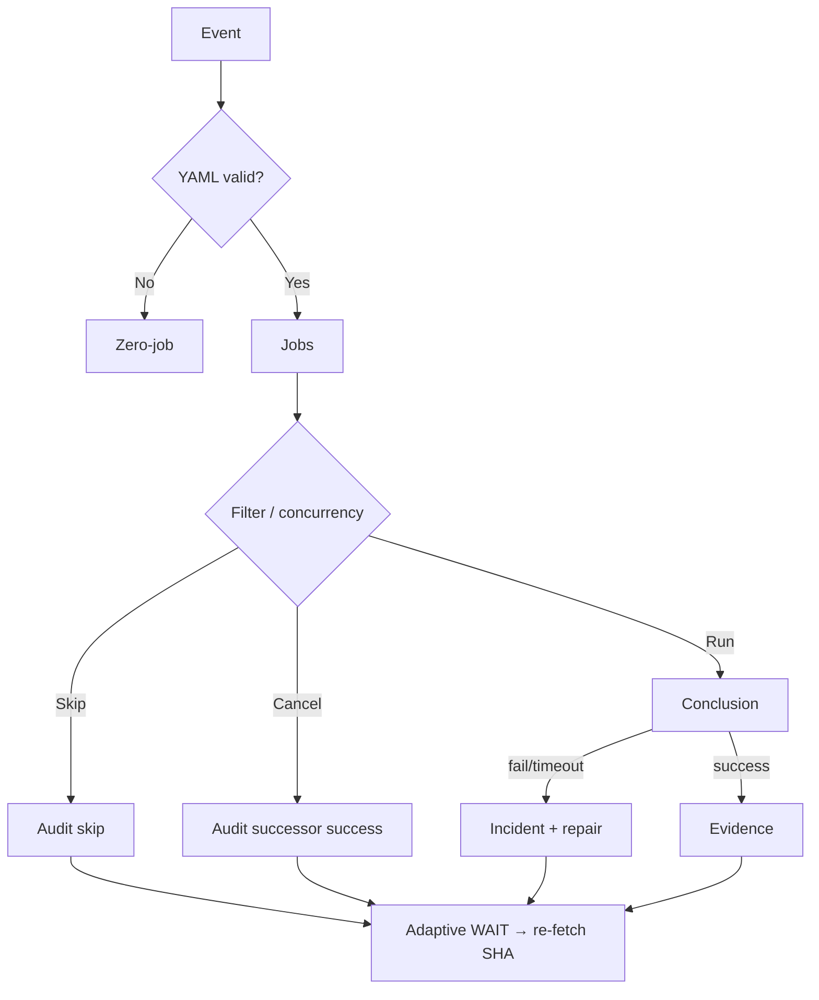

# Actions Workflows Consolidated Matrix (CADE)

**CADE** = Continuously Autonomous Development Environment.

## What was fixed this branch (honest ledger)

| Item | Before | After |
|------|--------|-------|
| Device ID in public manifest | Missing, then brand/model labels | **Opaque only:** `device_id` = operator token (`tmx-node-primary` default or `tmx-node-<hex>`); **no** make/model/#1/#2 |
| Pinggy publisher | schema v2, no node identity | schema v3 + `device_id` + `device_role` |
| n8n SHE bridge parents | 4 parents including Sweep + backfill → skip/cancel storms | **Dual-gate parents only**; concurrency **per SHA** (not per parent name) |
| Skipped/Cancelled policy | Treated as “expected noise” | **Validation-audit required**; notification edge stays failure/timeout only |
| Matrix SSOT | Absent / partial | This file + diagrams |

**Still open (not fixed until device-side + dual-gate promote):**

- Live Pinggy tunnel on primary node must publish `status: active` (current master manifest is seeded `unknown`).
- Operator must set unique opaque `TERMUX_DEVICE_ID` per physical unit.
- Dual-gate green on this branch + merge.
- Broader workflow fan-out (context audit concurrency) — next consolidation slice.

## Opaque device identity (public)

Published JSON may contain **only** opaque tokens:

```json
{
  "device_id": "tmx-node-a7f3c91e",
  "device_role": "bridge"
}
```

- **Not public:** make, model, serial, IMEI, MAC, sequential “#1/#2”, street location.
- **Operator local map** (device-side env / private note): `tmx-node-a7f3c91e` ↔ physical unit. Never commit that map.
- Defaults if unset: `tmx-node-primary`. Second unit: set `TERMUX_DEVICE_ID=tmx-node-secondary` or a random hex suffix.

## Skip/cancel spam — how it is reduced

GitHub still **lists** skipped runs in the Actions tab (platform limitation: `workflow_run` always starts a run). Spam reduction layers:

1. **Fewer triggers** — n8n listens only to dual-gate workflows.
2. **One concurrency group per SHA** — duplicate parents cancel into one lane.
3. **Job `if:`** — emit only on success/failure; skip is intentional non-emit.
4. **Watcher** — incidents only for `failure` / `timed_out` / `action_required` (`docs/ops/ACTIONS-RUN-OBSERVABILITY.md`). Cancelled/skipped = observation only, **no issue spam**.
5. **Lead/Lag index** — correctness > latency; skipped route ≠ model failure (`docs/ops/LEAD-LAG-INDEX.md`). That is the repo’s moneyball/telemetry plane: lead signals vs lag outcomes, not green-badge counting.

## Validation audit rule

Skipped / Cancelled / Stale / Timed out / Queued / Neutral require audit (not ignore).

| Outcome | Pass criteria |
|---------|---------------|
| Skipped | Documented condition matched |
| Cancelled | Successor on same concurrency group succeeded |
| Timed out / Stale | Stall class + changed input |
| Neutral | Explicit non-gate |

## Cadence / cache / adaptive telemetry

| Surface | Role |
|---------|------|
| Lead/Lag Index | Lead signals vs lag outcomes; latency diagnostic only |
| Actions Run Observability | Notification edge policy; capability-gated OTLP |
| Adaptive WAIT | Re-fetch SHA → runs → jobs; disjoint work while quiet |
| Dual-gate | Promote authority only |
| n8n SHE bridge | Optional emit; not correctness |

No separate “3L0 moneyball” filename found; **Lead/Lag + AEF/DOE** is that function.

## Lifecycle



Agent-Identity: Grok (Administrator)  
Observed: 2026-10-18T04:42Z
