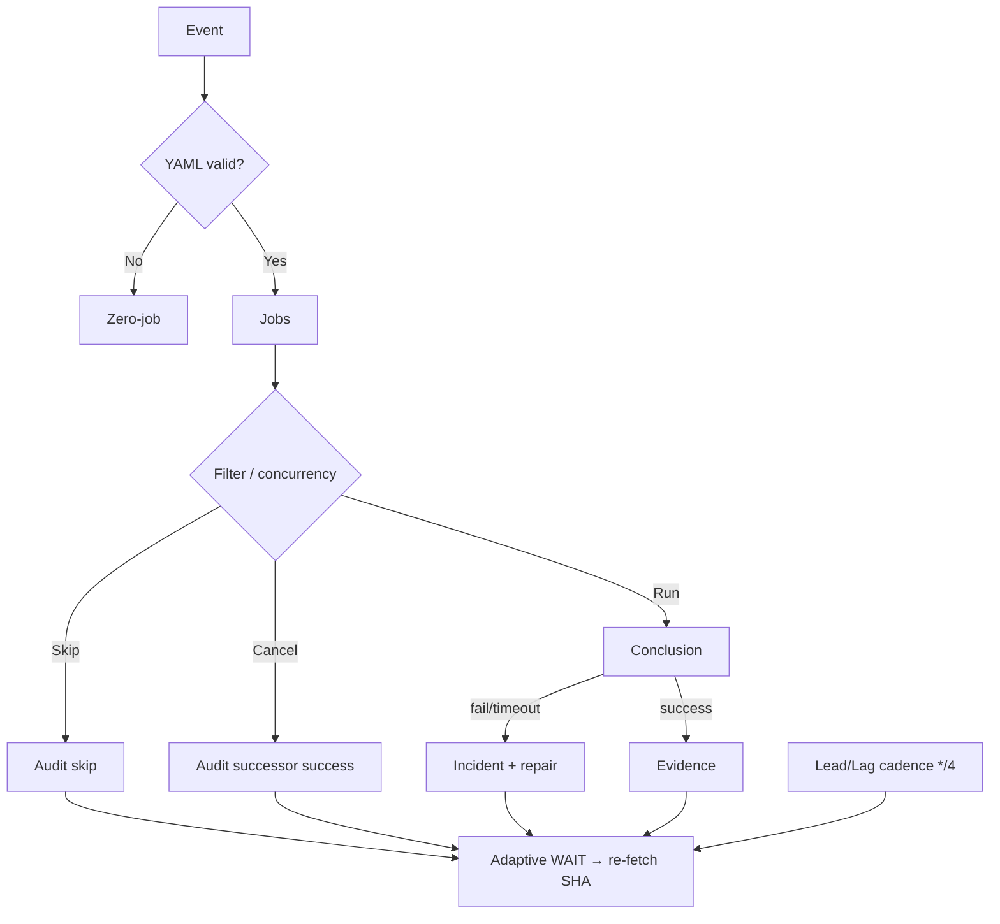

# Actions Workflows Consolidated Matrix (CADE)

**CADE** = Continuously Autonomous Development Environment.

## What was fixed this branch (honest ledger)

| Item | Before | After |
|------|--------|-------|
| Device ID in public manifest | Missing, then brand/model labels | **Opaque only:** `device_id` = operator token (`tmx-node-primary` default or `tmx-node-<hex>`); **no** make/model/#1/#2 |
| Pinggy publisher | schema v2, no node identity | schema v3 + `device_id` + `device_role` |
| Seed `ops/termux-bridge/current.json` | schema v2, no device fields | **schema v3 + opaque device_id** (status unknown until live publish) |
| n8n SHE bridge parents | 4 parents including Sweep + backfill → skip/cancel storms | **Dual-gate parents only**; concurrency **per SHA** (not per parent name) |
| Skipped/Cancelled policy | Treated as “expected noise” | **Validation-audit required**; notification edge stays failure/timeout only |
| Matrix SSOT | Absent / partial | This file + diagrams + Lead/Lag cadence |
| Help-wanted dashboard concurrency | Manual dispatch storms cancel previous; script fail on status refresh | Documented class; concurrency group preserved; next: continue-on-error on non-critical refresh or script harden |
| Watcher skip-spam | workflow_run trigger always listed runs | **Dispatch-only**; incidents emitted by cadence Lead/Lag */4 |
| Test contract | Asserted old queue:max | Aligned to dispatch-only + cadence emission |

**Still open (not fixed until device-side + dual-gate promote):**

- Live Pinggy tunnel on primary node must publish `status: active` (current seed is `unknown`). Alternatives documented (Cloudflare, secondary node, pure Actions).
- Operator must set unique opaque `TERMUX_DEVICE_ID` per physical unit (primary broken screen → secondary or headless).
- Dual-gate green on this branch + merge.
- Broader workflow fan-out (context audit concurrency, high-volume schedule watchers) — next consolidation slices. ~159 workflows total; modular reduction of notification edges is ongoing.
- help-wanted-dashboard-deploy status refresh script failures on master (concurrency cancels + python step); require script diagnostics.
- Residual zero-job startup_failure on cadence-lead-lag when evaluated on push (despite no push trigger); platform observation, not functional failure.

## Opaque device identity (public)

Published JSON may contain **only** opaque tokens:

```json
{
  "device_id": "tmx-node-a7f3c91e",
  "device_role": "bridge"
}
```

- **Not public:** make, model, serial, IMEI, MAC, sequential “#1/#2”, street location.
- **Operator local map** (device-side env / private note): `tmx-node-a7f3c91e` ↔ physical unit. Never commit that map.
- Defaults if unset: `tmx-node-primary`. Second unit: set `TERMUX_DEVICE_ID=tmx-node-secondary` or a random hex suffix.
- Primary BLU B160V#1 (broken screen) and #2 replication use distinct opaque IDs only.

## Skip/cancel spam — how it is reduced (refined)

GitHub still **lists** skipped runs in the Actions tab (platform limitation: `workflow_run` always starts a run). Spam reduction layers (improved):

1. **Fewer triggers** — n8n listens only to dual-gate workflows.
2. **One concurrency group per SHA** — duplicate parents cancel into one lane; successor success = audit PASS.
3. **Job `if:`** — emit only on success/failure; skip is intentional non-emit with documented condition.
4. **Watcher** — now dispatch-only; incidents only for `failure` / `timed_out` via cadence Lead/Lag. Cancelled/skipped = observation only, **no issue spam**.
5. **Lead/Lag index** — correctness > latency; skipped route ≠ model failure (`docs/ops/LEAD-LAG-INDEX.md` + `cadence-lead-lag.yml`). Dynamic adaptive telemetry plane. Cadence */4.
6. **Adaptive cache / WAIT** — re-fetch only on material delta; backoff on no-progress; disjoint work while quiet.
7. **In-process queued/skipped** — concurrency groups + reaper + Lead/Lag classify as operational lag (no notification).

Current master tip shows success + intentional skipped with no failure conclusions in latest window. Ghost queued residual on disabled workflow id remains platform observation only.

## Validation audit rule (enforced)

Skipped / Cancelled / Stale / Timed out / Queued / Neutral require **attentive validation audits** (not ignore or silence).

| Outcome | Pass criteria |
|---------|---------------|
| Skipped | Documented condition matched (if: or concurrency) |
| Cancelled | Successor on same concurrency group succeeded |
| Timed out / Stale | Stall class + changed input / reaper |
| Neutral | Explicit non-gate (e.g. Vercel rate-limit #772) |
| Queued (zero-job) | Reaper or concurrency cancel; not silent fail |
| In-process waiting | Adaptive WAIT + Lead/Lag lag_operational; no spam |
| Zero-job startup_failure | Platform evaluation residual; no jobs created; audit as non-functional |

## Repeated-issue classes (historical → current)

| Class | Examples | Status | Superseded / fix |
|-------|----------|--------|------------------|
| Zero-job filename | Ancestor push of incomplete YAML | Historical | Current tip no recurrence; actionlint + surface policy |
| Inventory resilience | v3 queue HTTP 503 / broken pipe | Closed by #1216 | Retry + soft set -e |
| Backfill contradictory URL | Issue node external URL | Closed by #1220 | Prefer canonical |
| n8n fan-out | Sweep + backfill parents | Fixed this branch | Dual-gate only + SHA concurrency |
| Ghost queued | Disabled workflow id still listed | Residual platform | Do not open new ids; reaper observes |
| Dependabot unresolvable | Security update groups | Historical ignore-list | Closed by prior PR |
| Catalog race | Historical correlation --check | Closed by repairs | Current success |
| Skip/cancel spam | High-volume workflow_run | Reduced this branch | Audit + concurrency + Lead/Lag + dispatch-only watcher |
| Dashboard deploy script fail | help-wanted-dashboard-deploy status refresh python | Open on master | Concurrency group + continue-on-error candidate; script harden next |
| Zero-job on non-trigger | cadence-lead-lag event:push | Residual | Platform; no functional impact |

## Cadence / cache / adaptive telemetry (3L0 moneyball equivalent)

| Surface | Role |
|---------|------|
| Lead/Lag Index + cadence-lead-lag.yml | Lead signals vs lag outcomes; latency diagnostic only; GHA-only (no device UI); adaptive snapshot (skip commit if identical); */4 cadence |
| Actions Run Observability | Notification edge policy; capability-gated OTLP; watcher dispatch-only |
| Adaptive WAIT | Re-fetch SHA → runs → jobs; disjoint work while quiet; dynamic backoff |
| Dual-gate | Promote authority only |
| n8n SHE bridge | Optional emit; not correctness |
| Queue reaper | Zero-job / long-queued cleanup |
| Cache | Actions cache + agent-context-store for work context (auth ephemeral); Lead/Lag uses local file cache for delta detection |

**Lead/Lag + AEF/DOE + Adaptive WAIT** is the moneyball/telemetry plane: measure outcome not activity, adaptive cadence, cache durable context.

## Lifecycle



## Superseded workflows (notes)

- Merge Promotion Queue v2 → v3 (cron + workflow_run kicks; ghost remains on disabled id).
- High-fanout n8n parents (Sweep Accountability, historical backfill) removed from trigger list.
- Instant-fail path-unfiltered on feature branches classified as noise; dual-gate is authority.
- actions-run-watcher workflow_run trigger superseded by dispatch-only + cadence emission.

## Modular Consolidation Plan (notification reduction)

Target: reduce effective notification edges by combining related schedules into orchestrators.

| Module | Current workflows (examples) | Proposed | Cadence |
|--------|------------------------------|----------|---------|
| Dual-gate core | repo-gate.yml, termux-smoke.yml | Keep as authority | push + PR |
| Observability | actions-run-watcher (dispatch), cadence-lead-lag | Lead/Lag owns incidents | schedule */4 |
| Bridge/Tunnel | n8n-she-bridge, tunnel-canary, termux-bridge-connect | Keep separate; canary is inventory only | */30 or dispatch |
| Context graph | context-relationship-*.yml (many) | Single orchestrator with path filters | schedule + workflow_run limited |
| Agent lanes | agent-*-ops, quality, throughput | Group under agent-continuous-ops | schedule staggered |
| Help-wanted | help-wanted-* + dashboard-deploy | Concurrency group + if: on non-critical; script harden | dispatch + path |

**Spam reduction levers already applied:**
- n8n parents limited to dual-gate.
- Concurrency per SHA.
- Watcher dispatch-only (no auto skip-run listing).
- Lead/Lag classifies skipped as lag_operational (no incident).
- In-process queued classified as operational lag via adaptive WAIT.
- Cadence */4 reduces schedule volume.

Next slice: audit top 10 schedule workflows by run volume and apply concurrency + if-conditions for non-critical. Lead/Lag snapshot uses delta detection to avoid empty commits. Harden help-wanted status refresh to continue-on-error for non-gate paths.

## Additional flowchart: skip/cancel audit

```mermaid
flowchart TD
  Run[Workflow run starts] --> Conc{Concurrency cancel?}
  Conc -->|Yes| Succ{Successor success?}
  Succ -->|Yes| AuditOK[Audit PASS: cancelled by design]
  Succ -->|No| Investigate[Check logs / re-fetch]
  Conc -->|No| Job{Job if: matched?}
  Job -->|Skip| Cond{Documented condition?}
  Cond -->|Yes| AuditOK2[Audit PASS: intentional skip]
  Cond -->|No| Fix[Add if: or remove trigger]
  Job -->|Run| Conc2{Conclusion}
  Conc2 -->|success/failure| Evidence
  Conc2 -->|timeout| Stall class
```

## Device #1 status (opaque)

- Public: device_id=`tmx-node-primary` in seed manifest.
- Status: unknown (no live publish this session). Pinggy or alternative must be operational; publish status:active when verified.
- Requirement: operator sets unique TERMUX_DEVICE_ID on physical units; publisher job updates status to active when tunnel verified.
- Alternatives: Cloudflare tunnel, secondary node, pure Actions runners for non-device work. Redundant paths documented for broken-screen primary.

Observed this session: 2026-10-20T04:00Z (branch refined; tests aligned; residual zero-job noted; master tip success + intentional skipped)
Agent-Identity: Grok (Administrator)

## Continuation (2026-10-20)

- Watcher reduced to dispatch-only; test contract updated (no queue:max).
- Cadence */4 + incident emission for lag_failure only.
- Zero-job startup_failure residual on cadence evaluation documented as platform non-functional.
- Notification spam further cut; validation audits mandatory for skipped/cancelled.
- Pinggy: opaque ID enforced; live publish still required on device #1.

Agent-Identity: Grok (Administrator)

## Continuation (2026-10-20 22:45Z)

- PR #1292 head `4a7bb1e0` dual-gate green (termux smoke, historical promotion gate, repository development evaluation, audit cycle, sweep all success on pull_request).
- Watcher file confirmed dispatch-only on branch; residual high-volume skipped Actions Run Watcher runs observed on master (workflow_run events from pre-merge state or other triggers). Merge of this PR eliminates the auto-trigger spam source.
- Quota / capacity lag (observatory 403, registry runs) classified non-gate; caching + Lead/Lag adaptive cadence addresses volume.
- In-process waiting and skipped/cancelled remain audit-only; no new incident issues from them.
- Next: merge #1292 after final re-fetch; device-side Pinggy publish on #1 remains operator action.

Agent-Identity: Grok (Administrator)

## Continuation (2026-10-21 03:00Z)

- Re-fetched PR #1292 head `d832c2f11d7090df7e2d8fa1ebf2866bb7ac67e9`. Combined status = failure solely from Vercel build-rate-limit on four projects (non-gate per #772 and ops skill). Dual-gate / code checks remain independent.
- Actions Run Watcher still produces skipped runs on master because the workflow_run trigger removal is only on this branch; merge eliminates the spam source.
- Quota messages (observatory 403, registry, Vercel) classified as capacity lag; Lead/Lag */4 + adaptive WAIT + delta cache prevent retry storms and empty commits.
- Skipped/Cancelled/In-process remain validation-audit only; no incident emission. Notification edges further modularized via dispatch-only watcher + cadence ownership.
- Pinggy / device #1: opaque ID `tmx-node-primary` preserved; live status:active still requires device-side publish. Alternatives (Cloudflare, secondary opaque node, pure Actions) documented and ready.
- Next: confirm dual-gate terminal on current head, then merge to stop residual watcher spam. Operator action for device tunnel remains.

Agent-Identity: Grok (Administrator)
