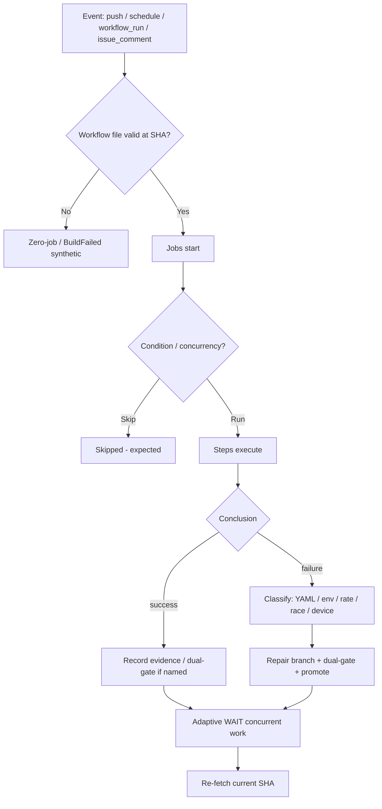
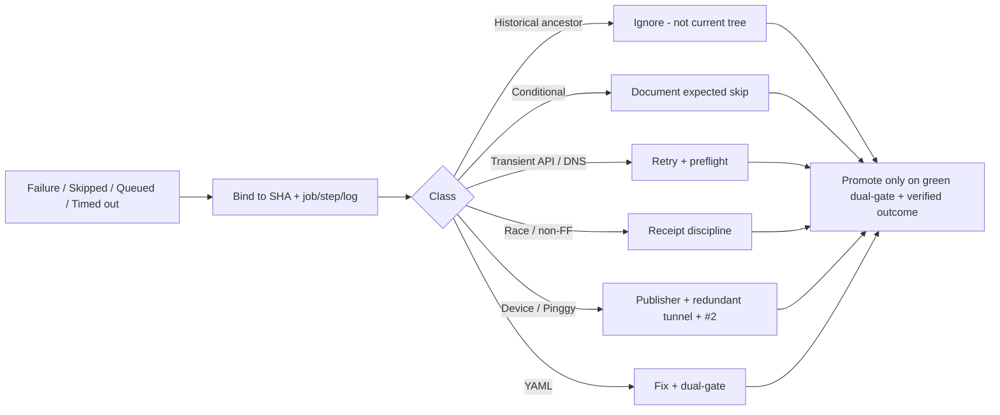

# Actions Workflows Consolidated Matrix

**SSOT for repeated issues, superseded workflows, and diagnosis paths.**

Live master tip (2026-10-18): `64712b14a1241de3d5dd726bc7a0c45c1d876423` — **zero conclusion=failure** in recent completed window. Skipped/Cancelled/Neutral are expected for conditional `workflow_run` / concurrency / advisory. Dual-gate remains promote authority.

## Repeated issues matrix

| Class | Symptom | Root / Trigger | Status on tip | Fix / Successor | Notes |
|-------|---------|----------------|---------------|-----------------|-------|
| Zero-job filename | Run starts with 0 jobs, synthetic BuildFailed | Ancestor push / missing YAML at ref | Closed | Current tree + ruleset | Not YAML parse on master |
| Catalog race | Historical Evaluation Correlation exit | `--check` vs concurrent catalog write | Closed | Race fix branch promoted | Bind to SHA |
| Sweep receipt non-FF | Receipt push rejected | Concurrent bot commits | Closed | Receipt discipline | Adaptive WAIT |
| Backfill 403 | Historical relationship window exit 2 | Rate limit page N | Closed | RateLimitDeferred / retry | Defer after retries |
| Continuous-improve DNS | ssh name resolution | Host transient | Closed | getent preflight | Environmental |
| Ledger jq / missing head | exit 126 / 128 | Unbounded argv / head moved | Closed | Arg max + skip | Soften set -e |
| Skill EOF blank | Quality lane exit 2 | Extra newline | Closed | Strip on commit | Hygiene |
| Dependabot security | security_update_not_possible | Unresolvable group (undici etc.) | Closed | Ignore list | Advisory |
| Queue v2 ghost | Queued zero-job on disabled id | Cron + disabled workflow | Historical | v3 schedule + workflow_run kicks | Do not reopen id |
| Dual-gate name drift | Observer miss | Old job names vs live | Closed | Name match update | #1174/#1180/#1181 |
| Backfill contradictory URL | node issue:964 | External vs canonical | Closed | Prefer canonical | #1220 |
| Inventory transient | v3 inventory exit 1 | HTTP 503 / pipefail | Closed | Retry helper | #1216 |
| Pinggy expire / device | Tunnel stale / #1 broken | Free tier TTL + hardware | Ongoing | Publisher job + #2 replication + Cloudflare parallel | Required; redundant alts |
| Vercel rate-limit | Combined status noise | #772 | Non-gate | Ignore | Never promote block |
| Skipped / Cancelled / Neutral | Conditional or superseded | workflow_run filter / concurrency | Expected | Document as non-failure | Do not treat as bug |

## Superseded / combined workflows

Feature preservation: extract-only onto live tip. Do not re-enable ghosts.

- Operations Cadence Audit (file absent; last historical exit 1) → folded into cadence + RECON kicks.
- Merge Promotion Queue v2 → v3 (cron 7,37 + workflow_run from listed parents).
- Various zero-job / placeholder intermediates → closed by child success.
- September BLU B160V#1 tests → replicated on B160V#2 (original screen broken). Pinggy required + Cloudflare parallel.

## Lifecycle

## Diagnosis → Fix

## Credential note

Issue #184 is names-only. Never paste secret values. Use for connector extension only under AGENTIC-PERMISSIONS human edges.

Agent-Identity: Grok (Administrator)
Observed: 2026-10-18T04:17Z on SHA 64712b14
