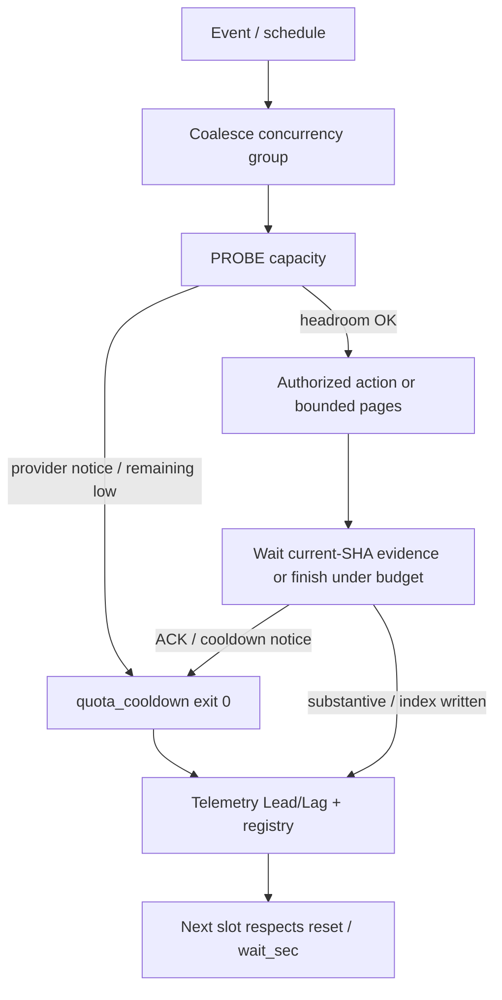

# Cadence collaborative orchestration & GitHub API quota

**Status:** Operational SSOT (2026-10-19)  
**Related:** `OPERATOR_INTERACTIVE_ACTIONS.md`, `LAG_DISPOSITION_UPGRADE.md`, `ops/quota/registry.json`, `FREE-QUOTA-WINDOWS.md`, `automation-decision-tree.md` §3–4,6

## Intent

Avoid **403/429 in the first place**. Capacity is a first-class state (`quota_cooldown` / `provider_cooldown`), not a post-hoc failure. The same collaborative pattern used for CodeRabbit cooldown applies to GitHub REST spend.

## Unified control loop

```text
EVENT
  → coalesce (concurrency; cancel-in-progress false where collect is live)
  → PROBE capacity (provider notice | GET /rate_limit | soft budget)
  → if capacity low: publish COOLDOWN / DEFERRED, exit 0, no writer
  → else: one authorized action (marker + SHA + cycle) or bounded API pages
  → wait for current-SHA evidence only (peers) or complete under page budget (API)
  → ACK / cooldown / checkbox → not completion
  → telemetry → Cadence Lead/Lag + lag index + quota registry
  → next schedule respects wait_sec / x-ratelimit-reset / safety band
```

## Peer-provider lane (reference implementation)

| Mechanism | Authority | Behavior |
|-----------|-----------|----------|
| CodeRabbit cooldown | `peer-review-orchestrator.yml` | Classify limit text as non-completing `provider_cooldown` |
| Single retry | `agent-continuous-ops.yml` | After stated interval, one marked `@coderabbitai full review` |
| Lag dispositions | `calculate_lag_index.py` | `ack_pending` / `quota_cooldown` → WAIT; block premature Jules |
| Autofix throttle | Lane consolidation SSOT | 45 min / PR; 90 s settle |
| Jules debounce | `agent-review-auto-jules.yml` | 20 min / PR |
| Sweep capacity | continuous-ops | max 8 PRs / run |

Cooldown notices never complete a peer cycle. Only current-SHA substantive review / review comment / successful check does.

## GitHub API lane (observatory)

| Registry id | Limit | Safety |
|-------------|-------|--------|
| `github.api.github_token` | 1000 req/hour/repo | 0.8 |
| `github.api.user_token` | 5000 req/hour | 0.8 |

**Implementation:** `scripts/github/repository_observatory.py` @2.2

1. **PROBE** `GET /rate_limit` with the same token used for pagination.
2. **GATE** if core `remaining < 50` → `RateLimitDeferred`, exit 0.
3. **BUDGET** pages = `min(MAX_PAGES, floor((remaining - 20) * 0.8))`.
4. **SPEND** owned/starred lists only within budget (truncation OK).
5. **DEFER** on 403/429 after retries → exit 0, no index file → workflow skips validate/commit.

Workflow: `.github/workflows/repository-observatory.yml` gates commit on `wrote_index=true`.

## Disposition vocabulary (shared)

| Disposition | Meaning | CI / dual-gate |
|-------------|---------|----------------|
| `quota_cooldown` | API or provider rate/review limit | Observation; not FAIL |
| `provider_cooldown` | CodeRabbit (etc.) explicit cooldown notice | Non-completing peer state |
| `ack_pending` | Bot promised re-review | WAIT |
| `real_review` | Substantive findings | Actionable |

## Hard rules

1. Never start multi-page GitHub API work without `/rate_limit` preflight when the job can page.
2. Never treat capacity skip as dual-gate failure or notification spam.
3. Safety band 0.8 is mandatory for documented GitHub API entitlements.
4. One authorized retry after recovery — no blind retry storms.
5. Token isolation: high-volume jobs must not share a single PAT budget with unrelated sweeps without reservation.

## Flowchart



## Truth boundary

This document describes the control contract. Promotion still requires dual-gate on the candidate SHA. Vercel capacity remains non-gate (#772). Device Pinggy health remains UNKNOWN until independently proven.
