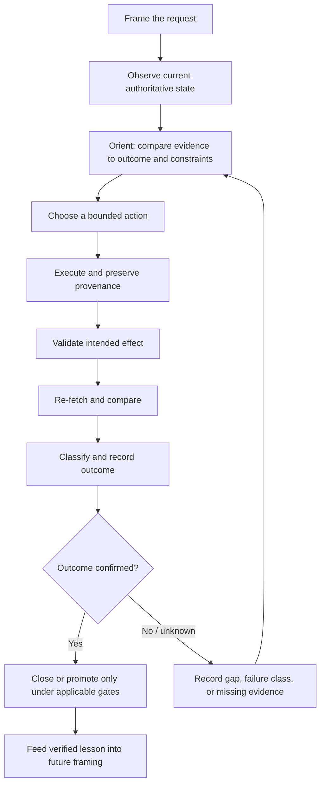

# DO Framing and Feedback Architecture

**Status:** explanatory architecture note  
**Purpose:** distinguish request framing from decision-making, execution control, and learning from outcomes.  
**Authority:** this note is conceptual. The linked repository contracts—not this mapping—govern execution and approval.

## 1. Four different layers

| Layer | Question | Primary responsibility | Repository anchor |
|---|---|---|---|
| **Request framing (DO)** | What exactly is being asked, within what boundaries, and how will it be verified? | Action, target, outcome, scope, constraints, acceptance evidence, stop/escalation | [DO Phrasing and Framing Framework](DO-PHRASING-FRAMING-FRAMEWORK.md) |
| **Decision cycle (OODA-like)** | Given new observations and context, what decision/action should happen next? | Observe, orient, decide, act; adapt as the situation changes | A useful mental model, not a new repository workflow |
| **Execution lifecycle** | What state is the work actually in, and what evidence permits the next transition? | Reconnaissance, planning, action, commit, wait/watch, validation, re-fetch, compare, classify, record | [Adaptive Wait](../../.agents/skills/adaptive-wait/SKILL.md), [Production Reconciliation](../../.github/skills/production-reconciliation/SKILL.md) |
| **Outcome learning** | Did the intervention produce the intended result, and what should change next time? | Preserve attempts, evaluate outcomes, update future choices from evidence | [Adaptive Feedback Cycle](../../.agents/skills/adaptive-feedback-cycle/SKILL.md), [Gemini Performance Psychology](../../.agents/skills/gemini-performance-psychology/SKILL.md) |

These layers connect, but they are not interchangeable. A well-framed task can still be executed incorrectly; a healthy execution loop can still pursue the wrong outcome; feedback is only useful when it is grounded in reliable observations.

## 2. Repository execution contract

The repository's established operational loop remains:

```text
RECON → PLAN/MEASURE → ACT → COMMIT → WAIT → WATCH
     → VALIDATE → RE-FETCH → COMPARE → CLASSIFY → RECORD → REPEAT
```

This sequence is the repository's operational contract. Do not replace it with OODA, PDCA, or another conceptual cycle. Use OODA only as a lens for situational awareness and decision adaptation; use the existing repository lifecycle for actual work-state transitions.

## 3. How the concepts relate

- **OODA (Observe–Orient–Decide–Act):** a decision-cycle model. It can help explain why new observations should change orientation and the next action, but it does not by itself define repository commit, wait, validation, or evidence-recording rules.
- **PDCA (Plan–Do–Check–Act) and Kaizen:** continuous-improvement concepts associated with testing changes, checking outcomes, and using learning to improve the next cycle. They are useful analogies for improvement, not a replacement for repository-specific acceptance gates.
- **T.A.K. (Tactical Awareness Kit):** a named situational-awareness software ecosystem. It may be an analogy for composing a timely operational picture from distributed signals; it is not a required dependency or an implementation recommendation here.
- **Repository feedback cycle:** preserves concrete work identities and outcomes across attempts. It is the authoritative implementation context for agentic development in this repository.

Do not claim these concepts are synonyms, that the repository loop derives directly from them, or that a diagram alone establishes improved performance.

## 4. Feedback flow



The diagram is explanatory, not an executable state machine. Every real transition remains governed by the relevant workflow, schema, permissions, and approval rules.

## 5. Non-goals and guardrails

- No parallel lifecycle engine, telemetry store, outcome ledger, scheduler, or source of truth.
- No auto-promotion from a plan, commit, queued workflow, green badge, or unverified claim.
- No inference that silence, activity, speed, or a positive reaction proves the desired outcome.
- No added T.A.K. software integration.
- No causal performance claims without a suitable evaluation design and observed outcome data.

## 6. Maintenance

Update this note only when the linked canonical contracts or the concept mapping materially change. Keep normative operational details in their canonical skills and process documents; keep request-writing rules in the DO framework.

## 7. Evidence and state discipline

The repository's existing contracts distinguish these states; the concept map does not weaken them:

- A plan is not an implementation.
- A commit is not execution evidence.
- A queued or running workflow is not success.
- A successful workflow is not automatically proof of the intended effect.
- A resolved inline review thread is not a formal review approval.
- A recommendation is not authorization.
- Missing evidence is unknown, not zero and not success.
- A failure or cancellation remains an observation; it is not rewritten as success.

For operational work, the repository loop is:

`RECON → PLAN/MEASURE → ACT → COMMIT → WAIT → WATCH → VALIDATE → RE-FETCH → COMPARE → CLASSIFY → RECORD → REPEAT`

Do not create a parallel lifecycle engine, telemetry store, or competing source of truth to implement the phrasing standard.

## 8. Documentation-review context and limits

The original guide's review recorded the following existing strengths:
1. Agentic-Agile defines bounded work units, dependencies, ownership, acceptance evidence, and review gates.
2. The Agent Evaluation Framework separates task outcome from latency and other operational signals.
3. Production Reconciliation requires fresh runtime observation, re-fetch, comparison, classification, and recording.
4. BIUDL execution/provenance rules distinguish observed identity from inferred attribution and protect sensitive context.

The motivating gaps were:
1. No authoritative expansion/origin definition for “DO” had been established; this remains unresolved rather than invented.
2. Prompt composition was distributed across several contracts, motivating a compact action-first writing guide.
3. Broad commands such as “everything,” “upgrade,” “continue,” and “production-ready” can be underspecified without outcome, boundaries, evidence, and stop conditions.
4. Research, recommendation, implementation, and proof of effect can be conflated.
5. Acceptance evidence can be implicit.
6. “Continue” can degrade into status narration unless it triggers fresh-state reconciliation and a useful bounded action.

These are findings from the earlier documentation review, not proof that every prompt or workflow has these defects. This change does not establish repository-wide adoption; that would require separate inventory and measured validation.
