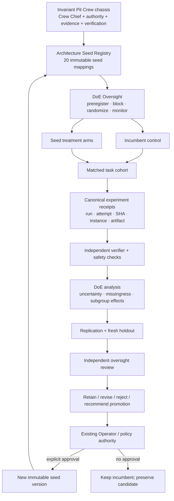

# Pit Crew alternative architectures — seed catalogue

**Purpose:** Every analogy in the architecture report becomes its own versioned candidate architecture seed for DoE comparison and evolution. Each entry is an explicit treatment candidate, not an informal metaphor.

## Common chassis: Crew Chief is invariant

All 20 seeds retain the existing Pit Crew Chief architecture and authority contract. The Chief receives the approved task identity/contract, source SHA, dependency state, DAG and write sets, eligible roster, manager policy, Ballet version, DoE assignment, authority envelope, budgets, stop conditions and acceptance contract.

The Chief confirms admission and freshness; checks readiness and ownership; assembles roles from the existing roster; selects the registered seed policy; requests choreography from Ballet where applicable; dispatches only through existing authorized routes; coordinates evidence-bearing handoffs; detects blocked/stale/conflicting work; requires independent verification; and returns a mission report.

The Chief never self-admits, elevates authority, bypasses QUE/claims/revocation, silently changes provider, holds conflicting write leases, edits evidence, self-reviews, changes a registered treatment mid-run, declares a winner, merges, deploys or promotes. DoE remains independent oversight. The registry creates no second scheduler, router, queue, lease manager, experiment ledger or execution runtime.

## Registry contract

Canonical machine-readable mapping: [PIT-CREW-ARCHITECTURE-SEED-REGISTRY.yaml](PIT-CREW-ARCHITECTURE-SEED-REGISTRY.yaml). Each seed has a stable ID, architecture ID, immutable version, source mapping, architecture delta, Crew Chief mode, factor set, outcomes, guardrails, target task family and explicit design-only/no-dispatch/no-promotion state.

## Tournament illustration

## Twenty competing architecture seeds

### PC-SEED-001 — Formula 1 pit crew

- **Architecture mapping:** Specialist pods with timed synchronized handoffs.
- **Crew Chief policy:** Fixed pit-stop checklist and explicit role call. The common Chief authority contract remains unchanged.
- **Registered DoE factors:** role specialization; choreography; capacity; handoff protocol.
- **Primary outcomes:** accepted integration time; first-pass yield.
- **Hard guardrails:** collision; skipped verification; unsafe concurrency.
- **Best-fit task family:** bounded implementation and rapid integration.
- **Treatment boundary:** this seed changes the architecture delta only; queue, admission, leases, dispatch, evidence and promotion remain with existing canonical owners.
- **Evolution:** children pin parent seed/version, change set, hypothesis, experiment/arm/repetition and evidence references. New versions are new arms; never overwrite historical results.

### PC-SEED-002 — NASCAR spotter and crew chief

- **Architecture mapping:** Continuous recon-to-chief feedback loop with track-state snapshots.
- **Crew Chief policy:** Re-plan only on evidence-backed hazard or state change. The common Chief authority contract remains unchanged.
- **Registered DoE factors:** recon depth; update cadence; hazard threshold.
- **Primary outcomes:** stale-state incidents; useful discoveries; decision latency.
- **Hard guardrails:** false hazard; stale source; uncontrolled plan churn.
- **Best-fit task family:** volatile repos and fast-moving incidents.
- **Treatment boundary:** this seed changes the architecture delta only; queue, admission, leases, dispatch, evidence and promotion remain with existing canonical owners.
- **Evolution:** children pin parent seed/version, change set, hypothesis, experiment/arm/repetition and evidence references. New versions are new arms; never overwrite historical results.

### PC-SEED-003 — NASA mission control

- **Architecture mapping:** Flight-director command with subsystem specialist cells and telemetry console.
- **Crew Chief policy:** Coordinate subsystem leads; independent evidence steward monitors anomalies. The common Chief authority contract remains unchanged.
- **Registered DoE factors:** command topology; escalation policy; telemetry coverage.
- **Primary outcomes:** verified outcome; anomaly detection latency.
- **Hard guardrails:** missed anomaly; false alarm; unverified subsystem state.
- **Best-fit task family:** complex multi-system work.
- **Treatment boundary:** this seed changes the architecture delta only; queue, admission, leases, dispatch, evidence and promotion remain with existing canonical owners.
- **Evolution:** children pin parent seed/version, change set, hypothesis, experiment/arm/repetition and evidence references. New versions are new arms; never overwrite historical results.

### PC-SEED-004 — Surgical operating team

- **Architecture mapping:** Time-out/checklist gates, sterile work scopes and independent verification roles.
- **Crew Chief policy:** Conduct preflight, pause points and explicit handoff/read-back. The common Chief authority contract remains unchanged.
- **Registered DoE factors:** checklist depth; role independence; handoff protocol.
- **Primary outcomes:** defect escape; rework; acceptance.
- **Hard guardrails:** boundary breach; skipped timeout; self-review.
- **Best-fit task family:** high-risk changes and sensitive boundaries.
- **Treatment boundary:** this seed changes the architecture delta only; queue, admission, leases, dispatch, evidence and promotion remain with existing canonical owners.
- **Evolution:** children pin parent seed/version, change set, hypothesis, experiment/arm/repetition and evidence references. New versions are new arms; never overwrite historical results.

### PC-SEED-005 — SRE incident command

- **Architecture mapping:** Incident command with operations, investigation, communications and recovery cells.
- **Crew Chief policy:** Act as incident commander; delegate bounded workstreams and track incident state. The common Chief authority contract remains unchanged.
- **Registered DoE factors:** command pattern; diagnosis strategy; recovery sequencing.
- **Primary outcomes:** verified recovery; recurrence; MTTR.
- **Hard guardrails:** unsafe mitigation; recurrence; lost evidence.
- **Best-fit task family:** outages, CI failures and platform incidents.
- **Treatment boundary:** this seed changes the architecture delta only; queue, admission, leases, dispatch, evidence and promotion remain with existing canonical owners.
- **Evolution:** children pin parent seed/version, change set, hypothesis, experiment/arm/repetition and evidence references. New versions are new arms; never overwrite historical results.

### PC-SEED-006 — Aircraft turnaround / ground crew

- **Architecture mapping:** Dependency- and resource-constrained parallel service teams.
- **Crew Chief policy:** Sequence service windows around shared resources and hard dependencies. The common Chief authority contract remains unchanged.
- **Registered DoE factors:** parallel capacity; partitioning; resource contention.
- **Primary outcomes:** turnaround time; integration success.
- **Hard guardrails:** resource conflict; skipped dependency; unsafe overlap.
- **Best-fit task family:** large multi-file changes and maintenance batches.
- **Treatment boundary:** this seed changes the architecture delta only; queue, admission, leases, dispatch, evidence and promotion remain with existing canonical owners.
- **Evolution:** children pin parent seed/version, change set, hypothesis, experiment/arm/repetition and evidence references. New versions are new arms; never overwrite historical results.

### PC-SEED-007 — Air traffic control

- **Architecture mapping:** Central admission/routing authority with locally autonomous execution crews.
- **Crew Chief policy:** Manage local sequencing under Race Control clearances; never self-grant clearance. The common Chief authority contract remains unchanged.
- **Registered DoE factors:** admission policy; queue pressure; priority.
- **Primary outcomes:** safe throughput; queue age.
- **Hard guardrails:** duplicate/stale dispatch; unauthorized action.
- **Best-fit task family:** high-volume concurrent task systems.
- **Treatment boundary:** this seed changes the architecture delta only; queue, admission, leases, dispatch, evidence and promotion remain with existing canonical owners.
- **Evolution:** children pin parent seed/version, change set, hypothesis, experiment/arm/repetition and evidence references. New versions are new arms; never overwrite historical results.

### PC-SEED-008 — Military mission command

- **Architecture mapping:** Intent-led mission cells with delegated bounded authority and escalation channels.
- **Crew Chief policy:** Translate approved intent into mission orders and check revocation. The common Chief authority contract remains unchanged.
- **Registered DoE factors:** delegation depth; autonomy envelope; revocation latency.
- **Primary outcomes:** mission success; intervention burden.
- **Hard guardrails:** authority violation; scope drift; delayed revocation.
- **Best-fit task family:** ambiguous goals and distributed execution.
- **Treatment boundary:** this seed changes the architecture delta only; queue, admission, leases, dispatch, evidence and promotion remain with existing canonical owners.
- **Evolution:** children pin parent seed/version, change set, hypothesis, experiment/arm/repetition and evidence references. New versions are new arms; never overwrite historical results.

### PC-SEED-009 — Orchestra / conductor

- **Architecture mapping:** Section-based specialists follow one task score with rehearsal/context synchronization.
- **Crew Chief policy:** Interpret approved score, set entrances and resolve integration timing. The common Chief authority contract remains unchanged.
- **Registered DoE factors:** conductor policy; section parallelism; rehearsal/context depth.
- **Primary outcomes:** coherence; integration rework.
- **Hard guardrails:** section drift; incompatible outputs.
- **Best-fit task family:** multi-discipline deliverables and coordinated docs/code.
- **Treatment boundary:** this seed changes the architecture delta only; queue, admission, leases, dispatch, evidence and promotion remain with existing canonical owners.
- **Evolution:** children pin parent seed/version, change set, hypothesis, experiment/arm/repetition and evidence references. New versions are new arms; never overwrite historical results.

### PC-SEED-010 — Manufacturing cell / Lean

- **Architecture mapping:** Standardized work cells, WIP caps, visual blockers and Andon escalation.
- **Crew Chief policy:** Balance cell load, enforce WIP limits and escalate blocked work. The common Chief authority contract remains unchanged.
- **Registered DoE factors:** WIP limit; batch size; standard work.
- **Primary outcomes:** first-pass yield; throughput; queue age.
- **Hard guardrails:** defects; hidden blockers; excess WIP.
- **Best-fit task family:** repeatable task families and throughput tuning.
- **Treatment boundary:** this seed changes the architecture delta only; queue, admission, leases, dispatch, evidence and promotion remain with existing canonical owners.
- **Evolution:** children pin parent seed/version, change set, hypothesis, experiment/arm/repetition and evidence references. New versions are new arms; never overwrite historical results.

### PC-SEED-011 — Distributed systems / actor model

- **Architecture mapping:** Isolated task actors with message-passing, idempotent commands and event receipts.
- **Crew Chief policy:** Coordinate messages and ownership; actor owns its state transition. The common Chief authority contract remains unchanged.
- **Registered DoE factors:** lease duration; idempotency; retry policy.
- **Primary outcomes:** duplicate side effects; lost work; conflict rate.
- **Hard guardrails:** split-brain writer; replay duplication; lost receipt.
- **Best-fit task family:** parallel work, retries and distributed tool chains.
- **Treatment boundary:** this seed changes the architecture delta only; queue, admission, leases, dispatch, evidence and promotion remain with existing canonical owners.
- **Evolution:** children pin parent seed/version, change set, hypothesis, experiment/arm/repetition and evidence references. New versions are new arms; never overwrite historical results.

### PC-SEED-012 — Supply chain / logistics

- **Architecture mapping:** Capability inventory, capacity buffers, critical-path routing and replenishment.
- **Crew Chief policy:** Plan against available capability/capacity and protect scarce resources. The common Chief authority contract remains unchanged.
- **Registered DoE factors:** buffer policy; route mix; capacity allocation.
- **Primary outcomes:** accepted outcome per total cost.
- **Hard guardrails:** quota exhaustion; starvation; stale inventory.
- **Best-fit task family:** provider quotas and scarce specialist capacity.
- **Treatment boundary:** this seed changes the architecture delta only; queue, admission, leases, dispatch, evidence and promotion remain with existing canonical owners.
- **Evolution:** children pin parent seed/version, change set, hypothesis, experiment/arm/repetition and evidence references. New versions are new arms; never overwrite historical results.

### PC-SEED-013 — Cyber SOC / incident response

- **Architecture mapping:** Triage, containment, investigation, remediation and evidence-preservation cells.
- **Crew Chief policy:** Prioritize containment and evidence custody; security authority controls quarantine. The common Chief authority contract remains unchanged.
- **Registered DoE factors:** triage threshold; review independence; containment sequence.
- **Primary outcomes:** verified remediation; missed-threat rate.
- **Hard guardrails:** secret leakage; evidence tampering; unsafe containment.
- **Best-fit task family:** security and provenance-sensitive work.
- **Treatment boundary:** this seed changes the architecture delta only; queue, admission, leases, dispatch, evidence and promotion remain with existing canonical owners.
- **Evolution:** children pin parent seed/version, change set, hypothesis, experiment/arm/repetition and evidence references. New versions are new arms; never overwrite historical results.

### PC-SEED-014 — Scientific laboratory

- **Architecture mapping:** Preregistered protocol, calibrated instruments, blinded evaluator and reproducible runs.
- **Crew Chief policy:** Execute only registered protocol; DoE steward independently controls design integrity. The common Chief authority contract remains unchanged.
- **Registered DoE factors:** factor levels; randomization; replication; blocking.
- **Primary outcomes:** effect estimate; uncertainty; reproducibility.
- **Hard guardrails:** protocol drift; selective reporting; uncalibrated measurement.
- **Best-fit task family:** all architecture and policy experiments.
- **Treatment boundary:** this seed changes the architecture delta only; queue, admission, leases, dispatch, evidence and promotion remain with existing canonical owners.
- **Evolution:** children pin parent seed/version, change set, hypothesis, experiment/arm/repetition and evidence references. New versions are new arms; never overwrite historical results.

### PC-SEED-015 — Sports coaching / talent development

- **Architecture mapping:** Seasonal roster development, role fit, training and repeated performance review.
- **Crew Chief policy:** Assign roles by demonstrated task-family capability, not popularity. The common Chief authority contract remains unchanged.
- **Registered DoE factors:** role mix; coaching policy; task family; season.
- **Primary outcomes:** holdout performance; stability; learning rate.
- **Hard guardrails:** overfit; selection bias; role lock-in.
- **Best-fit task family:** longitudinal capability evolution.
- **Treatment boundary:** this seed changes the architecture delta only; queue, admission, leases, dispatch, evidence and promotion remain with existing canonical owners.
- **Evolution:** children pin parent seed/version, change set, hypothesis, experiment/arm/repetition and evidence references. New versions are new arms; never overwrite historical results.

### PC-SEED-016 — Newsroom / editorial desk

- **Architecture mapping:** Assignment editor, beat specialists, fact-check desk, copy desk and correction trail.
- **Crew Chief policy:** Assign source-backed beats and require fact-check before integration. The common Chief authority contract remains unchanged.
- **Registered DoE factors:** source diversity; fact-check depth; review order.
- **Primary outcomes:** factual acceptance; correction rate.
- **Hard guardrails:** unsupported claim; provenance gap; correction loss.
- **Best-fit task family:** research, docs, synthesis and external-facing artifacts.
- **Treatment boundary:** this seed changes the architecture delta only; queue, admission, leases, dispatch, evidence and promotion remain with existing canonical owners.
- **Evolution:** children pin parent seed/version, change set, hypothesis, experiment/arm/repetition and evidence references. New versions are new arms; never overwrite historical results.

### PC-SEED-017 — Software release train

- **Architecture mapping:** Feature crews integrate through staged readiness, canary and rollback checkpoints.
- **Crew Chief policy:** Coordinate release train; release authority remains external. The common Chief authority contract remains unchanged.
- **Registered DoE factors:** validation depth; rollout strategy; cohort.
- **Primary outcomes:** stable release; rollback rate.
- **Hard guardrails:** regression; unauthorized promotion.
- **Best-fit task family:** release engineering and deployment proposals.
- **Treatment boundary:** this seed changes the architecture delta only; queue, admission, leases, dispatch, evidence and promotion remain with existing canonical owners.
- **Evolution:** children pin parent seed/version, change set, hypothesis, experiment/arm/repetition and evidence references. New versions are new arms; never overwrite historical results.

### PC-SEED-018 — Brain / cognitive architecture

- **Architecture mapping:** Shared context graph, reasoning, decomposition and feedback loop separated from execution.
- **Crew Chief policy:** Consume Brain proposals and route only manager-approved bounded plans. The common Chief authority contract remains unchanged.
- **Registered DoE factors:** context strategy; decomposition; handoff representation.
- **Primary outcomes:** verified outcome per total effort; stale-context rate.
- **Hard guardrails:** context leakage; plan treated as permission.
- **Best-fit task family:** repo-wide reasoning and context-heavy tasks.
- **Treatment boundary:** this seed changes the architecture delta only; queue, admission, leases, dispatch, evidence and promotion remain with existing canonical owners.
- **Evolution:** children pin parent seed/version, change set, hypothesis, experiment/arm/repetition and evidence references. New versions are new arms; never overwrite historical results.

### PC-SEED-019 — Ballet / choreography

- **Architecture mapping:** Deterministic dependency DAG and inspectable sequential/parallel/adaptive waves.
- **Crew Chief policy:** Delegate wave construction to Ballet; dispatch remains with existing controls. The common Chief authority contract remains unchanged.
- **Registered DoE factors:** wave policy; capacity treatment; dependency shape.
- **Primary outcomes:** observed integration outcome; useful parallel yield.
- **Hard guardrails:** planned makespan mistaken for outcome; dependency violation.
- **Best-fit task family:** dependency-rich engineering tasks.
- **Treatment boundary:** this seed changes the architecture delta only; queue, admission, leases, dispatch, evidence and promotion remain with existing canonical owners.
- **Evolution:** children pin parent seed/version, change set, hypothesis, experiment/arm/repetition and evidence references. New versions are new arms; never overwrite historical results.

### PC-SEED-020 — DoE / experimental science

- **Architecture mapping:** Independent design, assignment, monitoring, analysis and promotion recommendation wrapped around all crews.
- **Crew Chief policy:** Cannot alter treatment; DoE steward owns protocol integrity and evaluator independence. The common Chief authority contract remains unchanged.
- **Registered DoE factors:** architecture factors; randomization; replication; holdout.
- **Primary outcomes:** effect estimate with uncertainty.
- **Hard guardrails:** self-evaluation; contamination; post-hoc relabeling.
- **Best-fit task family:** tournament governance across every seed.
- **Treatment boundary:** this seed changes the architecture delta only; queue, admission, leases, dispatch, evidence and promotion remain with existing canonical owners.
- **Evolution:** children pin parent seed/version, change set, hypothesis, experiment/arm/repetition and evidence references. New versions are new arms; never overwrite historical results.

## Cross-seed comparison design

Do not place all 20 seeds into one unblocked, underpowered free-for-all. Run a staged, preregistered campaign:

1. **T0 — Measurement calibration:** prove seed identity, treatment assignment, configured-instance attribution, run/attempt/SHA joins, evaluator independence and receipt completeness.
2. **T1 — Architecture-family screening:** compare each eligible seed with the incumbent control on matched low-risk task families. Block by task family, complexity, risk and environment. Screen feasibility and safety; do not crown a winner.
3. **T2 — Family tournaments:** command/control (NASCAR, NASA, ATC, mission command, SRE); execution/flow (F1, aircraft, Lean, logistics, actor model, orchestra); assurance (surgery, SOC, release train); cognition/evolution (Brain, coaching, newsroom); oversight (scientific lab, DoE); then cross-family finalists.
4. **T3 — Factor decomposition:** separate architecture effects from confounded factors such as Chief policy, parallelism, context depth and capacity. Use implemented full-factorial or Taguchi L9 designs only when assumptions fit; otherwise label the method explicitly and do not claim unsupported randomization.
5. **T4 — Replication:** repeat on new matched tasks and a pinned environment; report variance, uncertainty, missingness and subgroup effects.
6. **T5 — Fresh holdout:** evaluate finalists on previously unseen task instances. No tuning on holdout.
7. **T6 — Oversight disposition:** independent DoE review recommends retain/revise/reject/cull/recommend promotion. Existing Operator and gates decide whether an exact version is promoted.
8. **T7 — Evolution:** create immutable child versions from evidence-backed changes; retain parent, losers, failures and retired seeds for lineage and replay.

### Common estimand and scorecard

**Primary estimand:** independently accepted integrated outcomes per total operational cost. Report acceptance/correctness, integration/rework, time-to-verified result, retries, conflicts, duplicate work, provider/model cost, requests/tokens, compute, human intervention, evaluator burden, attribution confidence and receipt completeness separately. Speed, low API spend or activity volume cannot compensate for safety/correctness failure.

### Assignment and contamination rules

- One task instance is assigned to one arm for a given comparison/repetition; paired designs must be preregistered.
- The incumbent remains a real control.
- Pin task contract, source SHA, tool manifest, configured model instance, prompts, policy and environment.
- DoE steward is independent of seed author/operator and treatment Chief.
- Retain all attempts, failures, cancellations, skips, unknowns, deviations and censored runs.
- Missing receipt is not zero; un-attributable observations are not silently pooled.
- Stop arms only under preregistered safety/futility/resource rules. Culling never deletes evidence.
- Registration does not authorize production dispatch. Offline/shadow phases precede any bounded live pilot and require existing authority.

## Canonical schema and ownership mapping

| Registry field / concern | Canonical owner |
|---|---|
| seed ID, version, parent and change lineage | this proposal mapping registry (proposal metadata only) |
| experiment, cohort, arm, repetition, actual run | existing DoE Family + `EXPERIMENT.schema.json` |
| manager/Chief policy cohort and tournament | `MANAGER-TOURNAMENT.schema.json` + Observatory |
| task/run/attempt/SHA/throughput | existing task boundary + `AGENT-THROUGHPUT-EVENT.schema.json` |
| execution telemetry and derived metrics | Actions JSONL + ATES/WTCV/TCV |
| dependency-wave plan | Ballet contracts |
| cognition/context and plan proposal | Brain + ICM + Context Relationship Graph |
| final performance interpretation | MoneyBall / 3L0 |
| dispatch, permission, leases, promotion | QUE/QDesk, phase engine, existing policy/Operator and gates |

The registry is a version mapping for proposals and experiment arms, not a new canonical experiment store. If an existing schema lacks a field, record a schema-gap proposal; do not create a parallel source of truth.

## Seed lifecycle

`DRAFT → DESIGN_ONLY → PREREGISTERED → SHADOW_ELIGIBLE → PILOT_ELIGIBLE → TOURNAMENT_ELIGIBLE → HOLDOUT_PASSED → DOE_RECOMMENDATION → OPERATOR_DECISION → PROMOTED_VERSION`

Each transition requires its own evidence and authority. `PROMOTED_VERSION` is reached only after existing operator-controlled promotion. Rejection, inconclusive and retirement are dispositions for that version, not deletion.

## Decision requested

Adopt the 20-entry seed registry as the complete candidate set derived from the 20 Section 7 mappings. Preserve the common Crew Chief chassis. Approve the DoE campaign design for independent review; do not interpret documentation registration as permission to dispatch live treatments.
