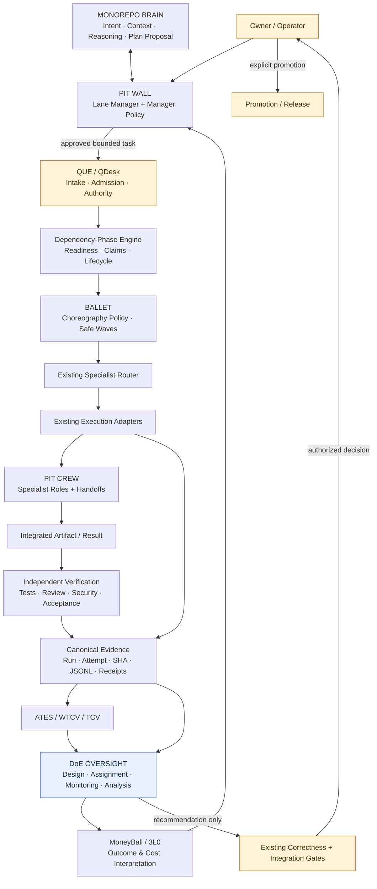
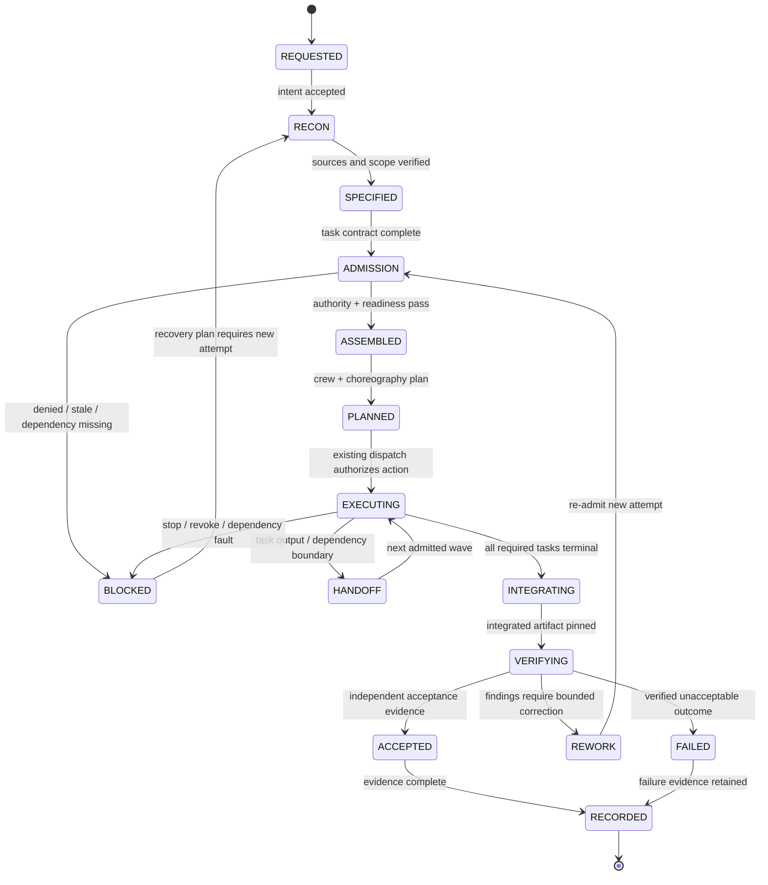

# Pit Crew — Whole-System Architecture and Analogy Mapping

**Status:** proposed architecture / documentation implementation  
**Architecture class:** bounded coordination policy + specialist-role topology  
**DoE authority:** independent experiment design, oversight, evaluation and promotion recommendation  
**Runtime authority:** remains with the existing Operator, QUE/QDesk, hub_mcp, dependency-phase engine, dispatch/claim adapters and production gates  
**Primary integration:** Ballet Coordinator (#5528 / PR #5529), Monorepo Brain (#5501 / PR #5503), Agent Team Control Plane, DoE Family, ATES and MoneyBall/3L0

## 1. Executive definition

The **Pit Crew** is a role-specialized, evidence-bearing team that executes a bounded intervention as a coordinated unit. It is not a new model router, scheduler, queue, claim engine, provider catalog, memory store, telemetry ledger or promotion authority.

The Pit Crew is the *execution team abstraction*. Ballet supplies a candidate choreography policy for arranging dependency-ready tasks into safe waves. The existing manager/lane manager remains responsible for choosing and approving a plan. Existing admission and dispatch systems remain responsible for authorizing and starting work. Existing execution adapters perform work. Existing evidence systems record what actually happened.

**DoE is Oversight.** DoE is not merely a scorecard after the race. It governs the experimental method before, during and after a tournament: preregistration, control/treatment separation, cohort construction, assignment, measurement contract, stopping rules, evidence sufficiency, analysis, uncertainty, and recommendation. DoE cannot grant production permissions, merge code, or promote a policy by itself.

The Monorepo Brain is the shared cognitive/context layer: it interprets intent, assembles evidence-grounded context, proposes decompositions and plans, and requests action through existing authorized control planes. Brain does not own dispatch, queue state, leases, execution, canonical evidence or DoE authority.

## 2. Vocabulary — keep the concepts distinct

| Term | Meaning | Existing architectural relationship |
|---|---|---|
| **Pit Wall** | Strategic observation, race/task state, policy selection and coordination | Existing lane manager / manager policy, SHE and observability projections |
| **Pit Crew** | Specialist participants assembled for a bounded intervention | Existing agent/team roster and execution adapters, organized by role |
| **Crew Chief** | Local coordinator for one crew/mission; translates approved intent into safe choreography and handoffs | Tier-2 coordination policy; Ballet is a candidate implementation, not a second manager |
| **Pit Stop** | One bounded, identified intervention with explicit acceptance evidence | Existing task/issue/phase unit admitted by QUE and dependency-phase contracts |
| **Spotter** | Reconnaissance and hazard/context specialist | Recon / Scout / ICM / Context Relationship Graph adapters |
| **Race Control** | Authority, permission, admission, revocation and protected-boundary enforcement | Operator, QUE/QDesk, hub_mcp, policy and claim/lease owners |
| **Timing System** | Runtime observation and execution measurements | Actions run/job/step evidence, JSONL receipts, ATES/WTCV/TCV |
| **Race Results** | Longitudinal comparison and performance interpretation | DoE records, MoneyBall / 3L0, existing tournament/leaderboard |
| **Championship** | Repeated, comparable campaigns across task families and time | Existing DoE Family / MVT campaigns |
| **Brain** | Shared cognition, repository context, reasoning and plan proposals | qdesk.brain-rs architecture; adapter to existing controls |
| **Ballet** | Deterministic task choreography and dependency-wave planning | Existing PR #5529 reference implementation and DoE treatment |

Do not confuse this architecture with `scripts/ci/queue_pitcrew.py` or `.github/workflows/queue-pitcrew.yml`. Those are a narrow, allowlisted queue-management feature. They do not define the general Pit Crew team model, role topology or DoE oversight architecture.

## 3. Whole architecture

### Layer contracts

1. **Intent and cognition — Brain.** Resolve owner intent, constraints, source freshness, sensitivity, capability candidates, task decomposition and verification criteria. Output is a typed proposal, not an execution grant.
2. **Strategic command — Pit Wall.** Select the mission, policy version, crew composition, escalation posture and approved resource envelope. It can choose among policy treatments admitted by the experiment and authority contracts.
3. **Admission and authority — Race Control.** QUE/QDesk, hub_mcp, phase engine, claim/lease and owner policy determine whether the work may proceed. Revocation is rechecked at the actual action boundary.
4. **Choreography — Crew Chief / Ballet.** Consume authoritative dependency readiness and manager-approved tasks. Produce deterministic waves, handoff checkpoints and integration sequence. Planning does not dispatch.
5. **Execution — Pit Crew.** Existing specialists and adapters perform bounded tasks. Each task has one accountable owner, explicit write set, scope, dependencies and acceptance evidence.
6. **Verification — independent inspectors.** Tests, review, security and integration checks evaluate the artifact independently of the builder. A producer cannot self-certify.
7. **Evidence and timing — existing substrate.** Preserve task, cohort, run, attempt, SHA, workflow, job, step, tool/model instance, artifact and outcome provenance.
8. **Oversight — DoE.** Govern experiment design and interpretation. Preserve controls, failed/censored observations, deviations, uncertainty and stop decisions. DoE is not a replacement production gate.
9. **Learning — MoneyBall / 3L0 / Brain candidate synthesis.** Produce evidence-backed policy recommendations and learning candidates. Promote only through existing gates and owner authority.

## 4. Pit Crew Chief — responsibilities and limits

The Crew Chief is a **mission-scoped coordination role**, not an unrestricted super-agent.

### Inputs

- approved task identity and task-contract hash;
- source repository/ref/SHA and freshness;
- authoritative dependency-phase state;
- declared task DAG, file/resource write sets and safety classification;
- eligible specialist roster and configured-instance identities;
- manager policy and Ballet choreography version;
- experiment ID, cohort, arm, repetition and assignment record when under DoE;
- authority envelope, resource budget, stop conditions and acceptance contract.

### Responsibilities

1. Confirm the mission is admitted and the authority is still valid.
2. Verify the task is bounded, dependencies are ready, and ownership/write sets are declared.
3. Assemble roles from the existing capability/agent roster; do not invent a provider or execution adapter.
4. Select the approved choreography policy and ask Ballet for a deterministic plan.
5. Enforce single-writer ownership through the existing claim/lease owner; labels or comments are not leases.
6. Dispatch only through existing authorized routes/adapters.
7. Coordinate handoffs using stable task/run/attempt identifiers and evidence references.
8. Detect blocked, stale, duplicate, conflicting, failed and progressing work; route each to the correct owner.
9. Require independent integration and acceptance verification.
10. Return a structured mission report to the Pit Wall and DoE evidence pipeline.

### Prohibited powers

- cannot self-admit work or elevate its permission tier;
- cannot bypass QUE, policy, dependency readiness, claims or revocation;
- cannot create provider credentials or silently switch to an unapproved provider;
- cannot take two conflicting write leases;
- cannot rewrite evidence or turn unknown/pending/cancelled/failed into success;
- cannot approve its own artifact as independent reviewer;
- cannot change experiment factors mid-run without recording a design deviation;
- cannot declare a tournament winner or promote a policy;
- cannot merge, deploy or release outside the existing authorization path.

### Role separation

The Crew Chief may be implemented by a policy component or assigned to an existing manager agent. It is not required to be a distinct model instance. The independent evaluator and DoE steward must remain functionally independent of the treatment being evaluated.

## 5. Crew roster and task roles

Roles are capabilities, not permanent model identities. A participant can fill multiple roles across different missions, but the same mission must preserve accountable ownership and independent verification.

| Crew seat | Mission responsibility | Inputs | Output / receipt | Typical existing owner |
|---|---|---|---|---|
| Crew Chief | Coordinate approved mission and handoffs | Approved plan, DAG, roster, policy | Crew plan, assignment and handoff trace | Manager policy / Ballet adapter |
| Spotter / Recon | Discover current state, dependencies, risks and prior work | Repo, issue/PR, ICM/CRG, source history | Recon report with verified vs candidate links | Scout / Recon / Brain context |
| Context Engineer | Assemble minimal fresh, sensitivity-safe context | ICM, CRG, source pins, task contract | Context manifest/hash and exclusions | Brain / ICM / CRG |
| Planner / Choreographer | Build safe dependency waves | Authoritative DAG/readiness/write sets | Deterministic choreography plan | Ballet |
| Builder / Mechanic | Implement assigned bounded change | Scope, write lease, acceptance contract | Diff, commit SHA, tests | Specialist execution adapter |
| Test Engineer | Execute deterministic tests and regressions | Artifact SHA, test contract | Test receipts and failures | CI/test specialists |
| Reviewer / Inspector | Independent correctness and maintainability critique | Diff, acceptance contract, test evidence | Findings and disposition | Independent review participant |
| Security Inspector | Check trust boundaries, permissions, secrets and supply chain | Diff, threat model, policy | Security findings / quarantine request | Security lane / existing controls |
| Integration Engineer | Reconcile disjoint outputs into one result | Branches/artifacts, dependency graph | Integrated artifact and conflict record | Integration lane |
| Release Inspector | Verify final SHA, gates, provenance and readiness | Integrated artifact and receipts | Acceptance packet; no self-promotion | Existing release/verification gates |
| Evidence Steward | Ensure event completeness and identity correlation | Run/job/step/attempt/SHA/artifact | Evidence completeness receipt | ATES / evidence substrate |
| DoE Steward | Protect design, assignment, measurement and analysis integrity | Preregistered campaign and receipts | Deviation log, analysis and recommendation | Existing DoE family / evaluator |

### Crew assembly patterns

- **Build Crew:** Spotter + Context Engineer + Planner + Builder + Test Engineer + independent Reviewer + Evidence Steward.
- **Incident Crew:** Incident Commander/Crew Chief + Spotter + service owner + diagnostics specialist + recovery specialist + independent verifier.
- **Security Crew:** Threat Recon + Security Inspector + Builder under strict scope + independent validator; no secret extraction into evidence.
- **Sync Crew:** source-pair Spotter + provenance analyst + platform specialist + conflict resolver + independent SHA verifier.
- **Research Crew:** source researcher + method specialist + experiment operator + independent evaluator + DoE Steward.
- **Release Crew:** integration owner + test/release inspector + provenance/evidence steward + authorized release authority.

A crew is assembled dynamically for the mission. Empty seats are not a reason to fabricate a capability; the Chief records a capability gap and blocks or narrows the mission.

## 6. Pit Stop lifecycle and state machine

**State dimensions are not collapsed.** Task outcome, execution state, validation state, integration state and promotion state remain separate. A completed workflow may have an unknown or failed task outcome. A validated artifact is not necessarily promoted.

### Required identities

`mission_id`, `task_id`, `task_contract_hash`, `crew_id`, `crew_policy_version`, `participant_instance_key`, `role_assignment_id`, `cohort_id`, `tournament_id`, `arm_id`, `repetition`, `run_id`, `run_attempt`, `head_sha`, `artifact_digest`, `evidence_refs`.

Use existing schema owners where fields already exist. This list is an integration mapping, not authorization to create a second ledger or supersede the canonical experiment schema.

## 7. Analogy mappings — each translated into architecture and DoE

The analogies below are design lenses. They are not claims that the repository implements the external institution's complete operating model.

| Analogy | Transferable operating principle | Pit Crew / architecture mapping | DoE treatment dimensions | Primary outcome / guardrail |
|---|---|---|---|---|
| Formula 1 pit crew | Specialized work, synchronized choreography, strict handoffs, minimize unsafe dwell | Crew Chief, specialist seats, Ballet waves, integration checkpoint | role specialization × choreography × capacity × handoff protocol | accepted result/time-to-integration; no collision or skipped check |
| NASCAR spotter + crew chief | Continuous situational awareness and local tactical coordination | Spotter feeds Crew Chief; Pit Wall owns strategy | recon depth × update cadence × chief policy | stale-state incidents, useful discoveries, decision latency |
| NASA mission control | Flight director coordinates domain specialists; independent telemetry and anomaly response | Pit Wall/Crew Chief, subsystem specialists, evidence steward, independent verification | command topology × escalation policy × telemetry coverage | verified mission outcome; missed anomaly and false alarm rates |
| Surgical operating team | Explicit roles, pre-flight checklist, sterile field, timeouts, independent checks | Role roster, task contract, protected write scope, verification pause | checklist depth × role independence × handoff count | defect escape, boundary breach, rework, acceptance |
| SRE incident command | Incident commander, operations, communications, investigation, recovery | Incident Crew, SHE, observer-only watcher, recovery owner | incident command pattern × diagnosis strategy × recovery sequencing | MTTR alongside recurrence and recovery correctness |
| Aircraft turnaround / ground crew | Parallel servicing with dependencies and shared-resource constraints | Dependency DAG, resource/write-set declarations, Ballet waves | parallel capacity × task partition × resource contention | turnaround/integration time; safety and resource conflicts |
| Air traffic control | Central authority separates routing/admission from local execution | Race Control admission, manager policy, specialist router, crews | admission policy × queue pressure × prioritization | safe throughput; denied/duplicate/stale dispatch |
| Military mission command | Intent, delegated bounded authority, shared situational awareness, escalation | Owner intent → Brain plan → manager approval → bounded Crew Chief execution | delegation depth × autonomy envelope × revocation latency | mission completion; authority violation and intervention |
| Orchestra / conductor | Common score, role-specific performance, timing and synchronization | Task contract as score, Crew Chief as conductor, specialists as sections | conductor policy × section parallelism × rehearsal/context depth | integrated coherence and rework, not solo speed |
| Manufacturing cell / Lean | Standard work, work-in-progress limits, visual flow, Andon escalation | Mission stages, explicit WIP/admission, blocked-state signal, retrospective | WIP policy × batch size × standardization | throughput and first-pass yield; queue age and defects |
| Distributed systems / actor model | Message-passing, isolated ownership, idempotency, explicit state transitions | Task identity, one writer/lease, handoff receipts, replayable event chain | lease duration × idempotency strategy × retry policy | duplicate side effects, lost work, conflict rate |
| Supply chain / logistics | Capacity, inventory, routing, buffers and critical-path dependencies | Capability roster, quota/capacity observation, DAG, resource-aware waves | buffer policy × route mix × capacity allocation | accepted output per total cost; stockout/quota and queue risk |
| Cyber SOC / incident response | Triage, containment, investigation, remediation, evidence preservation | Security Crew, quarantine request, immutable provenance, recovery crew | triage threshold × independent review × containment sequence | verified containment/remediation; false positive and missed-threat rates |
| Scientific laboratory | Preregistered hypotheses, controls, calibrated instruments, replication | DoE as Oversight; control cohort, treatment arms, measurement contract | factor levels, randomization, replication, blocking, holdout | effect estimate and uncertainty; bias, missingness, protocol drift |
| Sports coaching / talent development | Team composition, roles, training, season-long evaluation | Manager policy and roster evolution, not model-only leaderboard | role mix × coaching policy × task family × repeated season | durable team performance; overfit and selection bias |
| Newsroom / editorial desk | Assignment editor, beat specialists, fact-checking, copy desk and corrections | Crew Chief assigns; specialist authors; independent fact-check; evidence correction trail | source diversity × fact-check depth × review sequence | factual acceptance and correction rate; provenance completeness |
| Software release train | Feature integration, release readiness, staged rollout and rollback | Integration/Release Crew, existing CI gates, operator-authorized promotion | validation depth × rollout strategy × cohort | stable release outcome; regression/rollback rate |
| Brain / cognitive architecture | Shared context, reasoning, planning and feedback interpretation distinct from execution | Brain supplies context/plan proposal; Pit Crew executes only through existing controls | context policy × decomposition policy × handoff representation | verified outcome per total effort; stale-context and invalid-handoff rate |
| Ballet / choreography | Deterministic dependency waves, conflict isolation, inspectable plans | Ballet is the Crew Chief's planning instrument under manager approval | sequential/parallel/adaptive × capacity treatment | observed integration outcome; planned makespan never substitutes for actual |
| DoE / experimental science | Independent design and oversight, controls, randomization, replication and stopping rules | DoE oversees every tournament, including Pit Crew policy comparisons | all declared architecture and policy factors | reproducible causal/associational evidence with uncertainty; no self-awarded winner |

### Mapping interpretation

1. **F1 is the primary metaphor** for the execution team: specialist roles, precise coordination and fast but safe handoffs.
2. **NASA + SRE + ATC** explain the command and observability layers: strategy, local execution, authority, anomaly response and independent telemetry.
3. **Surgery + cyber response** explain safety and verification: bounded permissions, checklists, independent inspection and evidence preservation.
4. **Manufacturing + logistics + distributed systems** explain flow control: dependency readiness, capacity, idempotency, leases and conflict avoidance.
5. **Orchestra + newsroom** explain integration quality: coherent output requires a shared score, specialization, fact-checking and editorial integration.
6. **Scientific laboratory + sports coaching** explain learning: repeatable experiments, controls, cohort balance and longitudinal team evolution.
7. **Brain + Ballet + DoE** define the repository-specific decomposition: cognition proposes, choreography plans, crews execute, DoE oversees and existing authority governs.

## 8. Failure taxonomy and recovery

| Failure class | Example | Required response | What must not happen |
|---|---|---|---|
| Admission | QUE denies or authority revoked | Hold; record policy decision; request re-admission | Direct dispatch bypass |
| Context | stale SHA, missing source, sensitivity conflict | Re-recon; narrow or exclude context | Guessing source truth |
| Dependency | prerequisite incomplete or cycle | Block dependent wave; report exact edge | Start downstream task early |
| Ownership | overlapping write set or expired lease | Stop conflicting writer; re-fetch lease owner | Metadata-only lease |
| Capability | no adapter or unavailable participant | Mark unavailable / capability gap; recompose if allowed | Silent fallback to arbitrary model |
| Execution | provider/runtime/tool error | Preserve run/attempt and classify fault | Re-label failure as task success |
| Integration | merge conflict, incompatible outputs | Isolate conflict and assign one integration owner | Multiple simultaneous integrators |
| Verification | test/review/security failure | Rework as a new bounded attempt or reject | Builder self-approval |
| Evidence | missing run, SHA, configured instance or receipt | Mark incomplete/unknown; do not score as zero | Synthetic metrics or attribution |
| DoE validity | arm contamination, cohort mismatch, protocol deviation | Record deviation; exclude/stratify per preregistered rule | Quietly pool unlike observations |
| Promotion | CI green but task acceptance unproven | Keep candidate; run missing verification | Automatic promotion from workflow state |

### Adaptive WAIT

Reuse the existing loop, not a second watcher:

`RECON → PLAN/MEASURE → ACT → COMMIT → WAIT → WATCH → VALIDATE → RE-FETCH → COMPARE → CLASSIFY → RECORD → REPEAT`

While waiting, do only non-conflicting work. Watchers remain read-only. Every retry/recovery receives a distinct attempt identity. A failure is an observation and a diagnosis input, not an automatic rerun trigger.

## 9. Interfaces and canonical ownership

| Concern | Canonical owner to reuse | Pit Crew relationship |
|---|---|---|
| Repository cognition/context | Brain + ICM + Context Relationship Graph | Read/consume; emit plan/context references |
| Intake and queue | QUE / QDesk | Request bounded task; never duplicate queue state |
| Policy and permissions | hub_mcp / existing policy / Operator | Ask for authorization; no self-elevation |
| Dependency readiness and claims | Agentic-Agile phase engine | Consume authoritative state |
| Choreography plan | Ballet reference implementation | Invoke as candidate policy; do not fork scheduler |
| Provider/model selection | Existing specialist router and agent roster | Consume eligible assignments |
| Execution | Existing workflows, Hands, MCP and adapters | No parallel execution framework |
| Evidence | JSONL, Actions receipts, task-boundary artifacts | Attach IDs and refs; no new ledger |
| Runtime metrics | ATES / WTCV / TCV reducers | Supply attributable events |
| Experiment records | DoE Family / canonical EXPERIMENT schema | One record per actual designed run |
| Manager cohort/tournament | MANAGER-TOURNAMENT schema and Observatory APIs | Register crew/policy arms |
| Performance interpretation | MoneyBall / 3L0 | Consume raw metrics and uncertainty |
| Recovery | SHE / existing recovery lanes | Request bounded diagnosis/recovery |
| Release | Existing correctness/integration gates + owner | Deliver evidence packet; no self-promotion |

## 10. Adoption phases

| Phase | Deliverable | Evidence / exit condition | Runtime authority |
|---|---|---|---|
| P0 — Architecture | role model, authority map, analogy matrix, DoE protocol | independent review; no duplicate owners | documentation only |
| P1 — Contract mapping | map role assignments and receipts to existing schemas | schema/ownership crosswalk; no parallel ledger | read-only |
| P2 — Offline choreography | reuse Ballet planner against deterministic fixtures | DAG, cycle, write-set, isolation and reproducibility tests | no dispatch |
| P3 — Shadow crew | assemble proposed crews and plans beside incumbent | shadow receipt; canonical queue unchanged | no claims/dispatch |
| P4 — Bounded pilot | selected low-risk task family, manager-approved | existing lease/adapter; independent verification; all arms receipted | existing controls only |
| P5 — DoE tournament | preregistered repeated cohorts and holdout | complete raw outcomes, uncertainty, deviations and safety record | no self-promotion |
| P6 — Policy recommendation | retain/revise/reject/cull recommendation | independent analysis and existing gates | promotion remains external |
| P7 — Governed learning | feed validated lessons to Brain/skills/SSOT | versioned proposal and regression tests | no self-modifying policy |

## 11. Non-negotiable invariants

- One authoritative writer per protected resource/revision at a time.
- Parallel read-only recon and independent analysis are preferred where they do not duplicate work.
- One accountable integration owner per artifact.
- Every mission, task, participant instance, run, attempt, SHA and artifact is attributable where evidence exists.
- Unknown values remain null/unknown, not zero.
- DoE design and execution status are distinct; a planned or simulated arm is not an executed observation.
- Failures, negative results, skipped and censored arms are retained.
- DoE does not become production authorization, merge authority or a second policy engine.
- No component certifies its own success.
- Existing operator, permission, admission, release and rollback boundaries remain authoritative.
- No new scheduler, queue, dependency engine, router, claim protocol, provider catalog, memory database, telemetry store, evidence ledger or dashboard.

## 12. Decision requested

Adopt Pit Crew as a **team/role/coordination architecture** that composes the existing Brain, Ballet, QUE, dependency-phase, router, adapters, evidence, DoE, ATES and MoneyBall systems. Begin with documentation and contract mapping, then offline and shadow validation. Production dispatch and promotion remain behind the existing independent authorization and verification gates.
