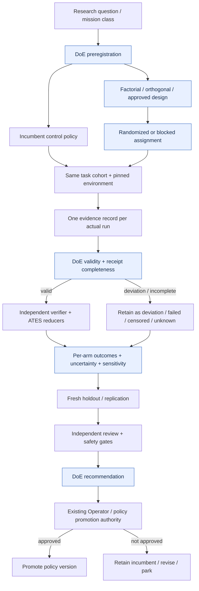
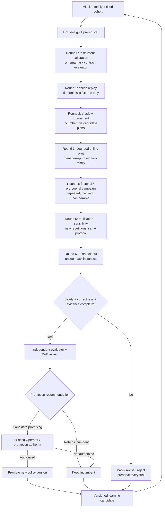

# Pit Crew — DoE Oversight and Tournament Architecture

**Status:** proposed campaign architecture; no new experiment ledger or execution authority  
**DoE meaning:** Design of Experiments  
**Oversight owner:** existing DoE Family / MVT separation / Observatory contracts  
**Related:** `docs/ops/DOE-FAMILY.md`, `docs/ops/MVT-DOE-ATES-SEPARATION.md`, `docs/ops/ATES-ORCHESTRATOR-DOE-MVT.md`, `docs/ops/EVOLUTIONARY-REPLAY.md`, `docs/ops/MANAGER-TOURNAMENT.schema.json`, `docs/ops/corpus/EXPERIMENT.schema.json`, Ballet PR #5529, Brain RFP #5501

## 1. DoE is Oversight

DoE oversees the *design and validity of the comparison*, not just the post-run score. For each Pit Crew tournament, DoE is responsible for:

1. **Question and hypothesis:** identify what policy or architecture change is being tested and the expected effect.
2. **Estimand:** define the outcome being compared (for example, accepted integrated outcome per total operational cost).
3. **Control:** preserve the incumbent manager/crew policy as a real control arm.
4. **Treatment definition:** pin exact policy, crew composition, choreography, prompt, tool manifest, configured model instance and environment versions.
5. **Cohort:** define task family, task contract hashes, complexity strata, exclusions and matching rules.
6. **Assignment:** use the existing DoE assignment mechanism and record the assignment method/seed where available.
7. **Measurement:** define primary/secondary outcomes, evidence source, null semantics and independent verifier before execution.
8. **Safety and stopping:** preregister hard stop conditions, sample sufficiency and permitted deviation handling.
9. **Monitoring:** detect contamination, missing receipts, capacity changes, arm imbalance and protocol drift.
10. **Analysis:** report raw outcomes, variance/uncertainty, censoring, missingness, subgroup behavior and sensitivity.
11. **Decision:** recommend retain, revise, reject, cull, hold, or promote for a fresh independent decision.
12. **Learning:** preserve the complete experiment lineage and propose versioned policy/skill updates.

DoE is **independent oversight**. The crew being evaluated cannot change the design, remove failed runs, choose its own evaluator, or declare itself winner.

## 2. Tournament topology

### The tournament is not a single-elimination bracket

A tournament is a sequence of designed comparisons, not a popularity contest. The control remains in the design. Arms may be culled only under preregistered rules, with all prior evidence retained. A candidate that wins a training cohort must face a fresh holdout. No winner is crowned from a single run or from simulated makespan.

## 3. Tournament illustration — multi-round championship

## 4. Tournament families

Each family tests a distinct architectural question. Do not collapse all factors into one unidentifiable mega-experiment. Use a sequence of compatible, preregistered campaigns, with the same experiment identity and evidence contract rules.

| Tournament family | Control | Treatment examples | Primary question | Primary outcomes |
|---|---|---|---|---|
| T0 — Instrument integrity | Existing evidence pipeline | Additional crew role and mission receipts | Can every real arm be attributed and independently verified? | receipt completeness, joinability, missingness |
| T1 — Crew topology | Incumbent roster/manager | F1-style role specialization; compact crew; cross-functional crew | Which role topology improves integrated outcomes? | acceptance, defects, rework, intervention |
| T2 — Crew Chief policy | Current manager policy | fixed sequencing, adaptive sequencing, evidence-triggered handoffs | Which local coordination policy yields best whole-team outcome? | time-to-integration, retries, conflicts, accepted result |
| T3 — Ballet choreography | Sequential incumbent | sequential / parallel / adaptive and declared capacity treatments | Does safe concurrency improve end-to-end integration? | observed integration time, parallel yield, conflicts |
| T4 — Brain context strategy | Current context path | bounded context packet, graph-assisted recon, freshness-first context | Does better context reduce invalid work and rework? | stale-context rate, omitted requirements, correctness |
| T5 — Verification topology | Existing independent review | test-first, reviewer-first, parallel independent checks | Which order improves defect detection without delaying integration? | escaped defects, rework, review latency |
| T6 — Resource/logistics policy | Existing admission/quota behavior | WIP/buffer policy, capacity-aware wave admission, task-family batching | How does resource contention affect accepted output? | cost per accepted result, queue age, quota failures |
| T7 — Incident/recovery crew | Existing recovery procedure | incident-command roles, parallel diagnosis, staged remediation | Which recovery structure reduces recurrence and risk? | verified recovery, recurrence, MTTR, regression |
| T8 — Cross-platform sync crew | Existing sync process | provenance-first sync, explicit source-pair reconciliation, independent verification | Which process safely resolves platform divergence? | SHA convergence, wrong-commit count, conflicts |
| T9 — Release crew | Existing release validation | independent release inspector, staged readiness checklist | Does role separation reduce release escapes? | regression, rollback, acceptance evidence |
| T10 — Longitudinal team evolution | Current roster and manager | role/crew policies selected from prior cohorts | Do learned compositions generalize across task families? | holdout outcome, variance, stability |

## 5. Factors and levels

The first experiment should stay small and interpretable. Factors are campaign-specific; a single tournament must not vary every dimension simultaneously.

| Factor | Example levels | Owner / source |
|---|---|---|
| Crew topology | compact / specialized / cross-functional | DoE campaign design |
| Chief policy | static / adaptive / evidence-triggered | manager policy version |
| Choreography | sequential / parallel / adaptive | Ballet policy |
| Capacity | 1 / 2 / 4 as experimental treatment levels only | DoE design; actual admission still authoritative |
| Context strategy | baseline / freshness-first / graph-assisted | Brain/ICM adapter |
| Handoff protocol | direct receipt / structured checkpoint / explicit review gate | existing workflow/evidence contract |
| Verification topology | serial / independent parallel / risk-tiered | review/test policy |
| Resource policy | baseline / WIP-limited / quota-aware | existing admission and quota controls |
| Recovery policy | baseline / incident-command / staged recovery | SHE/recovery policy |
| Task family | code / tests / docs / sync / incident / research | fixed cohort strata |

**Identity rule:** configured instances, not model names alone, are experimental units. Preserve provider, verbatim model@version, system-prompt reference/hash, tool reference/hash, role, moniker, context and instance_key as required by the existing DoE Family contract.

## 6. Experimental units, controls and allocation

- Unit of analysis: one actual mission/task instance assigned to one arm and one repetition, with one canonical record.
- Cluster/block by task family, complexity stratum, repository surface, risk tier and environment where needed.
- Use the same task contract, source baseline, evaluator and acceptance rubric across compared arms.
- Keep the incumbent manager/crew policy in every relevant comparison.
- Randomize assignment when the design supports it; record deterministic assignment evidence.
- Prevent a task instance from leaking across treatment arms. If a shared cohort or paired design is used, declare it explicitly.
- Distinguish simulated, shadow, live, replayed and forensic observations.
- Treat missing, ambiguous, un-attributable or protocol-contaminated observations as missing/unknown/censored according to the preregistration; never zero-fill.
- Preserve all failures, retries, cancellations, skips and deviations. No deleting losers.
- A campaign with insufficient observations reports INCONCLUSIVE / NOT_ESTABLISHED, not a fabricated winner.

Use only currently implemented design generators unless a separate implementation is accepted: full factorial and Taguchi L9 are implemented; other design classes in the taxonomy remain candidates or skill-described methods without a generator.

## 7. Outcomes — no speed-only or free-only winner

### Primary outcome

**Accepted integrated outcome per total operational cost**, evaluated only after independent correctness and acceptance evidence.

The denominator should include, where measured: model/provider cost, requests/tokens, wall-clock time, retries, duplicate work, conflict resolution, integration/rework and human intervention. Do not interpret a $0 API line item as zero total cost.

### Outcome hierarchy

1. Execution state: did an attributable invocation actually run?
2. Task outcome: PASS / FAIL / UNKNOWN with evidence.
3. Correctness: did the independent verifier accept the artifact?
4. Integration: was the result incorporated cleanly at the intended SHA?
5. Regression/safety: did it preserve invariants and avoid boundary violations?
6. Resource cost: what was the total operational cost?
7. Efficiency: time-to-integration, useful parallel yield, handoff latency, context efficiency.
8. Attribution/evidence confidence: can the result be reliably assigned to the correct arm and configured instance?

### Secondary metrics

- acceptance rate and correctness rate;
- time-to-integrated-and-verified result;
- useful parallel yield versus duplicate/idle work;
- write conflicts, lease contention and wrong-commit count;
- retries, failure classes and recovery count;
- handoff latency and number of feedback cycles;
- cost, tokens, requests, context duplication and compute;
- human intervention and reviewer burden;
- task complexity, cohort stratum and environment;
- attribution confidence and receipt completeness;
- variance, confidence intervals and subgroup effects.

### Hard guardrails

- unapproved dispatch or authority escalation;
- wrong SHA / wrong target / cross-task contamination;
- secret or private-context leakage;
- conflicting writes or duplicate side effects;
- missing required acceptance evidence;
- failed security or correctness gate;
- non-independent evaluator;
- invalid cohort/arm assignment or unverifiable provenance.

A guardrail violation is not compensated by a faster run or higher composite score.

## 8. Stopping, culling and promotion

### Stop an individual arm or mission when

- existing authority is revoked or the task scope changes materially;
- a safety guardrail is breached;
- the arm cannot be attributed or its cohort is contaminated;
- a preregistered futility or resource boundary is reached;
- the environment or evaluator no longer matches the registered protocol.

Stopping does not delete the observation. Record the reason, time, run/attempt, last known state and evidence references.

### Cull a policy only under declared rules

Cull decisions should consider repeated performance, confidence, safety, task-family effects and cost. Preserve participant identity, policy hash, all attempts, evidence and the reason for culling. Re-entry is a new versioned treatment, not an erased history.

### Promotion sequence

1. complete preregistered cohort and receipt audit;
2. independent correctness, security and integration gates;
3. uncertainty and sensitivity analysis;
4. replication or fresh holdout;
5. independent reviewer disposition;
6. DoE recommendation;
7. existing operator/policy promotion decision;
8. versioned policy update and rollback plan;
9. post-promotion monitoring with incumbent comparison.

DoE recommendation is necessary evidence, not a promotion command. Production policy cannot be self-modified by a tournament.

## 9. Receipt and schema integration

Reuse the existing canonical owners:

- `docs/ops/corpus/EXPERIMENT.schema.json` — one record per actual designed run;
- `docs/ops/MANAGER-TOURNAMENT.schema.json` — manager/policy cohort identity and evaluation contract;
- `docs/ops/AGENT-THROUGHPUT-EVENT.schema.json` — run/attempt/SHA-bound throughput events;
- existing ATES/WTCV/TCV reducers — derived operational measurements with null semantics;
- existing Ballet choreography/observation contracts — plan and online observation;
- existing MoneyBall/3L0 — downstream performance interpretation.

The campaign design may link to a Pit Crew manifest and role-assignment references, but this proposal does **not** create a new canonical experiment record, telemetry ledger, roster registry or tournament database.

Required join chain where available:

`tournament → campaign → cohort → task → arm → repetition → configured instance → mission → run → attempt → SHA → workflow/job/step → artifact → verifier → task outcome → recommendation`.

A planned wave, simulation, workflow completion, HTTP 200 or provider catalog row is not an online task outcome.

## 10. Example pilot design

**Question:** Does a specialized Pit Crew coordinated by an adaptive Crew Chief improve accepted integrated outcomes over the incumbent manager policy on a fixed class of low-risk documentation/test tasks?

- Control: incumbent manager policy and current role topology.
- Treatment A: specialized crew + sequential Ballet.
- Treatment B: specialized crew + adaptive Ballet.
- Treatment C: compact crew + adaptive Ballet.
- Cohort: fixed task contracts and matched complexity strata; no production/security-critical tasks in first pilot.
- Environment: pinned repository SHA and reproducible environment fingerprint.
- Evaluator: independent tests/review rubric with frozen version.
- Assignment: blocked/randomized within task family and complexity strata.
- Repetitions: preregister based on variance/power rationale; do not treat three repetitions as universal sufficiency.
- Primary: independently accepted integrated result per total operational cost.
- Secondary: time-to-integration, rework, conflicts, duplicate work, human interventions, evidence completeness.
- Stop: any unauthorized dispatch, wrong-target write, secret leakage, safety failure or cohort contamination.
- Holdout: new task instances not used to tune the policy.
- Output: raw arm receipts, failure/censoring table, uncertainty, sensitivity, DoE disposition and separate promotion recommendation.

This pilot is a proposed design, not an assertion that it has run.

## 11. Decision states

| State | Meaning |
|---|---|
| DESIGN_ONLY | preregistration exists; no run evidence |
| SIMULATED | offline deterministic plan/test only |
| SHADOW | proposed plans observed; no execution authority |
| EXECUTING | one or more real arm runs active |
| EXECUTED_PARTIAL | some assigned units have terminal receipts; cohort incomplete |
| COMPLETE | all preregistered units have terminal dispositions |
| INCONCLUSIVE | insufficient evidence or uncertainty too high |
| INVALID | protocol/safety breach invalidates intended comparison; evidence retained |
| RECOMMEND_RETAIN | evidence favors incumbent |
| RECOMMEND_REVISE | treatment has actionable weaknesses |
| RECOMMEND_REJECT | evidence supports rejecting candidate |
| RECOMMEND_PROMOTE | evidence supports a promotion request; no promotion implied |
| PROMOTED | existing authority has separately approved and promoted the exact policy version |

Never collapse these states into a green/red dashboard badge.

## 12. Oversight checklist

- [ ] Hypothesis, estimand and expected effect registered before runs.
- [ ] Incumbent control and exact treatment versions pinned.
- [ ] Cohort, exclusions, strata and assignment method declared.
- [ ] Configured-instance identity is complete or explicitly unknown.
- [ ] Acceptance rubric and independent verifier frozen.
- [ ] Primary/secondary metrics and null semantics declared.
- [ ] Safety stop conditions and resource boundaries declared.
- [ ] One canonical experiment record per actual designed run.
- [ ] Failed, skipped, blocked, censored and deviating runs retained.
- [ ] No synthetic zero, inferred attribution or post-hoc treatment relabeling.
- [ ] Raw results, uncertainty, sensitivity and holdout results reported.
- [ ] DoE recommendation is separate from operator promotion.
- [ ] Post-promotion monitoring and rollback path identified.
